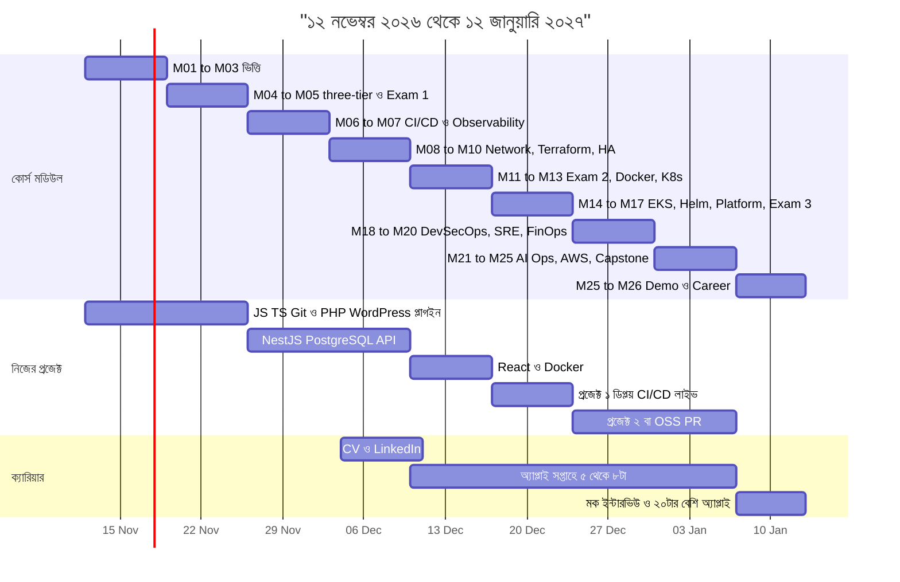
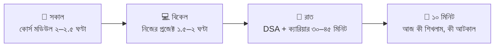

# ০৭ — ২ মাসের গাইডলাইন (১২ নভেম্বর ২০২৬ → ১২ জানুয়ারি ২০২৭)

> **লক্ষ্য:** ২৬টা মডিউল **প্রতিটি ছুঁয়ে**, ৬২ দিনে একটা Junior Software Developer-উপযোগী প্রোফাইল দাঁড় করানো — দিন-ভিত্তিক, কোন দিন কোন মডিউল তা সহ।
> **কার জন্য:** WordPress/PHP ব্যাকগ্রাউন্ড থেকে Junior Developer হয়ে, ধীরে ধীরে DevOps-এ যেতে চান যিনি।
> **সময়:** সোম–বৃহস্পতি, শনি, রবি ৪–৫ ঘণ্টা · **শুক্রবার হালকা (১.৫–২ ঘণ্টা)**।

---

## 📖 গল্প: তানভীরের ৬২ দিনের ক্যালেন্ডার

কোর্সের ২৬টা মডিউল তানভীর শেষ করেছে — কিন্তু সে বুঝল একটা সত্য: **ইন্টারভিউয়ে কেউ জিজ্ঞেস করবে না "তুমি ২৬টা মডিউল পড়েছ?"** জিজ্ঞেস করবে *"তুমি কী বানিয়েছ, আর সেটা কীভাবে কাজ করে?"*

মেন্টর বললেন: "সব মডিউল সমান গভীরে করার সময় নেই। কয়েকটা **হাতে-কলমে** করো, কয়েকটা **ছোট ল্যাবে** ছুঁয়ে যাও, বাকিগুলো **পড়ে নোট** রাখো — আর প্রতিদিন কিছুটা সময় রাখো **নিজের প্রজেক্ট, DSA ও চাকরির আবেদনের** জন্য। কারণ কোর্সের সার্টিফিকেট নয়, **প্রমাণ** চাকরি দেয়।"

এই ফাইল সেই ক্যালেন্ডার।

---

## ১. বড় ছবি

```mermaid
flowchart LR
    W1["W1: M01-M03<br/>Linux, AWS, Git"] --> W2["W2: M04-M05<br/>three-tier + WP প্লাগইন"]
    W2 --> W3["W3: M06-M07<br/>CI/CD + Observability + NestJS"]
    W3 --> W4["W4: M08-M10<br/>VPC, Terraform, HA + API সিকিউরিটি"]
    W4 --> W5["W5: M11-M13<br/>Docker, K8s + React + অ্যাপ্লাই শুরু"]
    W5 --> W6["W6: M14-M17<br/>EKS পড়া, Helm/GitOps + প্রজেক্ট ১ লাইভ"]
    W6 --> W7["W7: M18-M20<br/>DevSecOps, SRE, FinOps + OSS"]
    W7 --> W8["W8: M21-M25<br/>AI Ops, WA Review, mini-capstone"]
    W8 --> W9["W9: M25-M26<br/>ডেমো, CV, মক ইন্টারভিউ, অ্যাপ্লাই"]
```

> **অনুমান:** আমি ধরে নিচ্ছি তুমি মডিউলের ফাইল/রেকর্ডিং **নিজের গতিতে** পড়ছ। লাইভ ক্লাসের রুটিন আলাদা হলে ওই দিনের মডিউল অদলবদল করো — **মডিউলের ক্রম ঠিক রেখো**, কারণ প্রতিটা আগেরটার উপর দাঁড়িয়ে।

---

## ২. ২৬ মডিউল — তিন স্তরে ভাগ

একই গভীরতায় ২৬টা সম্ভব নয়। তাই:

| স্তর | মানে | মডিউল |
|---|---|---|
| 🔴 **গভীর** | হাতে বানাও, প্রতিটা লাইন ব্যাখ্যা করতে পারো | M01, M02, M03, M04, M06, M09, M12, M25 (mini), M26 |
| 🟡 **মাঝারি** | ছোট বা লোকাল ল্যাব + নোট + ইন্টারভিউ-প্রশ্ন | M07, M08, M10, M13, M15, M18, M19, M24 |
| ⚪ **হালকা** | পড়ো, ১ পৃষ্ঠা নোট, ইন্টারভিউ-প্রশ্ন ঝালাই | M14 (EKS), M16, M20, M21, M22 + এক্সাম উইক M05, M11, M17, M23 (রিভিশন) |

**কেন এই ভাগ?** জুনিয়র ডেভেলপার ইন্টারভিউয়ে সবচেয়ে বেশি কাজে লাগে: Linux/Git/CI-CD/Docker/Deploy। Kubernetes, Terraform, SRE, LLMOps — **জানা আছে, ছুঁয়ে দেখেছি, পরে গভীরে যাব** বলতে পারাই যথেষ্ট। বাকি গভীরতা ২০২৭-এর জানুয়ারি–এপ্রিলে (§৭)।

### 🛑 খরচ-নিয়ম (সবচেয়ে গুরুত্বপূর্ণ)

| ল্যাব | কোথা থেকে বিল আসে | নিয়ম |
|---|---|---|
| M02, M04 | EC2, Elastic IP, Route 53 | ল্যাব শেষে stop/terminate; **আগে Billing alarm** |
| M08 | NAT Gateway, ALB, RDS (ঘণ্টা-হিসাবে) | এক দিনে বানাও, একই দিনে destroy |
| M09, M10 | Terraform-এ ছোট রিসোর্স; ASG/ALB | ছোট instance, কাজ শেষে `terraform destroy` |
| M14 (EKS) | ক্লাস্টার ঘণ্টা-ফি + নোড + NAT | **ঐচ্ছিক**; না করলে kind/minikube-এ ডেমো |
| M20, M22 | Lambda/SQS (ছোট); Bedrock টোকেন | ছোট ইনপুটে চালাও; GPU/self-host **করবে না** |

> AWS Free Tier/ক্রেডিটের শর্ত এবং দাম বদলায় — **AWS-এর অফিসিয়াল Pricing ও Billing পেজে নিজে যাচাই করো।** প্রতি রবিবার Cost Explorer দেখা অভ্যাস করো। (M20, M23-এর শিক্ষা।)

---

## ৩. প্রতিদিনের রুটিন

- **শুক্রবার 🌿:** ১.৫–২ ঘণ্টা — নোট, রিভিশন, হালকা পড়া। বিশ্রামও কাজের অংশ।
- **বুধবার/সপ্তাহের শেষ দিন 📋:** সাপ্তাহিক রিভিউ — কী শেষ হলো, কী বাকি, পরের সপ্তাহের ৩টা লক্ষ্য।
- **পিছিয়ে পড়লে কী বাদ দেবে** (এই ক্রমে): ১) M14 EKS ল্যাব ২) M22 ল্যাব ৩) M20 Lambda ল্যাব ৪) M10 ল্যাব ৫) M08 ল্যাব। **কখনো বাদ নয়:** M01–M04, M06, M12, প্রজেক্ট ১, CV, অ্যাপ্লিকেশন।

### 🔗 একটা অ্যাপে দুই কাজ
কোর্সের BookNest অ্যাপে M02–M05-র ল্যাব। তারপর **তোমার নিজের NestJS + React প্রজেক্টই (প্রজেক্ট ১) হয়ে যাবে তোমার mini-capstone** — M12-তে ডকারাইজ, M06-র শিক্ষায় CI/CD, M07/M18/M19-এর ধারণা তার উপরে। ফলে পোর্টফোলিও আলাদা করে বানাতে হয় না।

**প্রজেক্ট ২ (সপ্তাহ ৭–৮):** (ক) একটা OSS PR (WordPress/PHP/NestJS-এ `good first issue`) — অথবা (খ) WP প্লাগইন v2 + REST ইন্টিগ্রেশন। (ক) পছন্দ, না হলে (খ)।

---

## ৪. দিন-ভিত্তিক সময়সূচি

> 🔴/🟡/⚪ স্তর §২-এ। 🛑 = খরচ-সতর্কতা বা destroy/stop। 🌿 = হালকা দিন। 📋 = সাপ্তাহিক রিভিউ।

### সপ্তাহ ১ — শুরু: টুলবক্স, Linux/AWS, Git (M01–M03)

**তারিখ:** ১২ নভেম্বর – ১৮ নভেম্বর · **লক্ষ্য:** JS/TS + Git দখল; প্রথম EC2 ডিপ্লয়, billing alarm

| # | তারিখ | 📘 কোর্স মডিউল | 💻 নিজের প্রজেক্ট | 🧮 DSA / 🎯 ক্যারিয়ার |
|---|---|---|---|---|
| ১ | ১২ নভেম্বর, বৃহস্পতি | [M01](../section-1-foundations/module-01-devops-in-the-ai-era.md) পড়ো (গল্প + role map); প্রজেক্ট লোকালি চালাও, ngrok ল্যাব | টুল সেটআপ: VS Code, Node, PHP, Git, GitHub; ২টা ছোট JS অনুশীলন | Big-O পরিচয় + Array ৩টি |
| ২ | ১৩ নভেম্বর, শুক্র 🌿 | [M01](../section-1-foundations/module-01-devops-in-the-ai-era.md) শেষ: AI usage rules ফাইল commit + ১ পৃষ্ঠার reflection (target role: Junior Software Developer) | JS ES6, async/await রিভিশন (১ ঘণ্টা) | ১টা সহজ সমস্যা; সপ্তাহের লক্ষ্য লেখো |
| ৩ | ১৪ নভেম্বর, শনি | [M02](../section-1-foundations/module-02-linux-and-aws-fundamentals.md) Class 1 — Linux কমান্ড, SSH, permission, EC2। 🛑 আগে Billing alarm বসাও | TypeScript: type, interface, function | String ৩টি |
| ৪ | ১৫ নভেম্বর, রবি | [M02](../section-1-foundations/module-02-linux-and-aws-fundamentals.md) Class 2 — UFW, Nginx, Route 53, HTTPS (ডোমেইন না থাকলে Nginx + IP পর্যন্ত) | TypeScript: generics, tsconfig | String/Array ৩টি |
| ৫ | ১৬ নভেম্বর, সোম | [M02](../section-1-foundations/module-02-linux-and-aws-fundamentals.md) অ্যাসাইনমেন্ট শেষ (HTTPS static site)। 🛑 EC2 stop/terminate | ছোট TS CLI টুল (ফাইল পড়ে রিপোর্ট দেয়) | Hash map পরিচয় ২টি |
| ৬ | ১৭ নভেম্বর, মঙ্গল | [M03](../section-1-foundations/module-03-git-workflows-and-ai-troubleshooting.md) Class 1 — Git workflow: branch, PR, merge, conflict, branch protection | নিজের repo-তে PR workflow দিয়ে কাজ (সরাসরি main-এ নয়) | Hash map ২টি |
| ৭ | ১৮ নভেম্বর, বুধ | [M03](../section-1-foundations/module-03-git-workflows-and-ai-troubleshooting.md) Class 2 — ৩টা ভাঙা-সার্ভার incident note; AI-র কোন পরামর্শ ঠিক/ভুল লিখো | GitHub প্রোফাইল README; 📋 সাপ্তাহিক রিভিউ | রিভিউ (১৫ মিনিট) |

**সপ্তাহ শেষে জমা (✅):**

- [ ] M01 AI usage rules + reflection commit করা
- [ ] M02 HTTPS static site + billing alarm
- [ ] M03 তিনটা incident note + branch protection-সহ repo
- [ ] JS/TS অনুশীলনের ছোট repo

### সপ্তাহ ২ — three-tier ও WordPress প্লাগইন প্রুফ (M04–M05)

**তারিখ:** ১৯ নভেম্বর – ২৫ নভেম্বর · **লক্ষ্য:** M04 ডিপ্লয়; Exam 1 মক-ল্যাব; WP প্লাগইন প্রুফ #১

| # | তারিখ | 📘 কোর্স মডিউল | 💻 নিজের প্রজেক্ট | 🧮 DSA / 🎯 ক্যারিয়ার |
|---|---|---|---|---|
| ৮ | ১৯ নভেম্বর, বৃহস্পতি | [M04](../section-1-foundations/module-04-three-tier-application-on-a-single-instance.md) Class 1 — three-tier আর্কিটেকচার, সিঙ্গেল EC2-তে ডিপ্লয় শুরু | PHP: OOP, namespace, Composer | Hash map ২টি + SQL SELECT/WHERE |
| ৯ | ২০ নভেম্বর, শুক্র 🌿 | [M04](../section-1-foundations/module-04-three-tier-application-on-a-single-instance.md) নোট; AI-লেখা architecture README রিভিউ করে ভুল চিহ্নিত করো | WordPress hooks: action/filter পড়া (১ ঘণ্টা) | SQL JOIN ২টি |
| ১০ | ২১ নভেম্বর, শনি | [M04](../section-1-foundations/module-04-three-tier-application-on-a-single-instance.md) Class 2 ল্যাব — ডিপ্লয় শেষ + README (তুমি যাচাই করা)। 🛑 শেষে stop | WP প্লাগইন স্কেলেটন: প্লাগইন হেডার, activation hook | Two-pointer পরিচয় ২টি |
| ১১ | ২২ নভেম্বর, রবি | [M05](../section-1-foundations/module-05-exam-week-1.md) Exam 1 — মক-ল্যাব (M01–M04) শূন্য থেকে, প্রথম অংশ | প্লাগইনের ডিজাইন-নোট ও টেবিল-পরিকল্পনা (৩০ মিনিট) | Two-pointer ২টি |
| ১২ | ২৩ নভেম্বর, সোম | [M05](../section-1-foundations/module-05-exam-week-1.md) মক-ল্যাব শেষ + exam-1-mistakes.md। 🛑 রিসোর্স বন্ধ | WP প্লাগইন: custom post type + shortcode | Sliding window ১টি |
| ১৩ | ২৪ নভেম্বর, মঙ্গল | ব্যাকলগ বাফার (M01–M05-এর যা বাকি) | WP প্লাগইন: settings page + nonce/sanitize/escape | SQL ২টি |
| ১৪ | ২৫ নভেম্বর, বুধ | 📋 সাপ্তাহিক রিভিউ | WP প্লাগইন শেষ: README, স্ক্রিনশট, GitHub-এ পুশ (প্রুফ #১) | ১টা সমস্যা |

**সপ্তাহ শেষে জমা (✅):**

- [ ] M04 অ্যাপ ডিপ্লয় + তোমার-যাচাই-করা README
- [ ] exam-1-mistakes.md
- [ ] WP প্লাগইন GitHub-এ (README + স্ক্রিনশট)

### সপ্তাহ ৩ — CI/CD, observability, NestJS API (M06–M07)

**তারিখ:** ২৬ নভেম্বর – ২ ডিসেম্বর · **লক্ষ্য:** OIDC pipeline; লোকাল Grafana; NestJS + PostgreSQL CRUD

| # | তারিখ | 📘 কোর্স মডিউল | 💻 নিজের প্রজেক্ট | 🧮 DSA / 🎯 ক্যারিয়ার |
|---|---|---|---|---|
| ১৫ | ২৬ নভেম্বর, বৃহস্পতি | [M06](../section-2-cicd-observability-iac/module-06-cicd-with-github-actions.md) Class 1 — GitHub Actions: workflow, job, cache, secrets | NestJS সেটআপ: module, controller, service | Sliding window ২টি |
| ১৬ | ২৭ নভেম্বর, শুক্র 🌿 | [M06](../section-2-cicd-observability-iac/module-06-cicd-with-github-actions.md) YAML অনুশীলন: একটা ছোট workflow লেখো | NestJS DI ও ডক পড়া | ১টা সমস্যা |
| ১৭ | ২৮ নভেম্বর, শনি | [M06](../section-2-cicd-observability-iac/module-06-cicd-with-github-actions.md) Class 2 — OIDC (keyless AWS), pinned actions, rollback ডক (IAM role বিনা-খরচ) | NestJS CRUD endpoint (in-memory) | Stack ২টি |
| ১৮ | ২৯ নভেম্বর, রবি | [M06](../section-2-cicd-observability-iac/module-06-cicd-with-github-actions.md) অ্যাসাইনমেন্ট: নিজের NestJS repo-তে CI (lint + test + build) | PostgreSQL + Prisma/TypeORM সংযোগ | Stack/Queue ২টি |
| ১৯ | ৩০ নভেম্বর, সোম | [M07](../section-2-cicd-observability-iac/module-07-observability-metrics-logs-and-traces.md) Class 1 — Prometheus + Grafana (লোকাল docker compose, বিনা খরচ) | Entity সম্পর্ক, DTO, migration | Queue ২টি |
| ২০ | ১ ডিসেম্বর, মঙ্গল | [M07](../section-2-cicd-observability-iac/module-07-observability-metrics-logs-and-traces.md) Class 2 — Loki/Tempo/OTel; slow request-এর trace ↔ log correlation | Validation + error handling | Linked list পরিচয় ১টি |
| ২১ | ২ ডিসেম্বর, বুধ | [M07](../section-2-cicd-observability-iac/module-07-observability-metrics-logs-and-traces.md) অ্যাসাইনমেন্ট: dashboard শেষ | Swagger ডক; 📋 সাপ্তাহিক রিভিউ | — |

**সপ্তাহ শেষে জমা (✅):**

- [ ] M06 pipeline (OIDC + pinned actions + rollback ডক)
- [ ] নিজের repo-তে CI সবুজ
- [ ] M07 correlated dashboard

### সপ্তাহ ৪ — নেটওয়ার্ক, Terraform, HA, API সিকিউরিটি (M08–M10)

**তারিখ:** ৩ ডিসেম্বর – ৯ ডিসেম্বর · **লক্ষ্য:** VPC/ALB/RDS ল্যাব (একদিনে destroy); Terraform ছোট স্ট্যাক; API auth + test

| # | তারিখ | 📘 কোর্স মডিউল | 💻 নিজের প্রজেক্ট | 🧮 DSA / 🎯 ক্যারিয়ার |
|---|---|---|---|---|
| ২২ | ৩ ডিসেম্বর, বৃহস্পতি | [M08](../section-2-cicd-observability-iac/module-08-securing-three-tier-with-aws-vpc-and-networking.md) Class 1 — VPC, subnet, route table, IGW/NAT, SG বনাম NACL (ডায়াগ্রাম আঁকো) | JWT auth (register/login) | Linked list ২টি |
| ২৩ | ৪ ডিসেম্বর, শুক্র 🌿 | [M08](../section-2-cicd-observability-iac/module-08-securing-three-tier-with-aws-vpc-and-networking.md) নোট: public বনাম private subnet-এ কী কী বসে | LinkedIn আপডেট + CV v1 খসড়া (১ পৃষ্ঠা) | ১টা সমস্যা |
| ২৪ | ৫ ডিসেম্বর, শনি | [M08](../section-2-cicd-observability-iac/module-08-securing-three-tier-with-aws-vpc-and-networking.md) Class 2 — ALB + private subnet + RDS ল্যাব। 🛑 NAT/ALB/RDS একই দিনে destroy | Auth guard + role | Recursion ২টি |
| ২৫ | ৬ ডিসেম্বর, রবি | [M09](../section-2-cicd-observability-iac/module-09-infrastructure-as-code-terraform.md) Class 1 — Terraform: provider, resource, variable, state | NestJS unit test | Recursion ২টি |
| ২৬ | ৭ ডিসেম্বর, সোম | [M09](../section-2-cicd-observability-iac/module-09-infrastructure-as-code-terraform.md) Class 2 — module, remote state, tflint, Checkov (ছোট রিসোর্সে)। 🛑 destroy | e2e টেস্ট | Binary search ২টি |
| ২৭ | ৮ ডিসেম্বর, মঙ্গল | [M10](../section-2-cicd-observability-iac/module-10-high-availability-auto-scaling-and-codepipeline.md) Class 1 — ASG, launch template, ALB health check (ল্যাব ঐচ্ছিক) | Security: helmet, rate limit, OWASP Top 10 চেক | Binary search ১টি |
| ২৮ | ৯ ডিসেম্বর, বুধ | [M10](../section-2-cicd-observability-iac/module-10-high-availability-auto-scaling-and-codepipeline.md) Class 2 — CodePipeline/blue-green পড়ো; instance-fail ডেমো দেখো। 🛑 | API ফাইনাল + README (প্রুফ #২); 📋 সাপ্তাহিক রিভিউ | — |

**সপ্তাহ শেষে জমা (✅):**

- [ ] M08 network diagram
- [ ] M09 Terraform repo + Checkov ০ high
- [ ] API: JWT, role, unit + e2e টেস্ট, README (প্রুফ #২)
- [ ] CV v1

### সপ্তাহ ৫ — Exam 2, Docker, Kubernetes, React; অ্যাপ্লাই শুরু (M11–M13)

**তারিখ:** ১০ ডিসেম্বর – ১৬ ডিসেম্বর · **লক্ষ্য:** নিজের API ডকারাইজ; kind-এ K8s; React UI; প্রথম ৫টা অ্যাপ্লিকেশন

| # | তারিখ | 📘 কোর্স মডিউল | 💻 নিজের প্রজেক্ট | 🧮 DSA / 🎯 ক্যারিয়ার |
|---|---|---|---|---|
| ২৯ | ১০ ডিসেম্বর, বৃহস্পতি | [M11](../section-2-cicd-observability-iac/module-11-exam-week-2.md) Exam 2 — M06–M10 চেকলিস্ট রিভিশন + exam-2-mistakes.md | React (Vite + TS): component, props, state | 🎯 CV v2 চূড়ান্ত; অ্যাপ্লাই শুরু — ৩টা |
| ৩০ | ১১ ডিসেম্বর, শুক্র 🌿 | [M11](../section-2-cicd-observability-iac/module-11-exam-week-2.md) মক-প্রশ্ন জোরে বলে উত্তর দাও | React hooks পড়া | ১টা সমস্যা |
| ৩১ | ১২ ডিসেম্বর, শনি | [M12](../section-3-containers-kubernetes-platform/module-12-dockerizing-the-three-tier-application.md) Class 1 — Docker: image, multi-stage, non-root; নিজের API ডকারাইজ | React: API কল, list/detail পেজ | Sorting ২টি |
| ৩২ | ১৩ ডিসেম্বর, রবি | [M12](../section-3-containers-kubernetes-platform/module-12-dockerizing-the-three-tier-application.md) Class 2 — Docker Compose (API + Postgres + frontend), ECR, Trivy, logging | React: ফর্ম, routing | Sorting ২টি |
| ৩৩ | ১৪ ডিসেম্বর, সোম | [M12](../section-3-containers-kubernetes-platform/module-12-dockerizing-the-three-tier-application.md) অ্যাসাইনমেন্ট — image ছোট করো, ০ critical CVE | React: login flow + protected route | Sort/Search মিক্স ২টি |
| ৩৪ | ১৫ ডিসেম্বর, মঙ্গল | [M13](../section-3-containers-kubernetes-platform/module-13-kubernetes-fundamentals.md) Class 1 — Kubernetes: Pod, Deployment, Service (kind/minikube, লোকাল) | React UI polish, loading/error state | অ্যাপ্লিকেশন ২টা |
| ৩৫ | ১৬ ডিসেম্বর, বুধ | [M13](../section-3-containers-kubernetes-platform/module-13-kubernetes-fundamentals.md) Class 2 — ConfigMap/Secret, probe, ইচ্ছাকৃত bad release + rollback | frontend ↔ backend end-to-end; 📋 সাপ্তাহিক রিভিউ | — |

**সপ্তাহ শেষে জমা (✅):**

- [ ] exam-2-mistakes.md
- [ ] Docker image ছোট + ০ critical CVE
- [ ] M13 bad release + rollback
- [ ] React ফ্রন্টএন্ড API-র সাথে সংযুক্ত
- [ ] CV v2 + অ্যাপ্লিকেশন ~৫টা

### সপ্তাহ ৬ — EKS (পড়া), Helm/GitOps, প্রজেক্ট ১ লাইভ (M14–M17)

**তারিখ:** ১৭ ডিসেম্বর – ২৩ ডিসেম্বর · **লক্ষ্য:** প্রজেক্ট ১ EC2/Docker/CI-CD-তে লাইভ; Helm + Argo CD kind-এ

| # | তারিখ | 📘 কোর্স মডিউল | 💻 নিজের প্রজেক্ট | 🧮 DSA / 🎯 ক্যারিয়ার |
|---|---|---|---|---|
| ৩৬ | ১৭ ডিসেম্বর, বৃহস্পতি | [M14](../section-3-containers-kubernetes-platform/module-14-migrating-the-three-tier-application-to-eks.md) Class 1 — EKS আর্কিটেকচার পড়ো (node group, IRSA, Ingress); ক্লাস্টার তোলো না | প্রজেক্ট ১: Dockerfile + compose পরিষ্কার, .env.example | Tree পরিচয় ২টি |
| ৩৭ | ১৮ ডিসেম্বর, শুক্র 🌿 | [M14](../section-3-containers-kubernetes-platform/module-14-migrating-the-three-tier-application-to-eks.md) Class 2 — StatefulSet, HPA, PDB, NetworkPolicy পড়ো | প্রজেক্ট ১: bug-তালিকা বানাও | ১টা সমস্যা |
| ৩৮ | ১৯ ডিসেম্বর, শনি | [M14](../section-3-containers-kubernetes-platform/module-14-migrating-the-three-tier-application-to-eks.md) ঐচ্ছিক: ৫–৬ ঘণ্টার EKS ল্যাব (বাজেট থাকলে), না থাকলে kind-এ HPA ডেমো। 🛑 destroy | প্রজেক্ট ১: EC2-তে Docker Compose ডিপ্লয় | Tree ২টি |
| ৩৯ | ২০ ডিসেম্বর, রবি | [M15](../section-3-containers-kubernetes-platform/module-15-packaging-and-delivery-helm-and-gitops-with-argo-cd.md) Class 1 — Helm chart বানাও (kind-এ) | প্রজেক্ট ১: Nginx + HTTPS + ডোমেইন | BFS/DFS ২টি |
| ৪০ | ২১ ডিসেম্বর, সোম | [M15](../section-3-containers-kubernetes-platform/module-15-packaging-and-delivery-helm-and-gitops-with-argo-cd.md) Class 2 — Argo CD GitOps + Argo Rollouts canary (kind-এ) | GitHub Actions: build → push → deploy (OIDC) | BFS/DFS ২টি |
| ৪১ | ২২ ডিসেম্বর, মঙ্গল | [M16](../section-3-containers-kubernetes-platform/module-16-platform-engineering-building-an-internal-developer-platform.md) Platform Engineering/Backstage/DORA — পড়ো + ১ পৃষ্ঠা সারাংশ | প্রজেক্ট ১: README + আর্কিটেকচার ডায়াগ্রাম | অ্যাপ্লিকেশন ৩টা |
| ৪২ | ২৩ ডিসেম্বর, বুধ | [M17](../section-3-containers-kubernetes-platform/module-17-exam-week-3.md) Exam 3 — M12–M16 চেকলিস্ট রিভিশন + mistakes | প্রজেক্ট ১ লাইভ ✅ (প্রুফ #৩); 📋 সাপ্তাহিক রিভিউ | — |

**সপ্তাহ শেষে জমা (✅):**

- [ ] প্রজেক্ট ১ লাইভ লিংক (প্রুফ #৩)
- [ ] M15 canary demo (kind)
- [ ] M16 ১ পৃষ্ঠা সারাংশ
- [ ] exam-3-mistakes.md

### সপ্তাহ ৭ — DevSecOps, SRE, FinOps + প্রজেক্ট ২/OSS (M18–M20)

**তারিখ:** ২৪ ডিসেম্বর – ৩০ ডিসেম্বর · **লক্ষ্য:** নিজের প্রজেক্টে Gitleaks/Trivy গেট; k6 + SLO; cost report; OSS PR

| # | তারিখ | 📘 কোর্স মডিউল | 💻 নিজের প্রজেক্ট | 🧮 DSA / 🎯 ক্যারিয়ার |
|---|---|---|---|---|
| ৪৩ | ২৪ ডিসেম্বর, বৃহস্পতি | [M18](../section-4-devsecops-sre-finops-ai-ops/module-18-devsecops-and-software-supply-chain-security.md) Class 1 — shift-left; Gitleaks, Trivy, SBOM নিজের প্রজেক্টে | প্রজেক্ট ২ সিদ্ধান্ত ও পরিকল্পনা (নিচের নোট দেখো) | DSA মিক্স ৩০ মিনিট |
| ৪৪ | ২৫ ডিসেম্বর, শুক্র 🌿 | [M18](../section-4-devsecops-sre-finops-ai-ops/module-18-devsecops-and-software-supply-chain-security.md) নোট: SAST/SCA/DAST পার্থক্য | OSS: good-first-issue খোঁজা | ১টা সমস্যা |
| ৪৫ | ২৬ ডিসেম্বর, শনি | [M18](../section-4-devsecops-sre-finops-ai-ops/module-18-devsecops-and-software-supply-chain-security.md) Class 2 — Cosign, Kyverno (kind-এ), External Secrets; CI-তে Gitleaks + Trivy গেট | প্রজেক্ট ২ / OSS কাজ | Graph/Tree রিভিশন ২টি |
| ৪৬ | ২৭ ডিসেম্বর, রবি | [M19](../section-4-devsecops-sre-finops-ai-ops/module-19-sre-and-ai-powered-operations.md) Class 1 — SLI/SLO, error budget, burn-rate | প্রজেক্ট ২ / OSS | ২টি সমস্যা |
| ৪৭ | ২৮ ডিসেম্বর, সোম | [M19](../section-4-devsecops-sre-finops-ai-ops/module-19-sre-and-ai-powered-operations.md) Class 2 — k6 লোড টেস্ট (লোকাল), incident, blameless postmortem | প্রজেক্ট ১-এ k6 + SLO ডক | ২টি সমস্যা |
| ৪৮ | ২৯ ডিসেম্বর, মঙ্গল | [M20](../section-4-devsecops-sre-finops-ai-ops/module-20-serverless-architecture-and-finops.md) Class 1 — Lambda, SQS, EventBridge, DLQ (ছোট Lambda ল্যাব, 🛑 পরে মোছো) | প্রজেক্ট ২ / OSS PR খোলো | অ্যাপ্লিকেশন ৩টা |
| ৪৯ | ৩০ ডিসেম্বর, বুধ | [M20](../section-4-devsecops-sre-finops-ai-ops/module-20-serverless-architecture-and-finops.md) Class 2 — FinOps: tags, Budgets, Infracost; নিজের ১ পৃষ্ঠা cost report | প্রজেক্ট ২ আপডেট; 📋 সাপ্তাহিক রিভিউ | অ্যাপ্লিকেশন ২টা |

**সপ্তাহ শেষে জমা (✅):**

- [ ] M18 CI-তে স্ক্যান গেট
- [ ] M19 postmortem (বাস্তব বা কাল্পনিক ঘটনা)
- [ ] M20 cost report (১ পৃষ্ঠা)
- [ ] OSS PR খোলা বা প্রজেক্ট ২ v1

### সপ্তাহ ৮ — AI Ops, AWS Deep Dive, Capstone (mini) (M21–M25)

**তারিখ:** ৩১ ডিসেম্বর – ৬ জানুয়ারি · **লক্ষ্য:** Agent Policy; ছোট eval; Well-Architected Review; ADR + runbook

| # | তারিখ | 📘 কোর্স মডিউল | 💻 নিজের প্রজেক্ট | 🧮 DSA / 🎯 ক্যারিয়ার |
|---|---|---|---|---|
| ৫০ | ৩১ ডিসেম্বর, বৃহস্পতি | [M21](../section-4-devsecops-sre-finops-ai-ops/module-21-agentic-devops-operating-infrastructure-with-ai-agents.md) — Agentic DevOps: allow/deny, MCP, IAM, Agent Policy ডক (লোকাল, বিনা-খরচ) | প্রজেক্ট ২ / OSS | ২০২৬-এর রিভিউ (১ পৃষ্ঠা) |
| ৫১ | ১ জানুয়ারি, শুক্র 🌿 | [M22](../section-4-devsecops-sre-finops-ai-ops/module-22-deploying-and-operating-ai-applications-llmops.md) Class 1 — RAG, pgvector, Bedrock/IRSA (পড়ো) | হালকা: README পরিষ্কার | ১টা সমস্যা |
| ৫২ | ২ জানুয়ারি, শনি | [M22](../section-4-devsecops-sre-finops-ai-ops/module-22-deploying-and-operating-ai-applications-llmops.md) Class 2 — LLM মেট্রিক, eval gate, cost control; ছোট golden.jsonl eval স্ক্রিপ্ট | প্রজেক্ট ২ / OSS | ২টি সমস্যা |
| ৫৩ | ৩ জানুয়ারি, রবি | [M23](../section-4-devsecops-sre-finops-ai-ops/module-23-exam-week-4.md) Exam 4 রিভিশন + [M24](../section-5-aws-deep-dive-capstone/module-24-aws-deep-dive-and-well-architected-review.md) Class 1 — IAM মূল্যায়ন, SCP, S3 lifecycle, DR | — | ২টি সমস্যা |
| ৫৪ | ৪ জানুয়ারি, সোম | [M24](../section-5-aws-deep-dive-capstone/module-24-aws-deep-dive-and-well-architected-review.md) Class 2 — নিজের প্রজেক্টের Well-Architected Review লেখো | প্রজেক্ট ১: review থেকে ৩টা fix | অ্যাপ্লিকেশন ৩টা |
| ৫৫ | ৫ জানুয়ারি, মঙ্গল | [M25](../section-5-aws-deep-dive-capstone/module-25-capstone-build.md) Class 1 — Capstone প্রস্তাব: MUST/SHOULD/COULD, ADR ≥৩, ঝুঁকি-তালিকা | প্রজেক্ট ১ = তোমার mini-capstone | ২টি সমস্যা |
| ৫৬ | ৬ জানুয়ারি, বুধ | [M25](../section-5-aws-deep-dive-capstone/module-25-capstone-build.md) Class 2 — mid-point চেকলিস্ট, runbook ×৩, SLO/cost ডক; 📋 সাপ্তাহিক রিভিউ | Gitleaks স্ক্যান, স্ক্রিনশট | অ্যাপ্লিকেশন ২টা |

**সপ্তাহ শেষে জমা (✅):**

- [ ] M21 Agent Policy ডক
- [ ] M22 golden.jsonl + eval স্ক্রিপ্ট
- [ ] M24 well-architected-review.md
- [ ] M25 ADR ≥৩, runbook ≥৩

### সপ্তাহ ৯ — ডেমো, পোর্টফোলিও, ইন্টারভিউ, অ্যাপ্লাই (M25–M26) (৬ দিন)

**তারিখ:** ৭ জানুয়ারি – ১২ জানুয়ারি · **লক্ষ্য:** ডেমো ভিডিও; CV ফাইনাল; মক ইন্টারভিউ; ১৫–২০টা অ্যাপ্লিকেশন

| # | তারিখ | 📘 কোর্স মডিউল | 💻 নিজের প্রজেক্ট | 🧮 DSA / 🎯 ক্যারিয়ার |
|---|---|---|---|---|
| ৫৭ | ৭ জানুয়ারি, বৃহস্পতি | [M25](../section-5-aws-deep-dive-capstone/module-25-capstone-build.md) ফাইনাল পলিশ: ডায়াগ্রাম, README (“কী পাল্টাতাম”), ডেমো-স্ক্রিপ্ট | প্রজেক্ট ১ + ২ ফাইনাল | ১টি সমস্যা; অ্যাপ্লিকেশন ৫টা |
| ৫৮ | ৮ জানুয়ারি, শুক্র 🌿 | [M26](../section-5-aws-deep-dive-capstone/module-26-capstone-demo-day-and-career-readiness.md) Class 1 — ৫–৭ মিনিটের ডেমো কাঠামো, failure injection রিহার্সাল, ব্যাকআপ রেকর্ডিং | ডেমো ভিডিও (≤৫ মিনিট) | ১টি সমস্যা |
| ৫৯ | ৯ জানুয়ারি, শনি | [M26](../section-5-aws-deep-dive-capstone/module-26-capstone-demo-day-and-career-readiness.md) Class 2 — পোর্টফোলিও কেস-স্টাডি + LinkedIn পোস্ট | CV ১ পৃষ্ঠা ফাইনাল | অ্যাপ্লিকেশন ৫টা |
| ৬০ | ১০ জানুয়ারি, রবি | মক টেকনিক্যাল ইন্টারভিউ ×২ (৪৫ মিনিট, রেকর্ড করো) — [M26](../section-5-aws-deep-dive-capstone/module-26-capstone-demo-day-and-career-readiness.md) §৭ | দুর্বল বিষয় ঠিক করো | STAR গল্প ৫টা |
| ৬১ | ১১ জানুয়ারি, সোম | 🛑 AWS-এ সব রিসোর্স ডিলিট, Cost Explorer ≈ $0 যাচাই; [M26](../section-5-aws-deep-dive-capstone/module-26-capstone-demo-day-and-career-readiness.md) চূড়ান্ত চেকলিস্ট | রেপো/README শেষ-চেক | অ্যাপ্লিকেশন ৫–১০টা + ফলো-আপ |
| ৬২ | ১২ জানুয়ারি, মঙ্গল | 🎉 ফাইনাল স্কোরকার্ড + জানুয়ারি–এপ্রিল পরিকল্পনা (EKS হ্যান্ডস-অন, SAA, Terraform গভীরে) | পরের ৯০ দিনের লক্ষ্য লেখো | ফলো-আপ মেইল |

**সপ্তাহ শেষে জমা (✅):**

- [ ] ডেমো ভিডিও (≤৫ মিনিট)
- [ ] পোর্টফোলিও কেস-স্টাডি + LinkedIn পোস্ট
- [ ] CV ১ পৃষ্ঠা
- [ ] AWS বিল শূন্য নিশ্চিত

---

## ৫. DSA — সংক্ষেপে (প্রতিদিন ৩০–৪৫ মিনিট, শুক্রবার ১টা)

| সপ্তাহ | বিষয় | লক্ষ্য |
|---|---|---|
| ১ | Big-O, Array, String | ~৭টি easy |
| ২ | Hash map, Two-pointer, SQL JOIN | ~৭টি easy |
| ৩ | Sliding window, Stack, Queue | ~৭টি easy |
| ৪ | Linked list, Recursion, Binary search | ~৭টি easy |
| ৫ | Sorting/Searching মিক্স | ~৬টি |
| ৬ | Tree, BFS/DFS | ~৬টি |
| ৭–৮ | রিভিশন + মিক্স | ~৮টি |
| ৯ | মক ইন্টারভিউ-ধাঁচ | ~৩টি |

**মোট প্রায় ৬০টি easy/মাঝারি।** WordPress/PHP জুনিয়র রোলে এর চেয়ে বেশি লাগে না; বরং প্রজেক্ট ও SQL বেশি কাজে আসে।

## ৬. অ্যাপ্লিকেশন ও পোর্টফোলিও

| কী | কবে | টার্গেট |
|---|---|---|
| LinkedIn আপডেট + CV v1 | ৪ ডিসেম্বর | ১ পৃষ্ঠা, প্রজেক্ট-লিংকসহ |
| CV v2 + অ্যাপ্লাই শুরু | ১০ ডিসেম্বর | প্রথম সপ্তাহে ৩–৫টা |
| সপ্তাহে ৫–৮টা অ্যাপ্লিকেশন | ডিসেম্বর–জানুয়ারি | Bdjobs, LinkedIn, কোম্পানির ক্যারিয়ার পেজ |
| মক ইন্টারভিউ ×২ | ১০ জানুয়ারি | [`04-interview-prep`](./04-interview-prep.md) থেকে |
| সপ্তাহ ৯: ১৫–২০টা অ্যাপ্লিকেশন + ফলো-আপ | ৭–১২ জানুয়ারি | রেফারাল ও নেটওয়ার্কও |

**টার্গেট রোল (ক্রম):** Junior Developer / WordPress-PHP Developer → Backend/Full-stack Junior → Cloud/DevOps Associate। DevOps ধীরে ঢুকবে — [`00-junior-dev-roadmap`](./00-junior-dev-roadmap.md) ও M26-এর পরামর্শ মিলে যায়।

**AI ব্যবহারের নিয়ম:** AI-লেখা যে কোড ব্যাখ্যা করতে পারো না, তা রেপোতে রেখো না; ইন্টারভিউ ও ক্লায়েন্টকে স্বচ্ছভাবে বলো কোথায় AI সাহায্য নিয়েছ (M01, M25)।

---

## ⚠️ সাধারণ ভুল

| ভুল | ফল / সমাধান |
|---|---|
| ২৬টা মডিউল সমান গভীরে করার চেষ্টা | কিছুই শেষ হয় না → §২-এর স্তর মেনে চলো |
| Billing alarm ছাড়া ল্যাব শুরু | অপ্রত্যাশিত বিল → M02-র প্রথম কাজ |
| NAT/ALB/EKS চালু রেখে ঘুমানো | ঘণ্টা-হিসাবে বিল → ল্যাব-দিনেই destroy |
| অ্যাপ্লাই করতে "প্রস্তুত হওয়ার" অপেক্ষা | সপ্তাহ ৫ থেকে শুরু; প্রজেক্ট থাকলেই চলে |
| শুধু কোর্স করা, প্রজেক্ট নয় | ইন্টারভিউয়ে দেখানোর কিছু নেই |
| শুক্রবারেও পুরো লোড | ক্লান্তি → সপ্তাহের ধারাবাহিকতা ভাঙে |
| পাবলিক রেপোতে secret/AWS ID | M18/M25: Gitleaks + placeholder |
| ডেমোর আগের রাতে প্রথম `apply` | আগেই দুইবার রিহার্সাল (M26) |

## ✅ ৬২ দিন শেষে চূড়ান্ত চেকলিস্ট

- [ ] ২৬টা মডিউল ছুঁয়েছি; 🔴-গুলো নিজে বানিয়েছি
- [ ] WP প্লাগইন GitHub-এ (README + স্ক্রিনশট)
- [ ] NestJS + PostgreSQL + React প্রজেক্ট লাইভ লিংকসহ
- [ ] Docker + CI/CD (OIDC) + Gitleaks/Trivy গেট
- [ ] README: ডায়াগ্রাম, ADR ≥৩, runbook ≥৩, "কী পাল্টাতাম"
- [ ] OSS PR বা প্রজেক্ট ২
- [ ] Well-Architected Review + Agent Policy ডক
- [ ] ডেমো ভিডিও (≤৫ মিনিট) + পোর্টফোলিও কেস-স্টাডি + LinkedIn পোস্ট
- [ ] CV ১ পৃষ্ঠা; ≥৪০টা অ্যাপ্লিকেশন; ২টা মক ইন্টারভিউ
- [ ] ~৬০টা DSA সমস্যা
- [ ] AWS বিল শূন্য (সব destroy)

## ৭. জানুয়ারি–এপ্রিল ২০২৭: যা এখন হালকা ছিল

| কী | কেন পরে |
|---|---|
| M14 EKS হ্যান্ডস-অন + M15 Argo CD EKS-এ | খরচ-সাপেক্ষ |
| Terraform গভীরে (M09), M10 পূর্ণ ল্যাব | জুনিয়র-ডেভ রোলে পরে কাজে লাগে |
| AWS SAA-C03 প্রস্তুতি (M24-এর ৪-সপ্তাহ পরিকল্পনা) | চাকরি পাওয়ার পর বা সমান্তরালে |
| M21/M22 গভীরে: নিজের RAG অ্যাপ + eval gate | AI-অ্যাপ প্রজেক্ট হিসেবে শক্ত |
| M16 Backstage | প্ল্যাটফর্ম রোলের জন্য |

## 🎯 ইন্টারভিউ প্রশ্ন (এই ৬২ দিনের গল্প থেকে)

1. তোমার সবচেয়ে বড় প্রজেক্ট কোনটা? স্ট্যাক ও ডিপ্লয় কীভাবে?
2. তোমার CI/CD pipeline-এ কী কী ধাপ? OIDC কেন, access key কেন নয়?
3. একটা অ্যাপ ডকারাইজ করার সময় image ছোট ও নিরাপদ করতে কী করেছ?
4. WordPress প্লাগইনে nonce, sanitize, escape কেন?
5. Git-এ branch protection ও PR workflow কেন?
6. AI-লেখা কোড রিভিউ করবে কীভাবে? কোথায় AI ভুল করেছিল?
7. NAT Gateway/EKS-এর খরচ কীভাবে নিয়ন্ত্রণে রেখেছ?
8. "কী ভিন্নভাবে করতে?" — তোমার প্রজেক্টের উত্তর।

## 🧠 সারসংক্ষেপ

**২৬ মডিউল = কাঁচামাল; ৬২ দিনের পণ্য = প্রমাণ।** গভীরে ৯টা, ছুঁয়ে ৮টা, পড়ে ৯টা — বাকি সময় নিজের প্রজেক্ট, DSA আর অ্যাপ্লিকেশনে। প্রতিটা ল্যাবের শেষে `destroy`, প্রতিটা সপ্তাহের শেষে জমা-তালিকা, আর শুক্রবারে বিশ্রাম। জানুয়ারির ১২ তারিখে তোমার হাতে থাকবে: লাইভ প্রজেক্ট, ডেমো ভিডিও, CV, চলমান অ্যাপ্লিকেশন — আর "পরের ৯০ দিন"-এর পরিষ্কার পথ।

---

⬅ [06 — ১২ সপ্তাহের প্ল্যান](./06-twelve-week-action-plan.md) · ⬆ [Career Track](./README.md) · 🏠 [মূল README](../README.md)
