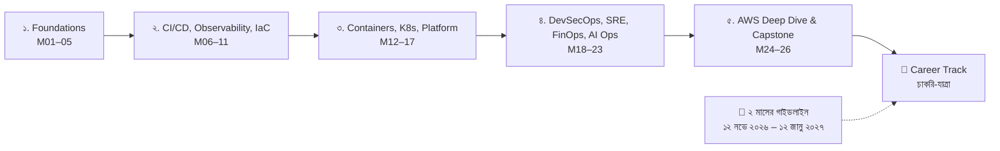
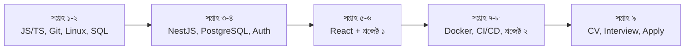

# 🚀 DevOps — AI Native DevOps: From Fundamentals to Advanced Practices

> বাংলায় গল্প, কোড, Mermaid ডায়াগ্রাম ও চেকলিস্টে লেখা **মডিউল-ভিত্তিক নোট**।
> ২৬টি মডিউল · ৫টি সেকশন · ১০টি প্রজেক্ট + ১টি Capstone · ৪টি এক্সাম উইক · সাথে **চাকরি-খোঁজার Career Track** ও **২ মাসের জুনিয়র ডেভেলপার গাইডলাইন**।

প্রতিটি মডিউলে আছে: 📖 গল্প (একটানা চরিত্র: তানভীর ও তার **BookNest** অ্যাপ) → 🗺 Mermaid ডায়াগ্রাম → 💻 মন্তব্যসহ কোড (প্রতিটি লাইনের "কেন") → ⚠ সাধারণ ভুল → ✅ চেকলিস্ট → 🎯 ইন্টারভিউ প্রশ্ন → 🧠 সারসংক্ষেপ।

---

## 🗺 রোডম্যাপ



## 🎯 কোথা থেকে শুরু করবে?

| তোমার লক্ষ্য | শুরু করো এখান থেকে |
|---|---|
| **দ্রুত জুনিয়র সফটওয়্যার ডেভেলপার চাকরি** (২ মাসের ফোকাসড প্ল্যান) | [🎯 ২ মাসের গাইডলাইন](./career-track/07-two-month-guideline.md) |
| **DevOps ইঞ্জিনিয়ার হওয়ার দীর্ঘ যাত্রা** | নিচের [মডিউল সূচি](#-মডিউল-সূচি) (M01 থেকে ধাপে ধাপে) |
| **চাকরির প্রস্তুতি (CV, ইন্টারভিউ, আবেদন)** | [🧭 Career Track](./career-track/README.md) |

---

## 📚 মডিউল সূচি

### সেকশন ১ — Foundations
| # | মডিউল |
|---|---|
| 01 | [DevOps in the AI Era](./section-1-foundations/module-01-devops-in-the-ai-era.md) |
| 02 | [Linux and AWS Fundamentals](./section-1-foundations/module-02-linux-and-aws-fundamentals.md) |
| 03 | [Git Workflows and AI-Assisted Troubleshooting](./section-1-foundations/module-03-git-workflows-and-ai-troubleshooting.md) |
| 04 | [Three-Tier Application on a Single Instance](./section-1-foundations/module-04-three-tier-application-on-a-single-instance.md) |
| 05 | [Exam Week 1](./section-1-foundations/module-05-exam-week-1.md) |

### সেকশন ২ — CI/CD, Observability, IaC
| # | মডিউল |
|---|---|
| 06 | [CI/CD with GitHub Actions](./section-2-cicd-observability-iac/module-06-cicd-with-github-actions.md) |
| 07 | [Observability: Metrics, Logs, Traces](./section-2-cicd-observability-iac/module-07-observability-metrics-logs-and-traces.md) |
| 08 | [Securing 3-Tier with AWS VPC and Networking](./section-2-cicd-observability-iac/module-08-securing-three-tier-with-aws-vpc-and-networking.md) |
| 09 | [Infrastructure as Code: Terraform](./section-2-cicd-observability-iac/module-09-infrastructure-as-code-terraform.md) |
| 10 | [High Availability, Auto Scaling, CodePipeline](./section-2-cicd-observability-iac/module-10-high-availability-auto-scaling-and-codepipeline.md) |
| 11 | [Exam Week 2](./section-2-cicd-observability-iac/module-11-exam-week-2.md) |

### সেকশন ৩ — Containers, Kubernetes, Platform
| # | মডিউল |
|---|---|
| 12 | [Dockerizing the Three-Tier App](./section-3-containers-kubernetes-platform/module-12-dockerizing-the-three-tier-application.md) |
| 13 | [Kubernetes Fundamentals](./section-3-containers-kubernetes-platform/module-13-kubernetes-fundamentals.md) |
| 14 | [Migrating to EKS](./section-3-containers-kubernetes-platform/module-14-migrating-the-three-tier-application-to-eks.md) |
| 15 | [Helm and GitOps with Argo CD](./section-3-containers-kubernetes-platform/module-15-packaging-and-delivery-helm-and-gitops-with-argo-cd.md) |
| 16 | [Platform Engineering / Internal Developer Platform](./section-3-containers-kubernetes-platform/module-16-platform-engineering-building-an-internal-developer-platform.md) |
| 17 | [Exam Week 3](./section-3-containers-kubernetes-platform/module-17-exam-week-3.md) |

### সেকশন ৪ — DevSecOps, SRE, FinOps, AI Ops
| # | মডিউল |
|---|---|
| 18 | [DevSecOps and Supply Chain Security](./section-4-devsecops-sre-finops-ai-ops/module-18-devsecops-and-software-supply-chain-security.md) |
| 19 | [SRE and AI-Powered Operations](./section-4-devsecops-sre-finops-ai-ops/module-19-sre-and-ai-powered-operations.md) |
| 20 | [Serverless and FinOps](./section-4-devsecops-sre-finops-ai-ops/module-20-serverless-architecture-and-finops.md) |
| 21 | [Agentic DevOps](./section-4-devsecops-sre-finops-ai-ops/module-21-agentic-devops-operating-infrastructure-with-ai-agents.md) |
| 22 | [LLMOps: Deploying and Operating AI Apps](./section-4-devsecops-sre-finops-ai-ops/module-22-deploying-and-operating-ai-applications-llmops.md) |
| 23 | [Exam Week 4](./section-4-devsecops-sre-finops-ai-ops/module-23-exam-week-4.md) |

### সেকশন ৫ — AWS Deep Dive ও Capstone
| # | মডিউল |
|---|---|
| 24 | [AWS Deep Dive and Well-Architected Review](./section-5-aws-deep-dive-capstone/module-24-aws-deep-dive-and-well-architected-review.md) |
| 25 | [Capstone Build](./section-5-aws-deep-dive-capstone/module-25-capstone-build.md) |
| 26 | [Capstone Demo Day and Career Readiness](./section-5-aws-deep-dive-capstone/module-26-capstone-demo-day-and-career-readiness.md) |

### 🧭 Career Track — জুনিয়র ডেভেলপার হিসেবে ক্যারিয়ার শুরু
| ফাইল | বিষয় |
|---|---|
| [README](./career-track/README.md) | ওভারভিউ |
| [00 Roadmap](./career-track/00-junior-dev-roadmap.md) | ২০২৬-এর জুনিয়র দক্ষতা-মানচিত্র |
| [01 Resume & LinkedIn](./career-track/01-resume-and-linkedin.md) | রিজুমে, LinkedIn, কভার লেটার |
| [02 Portfolio & GitHub](./career-track/02-portfolio-and-github.md) | প্রজেক্ট ও প্রোফাইল |
| [03 Job Search](./career-track/03-job-search-strategy.md) | খোঁজা, আবেদন, নেটওয়ার্কিং |
| [04 Interview Prep](./career-track/04-interview-prep.md) | টেকনিক্যাল, DSA, আচরণগত |
| [05 First 90 Days](./career-track/05-first-90-days-and-growth.md) | চাকরি পেয়ে এগোনো |
| [06 12-Week Plan](./career-track/06-twelve-week-action-plan.md) | সপ্তাহভিত্তিক অ্যাকশন প্ল্যান |
| [07 ২ মাসের গাইডলাইন](./career-track/07-two-month-guideline.md) | ১২ নভে ২০২৬ – ১২ জানু ২০২৭: ২৬ মডিউল দিন-ভিত্তিক + নিজের প্রজেক্ট, DSA, CV ও আবেদন |

---

## 🎯 ২ মাসের গাইডলাইন — এক নজরে



বিস্তারিত দিনভিত্তিক পরিকল্পনা: [career-track/07-two-month-guideline.md](./career-track/07-two-month-guideline.md)

---

## 🧪 প্রজেক্ট ম্যাপ

| প্রজেক্ট | মডিউল | মূল ফলাফল |
|---|---|---|
| Single-instance 3-tier deploy | M04 | EC2-তে লাইভ অ্যাপ, Nginx, HTTPS |
| CI/CD pipeline | M06 | OIDC, স্বয়ংক্রিয় ডিপ্লয়, rollback |
| Observability stack | M07 | Prometheus/Grafana/Loki/Tempo |
| Secure VPC architecture | M08 | public/private subnet, ALB, RDS |
| Terraform infrastructure | M09 | remote state, মডিউল, PR plan |
| HA + Auto Scaling + CodePipeline | M10 | ASG, blue/green |
| Dockerized app | M12 | multi-stage, Trivy, ECR, Compose |
| EKS migration | M14 | K8s, Ingress, HPA, IRSA |
| GitOps + Helm | M15 | Argo CD, canary |
| Platform / IDP | M16 | Backstage, golden path |
| Capstone | M25–M26 | সম্পূর্ণ প্রোডাকশন-মানের AI অ্যাপ |

## 🧑‍🤝‍🧑 গল্পের চরিত্র

- **তানভীর** — মূল শিক্ষার্থী/জুনিয়র; প্রতিটি মডিউলে নতুন সমস্যার মুখোমুখি।
- **মেন্টর** — প্রশ্ন করে, সিস্টেম ভাঙে, শেখায়।
- **BookNest** — চলমান থ্রি-টিয়ার অ্যাপ (frontend, backend, DB), যা মডিউল থেকে মডিউলে বিবর্তিত।

## 📂 ফোল্ডার-কাঠামো

```text
DevOps/
├── README.md
├── section-1-foundations/
├── section-2-cicd-observability-iac/
├── section-3-containers-kubernetes-platform/
├── section-4-devsecops-sre-finops-ai-ops/
├── section-5-aws-deep-dive-capstone/
└── career-track/
    ├── README.md
    ├── 00-junior-dev-roadmap.md
    ├── ...
    ├── 06-twelve-week-action-plan.md
    └── 07-two-month-guideline.md
```

## 🗓 প্রস্তাবিত পড়ার ক্রম

১. প্রতিটি মডিউল: গল্প → ডায়াগ্রাম → কোড নিজে চালাও → চেকলিস্ট → ইন্টারভিউ প্রশ্ন জোরে বলো।
২. প্রতি সেকশন শেষে Exam Week-এর Mock Lab সময় ধরে করো।
৩. M25 থেকে Capstone শুরু করো; **Career Track-এর সপ্তাহ ১–৩ কাজ Capstone-এর পাশাপাশি চালাও**।
৪. দ্রুত চাকরির লক্ষ্য থাকলে **২ মাসের গাইডলাইন** অনুসরণ করো এবং DevOps মডিউলগুলো তার পাশাপাশি ধীরে এগিয়ে নাও।

## ⚠ ব্যবহারের সতর্কতা

- AWS রিসোর্স **বিল তৈরি করে**। ল্যাবের পর সব `destroy`/delete করো; Budget অ্যালার্ট আগে বসাও।
- কোডগুলো শেখার উদ্দেশ্যে; প্রোডাকশনে নেওয়ার আগে নিজের পরিবেশ অনুযায়ী যাচাই করো।
- টুলের ভার্সন/ফিচার বদলায়; অফিসিয়াল ডকুমেন্টেশন মিলিয়ে নাও।
- Career Track-এর বাজার-তথ্য দিকনির্দেশনা মাত্র।
