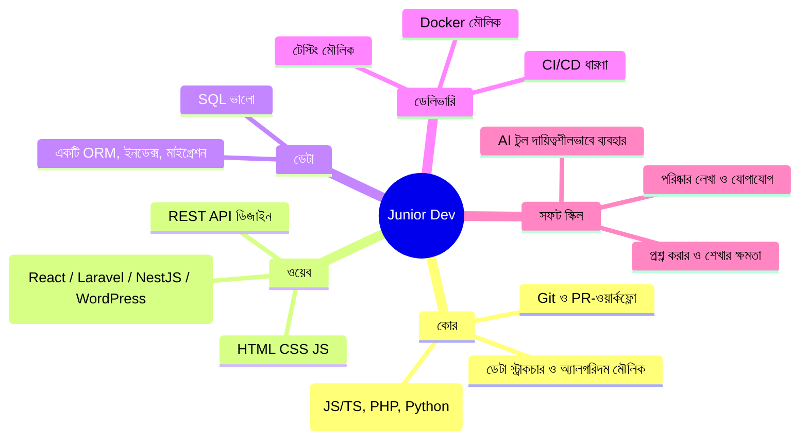
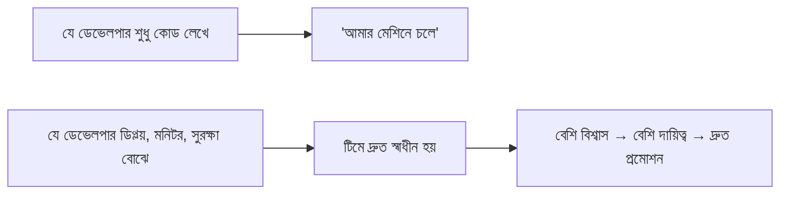

# 00 — Junior Software Developer Roadmap (2026)

## 📖 গল্প: দুই বন্ধুর চাকরির দৌড়

রাহিম আর করিম একই দিনে কোর্স শেষ করল। রাহিম ৫০টা টিউটোরিয়াল দেখেছে, কিন্তু একটাও সম্পূর্ণ প্রজেক্ট নেই। করিমের মাত্র ২টা প্রজেক্ট, দুটোই লাইভ, README-তে ডায়াগ্রাম, `git log`-এ নিয়মিত কমিট, আর একটায় একজন সত্যিকারের ব্যবহারকারী। ইন্টারভিউয়ে করিমকে জিজ্ঞেস করা হলো "এটা ভাঙলে কী হবে?" — সে উত্তর দিল। রাহিমকে জিজ্ঞেস করা হলো "কী বানিয়েছ?" — সে নাম বলল টুলের। **নিয়োগকর্তা প্রমাণ খোঁজে, তালিকা নয়।**

## 1. জুনিয়র ডেভেলপারের কাছে নিয়োগকর্তা কী চায়?

## 2. স্তর অনুযায়ী দক্ষতা

| স্তর | অবশ্যই | থাকলে বাড়তি সুবিধা |
|---|---|---|
| **নবিস (০–৩ মাস)** | একটি ভাষা, Git, HTML/CSS/JS, SQL মৌলিক | Linux কমান্ড |
| **জুনিয়র-রেডি** | REST API, DB ডিজাইন, টেস্ট, Docker, ডিপ্লয় একবার | CI/CD, ক্লাউড মৌলিক |
| **স্ট্যান্ড-আউট জুনিয়র** | উপরের সব + একটা প্রোডাকশন-মানের প্রজেক্ট | Terraform, observability, নিরাপত্তা-মৌলিক ← **এই কোর্সের মডিউলগুলো** |

## 3. এই কোর্স (DevOps) জুনিয়র-ডেভেলপার ক্যারিয়ারে কীভাবে সুবিধা দেয়

- ডিপ্লয় করতে পারলে "ফিচার শেষ" মানে সত্যিই শেষ (প্রোডাকশনে লাইভ)।
- লগ/মেট্রিক পড়তে পারলে বাগ নিজে খুঁজে বের করো।
- Docker/CI বুঝলে অনবোর্ডিং দ্রুত হয়।
- ইন্টারভিউয়ে **"আমি আমার প্রজেক্ট AWS-এ Terraform দিয়ে তুলেছি"** — বেশিরভাগ জুনিয়রের এটা থাকে না।

## 4. তোমার স্ট্যাকের জন্য বাস্তব পথ (WordPress/PHP + আধুনিক)

| ধাপ | কী করবে | প্রমাণ |
|---|---|---|
| ১ | PHP/WordPress প্লাগিন-অভিজ্ঞতা গুছিয়ে দেখাও (হুক, ফিল্টার, WooCommerce) | ২–৩টি প্লাগিন GitHub-এ, README সহ |
| ২ | একটি আধুনিক ব্যাকএন্ড (NestJS বা Laravel) + PostgreSQL + REST | CRUD API + টেস্ট + Swagger |
| ৩ | React ফ্রন্টএন্ডের সাথে জোড়া | ফুল-স্ট্যাক অ্যাপ লাইভ |
| ৪ | Docker + CI/CD + AWS ডিপ্লয় | GitHub Actions পাইপলাইন |
| ৫ | Terraform + মনিটরিং (কোর্সের Capstone) | ডেমো ভিডিও |
| ৬ | ওপেন-সোর্স PR (ছোট হলেও) | মার্জড PR লিংক |

> **টিপ:** আগে "জুনিয়র ডেভেলপার" বা "WordPress/PHP ডেভেলপার" পদে আবেদন করো। DevOps কাজ ভেতরে গিয়ে ধীরে ধীরে নাও। দুটোতেই আবেদন করা যায়।

## 5. AI-যুগে জুনিয়র: কী বদলেছে

| আগে | এখন |
|---|---|
| বয়লারপ্লেট লেখাই ছিল দক্ষতা | AI লিখে দেয়; **রিভিউ, ডিবাগ, ডিজাইন-সিদ্ধান্ত** দক্ষতা |
| "কোড জানি" | "কোড বুঝি, ব্যাখ্যা করতে পারি, দায় নিই" |
| ধীরে শেখা | AI-কে টিউটর বানিয়ে দ্রুত শেখা |

**নিয়ম:** ব্যাখ্যা করতে পারো না এমন কোড কমিট করো না। AI ব্যবহার করলে ক্লায়েন্ট/নিয়োগকর্তাকে স্বচ্ছভাবে বলো। এটা তোমার বিশ্বাসযোগ্যতা বাড়ায়।

## 6. শেখার অভ্যাস

- দৈনিক ২–৩ ঘণ্টা গভীর কাজ (টিউটোরিয়াল নয়, বানানো)।
- সাপ্তাহিক: একটা ছোট জিনিস শেষ করে পাবলিশ করো।
- মাসিক: একটা ব্লগ/LinkedIn পোস্ট ("এই মাসে যা শিখলাম")।
- **২০%** সময় মৌলিক বিষয়ে (DSA, নেটওয়ার্ক, DB), ৮০% প্রজেক্টে।

⬅️ [Career Track](./README.md) · ➡️ [01 — Resume & LinkedIn](./01-resume-and-linkedin.md)
