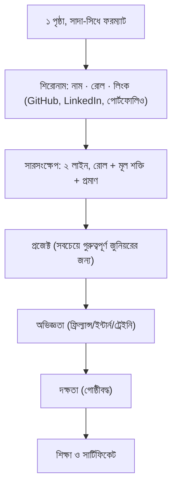

# 01 — Resume, LinkedIn ও কভার লেটার

## 📖 গল্প: ৬ সেকেন্ডের পরীক্ষা

একজন রিক্রুটার একদিনে ২০০টা রিজুমে দেখেন। প্রতিটায় গড়ে কয়েক সেকেন্ড। তানভীরের রিজুমে প্রথম সেকেন্ডেই বলল: **"Junior Developer · PHP/WordPress/Node · AWS-এ ডিপ্লয় করা প্রজেক্ট (লিংক)"**। বাকি ১৯৯টা বলল: "মেহনতি, উদ্যমী, নতুন কিছু শিখতে আগ্রহী।" কে ইন্টারভিউ পেল, বলার দরকার নেই।

## 1. রিজুমের নিয়ম



- **ATS-বান্ধব:** একটি কলাম, সাধারণ ফন্ট, ছবি/টেবিল/গ্রাফিক্স-ভারী ডিজাইন নয়।
- **PDF** পাঠাও (ফাইলের নাম: `Name_Role_Resume.pdf`)।
- **প্রতিটি বুলেট: ক্রিয়া + কী + ফলাফল (সংখ্যা)।**

### দুর্বল বনাম শক্তিশালী বুলেট

| দুর্বল | শক্তিশালী |
|---|---|
| WooCommerce প্লাগিনে কাজ করেছি | WooCommerce কুপন import/export প্লাগিন বানিয়েছি; ১০,০০০ কুপন ব্যাচে প্রসেস, ম্যানুয়াল কাজ ঘণ্টা থেকে মিনিটে |
| ডিপ্লয় করেছি | GitHub Actions + OIDC দিয়ে AWS-এ স্বয়ংক্রিয় ডিপ্লয়, rollback ৩০ সেকেন্ডে |
| টিমে কাজ করেছি | ৪ জনের টিমে PR রিভিউ ও branch protection চালু করে মার্জ-ভুল কমিয়েছি |

> সংখ্যা বানিয়ে ফেলো না। শুধু সত্য ও যাচাইযোগ্য সংখ্যা দাও।

## 2. রিজুমের টেমপ্লেট (Markdown নমুনা)

```markdown
# [আপনার নাম]
Junior Software Developer · PHP / WordPress / Node.js · AWS
Dhaka, Bangladesh · email · github.com/<user> · linkedin.com/in/<user> · portfolio

## সারসংক্ষেপ
WordPress/WooCommerce প্লাগিন ডেভেলপমেন্টে অভিজ্ঞ ফ্রিল্যান্স ডেভেলপার, প্রোডাকশন ডিপ্লয় ও
CI/CD-তে প্রশিক্ষিত। ক্লায়েন্টের জন্য লাইভ সিস্টেম বানিয়েছি; এখন একটি প্রোডাক্ট-টিমে জুনিয়র
রোলে অবদান রাখতে চাই।

## প্রজেক্ট
**BookNest AI — Cloud-Native Capstone** | [repo] · [demo]
- Terraform-এ ২-AZ VPC, EKS, RDS; CI/CD (GitHub Actions + Argo CD), canary rollback
- SLO 99.9% + burn-rate অ্যালার্ট; Trivy/Cosign/Kyverno দিয়ে সাপ্লাই-চেইন সুরক্ষা

**[ক্লায়েন্ট প্লাগিন নাম]** | [repo/description]
- ...

## অভিজ্ঞতা
**ফ্রিল্যান্স ডেভেলপার — WPHelpZone LLC** | তারিখ–এখন
- ...

## দক্ষতা
ভাষা: PHP, JavaScript/TypeScript, SQL · ফ্রেমওয়ার্ক: WordPress/WooCommerce, NestJS, React
টুল: Git, Docker, GitHub Actions, Terraform, AWS · ডেটাবেস: MySQL, PostgreSQL

## শিক্ষা
...
```

## 3. LinkedIn

| অংশ | কী লিখবে |
|---|---|
| **হেডলাইন** | `Junior Software Developer \| PHP · WordPress · Node.js \| AWS & CI/CD` (শুধু "Student" নয়) |
| **About** | ৩ অনুচ্ছেদ: কী করো → কী বানিয়েছ (১–২ প্রমাণ) → কী খুঁজছ |
| **Featured** | Capstone রিপো, ডেমো ভিডিও, সেরা প্রজেক্ট |
| **Experience** | রিজুমের মতো ফলাফল-ভিত্তিক |
| **Skills** | ১০–১৫টি প্রাসঙ্গিক, শীর্ষ ৩ পিন করো |
| **ফটো/ব্যানার** | পরিষ্কার, পেশাদার |

**নিয়মিত কনটেন্ট:** সপ্তাহে ১টি ছোট পোস্ট (শেখা/বানানো/ভুল থেকে শিক্ষা)। ফর্মুলা: *hook → গল্প → শিক্ষা → লিংক।*

## 4. কভার লেটার / আবেদন-বার্তা (সংক্ষিপ্ত)

```text
বিষয়: Junior Software Developer আবেদন — [আপনার নাম]

প্রিয় [নাম/হায়ারিং টিম],

[কোম্পানি]-র [প্রোডাক্ট/ব্লগ/কাজ নির্দিষ্ট কিছু] আমার ভালো লেগেছে কারণ ___।

আমি PHP/WordPress ও Node.js-এ ক্লায়েন্ট-প্রজেক্ট ডেলিভার করেছি এবং সম্প্রতি একটি পূর্ণ
cloud-native প্রজেক্ট AWS-এ ডিপ্লয় করেছি (লিংক)। আপনার JD-র [২টি প্রয়োজন]-এর সাথে এটি মেলে:
১) ___ ২) ___।

আমার রিজুমে সংযুক্ত। ১৫ মিনিটের একটি কলে আলাপ করতে পারলে খুশি হব।

ধন্যবাদ,
[নাম] · [লিংক]
```

> **নিয়ম:** প্রতিটি আবেদনে ২–৩ লাইন কাস্টমাইজ করো। জেনেরিক বার্তা সবার নজর এড়ায়।

## 5. রিজুমে ও LinkedIn-এ ঘন ঘন ভুল

- "Hardworking, passionate" ধরনের ফাঁকা শব্দ
- ২+ পৃষ্ঠা
- মিথ্যা বা বাড়িয়ে লেখা (ইন্টারভিউয়ে ধরা পড়ে)
- লিংক ভাঙা / প্রাইভেট রিপো
- বানান-ভুল

## ✅ চেকলিস্ট
- [ ] ১ পৃষ্ঠার PDF রিজুমে
- [ ] প্রতিটি প্রজেক্টে রিপো/ডেমো লিংক ও ফলাফল
- [ ] LinkedIn হেডলাইন/About/Featured আপডেট
- [ ] কভার লেটার টেমপ্লেট সেভ
- [ ] এক বন্ধু/মেন্টরকে দিয়ে রিভিউ

⬅️ [00 — Roadmap](./00-junior-dev-roadmap.md) · ➡️ [02 — Portfolio & GitHub](./02-portfolio-and-github.md)
