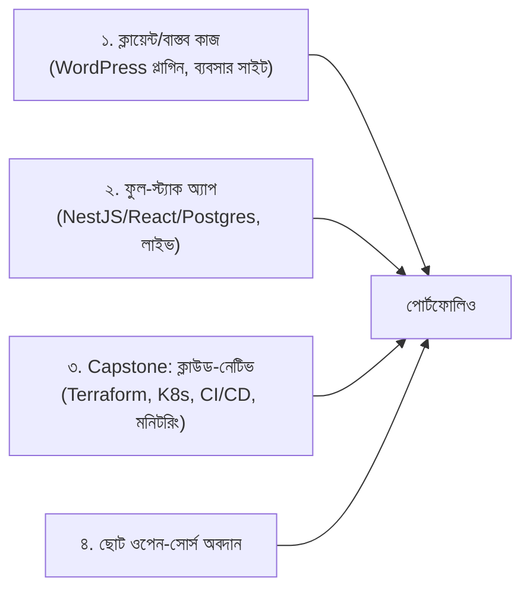

# 02 — Portfolio ও GitHub প্রোফাইল

## 📖 গল্প: রিপোর "দোকান-সাজানো"

একই পণ্য, দুই দোকান। একটায় তাকে ধুলো, লেবেল নেই। অন্যটায় সাজানো, দাম লেখা, ছোট ডেমো চলছে। GitHub প্রোফাইলও দোকান। রিক্রুটার ২ মিনিট ঘুরে দেখেন; যা সামনে পড়ে সেটাই তোমার "পণ্য"।

## 1. কোন প্রজেক্ট বানাবে (জুনিয়রের জন্য ৩-স্তরের পোর্টফোলিও)



| প্রজেক্ট ধারণা | কী প্রমাণ করে |
|---|---|
| WooCommerce প্লাগিন (পাবলিক ডেমো/স্ক্রিনশট; ক্লায়েন্ট-গোপনীয়তা মাস্ক করে) | বাস্তব ব্যবসায়িক সমস্যা সমাধান |
| ফুল-স্ট্যাক "টাস্ক/বুকিং" অ্যাপ: Auth, CRUD, পেজিনেশন, টেস্ট, Swagger | API ডিজাইন, DB, টেস্ট |
| Capstone (এই কোর্সের Module 25) | DevOps + ক্লাউড + নিরাপত্তা |
| একটি CLI/স্ক্রিপ্ট টুল (যেমন লগ-অ্যানালাইজার) | সমস্যা-সমাধান ও কোড-মান |
| ওপেন-সোর্সে ডকুমেন্টেশন/বাগ-ফিক্স PR | সহযোগিতা, কোড-রিডিং |

> **২–৪টি গভীর প্রজেক্ট > ২০টি অসম্পূর্ণ।**

## 2. প্রতিটি রিপোর README-র সূত্র

```markdown
# প্রজেক্ট-নাম
> এক বাক্যে: কী, কার জন্য।
![screenshot/gif]
## ✨ ফিচার
## 🛠️ টেক স্ট্যাক ও কেন
## 🚀 লোকালি চালানো (৩–৫ কমান্ড, `.env.example` সহ)
## 🧪 টেস্ট চালানো
## 🏗️ আর্কিটেকচার (Mermaid)
## 🌐 লাইভ ডেমো
## 💡 শেখা / কী পাল্টাতাম
```

**রিপো-হাইজিন:**
- অর্থবহ কমিট (`feat:`, `fix:`, `docs:` — conventional commits)
- `.gitignore`, `.env.example`; **কখনো `.env` নয়**
- সক্রিয় PR/Issue ইতিহাস (নিজের রিপোতেও ফিচার-ব্রাঞ্চ → PR অভ্যাস)
- GitHub Actions ব্যাজ (CI পাস)
- LICENSE

## 3. প্রোফাইল README (github.com/<user>/<user>)

```markdown
# 👋 হাই, আমি [নাম]
Junior Software Developer · PHP/WordPress · Node.js · AWS
🔭 এখন বানাচ্ছি: ___  📚 শিখছি: ___  📫 যোগাযোগ: ___

## ⭐ সেরা প্রজেক্ট
| প্রজেক্ট | কী | লিংক |
|---|---|---|

## 🧰 টুল
PHP · JS/TS · SQL · Docker · Terraform · GitHub Actions
```
- ৬টি প্রজেক্ট **Pin** করো (সেরাগুলো)।
- পুরনো/অসম্পূর্ণ রিপো আর্কাইভ বা প্রাইভেট।

## 4. সিকিউরিটি-হাইজিন (পাবলিক রিপো)

```bash
# পুশের আগে — গোপন তথ্য স্ক্যান (কেন: একবার পাবলিক হলে ইতিহাসেও থাকে)
gitleaks detect --source . --verbose
git log --all --full-history -- "*.env" "*.pem"   # ভুলে ঢোকানো ফাইল আছে কিনা
```
> আসল AWS অ্যাকাউন্ট ID, ডোমেইন, ইমেইল, ক্লায়েন্ট-নাম মাস্ক করো। কিছু ফাঁস হলে **রোটেট**; ইতিহাস মোছা যথেষ্ট নয়।

## 5. ব্লগ/লেখা

প্রতিটি বড় প্রজেক্টের পর একটি লেখা: **"আমি যে সমস্যায় আটকেছিলাম ও কীভাবে সমাধান করলাম।"** (dev.to / Hashnode / LinkedIn)। এটা SEO-ও দেয়, গভীর বোঝাও প্রমাণ করে।

## ✅ চেকলিস্ট
- [ ] ৩–৪টি পিন-করা প্রজেক্ট, প্রতিটিতে ভালো README
- [ ] প্রোফাইল README
- [ ] সব রিপো secret-পরিষ্কার
- [ ] অন্তত ১টি লাইভ ডেমো লিংক
- [ ] ১টি ব্লগ/পোস্ট প্রতি প্রজেক্টে

⬅️ [01 — Resume](./01-resume-and-linkedin.md) · ➡️ [03 — Job Search](./03-job-search-strategy.md)
