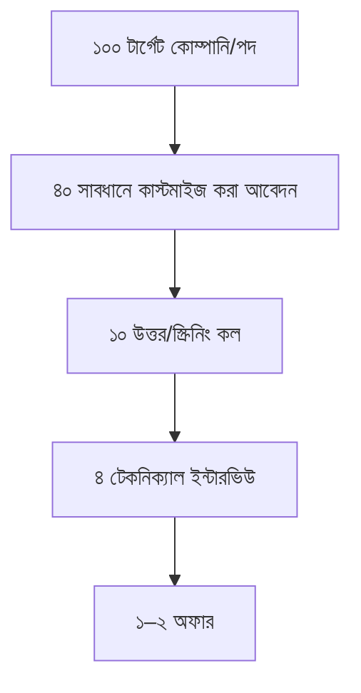

# 03 — চাকরি-খোঁজার কৌশল (Job Finder)

## 📖 গল্প: জালের বদলে বর্শা

তানভীর প্রথম মাসে ১৫০টা আবেদন পাঠাল, উত্তর এল ২টা। দ্বিতীয় মাসে সে পাল্টাল: সপ্তাহে ১০টা **বেছে নেওয়া** আবেদন, প্রতিটায় কাস্টম বার্তা, ৩টা রেফারাল-চেষ্টা, আর একটা LinkedIn পোস্ট। উত্তরের হার কয়েক গুণ বাড়ল। **চাকরি খোঁজা একটা ফানেল, কিছু-না-কিছু-লাগবে এমন লটারি নয়।**

## 1. ফানেল-চিন্তা


> প্রতিটা ধাপের রূপান্তর-হার মেপে দেখো। কোথায় আটকাচ্ছ? রিজুমে (B), স্ক্রিনিং (C), টেকনিক্যাল (D)? তারপর শুধু সেই অংশ উন্নত করো।

## 2. কোথায় খুঁজবে (বাংলাদেশ-কেন্দ্রিক + রিমোট)

| উৎস | কাজে লাগে |
|---|---|
| **LinkedIn Jobs** | কোম্পানি-ভিত্তিক, রেফারাল-সুযোগ, রিক্রুটার মেসেজ |
| **Bdjobs** ও স্থানীয় সাইট | বাংলাদেশি কোম্পানি |
| **কোম্পানির নিজস্ব Careers পেজ** | প্রায়ই সরাসরি, কম ভিড় |
| **Wellfound (AngelList)**, **RemoteOK**, **We Work Remotely** | স্টার্টআপ/রিমোট |
| **GitHub Jobs-ধাঁচের কমিউনিটি, Facebook/Discord/Telegram গ্রুপ** | স্থানীয় ডেভ কমিউনিটি, অনেক সুযোগ অনানুষ্ঠানিক |
| **Upwork/Freelancer** | অভিজ্ঞতা + আয় (ফ্রিল্যান্স হিসেবে) |
| **ইন্টার্নশিপ/ট্রেইনি প্রোগ্রাম** | জুনিয়রের প্রবেশদ্বার |

> প্ল্যাটফর্মের নীতি/জনপ্রিয়তা বদলায়; ২–৩টায় মনোযোগ দাও, ১০টায় ছড়িও না। প্রতারণা-সতর্কতা: "আগে টাকা দিন" এমন চাকরি/ট্রেনিং এড়িয়ে চলো।

## 3. আবেদনের আগে যাচাই (পদ বেছে নাও)

JD-র ৬০–৭০% মিললে আবেদন করো (১০০% নয়)। JD পড়ে ৩টি জিনিস নোট করো:
1. প্রধান দক্ষতা কী? (ভাষা/ফ্রেমওয়ার্ক)
2. কী সমস্যা সমাধান করতে নিচ্ছে?
3. রিজুমে/কভারে কোন ২টি প্রমাণ দেখাবো?

## 4. নেটওয়ার্কিং — সবচেয়ে কম-ব্যবহৃত অস্ত্র

```text
# রিক্রুটার/ইঞ্জিনিয়ারকে LinkedIn বার্তা (সংক্ষিপ্ত, নির্দিষ্ট, দাবিবিহীন)
হাই [নাম], আমি [নাম], একজন জুনিয়র ডেভেলপার। [কোম্পানি]-র [নির্দিষ্ট প্রজেক্ট/পোস্ট]
আমার ভালো লেগেছে। আমি [রিপো/প্রজেক্ট লিংক] বানিয়েছি। [পদ]-এ আবেদন করেছি;
আপনার টিমের কাজ সম্পর্কে ২ মিনিটে একটা প্রশ্ন করতে পারি?
```
- **সরাসরি চাকরি চেয়ো না;** পরামর্শ/প্রশ্ন চাও।
- মিটআপ/ওয়েবিনার/কমিউনিটিতে নিয়মিত যাও; মানুষকে সাহায্য করো (প্রশ্নের উত্তর, ছোট টিউটোরিয়াল)।
- রেফারাল প্রায়ই সাধারণ আবেদনের চেয়ে অনেক এগিয়ে।

## 5. ট্র্যাকার (Notion/Sheet/Markdown)

```markdown
| তারিখ | কোম্পানি | পদ | লিংক | স্ট্যাটাস | পরবর্তী ধাপ | নোট/শেখা |
|---|---|---|---|---|---|---|
| 11-05 | ABC Ltd | Jr PHP Dev | url | আবেদন | ১ সপ্তাহে ফলো-আপ | JD: Laravel বেশি |
```
**সাপ্তাহিক রিভিউ:** কতটা আবেদন, উত্তর, ইন্টারভিউ; কোন ধাপ দুর্বল; পরের সপ্তাহের একটি উন্নতি।

## 6. ফলো-আপ

আবেদনের ৫–৭ দিন পর ভদ্র ছোট বার্তা। ইন্টারভিউয়ের ২৪ ঘণ্টায় ধন্যবাদ-ইমেইল (একটি নির্দিষ্ট বিষয় উল্লেখ করে)।

## 7. অফার ও আলোচনা (জুনিয়রের জন্য)

- প্রথম অফারেই আতঙ্কে "হ্যাঁ" নয়; ২৪–৪৮ ঘণ্টা চাও।
- শেখার সুযোগ, মেন্টরশিপ, টিম-মান, প্রযুক্তি-স্ট্যাক — শুধু বেতন নয়।
- বাজার-গবেষণা করো (একাধিক উৎস; সংখ্যা বদলায়)।
- লিখিত অফার-লেটার; প্রবেশন-নিয়ম, নোটিশ পিরিয়ড বোঝো।
- (আমি আইনি/আর্থিক পরামর্শদাতা নই; চুক্তি সই করার আগে প্রয়োজনে অভিজ্ঞজনকে দেখাও।)

## 8. হতাশা সামলানো

প্রত্যাখ্যান স্বাভাবিক; এটা তোমার মূল্যের বিচার নয়। প্রতিটি প্রত্যাখ্যান থেকে ১টি শেখা নোট করো। সপ্তাহে একদিন বিরতি। ছোট জয় উদযাপন করো (প্রথম স্ক্রিনিং কল, প্রথম টেকনিক্যাল)।

## 9. সমান্তরাল পথ: ফ্রিল্যান্স + ছোট চুক্তি

ফুলটাইম খোঁজার সময় ফ্রিল্যান্স কাজ বন্ধ করো না: আয় + নতুন প্রজেক্ট + রেফারেন্স। ক্লায়েন্টকে AI-ব্যবহার নিয়ে স্বচ্ছ থাকো (তোমার আগের অভ্যাসের মতো)।

## ✅ চেকলিস্ট
- [ ] ৩০–১০০ টার্গেট কোম্পানির তালিকা
- [ ] ট্র্যাকার চালু
- [ ] সপ্তাহে ৮–১০ কাস্টম আবেদন + ৩ নেটওয়ার্কিং বার্তা
- [ ] সাপ্তাহিক রিভিউ
- [ ] ফ্রিল্যান্স পাইপলাইন সচল

⬅️ [02 — Portfolio](./02-portfolio-and-github.md) · ➡️ [04 — Interview Prep](./04-interview-prep.md)
