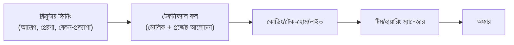

# 04 — ইন্টারভিউ প্রস্তুতি (জুনিয়র ডেভেলপার + DevOps-মৌলিক)

## 📖 গল্প: প্রশ্নের পেছনের প্রশ্ন

ইন্টারভিউয়ার "Array আর LinkedList-এর পার্থক্য কী?" জিজ্ঞেস করলে আসলে জানতে চান: *"এই মানুষটা কি ভাবতে পারে, ট্রেড-অফ বোঝে, আর ব্যাখ্যা করতে পারে?"* সঠিক উত্তরের চেয়ে **চিন্তার ধারা** বেশি দামি।

## 1. ইন্টারভিউ-ধাপ



## 2. ক্যাটাগরি অনুযায়ী প্রস্তুতি

### ক) নিজের প্রজেক্ট আলোচনা (সবচেয়ে গুরুত্বপূর্ণ)
প্রতিটি প্রজেক্টের জন্য উত্তর তৈরি রাখো:
- কেন বানালে? কী সমস্যা?
- আর্কিটেকচার আঁকো (হোয়াইটবোর্ডে)।
- সবচেয়ে কঠিন বাগ/সমস্যা ও সমাধান।
- কী পাল্টাতে? স্কেল ১০০× হলে কী ভাঙবে?
- AI কোন অংশে ব্যবহার করেছ, কীভাবে যাচাই করেছ?

### খ) ওয়েব/ব্যাকএন্ড মৌলিক

| প্রশ্ন | মূল বিষয় |
|---|---|
| REST বনাম GraphQL? | রিসোর্স-ভিত্তিক, কেস-ভিত্তিক ট্রেড-অফ |
| HTTP স্ট্যাটাস কোড, GET/POST/PUT/PATCH/DELETE, idempotency | ২xx/৩xx/৪xx/৫xx অর্থ |
| Authentication বনাম Authorization; JWT/সেশন | টোকেন কোথায় রাখো, মেয়াদ, রিফ্রেশ |
| CORS কী? | ব্রাউজার-সুরক্ষা, হেডার |
| SQL JOIN, INDEX, N+1 সমস্যা, ট্রানজ্যাকশন/ACID | ধীর কোয়েরি কীভাবে ঠিক করো (`EXPLAIN`) |
| SQL বনাম NoSQL | ডেটা-আকার/সম্পর্ক/সামঞ্জস্য |
| সাধারণ নিরাপত্তা: SQL injection, XSS, CSRF | প্রিপেয়ার্ড স্টেটমেন্ট, এস্কেপিং, nonce/টোকেন |
| কেন ক্যাশ? Redis কখন? | লেটেন্সি, invalidation কঠিন |

### গ) WordPress/PHP-নির্দিষ্ট (তোমার শক্তি)

| প্রশ্ন | মূল বিষয় |
|---|---|
| Action বনাম Filter হুক | সাইড-এফেক্ট বনাম মান-পরিবর্তন |
| `$wpdb->prepare` কেন? | SQL injection প্রতিরোধ |
| nonce/capability চেক | CSRF ও অনুমতি |
| কীভাবে প্লাগিন ধীর হয় ও ঠিক করবে? | অপ্টিমাইজড কোয়েরি, transients/object cache, ব্যাচ প্রসেসিং |
| বড় ডেটা import/export কীভাবে সামলাও? | চাঙ্ক, ব্যাকগ্রাউন্ড জব, মেমরি-নিয়ন্ত্রণ |

### ঘ) ডেটা স্ট্রাকচার ও অ্যালগরিদম (জুনিয়র-মান)

অধ্যয়ন-তালিকা (সব নয়, মৌলিকগুলো): Array/String, HashMap/Set, Stack/Queue, Two-pointers, Sliding window, Binary search, Recursion, Sorting (ধারণা), Tree/Graph BFS-DFS (মৌলিক), Big-O।

```python
# উদাহরণ: Two Sum — HashMap দিয়ে O(n)
def two_sum(nums, target):
    seen = {}                       # মান → ইনডেক্স; কেন: প্রতিটি সংখ্যার "পরিপূরক" দ্রুত খুঁজতে
    for i, n in enumerate(nums):
        need = target - n           # কেন: এটা আগে দেখা গেছে কিনা জানাই লক্ষ্য
        if need in seen:            # O(1) লুকআপ
            return [seen[need], i]
        seen[n] = i                 # না পেলে নিজেকে সংরক্ষণ
    return []
```

**কোডিং-ইন্টারভিউয়ের পদ্ধতি:** ১) প্রশ্ন ঝালিয়ে নাও ও উদাহরণ চাও → ২) ব্রুট-ফোর্স বলো → ৩) অপটিমাইজ করো → ৪) কোড → ৫) টেস্ট-কেস ও এজ-কেস (খালি/১টি/ডুপ্লিকেট) → ৬) জটিলতা বলো। **জোরে ভাবো।**

### ঙ) Git ও টিমওয়ার্ক
- `merge` বনাম `rebase`? কনফ্লিক্ট কীভাবে সমাধান?
- ভালো PR কেমন? কীভাবে কোড-রিভিউ দাও/নাও?
- `git revert` বনাম `reset`?

### চ) DevOps-মৌলিক (এই কোর্স থেকে — জুনিয়র রোলেও বাড়তি সুবিধা)

| প্রশ্ন | মডিউল |
|---|---|
| CI/CD কী? পাইপলাইন আঁকো | [M06](../section-2-cicd-observability-iac/module-06-cicd-with-github-actions.md) |
| Docker image বনাম container; multi-stage কেন? | [M12](../section-3-containers-kubernetes-platform/module-12-dockerizing-the-three-tier-application.md) |
| Terraform state কেন? | [M09](../section-2-cicd-observability-iac/module-09-infrastructure-as-code-terraform.md) |
| Pod/Deployment/Service পার্থক্য | [M13](../section-3-containers-kubernetes-platform/module-13-kubernetes-fundamentals.md) |
| মনিটরিং: metrics/logs/traces | [M07](../section-2-cicd-observability-iac/module-07-observability-metrics-logs-and-traces.md) |
| সিক্রেট কীভাবে ম্যানেজ করো? | [M18](../section-4-devsecops-sre-finops-ai-ops/module-18-devsecops-and-software-supply-chain-security.md) |

### ছ) সিস্টেম ডিজাইন (হালকা, জুনিয়র-স্তর)
প্রশ্ন: "URL-shortener/টাস্ক-অ্যাপ/ব্লগ ডিজাইন করো।" কাঠামো: প্রয়োজন → API → ডেটা-মডেল → উচ্চ-স্তরের চিত্র → বাধা (bottleneck) → স্কেল (ক্যাশ, DB রিড-রেপ্লিকা, লোড-ব্যালান্সার)।

### জ) আচরণগত (STAR)

```text
S (পরিস্থিতি): ক্লায়েন্টের সাইট ইমপোর্টে সময়সীমা পেরিয়ে টাইমআউট হচ্ছিল।
T (দায়িত্ব): ১০,০০০ রেকর্ড নির্ভরযোগ্যভাবে প্রসেস করতে হবে।
A (কাজ): চাঙ্ক-ভিত্তিক ব্যাকগ্রাউন্ড ব্যাচ, রিট্রাই, প্রগ্রেস-লগ বানালাম।
R (ফল): টাইমআউট শূন্য; ম্যানুয়াল কাজ ঘণ্টা → মিনিট।
```
সাধারণ প্রশ্ন: নিজের সম্পর্কে বলো · কেন আমাদের? · সবচেয়ে বড় ব্যর্থতা · মতবিরোধ কীভাবে সামলাও · যা জানো না তা কীভাবে শেখো · ৫ বছর পর কোথায়?

### ঝ) AI-যুগের প্রশ্ন
- AI-জেনারেটেড কোড কীভাবে রিভিউ করো? (টেস্ট, সিকিউরিটি, ব্যাখ্যা-যোগ্যতা, লাইসেন্স/ডেটা-ফাঁস সতর্কতা)
- AI-কে কখন বিশ্বাস করো না?
- Prompt injection কী?

## 3. তোমার জিজ্ঞাস্য প্রশ্ন (ইন্টারভিউয়ারকে)

- জুনিয়রদের অনবোর্ডিং কেমন? প্রথম ৯০ দিনে কী প্রত্যাশা?
- কোড-রিভিউ ও টেস্টিং সংস্কৃতি?
- ডিপ্লয় কত ঘন ঘন? অন-কল আছে কি?
- টিম কোন প্রযুক্তি-ঋণ নিয়ে লড়ছে?
- মেন্টরশিপ ও শেখার বাজেট?

## 4. ইন্টারভিউ-দিনের চেকলিস্ট

- [ ] কোম্পানির প্রোডাক্ট/ব্লগ/টেক-স্ট্যাক ২০ মিনিট পড়েছি
- [ ] নিজের প্রজেক্টগুলো ২ মিনিটে ব্যাখ্যা করতে পারি
- [ ] STAR গল্প ৫টি প্রস্তুত
- [ ] ৫টি DSA সমস্যা সমাধান-রিভিশন
- [ ] ক্যামেরা/ইন্টারনেট/শব্দ টেস্ট
- [ ] নিজের ২–৩টি প্রশ্ন
- [ ] ধন্যবাদ-ইমেইল খসড়া

## 5. মক-অভ্যাস
সপ্তাহে ২টি মক (বন্ধু/মেন্টর/AI-কে ইন্টারভিউয়ার বানিয়ে)। রেকর্ড করো, পরে দেখো। ধীরে, স্পষ্ট বলো।

⬅️ [03 — Job Search](./03-job-search-strategy.md) · ➡️ [05 — First 90 Days](./05-first-90-days-and-growth.md)
