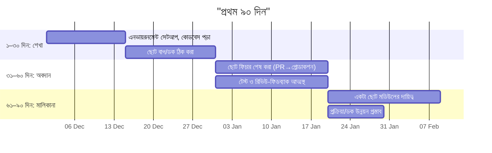
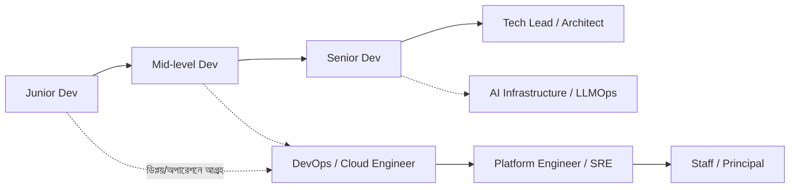

# 05 — প্রথম ৯০ দিন ও ক্যারিয়ার-বৃদ্ধি

## 📖 গল্প: প্রথম দিনের "কিছু বুঝি না" অনুভূতি

তানভীরের প্রথম সপ্তাহে মনে হলো সে কিছুই জানে না। কোডবেস বিশাল, ভাষা অচেনা। মেন্টর বললেন: *"প্রথম ৩ মাসে তোমার কাজ ফিচার বানানো নয়, শেখা ও বিশ্বাস গড়া।"* সে এক খাতায় প্রতিদিনের প্রশ্ন লিখত। ৩ মাস পরে সেই খাতা-ই হয়ে গেল টিমের অনবোর্ডিং-ডক।

## 1. ৯০ দিনের পরিকল্পনা



## 2. প্রথম মাসের অভ্যাস

- **প্রশ্ন করো — কিন্তু আগে নিজে ২০ মিনিট চেষ্টা করো,** তারপর গুছিয়ে (কী চেষ্টা করেছি, কী দেখেছি) জিজ্ঞেস করো।
- সব উত্তর নোটে লেখো; একই প্রশ্ন দ্বিতীয়বার নয়।
- PR ছোট রাখো; রিভিউ-কমেন্ট ব্যক্তিগত নেয়ো না।
- টিমের কোডিং-স্টাইল, ব্র্যাঞ্চ-নীতি, ডিপ্লয়-প্রক্রিয়া বুঝে নাও।
- প্রোডাকশনে ভুল হলে **দ্রুত জানাও** (লুকিও না)। এটাই বিশ্বাস গড়ে।

## 3. কোডবেস-বোঝার কৌশল

```bash
git log --oneline -n 30            # সাম্প্রতিক কী বদলাচ্ছে
git log -p -- path/to/file         # একটা ফাইলের ইতিহাস ও "কেন"
grep -rn "functionName" .          # ফাংশন কোথায় ব্যবহৃত
# টেস্ট চালিয়ে দেখো কীভাবে আচরণ কাজ করে — টেস্টই সবচেয়ে ভালো ডকুমেন্টেশন
```

## 4. দৃশ্যমানতা ও বিশ্বাস

| কাজ | ফল |
|---|---|
| ছোট কিছু শেষ করে জানাও | নির্ভরযোগ্যতা |
| ডক/রানবুক লেখো | টিমের সময় বাঁচে |
| অন-কল/ইনসিডেন্টে শেখো, postmortem লেখো | সিনিয়রদের নজর |
| AI টুল দায়িত্বশীল ও স্বচ্ছভাবে | বিশ্বাস |

## 5. ক্যারিয়ার-মানচিত্র



- **১–২ বছর:** Junior → Mid: স্বাধীনভাবে ফিচার ডেলিভারি, টেস্ট, রিভিউ।
- **২–৪ বছর:** Mid → Senior: ডিজাইন-সিদ্ধান্ত, মেন্টরিং, সিস্টেম-মালিকানা।
- **পাশ-পথ:** DevOps/SRE/Platform/AI-Infra — এই কোর্সের ভিত্তিতে।
- সার্টিফিকেট (সহায়ক, বিকল্প নয়): AWS Cloud Practitioner → Solutions Architect Associate (SAA-C03, [M24](../section-5-aws-deep-dive-capstone/module-24-aws-deep-dive-and-well-architected-review.md)), Terraform Associate, CKA/CKAD (পরে)।

## 6. পারফরম্যান্স-রিভিউ ও বেতন-বৃদ্ধির প্রস্তুতি

প্রতি মাসে একটি "ব্র্যাগ ডকুমেন্ট": কী ডেলিভার করলাম, কী প্রভাব (সংখ্যা), কী শিখলাম, কী প্রশংসা পেলাম। রিভিউয়ের সময় এটাই তোমার প্রমাণ।

## 7. দীর্ঘমেয়াদি অভ্যাস

- সপ্তাহে ৩–৫ ঘণ্টা নতুন কিছু শেখা।
- বছরে ১টি বড় নতুন দক্ষতা।
- বিশ্বস্ত মেন্টর খুঁজে নাও।
- বার্নআউট এড়াও: সীমা রাখো, বিশ্রাম নাও।
- কমিউনিটিতে ফেরত দাও।

## ✅ চেকলিস্ট
- [ ] ৩০/৬০/৯০ দিনের লক্ষ্য ম্যানেজারের সাথে মিলিয়েছি
- [ ] প্রশ্ন-নোট ও ব্র্যাগ ডক চালু
- [ ] সপ্তাহিক ১-অন-১ (ম্যানেজার/মেন্টর)

⬅️ [04 — Interview Prep](./04-interview-prep.md) · ➡️ [06 — 12-Week Plan](./06-twelve-week-action-plan.md)
