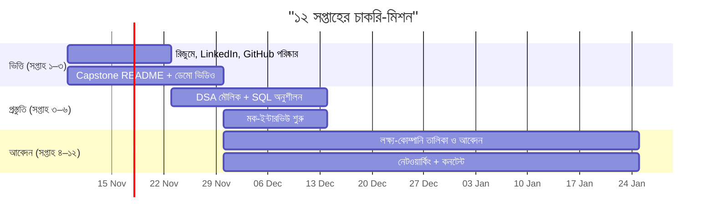

# 06 — ১২ সপ্তাহের অ্যাকশন প্ল্যান (চাকরি-প্রস্তুতি + আবেদন)

> কোর্সের Capstone (M25–M26) শেষ করার পর বা সমান্তরালে এই পরিকল্পনা চালাও। নিজের সময় অনুযায়ী মানিয়ে নাও।



## সপ্তাহ-ভিত্তিক

| সপ্তাহ | মূল কাজ | ফল |
|---|---|---|
| **১** | রিজুমে (১ পৃষ্ঠা), LinkedIn হেডলাইন/About, GitHub ক্লিনআপ ও পিন | প্রথম "দোকান-সাজানো" |
| **২** | প্রোফাইল README, সব রিপো secret-স্ক্যান, প্রজেক্ট README উন্নত | পরিষ্কার পোর্টফোলিও |
| **৩** | Capstone ডেমো ভিডিও, কেস-স্টাডি লেখা, প্রথম LinkedIn পোস্ট | দৃশ্যমানতা |
| **৪** | টার্গেট-কোম্পানি তালিকা (৩০–১০০), ট্র্যাকার চালু; ৮ আবেদন | ফানেল শুরু |
| **৫** | DSA: Array/HashMap/Two-pointers; SQL JOIN/Index; ১০ আবেদন + ৩ নেটওয়ার্ক বার্তা | মৌলিক শক্ত |
| **৬** | প্রথম মক-ইন্টারভিউ (প্রজেক্ট + আচরণ); STAR গল্প ৫টি; ১০ আবেদন | আত্মবিশ্বাস |
| **৭** | DSA: Stack/Queue/Binary search; সিস্টেম-ডিজাইন হালকা অভ্যাস; ১০ আবেদন | বিস্তার |
| **৮** | ফানেল বিশ্লেষণ: কোথায় আটকাচ্ছ? সেটা ঠিক করো; ২য় ব্লগ/পোস্ট | লক্ষ্যভিত্তিক উন্নতি |
| **৯** | ছোট ওপেন-সোর্স PR; মক-ইন্টারভিউ ×২; ১০ আবেদন | সহযোগিতা-প্রমাণ |
| **১০** | রেফারাল-কেন্দ্রিক সপ্তাহ: ১০টি নির্দিষ্ট ব্যক্তিকে বার্তা; ফলো-আপ | নেটওয়ার্ক |
| **১১** | অফার-আলোচনার প্রস্তুতি; ইন্টারভিউ-সংশোধন; ১০ আবেদন | প্রস্তুতি |
| **১২** | পুরো রিভিউ: সংখ্যা, শেখা; পরের ১২ সপ্তাহের পরিকল্পনা | চক্র চালু |

## দৈনিক ছক (৪–৫ ঘণ্টা কার্যকর সময়)

```text
৯:০০–১১:০০  গভীর কাজ: প্রজেক্ট / DSA (ফোন বন্ধ)
১১:০০–১২:০০ আবেদন (২ কাস্টম) + নেটওয়ার্কিং বার্তা
বিকেল        শেখা: একটি মডিউল রিভিশন/ল্যাব
সন্ধ্যা       পোস্ট/ব্লগ বা মক-ইন্টারভিউ (সপ্তাহে ২ দিন)
রাত          ট্র্যাকার আপডেট; পরদিনের ৩টি কাজ লিখে রাখা
```

## সাপ্তাহিক রিভিউ (রবিবার, ২০ মিনিট)

1. কত আবেদন/উত্তর/ইন্টারভিউ?
2. কোন ধাপ দুর্বল (রিজুমে / স্ক্রিনিং / টেকনিক্যাল)?
3. এই সপ্তাহে কী শিখলাম?
4. আগামী সপ্তাহের একটি মূল উন্নতি।

## 🧠 শেষ কথা

সফলতা = ধারাবাহিকতা × প্রমাণ × নেটওয়ার্ক। তুমি আগেই বাস্তব ক্লায়েন্টের জন্য প্রোডাকশন প্লাগিন বানিয়েছ। এখন সেই গল্পকে সাজিয়ে বলো, ক্লাউড/DevOps প্রমাণ জুড়ো, আর নিয়মিত দরজায় নক করো। প্রতিটি "না" একটি "হ্যাঁ"-এর কাছে নিয়ে যায়।

⬅️ [05 — First 90 Days](./05-first-90-days-and-growth.md) · ⬆️ [Career Track](./README.md) · 🏠 [মূল README](../README.md)
