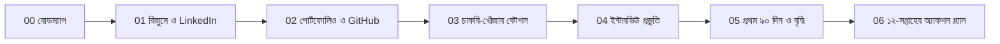

# 🧭 Career Track — Junior Software Developer থেকে DevOps পর্যন্ত

এই ফোল্ডারটা কোর্সের বাইরের জিনিস: **কীভাবে চাকরি পাবে, কীভাবে নিজেকে উপস্থাপন করবে, কীভাবে এগিয়ে যাবে।** মডিউলগুলো "কী শিখব" বলে; এই ফোল্ডার বলে "শিখে কী করব"।

| ফাইল | কী পাবে |
|---|---|
| [00-junior-dev-roadmap.md](./00-junior-dev-roadmap.md) | ২০২৬-এ জুনিয়র ডেভেলপারের দক্ষতা-মানচিত্র, DevOps কীভাবে সুবিধা দেয় |
| [01-resume-and-linkedin.md](./01-resume-and-linkedin.md) | রিজুমে, LinkedIn, কভার লেটার টেমপ্লেট |
| [02-portfolio-and-github.md](./02-portfolio-and-github.md) | কোন প্রজেক্ট বানাবে, GitHub প্রোফাইল সাজানো |
| [03-job-search-strategy.md](./03-job-search-strategy.md) | কোথায় খুঁজবে, কীভাবে আবেদন, নেটওয়ার্কিং, ট্র্যাকার |
| [04-interview-prep.md](./04-interview-prep.md) | টেকনিক্যাল, DSA-মৌলিক, আচরণগত, AI-যুগের প্রশ্ন |
| [05-first-90-days-and-growth.md](./05-first-90-days-and-growth.md) | চাকরি পেয়ে কী করবে, প্রমোশন-পথ |
| [06-twelve-week-action-plan.md](./06-twelve-week-action-plan.md) | সপ্তাহ-ভিত্তিক পরিকল্পনা |

> ⚠️ বাজারের তথ্য (বেতন, চাহিদা, প্ল্যাটফর্ম-নীতি) দ্রুত বদলায়। এখানে দেওয়া সংখ্যা/তালিকা **দিকনির্দেশনা**; আবেদনের আগে নিজে যাচাই করো।

⬅️ [মূল README](../README.md)
