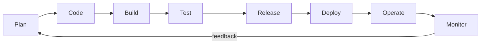
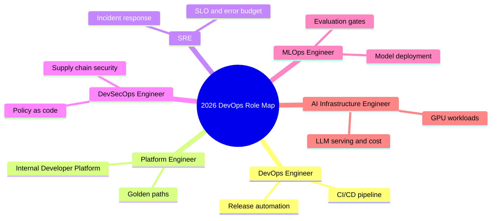
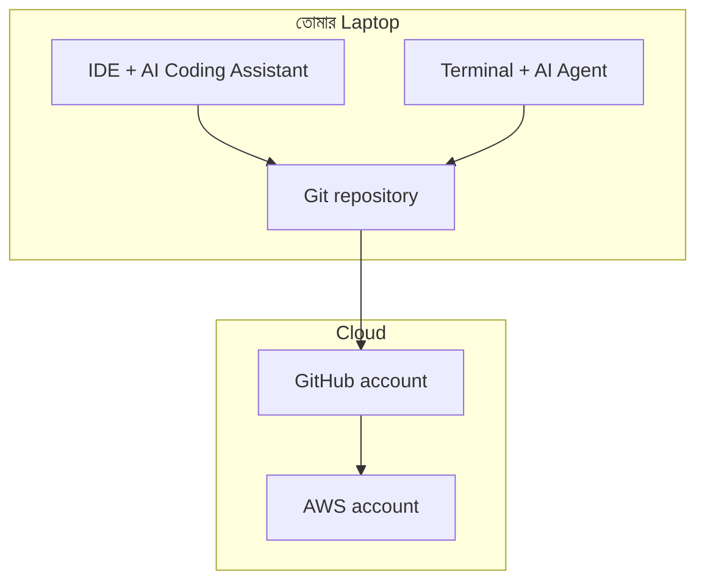
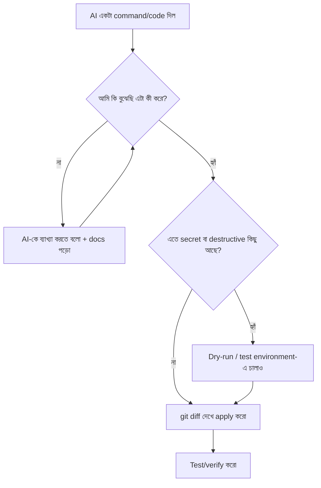
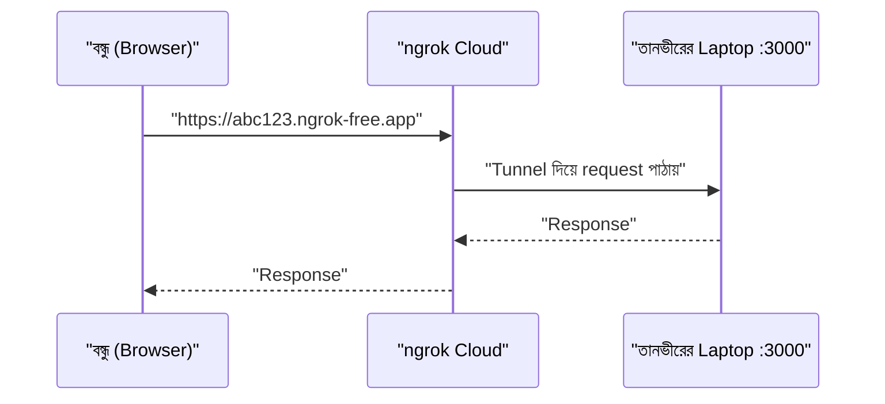

# Module 01 — DevOps in the AI Era: Setup and Role Map

> **Section 1 · Foundations: Linux, AWS & Git** · ২টি Live Class
> **Project:** My First Live Website
> **Goal:** প্রজেক্ট লোকালি চালানো, ngrok দিয়ে ইন্টারনেটে expose করা, আর নিজের একটা AI usage rules ফাইল repository-তে commit করা।
> **Assignment ★:** AI workspace সেটআপ করো + একপাতার reflection লেখো — 2026 role map থেকে তোমার target role কোনটা এবং কেন।

---

## 📖 গল্প: তানভীরের প্রথম দিন

তানভীর একটা ছোট অনলাইন বইয়ের দোকান বানিয়েছে — নাম **BookNest**। কোড তার laptop-এ দিব্যি চলে। বন্ধুকে বলল, "আমার সাইটটা দেখ!" বন্ধু বলল, "লিংক দে।" তানভীর থমকে গেল — `localhost:3000` তো শুধু তার নিজের মেশিনেই আছে।

এটাই **DevOps-এর প্রথম প্রশ্ন**: *"আমার বানানো জিনিস অন্য মানুষের কাছে নিরাপদে, নির্ভরযোগ্যভাবে, বারবার কীভাবে পৌঁছাবে?"*

একজন Developer বানায়। একজন Ops চালায়। দুজনের মাঝখানে দেয়াল থাকলে বানানো জিনিস আটকে থাকে — "আমার মেশিনে তো চলছিল!" DevOps হলো সেই দেয়াল ভাঙার সংস্কৃতি + প্র্যাকটিস + টুলস।

আর এখন নতুন চরিত্র এসেছে — **AI**। তানভীরের পাশে এখন এক অতি দ্রুত কিন্তু মাঝে মাঝে আত্মবিশ্বাসী ভুল করা সহকারী বসে আছে। সহকারীকে কাজ দেওয়া যায়, কিন্তু **সিদ্ধান্ত আর দায়িত্ব তানভীরের**। এই মডিউলের মূল শিক্ষা এটাই।

---

## 1. DevOps আসলে কী? (Concept)

| শব্দ | সহজ কথা |
|---|---|
| **SDLC** | সফটওয়্যার বানানোর পুরো জীবনচক্র: Plan → Code → Build → Test → Release → Deploy → Operate → Monitor |
| **DevOps culture** | Dev আর Ops একই লক্ষ্যে কাজ করে; দোষারোপ নয়, shared ownership |
| **CI/CD** | কোড merge হলেই স্বয়ংক্রিয় build/test (CI), তারপর স্বয়ংক্রিয় release (CD) |
| **IaC** | সার্ভার/নেটওয়ার্ক হাতে ক্লিক না করে কোড দিয়ে বানানো |
| **Observability** | সিস্টেম ভেতরে কী করছে তা metrics, logs, traces দিয়ে দেখা |



> **মনে রাখার কৌশল:** DevOps একটা সোজা রাস্তা নয়, একটা **চক্র (loop)**। Monitor থেকে পাওয়া তথ্য আবার Plan-এ ফিরে যায়।

---

## 2. 2026 Role Map — তুমি কোন পথে?

কোর্সের ব্রশিওর অনুযায়ী ছয়টা প্রধান role:



| Role | প্রতিদিনের কাজ | এই কোর্সে কোন মডিউলে |
|---|---|---|
| DevOps Engineer | Pipeline, deploy, environment | M06, M09, M10 |
| Platform Engineer | Developer-দের self-service platform | M15, M16 |
| SRE | Reliability, alert, incident | M07, M19 |
| DevSecOps | Scan, secrets, policy | M18 |
| MLOps | মডেল/প্রম্পট ভার্সন, eval | M22 |
| AI Infra | GPU, token cost, observability | M22 |

### AI এখন কী automate করে, কী করে না?

| AI ভালো পারে ✅ | AI-এর উপর ছেড়ে দেওয়া যায় না ❌ |
|---|---|
| Pipeline YAML-এর প্রথম খসড়া | Architecture সিদ্ধান্ত ও trade-off |
| Boilerplate Terraform/Helm | Production-এ কী যাবে তার অনুমোদন |
| Log পড়ে প্রথম ধাপের incident triage | Accountability (দায়) |
| Documentation, README | Security-sensitive সিদ্ধান্ত |

> **প্রেক্ষাপট (Prerequisites):** Software engineering অভিজ্ঞতা, networking ধারণা, আর soft skill — troubleshooting mindset ও ধৈর্য। DevOps-এ ৫০% কাজ হলো "কেন ভাঙল?" খোঁজা।

---

## 3. Live Class 1 — AI Workspace Setup

### 3.1 তোমার workspace-এর তিনটা স্তর



### 3.2 টুলস ইনস্টল (Ubuntu/WSL উদাহরণ)

```bash
# সিস্টেম প্যাকেজ লিস্ট আপডেট — পুরনো লিস্ট থেকে ইনস্টল করলে ভুল/পুরনো ভার্সন আসে
sudo apt update

# git: কোড ভার্সন কন্ট্রোল; curl: ইন্টারনেট থেকে ফাইল/স্ক্রিপ্ট আনতে
sudo apt install -y git curl

# Node.js — অনেক AI terminal agent আর আমাদের demo app Node ভিত্তিক
curl -fsSL https://deb.nodesource.com/setup_20.x | sudo -E bash -
sudo apt install -y nodejs

# ভার্সন চেক: "ইনস্টল হয়েছে" ধরে না নিয়ে নিজে যাচাই করো
git --version && node --version && npm --version
```

```bash
# Git-এ তোমার পরিচয় — প্রতিটা commit-এ এই নাম/ইমেইল বসবে
git config --global user.name "তোমার নাম"
git config --global user.email "you@example.com"

# নতুন repo-র default branch নাম main রাখা (আধুনিক convention)
git config --global init.defaultBranch main
```

### 3.3 Terminal-এ AI Agent

Terminal coding agent হলো এমন AI যে শুধু উত্তর দেয় না — তোমার প্রজেক্টের ফাইল পড়ে, কমান্ড চালায়, কোড বদলায় (তোমার অনুমতি নিয়ে)। উদাহরণ: Claude Code, GitHub Copilot-এর agent mode।

```bash
# উদাহরণ: Claude Code ইনস্টল (Node দরকার, তাই আগে Node বসিয়েছি)
npm install -g @anthropic-ai/claude-code

# প্রজেক্ট ফোল্ডারে ঢুকে agent চালু — agent ওই ফোল্ডারের context-ই দেখতে পায়
cd ~/booknest
claude
```

---

## 4. 🔐 Safe AI Usage Rules (সবচেয়ে গুরুত্বপূর্ণ অংশ)

তানভীর একবার `.env` ফাইল পুরোটা AI-তে paste করে দিল — ভেতরে AWS secret key ছিল। ওই key এখন তৃতীয় পক্ষের সার্ভারে। **একবার বেরিয়ে গেলে ফেরানো যায় না — শুধু rotate করা যায়।**

### ৪টা সোনার নিয়ম

1. **Secret/credential কখনো prompt-এ দেবে না।** (AWS keys, DB password, private key, token)
2. **প্রতিটা command নিজে পড়ে বুঝে তারপর চালাবে।** `rm -rf`, `chmod -R 777`, `terraform destroy` — এগুলোতে দুবার ভাবো।
3. **প্রতিটা AI-করা পরিবর্তন apply করার আগে review করবে।** `git diff` তোমার বন্ধু।
4. **AI-এর কথা যাচাই করবে** — official docs, `man` page, আসল log-এর সাথে মিলিয়ে।



### Assignment ফাইল: `AI_USAGE_RULES.md`

এটাই তোমার repository-তে commit করার ফাইল (Goal-এর শেষ অংশ):

```markdown
# AI Usage Rules

## Never share with AI
- Passwords, API keys, tokens, private keys, .env contents
- Customer personal data

## Always do
- Read every command before running it
- Review `git diff` before committing AI-written changes
- Verify claims against official docs / real logs

## Redact before pasting
Replace secrets with placeholders: AKIA**************** → <AWS_ACCESS_KEY>

## Ownership
I am responsible for everything I commit, no matter who wrote it.
```

```bash
# ফাইলটা repo-তে যোগ করা ও commit করা
git add AI_USAGE_RULES.md          # শুধু এই ফাইলটা stage করছি
git commit -m "docs: add personal AI usage rules"   # conventional commit message
```

> **কেন `.gitignore`-ও দরকার?** যাতে ভুল করেও `.env` commit না হয়:

```bash
# .env এবং node_modules কখনো Git-এ যাবে না — secret leak ও repo ফুলে ওঠা ঠেকায়
printf ".env\nnode_modules/\n*.pem\n" >> .gitignore
```

---

## 5. Live Class 2 — Demo App চালানো ও ngrok

### 5.1 লোকালি চালানো

```bash
git clone <demo-app-repo-url> booknest   # <...> জায়গায় ইন্সট্রাক্টরের দেওয়া URL
cd booknest
npm install        # package.json-এর সব dependency নামায়
npm run start      # অ্যাপ চালু — সাধারণত http://localhost:3000
```

### 5.2 ngrok কেন লাগে?

`localhost` শুধু তোমার মেশিনের ঠিকানা। **ngrok** একটা *tunnel* বানায়: ইন্টারনেটের একটা পাবলিক URL → তোমার laptop-এর port।



```bash
# ngrok একবার আপনার account-এর authtoken দিয়ে সংযুক্ত করতে হয় (dashboard.ngrok.com থেকে নাও)
# ⚠️ token chat/AI-তে paste করো না!
ngrok config add-authtoken <YOUR_NGROK_TOKEN>

# লোকাল port 3000 কে ইন্টারনেটে খুলে দাও
ngrok http 3000
```

> ⚠️ ngrok শুধু **টেস্ট/ডেমোর** জন্য। এটা production hosting নয় — ল্যাপটপ বন্ধ = সাইট বন্ধ। Production-এর জন্য আমরা Module 02 থেকে AWS-এ যাব।

---

## 6. তোমার reflection (Assignment ★)

একপাতার লেখায় এই প্রশ্নগুলোর উত্তর দাও:

1. 2026 role map-এর কোন role তোমার টার্গেট? (DevOps / Platform / SRE / DevSecOps / MLOps / AI Infra)
2. সেই role-এ ৬ মাস পরে তুমি কী কী পারতে চাও?
3. AI তোমার কোন কাজটা সহজ করবে? কোন কাজ তুমি নিজে শিখবেই?
4. তোমার "AI usage rules" থেকে সবচেয়ে গুরুত্বপূর্ণ নিয়ম কোনটা?

---

## ✅ চেকলিস্ট

- [ ] IDE-তে AI assistant সেটআপ
- [ ] Terminal-এ AI agent সেটআপ
- [ ] GitHub account + repository onboarding
- [ ] Demo app লোকালি চলছে
- [ ] ngrok দিয়ে পাবলিক URL পেয়েছি
- [ ] `AI_USAGE_RULES.md` commit করা হয়েছে
- [ ] Role map reflection লিখেছি

## 🎯 ইন্টারভিউ প্রশ্ন

1. DevOps আর SRE-এর পার্থক্য কী?
2. CI আর CD-এর পার্থক্য বলো।
3. AI-generated command production-এ চালানোর আগে তুমি কী কী যাচাই করবে?
4. ngrok কীভাবে কাজ করে? কেন production-এ ব্যবহার করা উচিত নয়?

## 🧠 সারসংক্ষেপ

DevOps = বানানো থেকে চালানো পর্যন্ত পুরো পথের মালিকানা। AI সেই পথে দ্রুত হাঁটতে সাহায্য করে, কিন্তু **কোথায় যাচ্ছ আর কী ঝুঁকি নিচ্ছ — সেটা তোমারই বোঝার কথা।**

➡️ পরের মডিউল: [Module 02 — Linux and AWS Fundamentals](./module-02-linux-and-aws-fundamentals.md)
