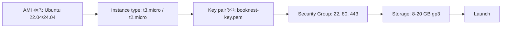
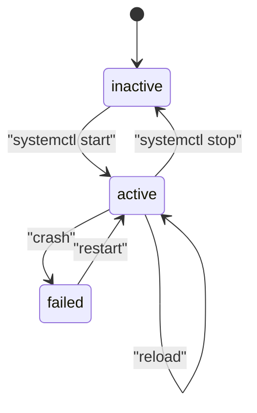
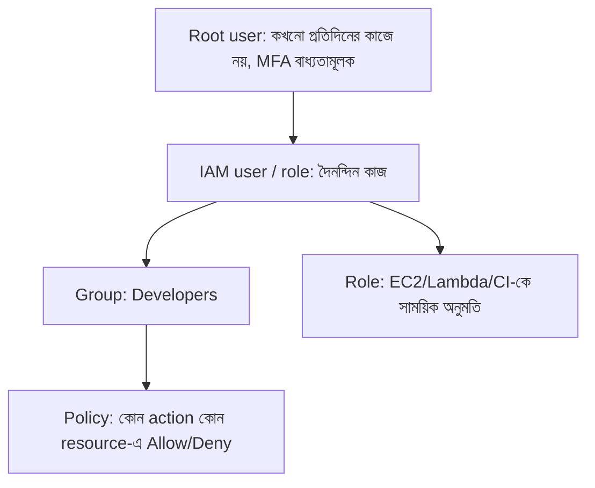
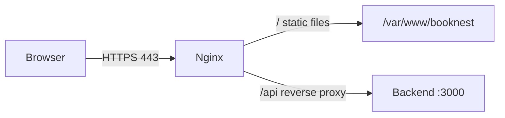
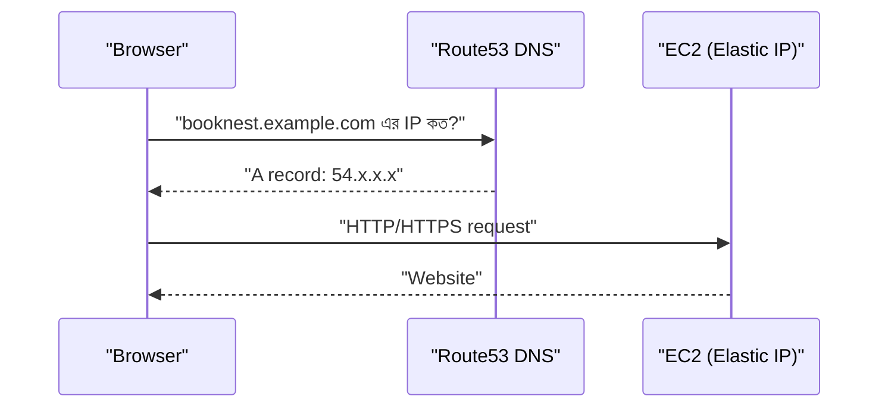
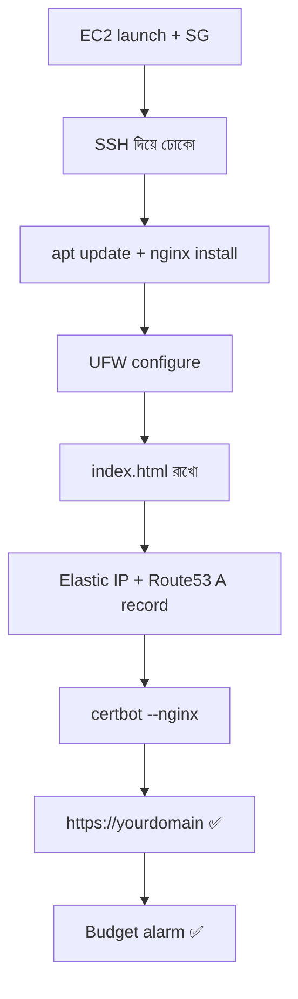

# Module 02 — Linux and AWS Fundamentals

> **Section 1 · Foundations: Linux, AWS & Git** · ২টি Live Class
> **Project:** My First Live Website
> **Goal:** End-to-end production deployment — EC2, UFW, Nginx, Route53, HTTPS।
> **Assignment ★:** নিজের domain-এ HTTPS দিয়ে একটা static site deploy করো, সাথে billing alarm বসাও।

---

## 📖 গল্প: ভাড়া বাড়ির সার্ভার

তানভীর ঠিক করল BookNest-কে একটা "স্থায়ী বাড়ি" দেবে। AWS হলো এক বিশাল **আবাসন কোম্পানি**:

- **EC2 instance** = ভাড়া নেওয়া একটা ফ্ল্যাট (virtual server)।
- **Security Group** = বিল্ডিংয়ের গেটের দারোয়ান — কোন দরজা (port) দিয়ে কে ঢুকতে পারবে।
- **Key pair** = ফ্ল্যাটের তালার চাবি। চাবি হারালে ঢোকা কঠিন; চাবি অন্যকে দিলে চুরি।
- **IAM** = কোম্পানির ID card সিস্টেম — কে কোন ঘরে ঢুকতে পারবে।
- **Route53** = ডাকঘরের ঠিকানা-বই — `booknest.com` লিখলে বলে দেয় ফ্ল্যাট নম্বর (IP) কত।
- **Nginx** = ফ্ল্যাটের রিসেপশনিস্ট — অতিথি এলে বলে "এই ফাইল নিন" বা "ভেতরের ম্যানেজারকে ডাকছি"।
- **Certbot / SSL** = সরকারি সিল — "এই ঠিকানা আসল, আর কথাবার্তা গোপন"।

---

# 🧩 Live Class 1 — AWS EC2 and Linux Fundamentals

## 1. EC2 Launch করার ধাপ



| উপাদান | কেন দরকার |
|---|---|
| **AMI** | OS-এর "ছাঁচ" — Ubuntu, Amazon Linux… |
| **Instance type** | CPU/RAM-এর সাইজ; ছোট দিয়ে শুরু = কম খরচ |
| **Key pair** | SSH দিয়ে ঢোকার প্রমাণ |
| **Security Group** | ভার্চুয়াল ফায়ারওয়াল (stateful) |
| **EBS volume** | সার্ভারের ডিস্ক |

### Security Group নিয়ম

| Port | Protocol | কার জন্য | কে ঢুকতে পারবে |
|---|---|---|---|
| 22 | SSH | অ্যাডমিন | **শুধু তোমার IP** (`x.x.x.x/32`), `0.0.0.0/0` নয়! |
| 80 | HTTP | ওয়েব | সবাই |
| 443 | HTTPS | ওয়েব | সবাই |

## 2. SSH দিয়ে ঢোকা

```bash
# .pem ফাইলের permission কঠিন করতে হয় — SSH নিজেই এটা চায়
# 400 = শুধু owner পড়তে পারবে; না করলে "UNPROTECTED PRIVATE KEY FILE" error
chmod 400 booknest-key.pem

# ubuntu = Ubuntu AMI-র default user; <PUBLIC_IP> = EC2-র public IP
ssh -i booknest-key.pem ubuntu@<PUBLIC_IP>
```

## 3. Linux Basics — প্রতিটা কমান্ড কেন?

```bash
pwd                      # এখন কোন ফোল্ডারে আছি
ls -la                   # সব ফাইল (hidden সহ) বিস্তারিত — permission ও owner দেখতে
cd /var/www              # ফোল্ডারে যাওয়া
mkdir -p ~/app/logs      # -p = মাঝের ফোল্ডার না থাকলেও বানাবে, থাকলে error দেবে না
cat file.txt             # ফাইল পড়া
less /var/log/syslog     # বড় ফাইল পড়া (q দিয়ে বের হও)
grep -i "error" app.log  # লগে "error" খোঁজা (-i = বড়/ছোট হাত গুরুত্বহীন)
tail -f app.log          # লাইভ লগ দেখা — সমস্যা debug করতে সবচেয়ে বেশি কাজে লাগে
```

### Package manager (apt)

```bash
sudo apt update              # প্যাকেজের নতুন তালিকা আনা
sudo apt upgrade -y          # ইনস্টল থাকা প্যাকেজ আপডেট
sudo apt install -y nginx    # নতুন সফটওয়্যার বসানো
apt list --installed | grep nginx   # ইনস্টল আছে কিনা যাচাই
```

### Process manager (systemd / systemctl)

systemd হলো সার্ভারের "ম্যানেজার" — সার্ভিস চালু/বন্ধ রাখে, রিবুটের পর নিজে থেকে চালু করে।

```bash
sudo systemctl status nginx     # চলছে কিনা, শেষ লগ কী
sudo systemctl start nginx      # এখনই চালু
sudo systemctl stop nginx       # বন্ধ
sudo systemctl restart nginx    # বন্ধ করে আবার চালু (config বদলালে)
sudo systemctl reload nginx     # downtime ছাড়াই config নতুন করে পড়া
sudo systemctl enable nginx     # সার্ভার রিবুটের পর অটো চালু হবে
journalctl -u nginx -n 50 --no-pager   # nginx সার্ভিসের শেষ ৫০ লাইন লগ
```



## 4. File Permissions ও Ownership

`ls -l` এর আউটপুট: `-rwxr-xr-- 1 ubuntu www-data 1200 Nov 1 app.sh`

```text
 -   rwx   r-x   r--
 │    │     │     └── অন্যান্য (others): শুধু পড়া
 │    │     └──────── গ্রুপ (www-data): পড়া + চালানো
 │    └────────────── মালিক (ubuntu): পড়া + লেখা + চালানো
 └─────────────────── ফাইল টাইপ (- = ফাইল, d = ফোল্ডার)
```

| সংখ্যা | অর্থ |
|---|---|
| r=4, w=2, x=1 | যোগ করে লেখা হয়: rwx=7, r-x=5, r--=4 |

```bash
chmod 755 deploy.sh        # মালিক সব পারে; বাকিরা পড়া+চালানো
chmod 600 secret.env       # শুধু মালিক পড়া/লেখা — secret ফাইলের জন্য আদর্শ
sudo chown ubuntu:www-data /var/www/booknest   # মালিক ও গ্রুপ বদল
# ❌ কখনো chmod 777 করবে না — "সবাই সব পারে" মানে security গর্ত
```

## 5. Environment Variables

```bash
export APP_ENV=production          # শুধু এই শেলে; বন্ধ করলে হারিয়ে যায়
echo $APP_ENV                      # মান দেখা
printenv | grep APP                # সব env থেকে ফিল্টার

# স্থায়ী করতে ~/.bashrc এ লেখো (শুধু non-secret মান!)
echo 'export APP_ENV=production' >> ~/.bashrc
source ~/.bashrc                   # এখনই কার্যকর করা
```

> Secret (DB password) `.bashrc`-এ নয় — পরে Secrets Manager/GitHub Secrets ব্যবহার করব।

## 6. Logs, Monitoring, Firewall (UFW), Cron

```bash
# --- Monitoring ---
top                      # লাইভ CPU/RAM (q দিয়ে বের হও); htop আরও সুন্দর
df -h                    # ডিস্কের কত % ভরা — ডিস্ক ফুল হলে অনেক সার্ভিস মরে
free -h                  # RAM
ss -tulnp                # কোন port-এ কোন প্রসেস শুনছে

# --- UFW (Uncomplicated Firewall): সার্ভারের ভেতরের দ্বিতীয় দারোয়ান ---
sudo ufw allow OpenSSH   # ⚠️ ENABLE করার আগে SSH allow করো, নইলে নিজেই বাইরে!
sudo ufw allow 80/tcp
sudo ufw allow 443/tcp
sudo ufw enable
sudo ufw status verbose
```

### Cronjob — সময়মতো কাজ

```text
 ┌──────── মিনিট (0-59)
 │ ┌────── ঘণ্টা (0-23)
 │ │ ┌──── মাসের দিন (1-31)
 │ │ │ ┌── মাস (1-12)
 │ │ │ │ ┌ সপ্তাহের দিন (0-6, 0=রবি)
 * * * * *  কমান্ড
```

```bash
crontab -e
# প্রতিদিন রাত ২টায় লগ ব্যাকআপ — কম ট্রাফিকের সময় বেছে নেওয়া হয়েছে
0 2 * * * /home/ubuntu/scripts/backup.sh >> /home/ubuntu/backup.log 2>&1
# >> ... 2>&1 = আউটপুট ও error দুটোই লগে জমাও, যাতে ব্যর্থ হলে কারণ দেখা যায়
```

## 7. 🤖 AI-assisted log reading

Rule: **AI-কে প্রশ্ন করো → উত্তর আসল log-এর সাথে মিলাও → তারপর fix।**

```bash
# লগ থেকে শুধু প্রাসঙ্গিক অংশ কেটে AI-কে দাও (secret/IP মাস্ক করে!)
sudo tail -n 40 /var/log/nginx/error.log
```
Prompt উদাহরণ: *"এই nginx error log পড়ে সম্ভাব্য ৩টা কারণ বলো, প্রতিটা যাচাই করার কমান্ডসহ। কোনো ফিক্স এখনই চালাতে বলবে না।"*

---

# 🧩 Live Class 2 — IAM, AWS CLI and Web Server Setup

## 8. IAM — কে কী করতে পারবে



**IAM best practices (পরীক্ষা ও ইন্টারভিউ দুটোতেই আসে):**

1. Root account-এ MFA চালু, প্রতিদিন root ব্যবহার নয়।
2. **Least privilege** — যতটুকু দরকার, ততটুকু।
3. মানুষের জন্য user/group; মেশিনের জন্য **role** (long-lived key নয়)।
4. Access key যত কম, তত ভালো; থাকলে নিয়মিত rotate।

### Policy নমুনা (একটা S3 বাকেট শুধু পড়া)

```json
{
  "Version": "2012-10-17",
  "Statement": [
    {
      "Effect": "Allow",
      "Action": ["s3:GetObject", "s3:ListBucket"],
      "Resource": [
        "arn:aws:s3:::booknest-assets",
        "arn:aws:s3:::booknest-assets/*"
      ]
    }
  ]
}
```
`Effect` = অনুমতি/নিষেধ, `Action` = কোন কাজ, `Resource` = কোন জিনিসের উপর। তিনটাই মিলে একটা নিয়ম।

## 9. AWS CLI

```bash
# CLI ইনস্টল (Ubuntu)
sudo apt install -y unzip
curl "https://awscli.amazonaws.com/awscli-exe-linux-x86_64.zip" -o awscliv2.zip
unzip awscliv2.zip && sudo ./aws/install

# configure: Access key ID, Secret, region, output — IAM user-এর key দিয়ে (root নয়!)
aws configure

# আমি কে? — প্রথম যাচাই, ভুল account-এ কাজ করছি কিনা বোঝা যায়
aws sts get-caller-identity

# EC2 তালিকা (table ফরম্যাট পড়তে সহজ)
aws ec2 describe-instances --query "Reservations[].Instances[].[InstanceId,State.Name,PublicIpAddress]" --output table
```

## 10. Nginx — Static Site ও Reverse Proxy

```bash
sudo apt install -y nginx
sudo mkdir -p /var/www/booknest
echo "<h1>BookNest is live!</h1>" | sudo tee /var/www/booknest/index.html
```

```nginx
# /etc/nginx/sites-available/booknest
server {
    listen 80;                         # HTTP port
    server_name booknest.example.com;  # কোন domain-এর জন্য এই ব্লক

    root /var/www/booknest;            # static ফাইল কোথায়
    index index.html;

    location / {
        try_files $uri $uri/ =404;     # ফাইল না পেলে 404
    }

    # Reverse proxy: /api এ আসা request ভেতরের backend (port 3000) কে দাও
    location /api/ {
        proxy_pass http://127.0.0.1:3000;
        proxy_set_header Host $host;                       # মূল hostname পাঠাও
        proxy_set_header X-Real-IP $remote_addr;           # আসল ক্লায়েন্ট IP
        proxy_set_header X-Forwarded-Proto $scheme;        # http না https
    }
}
```

```bash
sudo ln -s /etc/nginx/sites-available/booknest /etc/nginx/sites-enabled/   # সাইট চালু
sudo nginx -t                  # ⚠️ reload-এর আগে সবসময় syntax test
sudo systemctl reload nginx
```



## 11. Route53 + DNS



ধাপ: (1) Domain কেনো → (2) Hosted zone → (3) **Elastic IP** EC2-তে বাঁধো (নইলে stop/start-এ IP বদলায়) → (4) A record: `booknest.example.com → Elastic IP`।

| Record | কাজ |
|---|---|
| **A** | নাম → IPv4 |
| **CNAME** | নাম → আরেক নাম |
| **MX** | ইমেইল সার্ভার |
| **TXT** | যাচাই/SPF ইত্যাদি |

## 12. SSL — Certbot (Let's Encrypt)

```bash
sudo apt install -y certbot python3-certbot-nginx
# -d = কোন domain; certbot নিজে nginx config বদলে HTTPS বসিয়ে দেয় + HTTP→HTTPS redirect
sudo certbot --nginx -d booknest.example.com
sudo certbot renew --dry-run     # অটো-রিনিউ কাজ করছে কিনা পরীক্ষা (সার্টিফিকেট ৯০ দিনে মেয়াদ শেষ হয়)
```

## 13. AWS Budgets — day-one খরচ সুরক্ষা

ক্লাউডে ভুল করে একটা বড় instance চালু রেখে মাস শেষে বিল দেখে ঘাবড়ানো — অতি পরিচিত ঘটনা। তাই **প্রথম দিনেই**:

```bash
# Budget তৈরি (কনসোল থেকেও করা যায়): মাসিক $5 সীমা, ৮০% হলে ইমেইল alert
# Console: Billing → Budgets → Create budget → Cost budget → Monthly → $5 → Email alert at 80%
```
- Free tier usage alert চালু রাখো।
- Billing → Cost Explorer দেখার অভ্যাস করো।

---

## 🛠️ Project: My First Live Website — সম্পূর্ণ ফ্লো



## ⚠️ সাধারণ ভুল ও সমাধান

| সমস্যা | সম্ভাব্য কারণ | যাচাই |
|---|---|---|
| SSH timeout | SG-তে port 22 নেই / ভুল IP | SG inbound rules |
| SSH "Permission denied (publickey)" | ভুল user বা key | `ubuntu@` ঠিক আছে? `chmod 400`? |
| সাইট খোলে না | SG-তে 80 নেই / nginx বন্ধ / UFW | `systemctl status nginx`, `ufw status` |
| Domain কাজ করছে না | DNS propagate হয়নি / ভুল IP | `dig booknest.example.com` |
| certbot ফেল | DNS এখনো ঠিক নয় / 80 বন্ধ | আগে HTTP-তে সাইট খোলো |

## ✅ চেকলিস্ট

- [ ] EC2 চালু, SSH কাজ করছে
- [ ] UFW + Security Group ঠিকমতো
- [ ] Nginx static site দেখাচ্ছে
- [ ] Route53 → Elastic IP
- [ ] HTTPS (padlock) আছে
- [ ] Budget alarm বসানো

## 🎯 ইন্টারভিউ প্রশ্ন

1. Security Group আর NACL-এর পার্থক্য? (SG = stateful, instance-level; NACL = stateless, subnet-level)
2. `reload` আর `restart`-এর পার্থক্য?
3. Elastic IP কেন দরকার?
4. IAM user আর role-এর পার্থক্য?
5. `chmod 755` মানে কী?

## 🧠 সারসংক্ষেপ

Linux = সার্ভারের ভাষা; AWS = ভাড়ার জমি; Nginx = দরজা; DNS+SSL = ঠিকানা ও বিশ্বাস। এই চারটা মিললেই তোমার প্রথম **real live website**।

⬅️ [Module 01](./module-01-devops-in-the-ai-era.md) · ➡️ [Module 03](./module-03-git-workflows-and-ai-troubleshooting.md)
