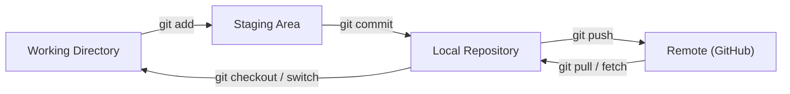
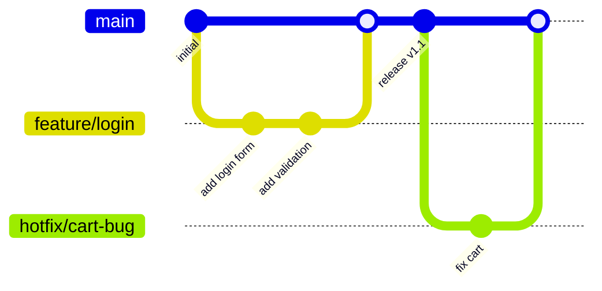
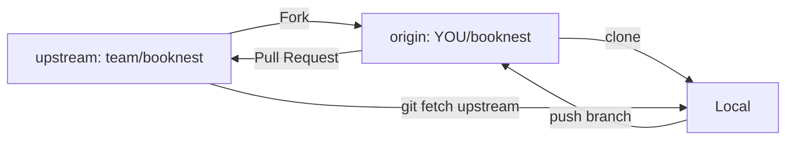
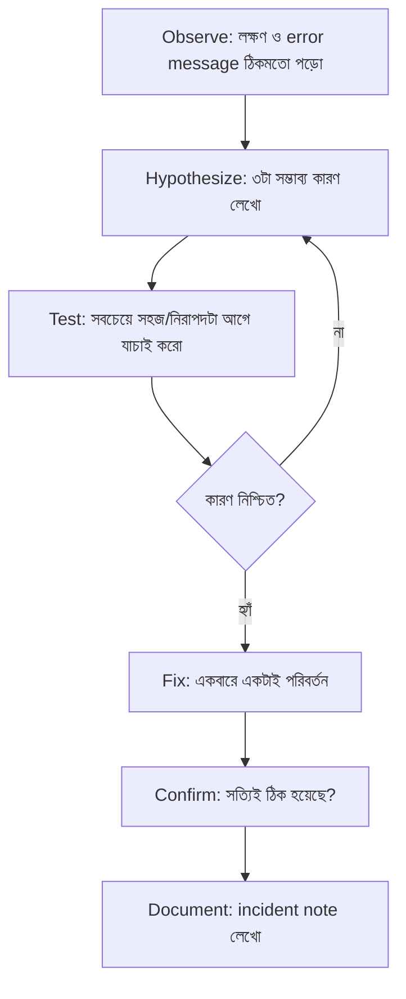
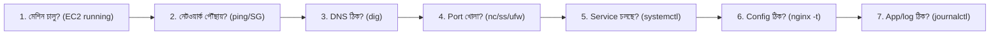

# Module 03 — Git Workflows and AI-Assisted Troubleshooting

> **Section 1 · Foundations: Linux, AWS & Git** · ২টি Live Class
> **Project:** Fix the Broken Server
> **Goal:** তিনটা ইচ্ছাকৃতভাবে ভাঙা server scenario সমাধান করা, আর AI-এর কোন পরামর্শ ঠিক ছিল ও কোনটা ভুল তা লিখে রাখা।
> **Assignment ★:** তিনটা incident note + branch protection সহ একটা repository যেখানে pull request workflow চলছে।

---

## 📖 গল্প: দলের খাতা আর ভাঙা তালা

BookNest-এ এখন তিনজন ডেভেলপার। সবাই সরাসরি `main` ব্রাঞ্চে লিখত। একদিন একজন ভুলে একটা অর্ধেক কাজ push করল — সাইট ভেঙে গেল, কে করল কেউ জানে না।

ঠিক হলো: **main হবে "পবিত্র খাতা"** — কেউ সরাসরি লিখতে পারবে না। কাজ করবে আলাদা পাতায় (branch), তারপর **Pull Request**-এ অন্যরা পড়ে অনুমোদন দিলে তবেই মূল খাতায় যাবে।

আরেকদিন সার্ভার ভেঙে গেল। তানভীর ঘাবড়ে AI-কে বলল "ঠিক করে দাও!" — AI একটা কমান্ড দিল, কাজ হলো না, আরেকটা... শেষে সার্ভার আরও বিগড়ে গেল। এবার শিখল **পদ্ধতিগত troubleshooting**: *দেখো → অনুমান করো → পরীক্ষা করো → নিশ্চিত হও।*

---

# 🧩 Live Class 1 — Git for Teams

## 1. Git-এর মূল ধারণা



| ধারণা | সহজ কথা |
|---|---|
| commit | একটা "সেভ পয়েন্ট" (বার্তাসহ) |
| branch | সমান্তরাল কাজের আলাদা পাতা |
| merge | দুই পাতা জোড়া |
| remote | GitHub-এ থাকা কপি |
| origin | তোমার remote-এর ডাকনাম |
| upstream | মূল (fork করা) repo |

## 2. Branching Strategy

### Trunk-based development
সবাই ছোট ছোট branch বানায়, দ্রুত (ঘণ্টা/দিন) `main`-এ merge। Feature flag ব্যবহার। **আধুনিক CI/CD-র জন্য সেরা।**

### GitFlow
`main`, `develop`, `feature/*`, `release/*`, `hotfix/*` — ভারী রিলিজ চক্রে উপযোগী, কিন্তু জটিল।



## 3. প্রতিদিনের Git workflow (কমান্ড + কারণ)

```bash
git clone git@github.com:team/booknest.git   # repo নামানো (SSH — বারবার password লাগে না)
cd booknest

git switch -c feature/add-search      # নতুন branch বানিয়ে সেখানে যাওয়া (main অক্ষত থাকে)

# ... কোড বদলাও ...
git status                            # কী কী বদলেছে
git diff                              # ঠিক কোন লাইন বদলেছে (commit-এর আগে নিজে review)
git add src/search.js                 # নির্দিষ্ট ফাইল stage (git add . এ ভুল ফাইল ঢোকার ঝুঁকি)
git commit -m "feat(search): add title search endpoint"

git push -u origin feature/add-search # -u = পরের বার শুধু `git push` লিখলেই চলবে
```

### Remote-এর সাথে সিঙ্ক

```bash
git fetch origin                # নতুন তথ্য আনো কিন্তু নিজের কাজে হাত দিও না
git rebase origin/main          # নিজের branch-কে main-এর মাথায় সাজাও (পরিষ্কার ইতিহাস)
# অথবা
git pull --rebase origin main   # fetch + rebase একসাথে
```

> **merge vs rebase:** merge ইতিহাস অক্ষত রাখে (merge commit তৈরি করে); rebase ইতিহাস সরল রেখায় সাজায়। **শেয়ার করা (push করা) branch-এ rebase কোরো না।**

## 4. Repository Roles, Fork & Upstream

| Role | কী পারে |
|---|---|
| Read | দেখা/clone |
| Triage | issue/PR ম্যানেজ |
| Write | push, branch তৈরি |
| Maintain | সেটিং কিছুটা |
| Admin | সব, repo মুছে ফেলা পর্যন্ত |

**Fork workflow** (open source-এ সাধারণ):

```bash
# GitHub-এ Fork বাটন চাপার পর নিজের fork clone করো
git clone git@github.com:YOU/booknest.git
cd booknest

# মূল repo-কে "upstream" নামে যুক্ত করো — যাতে মূল repo-র নতুন কাজ আনতে পারো
git remote add upstream git@github.com:team/booknest.git
git remote -v                           # origin ও upstream দুটোই দেখাবে

git fetch upstream
git switch main
git merge upstream/main                 # fork-কে মূল repo-র সাথে সমান রাখো
```



## 5. Branch Protection ও History Deletion সুরক্ষা

GitHub → Settings → Branches → Add rule (`main`):

- ✅ Require a pull request before merging
- ✅ Require approvals (১ বা বেশি)
- ✅ Require status checks to pass (CI পরে M06-এ যুক্ত হবে)
- ✅ Require conversation resolution
- ✅ Restrict who can push / **Do not allow force pushes**
- ✅ Do not allow deletions

> **কেন force push বন্ধ?** `git push --force` দূরবর্তী ইতিহাস মুছে নতুন ইতিহাস বসায় — সহকর্মীর কাজ গায়েব হতে পারে। Protection এটাকে সরাসরি আটকে দেয়।

## 6. Conventional Commits ও PR Template

```text
<type>(<scope>): <সংক্ষিপ্ত বিবরণ>

type: feat | fix | docs | style | refactor | test | chore | ci | perf
```

উদাহরণ:
- `feat(cart): add quantity selector`
- `fix(nginx): correct proxy_pass trailing slash`
- `ci: pin actions versions`

কেন? কারণ চেঞ্জলগ ও ভার্সন নম্বর **স্বয়ংক্রিয়** বানানো যায়।

```markdown
<!-- .github/pull_request_template.md -->
## কী বদলেছে?
<!-- সংক্ষেপে -->

## কেন?
<!-- সমস্যা / issue লিংক -->

## কীভাবে পরীক্ষা করেছি?
- [ ] Local-এ চালিয়েছি
- [ ] Test লিখেছি/চালিয়েছি

## Checklist
- [ ] Secrets নেই
- [ ] Docs আপডেট
- [ ] AI-generated হলে আমি লাইন-বাই-লাইন review করেছি
```

## 7. 🤖 AI-assisted PR Review: কী বিশ্বাস, কী নিজে দেখা

| AI-কে ভরসা করা যায় | নিজে দেখতেই হবে |
|---|---|
| সিনট্যাক্স/ typo / style | Business logic ঠিক কিনা |
| স্পষ্ট বাগ (null check ইত্যাদি) | Security: auth, secret, permission |
| PR সারাংশ লেখা | Performance/cost প্রভাব |
| টেস্ট কেসের আইডিয়া | AI যা "বানিয়ে" বলেছে (hallucinated API/flag) |

---

# 🧩 Live Class 2 — Break-Fix Lab: Debugging Linux and Network Issues with AI

## 8. Troubleshooting পদ্ধতি (সবচেয়ে বড় দক্ষতা)



> **সোনার নিয়ম:** একসাথে একাধিক জিনিস বদলাবে না — নইলে কোনটা কাজ করেছে বুঝবে না।

## 9. OSI মনে রেখে নেটওয়ার্ক ডিবাগ — নিচ থেকে উপরে



### টুলবক্স

```bash
ping -c 3 8.8.8.8                       # ইন্টারনেট পৌঁছায় কিনা (IP দিয়ে)
ping -c 3 google.com                    # পৌঁছায়, কিন্তু নাম-থেকে-IP (DNS) কাজ করছে কিনা
dig +short booknest.example.com         # domain কোন IP দেখাচ্ছে
nslookup booknest.example.com           # বিকল্প DNS চেক
curl -I http://localhost                # সার্ভার নিজে নিজের কাছে সাড়া দেয়? (শুধু header)
curl -v https://booknest.example.com    # -v: ধাপে ধাপে TLS/HTTP দেখা
nc -zv <IP> 80                          # নির্দিষ্ট port খোলা কিনা
ss -tulnp | grep :80                    # কোন প্রসেস 80 পোর্টে শুনছে
sudo ufw status verbose                 # firewall নিয়ম
sudo nginx -t                           # nginx config syntax
sudo journalctl -u nginx -n 100 --no-pager
sudo tail -n 50 /var/log/nginx/error.log
df -h; free -h                          # ডিস্ক/র‍্যাম ফুল?
```

## 10. তিনটা Break-Fix দৃশ্য (অনুশীলন)

### 🔧 Scenario A — Nginx misconfiguration

**লক্ষণ:** `systemctl status nginx` → `failed`।

```bash
sudo nginx -t
# nginx: [emerg] unexpected "}" in /etc/nginx/sites-enabled/booknest:14
```
**ব্যাখ্যা:** config-এ ব্র্যাকেট বেমিল। **ফিক্স:** ১৪ নম্বর লাইনের কাছে ঠিক করো → `nginx -t` পাস → `reload`।
**শিক্ষা:** `reload`-এর আগে সবসময় `nginx -t`।

### 🔧 Scenario B — DNS সমস্যা

**লক্ষণ:** `curl http://<IP>` কাজ করে, কিন্তু `curl http://booknest.example.com` ফেল।

```bash
dig +short booknest.example.com    # খালি বা ভুল IP
```
**কারণ:** Route53 A record ভুল/নেই, বা পুরনো IP (Elastic IP বাঁধা হয়নি, instance restart-এ IP বদলেছে)।
**ফিক্স:** সঠিক Elastic IP-তে A record আপডেট। TTL-এর জন্য অপেক্ষা।

### 🔧 Scenario C — File permission / Firewall

**লক্ষণ:** `403 Forbidden` বা বাইরে থেকে timeout।

```bash
sudo tail /var/log/nginx/error.log     # "(13: Permission denied)" দেখা যায়?
ls -ld /var/www /var/www/booknest      # ডিরেক্টরিতে execute (x) permission আছে?
sudo ufw status                        # 80/443 allow?
```
**ফিক্স:** `sudo chmod -R o+rX /var/www/booknest` (পড়া + ডিরেক্টরি ঢোকার অনুমতি) / `sudo ufw allow 80/tcp`; AWS Security Group-ও যাচাই।

## 11. AI Agent দিয়ে ডিবাগ — নিরাপদ প্রম্পট

```text
আমার Ubuntu server-এ nginx চলছে না। নিচে `nginx -t` ও `journalctl` এর আউটপুট দিলাম
(secret/IP মাস্ক করা আছে)। 
১. সম্ভাব্য ৩টা কারণ ranking সহ বলো।
২. প্রতিটা যাচাইয়ের READ-ONLY কমান্ড দাও।
৩. আমি বলার আগে কোনো পরিবর্তনের কমান্ড দিও না।
```

### AI-র উত্তর যাচাইয়ের টেবিল (Assignment-এ এটাই লিখবে)

| AI যা বলল | আসল log/docs কী বলল | সঠিক / ভুল | শিক্ষা |
|---|---|---|---|
| "port 80 খুলে দাও" | nginx config-এই সমস্যা, port ঠিক ছিল | ❌ | আগে `nginx -t` |
| "`sudo systemctl restart nginx`" | config ঠিক করার পরেই কাজ করল | ⚠️ আংশিক | ক্রম গুরুত্বপূর্ণ |

## 12. Incident Note টেমপ্লেট

```markdown
# Incident: <শিরোনাম>
- **Date/Time:**
- **Symptom (লক্ষণ):**
- **Impact:**
- **Investigation (কী কী দেখেছি):**
- **Root cause:**
- **Fix:**
- **AI সাহায্য:** কী বলেছিল / সঠিক ছিল কিনা
- **Prevention (ভবিষ্যতে এড়াতে):**
```

---

## ✅ চেকলিস্ট

- [ ] Branch protection চালু (PR ছাড়া main-এ push হয় না)
- [ ] PR template + conventional commit চর্চা
- [ ] Fork + upstream সেটআপ বুঝেছি
- [ ] ৩টা incident note লেখা
- [ ] AI-র ভুল/ঠিক উত্তরের তালিকা আছে

## 🎯 ইন্টারভিউ প্রশ্ন

1. `git merge` vs `git rebase`?
2. `git fetch` vs `git pull`?
3. Trunk-based development কী? কেন CI/CD-র সাথে মানানসই?
4. "Website খুলছে না" — কীভাবে ধাপে ধাপে ডিবাগ করবে?
5. `git revert` vs `git reset` — shared branch-এ কোনটা নিরাপদ? (revert)

## 🧠 সারসংক্ষেপ

Git = দলের নিরাপদ খাতা; PR = অনুমোদনের দরজা; Troubleshooting = *পর্যবেক্ষণ → অনুমান → পরীক্ষা → নিশ্চিতকরণ*। AI একজন দ্রুত সহকারী, কিন্তু **আসল log-ই সত্যের উৎস**।

⬅️ [Module 02](./module-02-linux-and-aws-fundamentals.md) · ➡️ [Module 04](./module-04-three-tier-application-on-a-single-instance.md)
