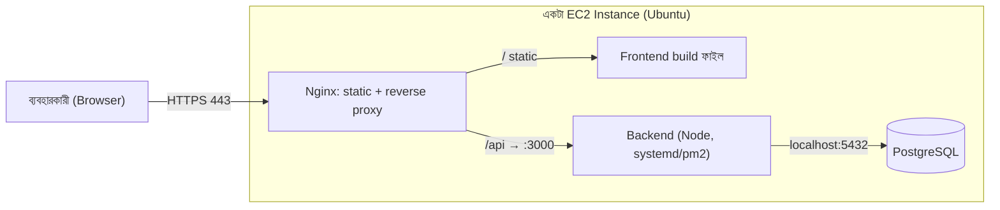
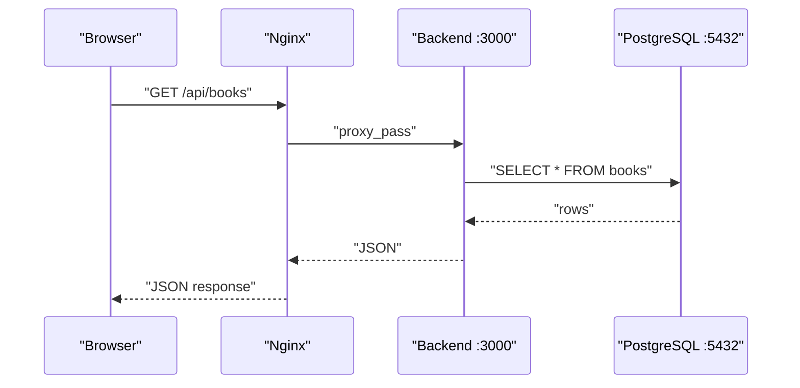
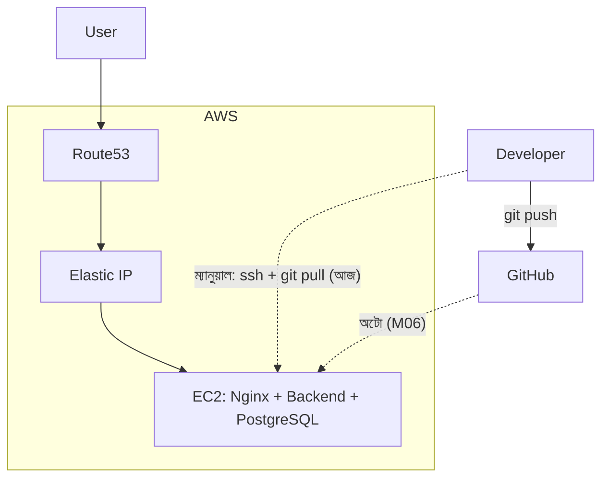

# Module 04 — Deploying a Three-Tier Application on a Single Instance

> **Section 1 · Foundations: Linux, AWS & Git** · ২টি Live Class
> **Project:** Launch and Auto-Deploy a Full App (এই প্রজেক্ট Module 06-এ চলবে)
> **Goal:** AWS-এ একটা production-ready three-tier application deploy ও manage করা। **এই অ্যাপই কোর্সের বাকি অংশের project thread।**
> **Assignment ★:** Three-tier deployment + AI দিয়ে বানানো, কিন্তু তোমার review করা architecture README।

> 📌 **নোট:** কোর্সের demo app-এর স্ট্যাক ইন্সট্রাক্টর নির্ধারণ করবেন। এই নোটে উদাহরণ হিসেবে **React (frontend) + NestJS/Node (backend) + PostgreSQL (database)** ধরেছি। স্ট্যাক বদলালেও ধারণা, ধাপ ও আর্কিটেকচার একই।

---

## 📖 গল্প: তিন তলার বাড়ি

BookNest একটা **তিনতলা বাড়ি**:

- **নিচতলা — Database (PostgreSQL):** ভল্টে বই ও গ্রাহকের তথ্য। সরাসরি রাস্তা থেকে ঢোকা যায় না।
- **দোতলা — Backend (API):** ম্যানেজার। "এই বইয়ের দাম কত?" — ভল্ট থেকে এনে দেয়, নিয়ম মানে।
- **তিনতলা — Frontend:** শোরুম। গ্রাহক যা দেখেন, ক্লিক করেন।

গ্রাহক শোরুমে আসেন → শোরুম ম্যানেজারকে বলে → ম্যানেজার ভল্ট খোলে। **গ্রাহক কখনো সরাসরি ভল্টে যান না।** এই বিভাজনই three-tier।

আজ তানভীর তিনটা তলাই **একটা বাড়িতে (একটা EC2-তে)** তুলবে। পরে (M08) ভাগ করে আলাদা বাড়িতে সরাবে।

---

# 🧩 Live Class 1 — Three-Tier Architecture and Application Setup

## 1. কেন তিন স্তর?

| স্তর | দায়িত্ব | কেন আলাদা? |
|---|---|---|
| Presentation (Frontend) | UI, ব্রাউজারে চলে | UI বদলালে ব্যাকএন্ড ছুঁতে হয় না |
| Application (Backend) | Business logic, API, auth | আলাদা scale/test/security |
| Data (Database) | স্থায়ী তথ্য | সবচেয়ে সুরক্ষিত; সরাসরি এক্সেস নয় |

## 2. Single-Instance আর্কিটেকচার (আজকের লক্ষ্য)



**অনুরোধের ভ্রমণ (Request flow):**



## 3. Tech Stack Overview — Database Deep Dive

### 3.1 PostgreSQL ইনস্টল ও সেটআপ

```bash
sudo apt update
sudo apt install -y postgresql postgresql-contrib   # PostgreSQL সার্ভার ও এক্সটেনশন
sudo systemctl enable --now postgresql              # চালু + রিবুটে অটো-স্টার্ট একসাথে

# postgres ইউজার হয়ে psql shell-এ ঢোকা (শুরুতে এটাই সুপার-ইউজার)
sudo -u postgres psql
```

```sql
-- অ্যাপের জন্য আলাদা ইউজার: কখনো 'postgres' superuser দিয়ে অ্যাপ চালাবে না (least privilege)
CREATE USER booknest_app WITH PASSWORD 'CHANGE_ME_STRONG';   -- আসল পাসওয়ার্ড কোড/chat-এ নয়!

-- অ্যাপের নিজস্ব ডেটাবেস
CREATE DATABASE booknest OWNER booknest_app;

-- ডেটাবেসে ঢুকে টেবিল বানানো
\c booknest

CREATE TABLE books (
    id          SERIAL PRIMARY KEY,           -- অটো-বাড়ন্ত ইউনিক আইডি
    title       VARCHAR(200) NOT NULL,        -- নাম ছাড়া বই হয় না
    author      VARCHAR(120) NOT NULL,
    price       NUMERIC(10,2) NOT NULL CHECK (price >= 0),  -- ঋণাত্মক দাম আটকায়
    created_at  TIMESTAMPTZ DEFAULT NOW()     -- কখন যুক্ত হয়েছে
);

INSERT INTO books (title, author, price) VALUES
('Pather Panchali', 'Bibhutibhushan Bandyopadhyay', 350.00);

\q
```

### 3.2 কেন localhost-only?

PostgreSQL ডিফল্টে শুধু `localhost` শোনে — **এটা ভালো**। Single-instance-এ backend ও DB একই মেশিনে, তাই বাইরে খোলার দরকারই নেই।

```bash
# যাচাই: 127.0.0.1:5432 এ শুনছে, 0.0.0.0 এ নয়
ss -tulnp | grep 5432
```
> ❌ কখনো Security Group-এ 5432 `0.0.0.0/0` খুলবে না।

## 4. Backend বাস্তবায়ন

### 4.1 Node ও কোড সংগ্রহ

```bash
curl -fsSL https://deb.nodesource.com/setup_20.x | sudo -E bash -
sudo apt install -y nodejs

cd ~ && git clone <backend-repo-url> booknest-backend
cd booknest-backend
npm ci          # package-lock.json অনুযায়ী হুবহু একই ভার্সন (npm install-এর চেয়ে নির্ভরযোগ্য, CI-তে পছন্দের)
```

### 4.2 Environment variable (`.env`)

```bash
# ~/booknest-backend/.env  —  ⚠️ এই ফাইল Git-এ যাবে না (.gitignore-এ আছে)
cat > .env <<'EOF'
NODE_ENV=production
PORT=3000
DB_HOST=127.0.0.1
DB_PORT=5432
DB_USER=booknest_app
DB_PASSWORD=CHANGE_ME_STRONG
DB_NAME=booknest
EOF
chmod 600 .env     # শুধু মালিক পড়তে পারবে — secret ফাইলের নিরাপত্তা
```

### 4.3 NestJS-এ DB সংযোগ (উদাহরণ)

```ts
// src/app.module.ts
import { Module } from '@nestjs/common';
import { ConfigModule, ConfigService } from '@nestjs/config';
import { TypeOrmModule } from '@nestjs/typeorm';

@Module({
  imports: [
    // .env ফাইল পড়ে process.env-এ রাখে; isGlobal = সব মডিউলে ConfigService পাওয়া যাবে
    ConfigModule.forRoot({ isGlobal: true }),

    // ConfigService থেকে মান পড়ে DB কানেকশন বানায় — হার্ডকোড করি না,
    // কারণ dev/staging/prod-এ মান আলাদা এবং secret কোডে থাকা বিপজ্জনক
    TypeOrmModule.forRootAsync({
      inject: [ConfigService],
      useFactory: (cfg: ConfigService) => ({
        type: 'postgres',
        host: cfg.get<string>('DB_HOST'),
        port: cfg.get<number>('DB_PORT'),
        username: cfg.get<string>('DB_USER'),
        password: cfg.get<string>('DB_PASSWORD'),
        database: cfg.get<string>('DB_NAME'),
        autoLoadEntities: true,
        synchronize: false, // production-এ false! true হলে স্কিমা নিজে বদলে ডেটা হারাতে পারে
      }),
    }),
  ],
})
export class AppModule {}
```

### 4.4 Health endpoint — DevOps-এর সবচেয়ে কাজের ছোট জিনিস

```ts
// src/health.controller.ts
import { Controller, Get } from '@nestjs/common';

@Controller('health')
export class HealthController {
  // Load balancer / monitoring এই URL ডেকে বোঝে অ্যাপ বেঁচে আছে কিনা
  @Get()
  check() {
    return { status: 'ok', time: new Date().toISOString() };
  }
}
```

### 4.5 Backend-কে systemd সার্ভিস বানানো

কেন? `node main.js` টার্মিনালে চালালে SSH বন্ধ = অ্যাপ বন্ধ। systemd অ্যাপকে ব্যাকগ্রাউন্ডে রাখে, ক্র্যাশ করলে আবার চালায়।

```bash
npm run build     # TypeScript → dist/ ফোল্ডারে JavaScript
```

```ini
# /etc/systemd/system/booknest-backend.service
[Unit]
Description=BookNest Backend API
After=network.target postgresql.service      # নেটওয়ার্ক ও DB চালু হওয়ার পর শুরু

[Service]
Type=simple
User=ubuntu                                  # root নয় — least privilege
WorkingDirectory=/home/ubuntu/booknest-backend
EnvironmentFile=/home/ubuntu/booknest-backend/.env   # secret এখান থেকে পড়ে
ExecStart=/usr/bin/node dist/main.js
Restart=on-failure                           # ক্র্যাশ হলে আবার চালু
RestartSec=5                                 # ৫ সেকেন্ড অপেক্ষা (ঘন ঘন লুপ এড়াতে)

[Install]
WantedBy=multi-user.target
```

```bash
sudo systemctl daemon-reload                  # নতুন unit ফাইল চেনাও
sudo systemctl enable --now booknest-backend  # চালু + অটো-স্টার্ট
curl http://127.0.0.1:3000/health             # {"status":"ok",...}
journalctl -u booknest-backend -f             # লাইভ লগ
```

---

# 🧩 Live Class 2 — Frontend Development and AWS Deployment

## 5. Frontend আর্কিটেকচার

React অ্যাপ ব্রাউজারে চলে। `npm run build` **static ফাইল** (HTML/CSS/JS) বানায় — Nginx এগুলো পরিবেশন করবে। **সার্ভারে Node দিয়ে frontend চালানোর দরকার নেই।**

```bash
cd ~ && git clone <frontend-repo-url> booknest-frontend
cd booknest-frontend
npm ci
# API-র ঠিকানা বিল্ড-টাইমে ঢোকে (Vite হলে VITE_ প্রিফিক্স, CRA হলে REACT_APP_)
# '/api' রিলেটিভ রাখা ভালো: Nginx একই domain থেকে proxy করবে, CORS ঝামেলা কমে
echo "VITE_API_URL=/api" > .env.production
npm run build            # dist/ (বা build/) ফোল্ডার তৈরি
sudo mkdir -p /var/www/booknest
sudo cp -r dist/* /var/www/booknest/
```

## 6. Nginx — সম্পূর্ণ কনফিগ

```nginx
# /etc/nginx/sites-available/booknest
server {
    listen 80;
    server_name booknest.example.com;

    root /var/www/booknest;
    index index.html;

    # SPA (Single Page App): React Router-এর URL যেন রিফ্রেশে 404 না দেয়
    location / {
        try_files $uri /index.html;
    }

    # API → backend
    location /api/ {
        proxy_pass http://127.0.0.1:3000/;      # শেষের / গুরুত্বপূর্ণ: /api/books → /books
        proxy_set_header Host $host;
        proxy_set_header X-Real-IP $remote_addr;
        proxy_set_header X-Forwarded-For $proxy_add_x_forwarded_for;
        proxy_set_header X-Forwarded-Proto $scheme;
    }

    # স্ট্যাটিক অ্যাসেট ক্যাশ — ব্রাউজার বারবার একই ফাইল ডাউনলোড করবে না
    location ~* \.(js|css|png|jpg|svg|woff2)$ {
        expires 7d;
        add_header Cache-Control "public";
    }
}
```

```bash
sudo ln -sf /etc/nginx/sites-available/booknest /etc/nginx/sites-enabled/booknest
sudo rm -f /etc/nginx/sites-enabled/default    # ডিফল্ট পেজ সরাও
sudo nginx -t && sudo systemctl reload nginx
sudo certbot --nginx -d booknest.example.com   # HTTPS (Module 02)
```

> ⚠️ `proxy_pass http://127.0.0.1:3000/;` (শেষে `/`) বনাম `http://127.0.0.1:3000;` (শেষে নেই) — আচরণ আলাদা। প্রথমটা `/api` অংশ কেটে পাঠায়, দ্বিতীয়টা পুরো path পাঠায়। এটা Break-Fix-এ খুব আসে।

## 7. আপডেট করা ও পুরো আর্কিটেকচার

```bash
# frontend আপডেট ফ্লো (এটাই Module 06-এ অটোমেট করব)
cd ~/booknest-frontend && git pull && npm ci && npm run build
sudo rsync -a --delete dist/ /var/www/booknest/    # --delete: পুরনো ফাইল সরায়, নতুনটা আনে

# backend আপডেট ফ্লো
cd ~/booknest-backend && git pull && npm ci && npm run build
sudo systemctl restart booknest-backend
curl -f http://127.0.0.1:3000/health && echo "OK"
```

**পরিপূর্ণ চিত্র:**



## 8. 🤖 AI দিয়ে Architecture Diagram ও README

**কাজের ধাপ (Assignment):**
1. AI-কে বলো: *"নিচের স্ট্যাক ও ফোল্ডার স্ট্রাকচার দেখে Mermaid আর্কিটেকচার ডায়াগ্রাম ও README খসড়া লেখো।"*
2. **নিজে পড়ে মিলাও:** port নম্বর, কোন কম্পোনেন্ট কার সাথে কথা বলে, secret আছে কিনা।
3. ভুল ঠিক করো — যেমন AI প্রায়ই লেখে "DB পাবলিক", "Redis আছে" (তোমার অ্যাপে নেই)।

```markdown
# BookNest — Architecture README (টেমপ্লেট)

## Overview
## Architecture diagram (Mermaid)
## Components & ports
| Component | Tech | Port | Exposed? |
|---|---|---|---|
| Nginx | nginx | 80/443 | Public |
| Backend | NestJS | 3000 | localhost only |
| DB | PostgreSQL | 5432 | localhost only |

## How to deploy
## Environment variables (names only — NO values)
## Troubleshooting
## Reviewed by: <তোমার review নোট — AI কী ভুল করেছিল>
```

## ⚠️ সাধারণ ভুল

| সমস্যা | কারণ | সমাধান |
|---|---|---|
| `502 Bad Gateway` | Backend চলছে না / ভুল port | `systemctl status booknest-backend`, `curl :3000/health` |
| DB connection refused | PostgreSQL বন্ধ / ভুল ইউজার-পাসওয়ার্ড | `systemctl status postgresql`, `.env` মিলাও |
| React রিফ্রেশে 404 | `try_files ... /index.html` নেই | Nginx `location /` ঠিক করো |
| CORS error | ভিন্ন origin থেকে API কল | Nginx proxy ব্যবহার / backend CORS config |
| Backend reboot-এর পর বন্ধ | `systemctl enable` করা হয়নি | `enable --now` |
| `.env` পড়ছে না | `EnvironmentFile` পাথ ভুল | service ফাইল ঠিক করে `daemon-reload` |

## ✅ চেকলিস্ট

- [ ] PostgreSQL চালু; অ্যাপের জন্য আলাদা ইউজার
- [ ] Backend systemd সার্ভিস হিসেবে চলছে; `/health` ঠিক
- [ ] Frontend build `/var/www/booknest`-এ
- [ ] Nginx: static + `/api` proxy + HTTPS
- [ ] DB পোর্ট বাইরে বন্ধ
- [ ] README + architecture diagram (AI-খসড়া, তোমার review করা)

## 🎯 ইন্টারভিউ প্রশ্ন

1. Three-tier আর monolith-এর পার্থক্য? তিন স্তর আলাদা করার সুবিধা কী?
2. Reverse proxy কী? কেন Nginx সামনে রাখি?
3. DB-কে public করা কেন বিপজ্জনক?
4. `npm ci` আর `npm install`-এর পার্থক্য?
5. systemd দিয়ে অ্যাপ চালানোর সুবিধা কী?
6. Single instance-এর সীমাবদ্ধতা কী? (SPOF, scale করা কঠিন, DB ও অ্যাপ রিসোর্স ভাগাভাগি)

## 🧠 সারসংক্ষেপ

তিন তলা: **DB (ভল্ট) ← Backend (ম্যানেজার) ← Frontend (শোরুম)**, সামনে Nginx (রিসেপশন)। আজ সব একটা বাড়িতে — সহজ কিন্তু একমাত্র ব্যর্থতা-বিন্দু (SPOF)। এই অ্যাপই কোর্সের বাকি অংশে CI/CD, VPC, Terraform, Docker, Kubernetes-এ রূপান্তরিত হবে।

⬅️ [Module 03](./module-03-git-workflows-and-ai-troubleshooting.md) · ➡️ [Module 05 (Exam Week 1)](./module-05-exam-week-1.md)
