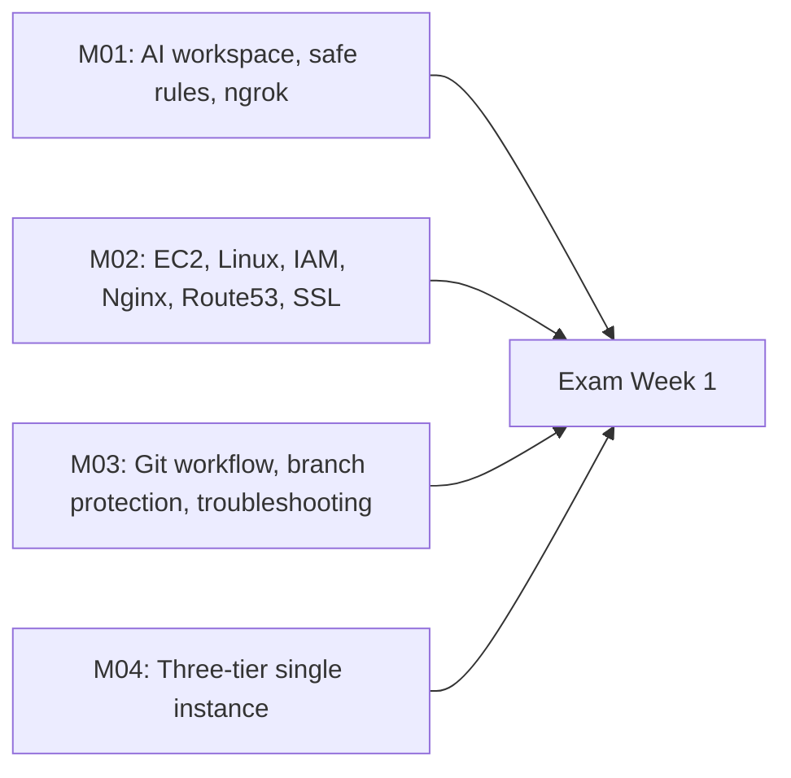

# Module 05 — Exam Week 1

> **Section 1 · Foundations** · এক্সাম উইক
> **কভার করে:** Module 01 – Module 04
> **ধরন:** একটা বড় অ্যাসাইনমেন্ট + লাইভ টেস্ট। **ঝালিয়ে নিতে পারবে নিজেকে।**

---

## 📖 গল্প: প্রথম পরীক্ষা

তানভীরের মেন্টর বললেন, "এবার তোমার বানানো BookNest আমি নিজে ভেঙে দেখব — আর তুমি ঠিক করবে।" পরীক্ষা মুখস্থের নয়; **হাতে-কলমে ঠিক করার**। তাই এই সপ্তাহে নতুন কিছু শেখা নেই — আগের চার মডিউল নিজের হাতে একবার পুরোটা ঘুরে আসার সপ্তাহ।

---

## 1. কী কী প্রস্তুত থাকতে হবে (Map)



## 2. শূন্য থেকে নিজে করার প্র্যাকটিস (Mock Lab)

নিজেকে সময় ধরে পরীক্ষা নাও (লক্ষ্য: ২ ঘণ্টা):

1. একটা নতুন EC2 তোলো, SG-তে শুধু 22 (তোমার IP), 80, 443।
2. UFW + Nginx বসাও।
3. PostgreSQL, ব্যাকএন্ড (systemd), ফ্রন্টএন্ড build ও Nginx কনফিগ।
4. Domain + HTTPS।
5. `main` ব্রাঞ্চ protect করো, একটা PR দিয়ে ছোট বদল merge করো।
6. কেউ ইচ্ছে করে ভেঙে দিলে (Nginx config, DNS, permission) — ঠিক করে incident note লেখো।

## 3. টপিক-ভিত্তিক রিভিশন চেকলিস্ট

### Linux ও AWS
- [ ] `systemctl` start/stop/enable/status/reload পার্থক্য
- [ ] `chmod`, `chown` সংখ্যা/অক্ষরে পড়তে পারি
- [ ] `ss`, `df`, `free`, `journalctl`, `tail -f` ব্যবহার জানি
- [ ] SG বনাম UFW; কেন দুটোই
- [ ] IAM: user/group/role/policy; least privilege
- [ ] Elastic IP কেন; Route53 A record
- [ ] Certbot ও auto-renew

### Git
- [ ] branch → commit → push → PR → merge
- [ ] `merge` বনাম `rebase`; `fetch` বনাম `pull`
- [ ] fork + upstream
- [ ] branch protection কী কী আটকায়

### Three-tier
- [ ] request flow মুখে বলতে পারি (Browser → Nginx → Backend → DB)
- [ ] `.env` কেন Git-এ নয়
- [ ] DB পোর্ট কেন বাইরে বন্ধ
- [ ] `/health` endpoint কী কাজে

### AI ব্যবহার
- [ ] Safe AI rules মুখস্থ নয়, **কারণসহ** বুঝি
- [ ] AI-র উত্তর যাচাইয়ের অভ্যাস

## 4. দ্রুত ডিবাগ ক্রম (পরীক্ষায় আটকে গেলে)

```text
EC2 running? → SG port? → DNS (dig)? → UFW? → service active? → config test (nginx -t)? → logs (journalctl)?
```

## 5. সম্ভাব্য মৌখিক/লিখিত প্রশ্ন

1. Browser-এ URL লিখে Enter চাপার পর থেকে পেজ আসা পর্যন্ত কী কী ঘটে? (DNS → TCP → TLS → HTTP → Nginx → Backend → DB)
2. `502`, `403`, `404`, `504` — প্রতিটার সম্ভাব্য কারণ?
3. SSH-এ ঢুকতে পারছ না — কী কী পরীক্ষা করবে?
4. Branch protection কেন, কীভাবে?
5. AI তোমাকে `chmod -R 777 /var/www` করতে বলল — কী করবে?

## 6. পরীক্ষা-পরবর্তী

নিজের ভুলগুলো `exam-1-mistakes.md` নামে লিখে রাখো — **একই ভুল দ্বিতীয়বার করলে সেটা অভ্যাস।** এই তালিকা ইন্টারভিউয়ের আগের রাতে সবচেয়ে কাজে লাগবে।

➡️ পরের সেকশন: [Module 06 — CI/CD with GitHub Actions](../section-2-cicd-observability-iac/module-06-cicd-with-github-actions.md)
