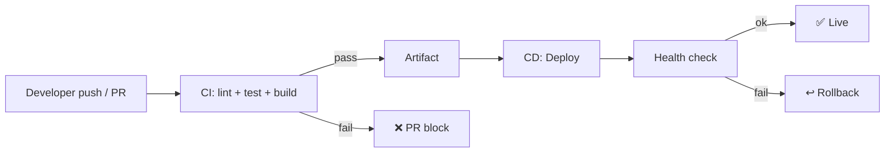
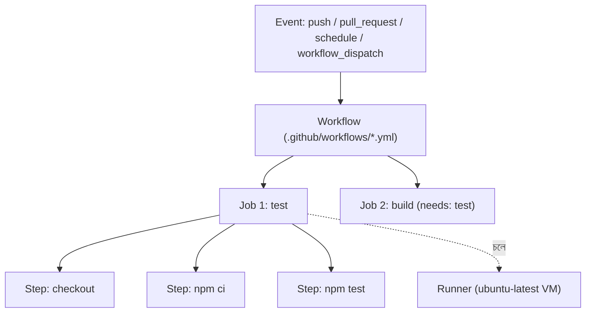
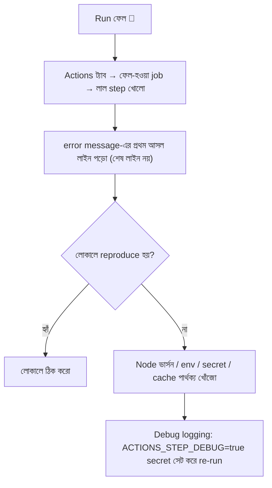
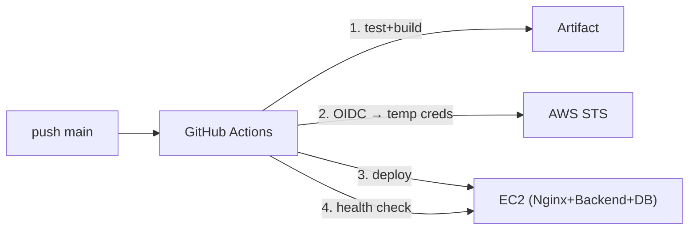
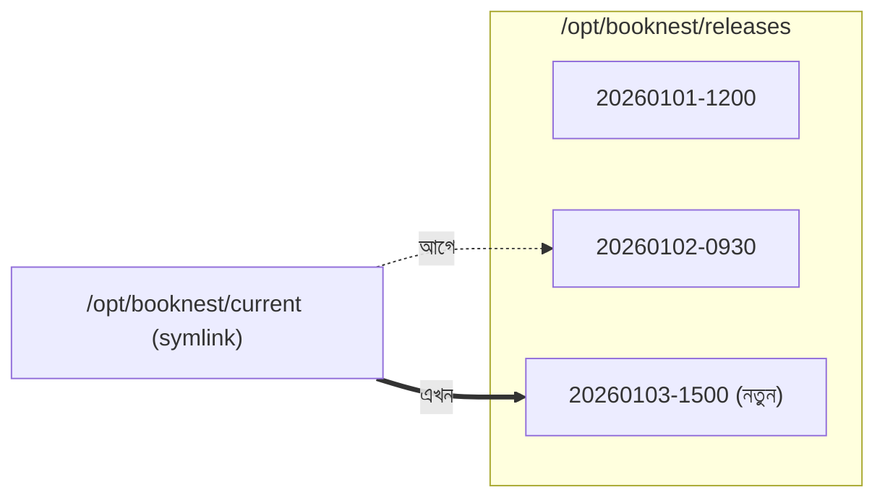
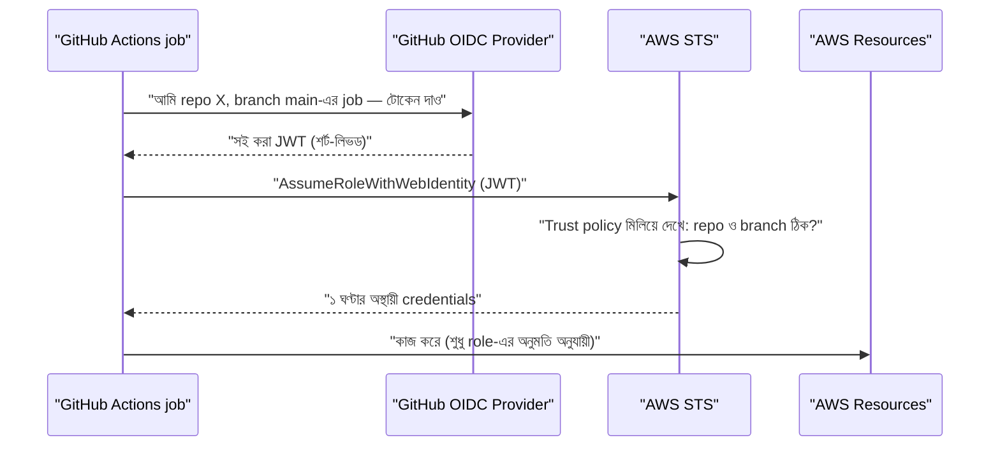
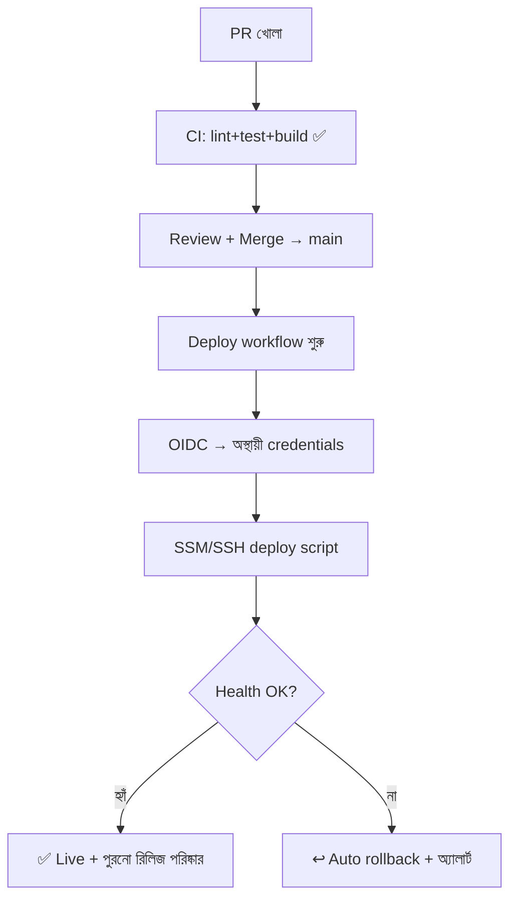

# Module 06 — CI/CD with GitHub Actions for the Three-Tier Application

> **Section 2 · CI/CD, Observability & Infrastructure as Code** · ২টি Live Class
> **Project:** Launch and Auto-Deploy a Full App
> **Goal:** Three-tier অ্যাপের জন্য নিরাপদ, স্বয়ংক্রিয় CI/CD pipeline — **keyless AWS authentication** সহ।
> **Assignment ★:** OIDC, pinned actions আর documented rollback সহ একটা pipeline।

---

## 📖 গল্প: হাতে ডেলিভারি বনাম কনভেয়ার বেল্ট

আগে তানভীর প্রতিবার কোড বদলালে: SSH → `git pull` → `npm ci` → build → restart। একদিন তাড়াহুড়োয় `npm ci` ভুলে গেল, সাইট ভেঙে গেল। আরেকদিন ভুল সার্ভারে ঢুকে গেল।

এবার সে একটা **কনভেয়ার বেল্ট** বানাল: কোড `main`-এ merge হলেই → বেল্ট নিজে test চালায়, build করে, সার্ভারে পাঠায়, health দেখে, আর গোলমাল হলে আগের ভার্সনে ফিরে যায়। মানুষ ভুল করে; বেল্ট প্রতিবার একইভাবে চলে।

আর AWS-এর **চাবি** নিয়ে গল্প: আগে সে GitHub-এ AWS access key রেখেছিল — "স্থায়ী চাবি"। চাবি লিক হলে চোর যখন খুশি ঢুকতে পারে। এখন সে **OIDC** শিখেছে — GitHub প্রতিবার এক-ব্যবহারের *টিকিট* দেয়, AWS টিকিট যাচাই করে ১ ঘণ্টার অস্থায়ী চাবি দেয়। রাখার মতো স্থায়ী চাবিই নেই।

---

# 🧩 Live Class 1 — GitHub Actions Fundamentals

## 1. CI/CD কী ও কেন?

| | কী করে | লাভ |
|---|---|---|
| **CI** (Continuous Integration) | প্রতি push/PR-এ build + test + lint | ভাঙা কোড মূল ব্রাঞ্চে ঢোকার আগেই ধরা |
| **CD** (Continuous Delivery) | পাস হওয়া কোড release-যোগ্য রাখা (ম্যানুয়াল অনুমোদনসহ deploy) | নিরাপদ ও দ্রুত রিলিজ |
| **CD** (Continuous Deployment) | পাস হলে সরাসরি production-এ | সর্বোচ্চ গতি; শক্ত test দরকার |



## 2. GitHub Actions-এর স্থাপত্য



| শব্দ | অর্থ |
|---|---|
| **Workflow** | একটা YAML ফাইল; পুরো স্বয়ংক্রিয় প্রক্রিয়া |
| **Event** | কী ঘটলে চলবে (`push`, `pull_request`…) |
| **Job** | একদল step; প্রতিটা আলাদা fresh VM-এ, ডিফল্টে সমান্তরাল |
| **Step** | একটা কাজ: `run:` কমান্ড বা `uses:` action |
| **Runner** | যে মেশিনে job চলে (GitHub-hosted বা self-hosted) |
| **Action** | পুনঃব্যবহারযোগ্য ছোট প্যাকেজ |

## 3. প্রথম Pipeline — CI

```yaml
# .github/workflows/ci.yml
name: CI                        # GitHub-এর Actions ট্যাবে যে নামে দেখাবে

on:
  pull_request:                 # PR খুললে/আপডেট হলে চলবে — merge-এর আগেই ধরার জন্য
    branches: [main]
  push:
    branches: [main]            # main-এ merge হওয়ার পরও চলবে

permissions:
  contents: read                # ন্যূনতম অনুমতি: শুধু কোড পড়া (least privilege)

jobs:
  test:
    runs-on: ubuntu-latest      # GitHub-র দেওয়া অস্থায়ী Ubuntu VM
    steps:
      - uses: actions/checkout@v4          # repo কোড নামাও (runner শুরুতে খালি)

      - uses: actions/setup-node@v4        # Node ভার্সন নির্দিষ্ট করা — "আমার মেশিনে চলে" সমস্যা এড়াতে
        with:
          node-version: 20
          cache: npm                       # node_modules ক্যাশ — পরের রানে দ্রুত

      - run: npm ci                        # lockfile অনুযায়ী হুবহু ইনস্টল
      - run: npm run lint                  # কোড-স্টাইল/সহজ ভুল
      - run: npm test                      # ইউনিট টেস্ট
      - run: npm run build                 # build ভাঙলে এখানেই ধরা পড়বে
```

> **PR-এ CI আবশ্যক করতে:** Module 03-এর branch protection-এ "Require status checks → `test`" যোগ করো। এখন CI পাস না করলে merge-ই করা যাবে না।

## 4. YAML সিনট্যাক্সে সাধারণ ভুল

| ভুল | ফল |
|---|---|
| ট্যাব ব্যবহার (শুধু স্পেস চলে) | pipeline parse error |
| ইন্ডেন্টেশন ভুল | step ভুল জায়গায় / ignore |
| `on:` ভুল বানান | workflow কখনো চলে না |
| স্ট্রিংয়ে `:` কোট ছাড়া | parse সমস্যা |

## 5. Pipeline Failure ডিবাগ



কাজের টিপস:
- `Re-run jobs → Enable debug logging`।
- `run: env | sort` — (⚠️ secret প্রিন্ট হয় না, কিন্তু সাবধান) পরিবেশ দেখতে।
- `run: pwd && ls -la` — ফাইল সত্যিই কোথায় আছে।
- **`act`** টুল দিয়ে লোকালে workflow চালানো সম্ভব।

## 6. Reusable Workflow ও Composite Action

একই ধাপ ৫টা repo-তে কপি-পেস্ট? বদলাতে হলে ৫ জায়গায়! এর সমাধান:

### Reusable workflow (পুরো workflow ডেকে ব্যবহার)

```yaml
# .github/workflows/node-ci.yml  (একটা কেন্দ্রীয় repo-তে)
name: Reusable Node CI
on:
  workflow_call:                 # অন্য workflow থেকে ডাকা যাবে
    inputs:
      node-version:
        type: string
        default: "20"
jobs:
  ci:
    runs-on: ubuntu-latest
    steps:
      - uses: actions/checkout@v4
      - uses: actions/setup-node@v4
        with: { node-version: "${{ inputs.node-version }}", cache: npm }
      - run: npm ci && npm test && npm run build
```

```yaml
# ব্যবহারকারী repo-র workflow
jobs:
  call-ci:
    uses: my-org/shared-workflows/.github/workflows/node-ci.yml@main
    with:
      node-version: "20"
```

### Composite action (কয়েকটা step একসাথে বান্ডিল)

```yaml
# .github/actions/setup-app/action.yml
name: Setup App
runs:
  using: composite
  steps:
    - uses: actions/setup-node@v4
      with: { node-version: 20, cache: npm }
    - run: npm ci
      shell: bash               # composite action-এ shell উল্লেখ বাধ্যতামূলক
```

## 7. 🔐 AI-generated Pipeline-এর Security Review

AI যে YAML বানায় তা দ্রুত, কিন্তু ঝুঁকিপূর্ণ জিনিস ঢোকাতে পারে। **চেকলিস্ট:**

| পরীক্ষা | কেন |
|---|---|
| `uses: some/action@main` বা `@v1` | tag বদলে যেতে পারে → **commit SHA দিয়ে pin করো** |
| `permissions:` নেই | ডিফল্টে বেশি অনুমতি পেতে পারে → `contents: read` দিয়ে শুরু |
| `pull_request_target` + PR-এর কোড চালানো | fork থেকে secret চুরির পথ — এড়াও |
| `${{ github.event.pull_request.title }}` সরাসরি `run:` এ | script injection ঝুঁকি |
| `echo ${{ secrets.X }}` | secret লগে ফাঁস |
| অচেনা তৃতীয়-পক্ষ action | সাপ্লাই-চেইন ঝুঁকি |

```yaml
# ✅ SHA দিয়ে pin (SHA-টি উদাহরণ; আসল action-এর release page থেকে SHA নাও)
- uses: actions/checkout@<FULL_40_CHAR_COMMIT_SHA>   # v4.x.x — মন্তব্যে ভার্সন রাখো, Dependabot আপডেট দেবে
```

```yaml
# ❌ injection-প্রবণ
- run: echo "PR title: ${{ github.event.pull_request.title }}"
# ✅ নিরাপদ: env দিয়ে পাঠাও, shell-এ ভ্যারিয়েবল হিসেবে ব্যবহার
- run: echo "PR title: $TITLE"
  env:
    TITLE: ${{ github.event.pull_request.title }}
```

---

# 🧩 Live Class 2 — Automate Full Three-Tier Deployment

## 8. Deploy আর্কিটেকচার



## 9. পদ্ধতি A — SSH দিয়ে EC2-তে ডিপ্লয় (ধাপে শেখার জন্য)

### Secrets সেট করা
GitHub → Repo → Settings → Secrets and variables → Actions:
`EC2_HOST`, `EC2_USER`, `EC2_SSH_KEY` (private key-র সম্পূর্ণ টেক্সট)।

```yaml
# .github/workflows/deploy.yml
name: Deploy

on:
  push:
    branches: [main]
  workflow_dispatch:            # প্রয়োজনে হাতে বোতাম চেপেও চালানো যাবে (rollback-এ কাজে লাগবে)

concurrency:
  group: deploy-production      # একসাথে দুটো deploy চলবে না
  cancel-in-progress: false     # চলমান deploy মাঝপথে কাটবে না

permissions:
  contents: read

jobs:
  test:
    runs-on: ubuntu-latest
    steps:
      - uses: actions/checkout@v4
      - uses: actions/setup-node@v4
        with: { node-version: 20, cache: npm }
      - run: npm ci && npm test && npm run build

  deploy:
    needs: test                 # test পাস না হলে deploy চলবেই না
    runs-on: ubuntu-latest
    environment: production     # GitHub Environment: চাইলে ম্যানুয়াল অনুমোদন/আলাদা secret
    steps:
      - uses: actions/checkout@v4

      - name: SSH key প্রস্তুত
        run: |
          install -m 700 -d ~/.ssh
          echo "${{ secrets.EC2_SSH_KEY }}" > ~/.ssh/id_ed25519
          chmod 600 ~/.ssh/id_ed25519
          ssh-keyscan -H "${{ secrets.EC2_HOST }}" >> ~/.ssh/known_hosts   # host key বিশ্বাস করা

      - name: Deploy (remote script চালাও)
        run: |
          ssh ${{ secrets.EC2_USER }}@${{ secrets.EC2_HOST }} 'bash -s' < scripts/deploy.sh
```

> ⚠️ সমস্যা: `EC2_SSH_KEY` একটা **স্থায়ী চাবি**। লিক হলে সরাসরি সার্ভারে ঢোকা যায়। তাই পরের পদ্ধতিতে স্থায়ী চাবি হটাব।

## 10. Zero-Downtime Deploy Script (symlink রিলিজ কৌশল)

**ধারণা:** প্রতিটা রিলিজ আলাদা ফোল্ডারে; `current` নামে একটা **symlink** (শর্টকাট) সক্রিয় রিলিজ দেখায়। বদলানো = শর্টকাট সরানো — প্রায় তাৎক্ষণিক। **Rollback = শর্টকাট আগেরটায় ফিরিয়ে দেওয়া।**



```bash
#!/usr/bin/env bash
# scripts/deploy.sh — সার্ভারে চলে (ssh দিয়ে পাঠানো)
set -euo pipefail
# -e: কোনো কমান্ড ফেল করলে সাথে সাথে থামো  -u: অসংজ্ঞায়িত ভ্যারিয়েবলে থামো
# pipefail: pipe-এর মাঝের ফেলিওরও ধরো — নইলে ভাঙা deploy "সফল" দেখাত

APP_DIR=/opt/booknest
RELEASE="$APP_DIR/releases/$(date +%Y%m%d-%H%M%S)"   # টাইমস্ট্যাম্প = ইউনিক রিলিজ নাম
KEEP=5                                                # শেষ ৫টা রিলিজ রাখব (ডিস্ক ভরা ঠেকাতে)

mkdir -p "$RELEASE"
git clone --depth 1 --branch main <repo-url> "$RELEASE"   # --depth 1: শুধু সর্বশেষ কমিট, দ্রুত
cd "$RELEASE"

cp "$APP_DIR/shared/.env" .env      # secret রিলিজের বাইরে ('shared') থাকে — প্রতিবার নতুন করে বানাতে হয় না
npm ci && npm run build      # build-এ devDependencies (TypeScript ইত্যাদি) লাগে, তাই সব ইনস্টল

PREV=$(readlink -f "$APP_DIR/current" || true)     # আগের রিলিজ মনে রাখি (rollback-এর জন্য)

ln -sfn "$RELEASE" "$APP_DIR/current"   # -n: symlink-কে ফাইল ধরে ওভাররাইট; তাৎক্ষণিক swap
sudo systemctl restart booknest-backend

# স্বাস্থ্য পরীক্ষা: ১০ বার, ২ সেকেন্ড বিরতি — না এলে rollback
for i in $(seq 1 10); do
  if curl -fsS http://127.0.0.1:3000/health >/dev/null; then
    echo "✅ Healthy"
    ls -1dt "$APP_DIR"/releases/* | tail -n +$((KEEP+1)) | xargs -r rm -rf   # পুরনো রিলিজ মোছা
    exit 0
  fi
  sleep 2
done

echo "❌ Health check failed — rolling back"
if [ -n "$PREV" ]; then
  ln -sfn "$PREV" "$APP_DIR/current"
  sudo systemctl restart booknest-backend
fi
exit 1
```
systemd সার্ভিসে `WorkingDirectory=/opt/booknest/current` রাখলে এই কৌশল কাজ করে।

> **একটি সত্যি কথা:** একটাই ইনস্ট্যান্সে সত্যিকারের zero-downtime কঠিন (restart-এর কয়েক সেকেন্ড)। **সত্যিকারের zero-downtime** আসবে M10 (Auto Scaling + blue/green) ও M15 (Argo Rollouts)-এ। এখানে লক্ষ্য: *ন্যূনতম downtime + নিশ্চিত rollback*।

## 11. 🔑 OIDC — Keyless AWS Authentication

### 11.1 বিনিময়ের ছবি



### 11.2 AWS-এ সেটআপ

**ধাপ ১ — OIDC Identity Provider:** IAM → Identity providers → Add provider
- Type: OpenID Connect
- URL: `https://token.actions.githubusercontent.com`
- Audience: `sts.amazonaws.com`

**ধাপ ২ — Role + Trust policy** (সবচেয়ে গুরুত্বপূর্ণ অংশ):

```json
{
  "Version": "2012-10-17",
  "Statement": [{
    "Effect": "Allow",
    "Principal": {
      "Federated": "arn:aws:iam::<ACCOUNT_ID>:oidc-provider/token.actions.githubusercontent.com"
    },
    "Action": "sts:AssumeRoleWithWebIdentity",
    "Condition": {
      "StringEquals": {
        "token.actions.githubusercontent.com:aud": "sts.amazonaws.com",
        "token.actions.githubusercontent.com:sub": "repo:my-org/booknest:ref:refs/heads/main"
      }
    }
  }]
}
```
**`sub` শর্ত না দিলে যেকোনো GitHub repo তোমার role নিতে পারত!** সবচেয়ে ভয়ানক কনফিগ-ভুল এটাই। `repo:ORG/REPO:ref:refs/heads/main` মানে: শুধু এই repo-র `main` ব্রাঞ্চ।

**ধাপ ৩ — Permissions policy:** শুধু যা দরকার (যেমন নির্দিষ্ট S3 বাকেট/SSM কমান্ড), `AdministratorAccess` নয়।

### 11.3 Workflow-তে ব্যবহার

```yaml
permissions:
  id-token: write      # ← OIDC টোকেন চাইতে এই অনুমতি বাধ্যতামূলক
  contents: read

steps:
  - uses: actions/checkout@v4

  - name: AWS অস্থায়ী credentials নাও
    uses: aws-actions/configure-aws-credentials@v4
    with:
      role-to-assume: arn:aws:iam::<ACCOUNT_ID>:role/gha-booknest-deploy
      aws-region: ap-southeast-1
      # ← কোনো access key/secret নেই!

  - run: aws sts get-caller-identity     # যাচাই: আমি এখন কে?
```

### 11.4 SSH-ও সরানো: SSM Run Command

OIDC role দিয়ে সার্ভারে SSH ছাড়াই কমান্ড পাঠানো যায় (EC2-তে SSM Agent + `AmazonSSMManagedInstanceCore` role লাগে):

```yaml
  - name: SSM দিয়ে deploy (SSH key ছাড়া, port 22 বন্ধ রাখা যাবে!)
    run: |
      aws ssm send-command \
        --instance-ids "${{ vars.EC2_INSTANCE_ID }}" \
        --document-name "AWS-RunShellScript" \
        --parameters 'commands=["sudo -u ubuntu /opt/booknest/deploy.sh"]' \
        --comment "deploy ${{ github.sha }}"
```
সুবিধা: ✅ স্থায়ী key নেই ✅ port 22 বন্ধ ✅ CloudTrail-এ সব রেকর্ড।

## 12. Secrets ঠিকমতো কনফিগার

| তথ্য | কোথায় রাখবে |
|---|---|
| DB password, API key | GitHub Secrets / AWS Secrets Manager |
| Instance ID, region (গোপন নয়) | GitHub **Variables** (`vars.`) |
| প্রোডাকশন-নির্দিষ্ট secret | **Environment secrets** + required reviewers |

> কোডে বা workflow ফাইলে কখনো সরাসরি secret নয়। লগে `::add-mask::` দিয়ে ডায়নামিক মানও মাস্ক করা যায়।

## 13. Deployment লগ ও Rollback

### Rollback কৌশল (ডকুমেন্ট করতে হবে — Assignment)

| কৌশল | কীভাবে | গতি |
|---|---|---|
| **Symlink revert** | `ln -sfn <আগের রিলিজ> current` + restart | সেকেন্ড |
| **Git revert + re-deploy** | `git revert <bad-sha>` → PR → pipeline | মিনিট (সবচেয়ে নিরাপদ, ইতিহাস ঠিক থাকে) |
| **workflow_dispatch input** | কোন SHA/রিলিজে ফিরব তা ইনপুট দিয়ে চালানো | মিনিট |

```yaml
on:
  workflow_dispatch:
    inputs:
      ref:
        description: "কোন commit/tag ডিপ্লয় করবে (rollback-এ আগের টা দাও)"
        required: true
        default: main
```

**Rollback ডকুমেন্টের টেমপ্লেট:**
```markdown
## Rollback Runbook
1. সমস্যা নিশ্চিত: /health, error rate, লগ।
2. দ্রুত: সার্ভারে `ln -sfn <PREV> /opt/booknest/current && sudo systemctl restart booknest-backend`
3. স্থায়ী: `git revert <sha>` → PR → merge → pipeline।
4. যাচাই: curl /health + মূল user-flow।
5. Incident note লেখো।
```

---

## 🛠️ Project চূড়ান্ত ফ্লো



## ⚠️ সাধারণ ভুল

| সমস্যা | কারণ |
|---|---|
| `Could not assume role` | Trust policy-র `sub` ভুল (ব্রাঞ্চ/repo নাম), `id-token: write` নেই |
| `Not authorized to perform ...` | Role-এর permission policy-তে অ্যাকশন নেই |
| SSH `Host key verification failed` | `known_hosts` সেট হয়নি |
| Deploy "সফল" কিন্তু সাইট ভাঙা | health check নেই / `set -e` নেই |
| পুরনো secret ব্যবহার | Environment secret আর Repo secret গুলিয়ে ফেলা |

## ✅ চেকলিস্ট

- [ ] CI চলে প্রতি PR-এ; branch protection-এ required
- [ ] Actions SHA-pinned; `permissions` সীমিত
- [ ] OIDC role (trust policy-তে repo+branch শর্ত)
- [ ] কোথাও স্থায়ী AWS key নেই
- [ ] Deploy-এর পর health check; ব্যর্থ হলে rollback
- [ ] Rollback runbook লেখা

## 🎯 ইন্টারভিউ প্রশ্ন

1. CI আর CD-র পার্থক্য? Continuous Delivery vs Deployment?
2. OIDC কেন long-lived access key-র চেয়ে নিরাপদ? Trust policy-র `sub` শর্ত না দিলে কী হয়?
3. GitHub Actions-এ job কীভাবে সমান্তরাল/ক্রমানুসারে চলে? (`needs`)
4. Action কেন commit SHA দিয়ে pin করা উচিত?
5. Blue/green আর rolling deployment-এর পার্থক্য?
6. `set -euo pipefail` কী করে?

## 🧠 সারসংক্ষেপ

CI = ভাঙা কোড আটকানোর ছাঁকনি; CD = নিরাপদ ডেলিভারির বেল্ট; **OIDC = স্থায়ী চাবি ছাড়া অস্থায়ী টিকিট**; Rollback = আগের ঘরে ফেরার সিঁড়ি — ডিপ্লয়ের আগেই যা প্রস্তুত থাকে।

⬅️ [Module 05](../section-1-foundations/module-05-exam-week-1.md) · ➡️ [Module 07](./module-07-observability-metrics-logs-and-traces.md)
