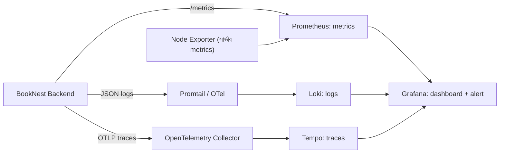
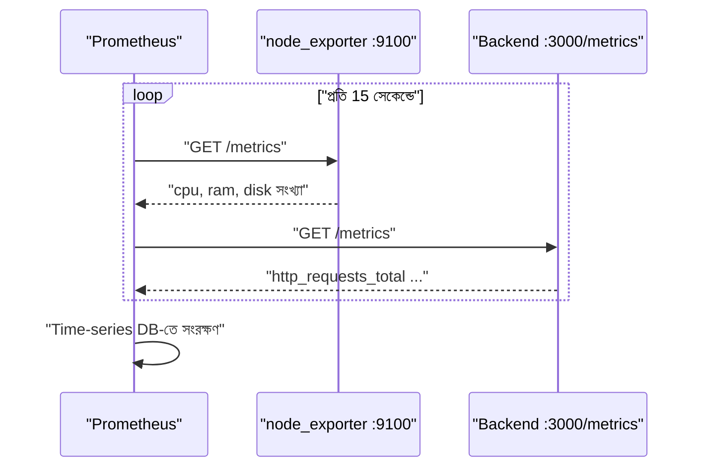
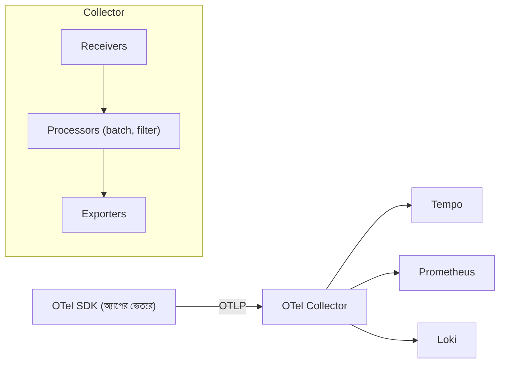
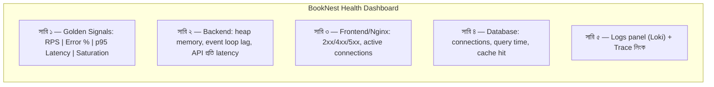
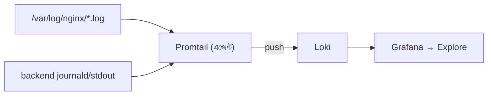
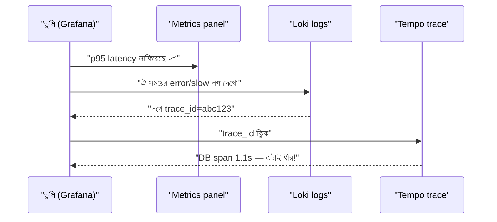

# Module 07 — Observability: Metrics, Logs and Traces

> **Section 2 · CI/CD, Observability & Infrastructure as Code** · ২টি Live Class
> **Project:** See Everything: App Health Dashboard
> **Goal:** Three-tier অ্যাপের জন্য সম্পূর্ণ metrics, logs ও traces — সাথে কাজের alert।
> **Assignment ★:** একটাই dashboard যেখানে একটা slow API request তার trace ও log-এর সাথে সম্পর্কিত (correlated) দেখা যায়।

---

## 📖 গল্প: রাতে ফোন আসার দিন

রাত ২টায় গ্রাহকের ফোন: "BookNest ধীর!" তানভীর কিছুই জানে না — সার্ভার চালু আছে, কিন্তু **ভেতরে কী হচ্ছে** সে অন্ধ। CPU? DB? কোন API? কখন থেকে?

এরপর সে একটা **হাসপাতালের ICU মনিটর** বানাল:

- **Metrics (সংখ্যা)** — হার্টবিট, প্রেশার: "এখন প্রতি সেকেন্ডে ৫০ রিকোয়েস্ট, ৫% ফেল"। *কী ঘটছে?*
- **Logs (ডায়েরি)** — নার্সের নোট: "২:০৩-এ DB timeout"। *কী ঘটেছিল?*
- **Traces (যাত্রাপথ)** — রোগী ঢুকে কোন কোন ঘর ঘুরল, কোথায় কত সময়: "/books রিকোয়েস্ট: Nginx ২ms → API ১২০০ms → DB ১১৫০ms।" *কোথায় আটকাল?*

তিনটা মিলে হয় **Observability** — সিস্টেমকে প্রশ্ন করার ক্ষমতা, এমনকি যে প্রশ্ন আগে ভাবোনি।

> **Monitoring বনাম Observability:** Monitoring = জানা সমস্যার জন্য অ্যালার্ম ("CPU > 90%")। Observability = অজানা সমস্যার কারণ খুঁজে পাওয়া।

---

## 1. তিন স্তম্ভ ও আমাদের টুলস



| স্তম্ভ | টুল | প্রশ্ন | ডেটার ধরন |
|---|---|---|---|
| Metrics | **Prometheus** | কতটা/কত দ্রুত/কত ভুল? | সময়ভিত্তিক সংখ্যা |
| Logs | **Loki** | কী লেখা হয়েছিল? | টেক্সট ইভেন্ট |
| Traces | **Tempo** (+ OpenTelemetry) | সময় কোথায় গেল? | রিকোয়েস্টের span-গাছ |
| ভিজ্যুয়াল | **Grafana** | সবকিছু এক জায়গায় | dashboard |

---

# 🧩 Live Class 1 — Monitoring Fundamentals, Prometheus and OpenTelemetry

## 2. কেন মনিটর করি?

- সমস্যা **গ্রাহকের আগে** ধরতে
- Capacity পরিকল্পনা (কবে বড় সার্ভার লাগবে)
- Deploy-এর পর নিশ্চিত হতে (M06-র health check-এর বড় ভাই)
- SLO (M19) মাপতে

### Golden Signals (Google SRE)

| সিগন্যাল | অর্থ | উদাহরণ |
|---|---|---|
| **Latency** | কত সময় লাগে | p95 রেসপন্স টাইম |
| **Traffic** | কত চাহিদা | requests/sec |
| **Errors** | কত ব্যর্থ | 5xx হার |
| **Saturation** | রিসোর্স কত ভরা | CPU, মেমরি, ডিস্ক |

## 3. Prometheus কীভাবে কাজ করে — **Pull মডেল**



Prometheus নিজে গিয়ে *টেনে আনে* (scrape)। সুবিধা: কোন টার্গেট বেঁচে আছে তা সে নিজেই জানে (`up` মেট্রিক)।

### Metric টাইপ

| টাইপ | অর্থ | উদাহরণ |
|---|---|---|
| **Counter** | শুধু বাড়ে | `http_requests_total` |
| **Gauge** | বাড়ে-কমে | `memory_usage_bytes` |
| **Histogram** | মান ভাগ-ভাগ করে গোনে (latency-র জন্য) | `http_request_duration_seconds_bucket` |

## 4. EC2-তে Prometheus ও Node Exporter

```bash
# --- Node Exporter: সার্ভারের CPU/RAM/ডিস্ক/নেটওয়ার্ক metrics ---
# নিরাপত্তার জন্য আলাদা, লগইনহীন ইউজার
sudo useradd --no-create-home --shell /usr/sbin/nologin node_exporter

cd /tmp
# ⚠️ ভার্সন বসাও release page থেকে দেখে (github.com/prometheus/node_exporter/releases)
VER=<NODE_EXPORTER_VERSION>
curl -LO https://github.com/prometheus/node_exporter/releases/download/v${VER}/node_exporter-${VER}.linux-amd64.tar.gz
tar xzf node_exporter-${VER}.linux-amd64.tar.gz
sudo cp node_exporter-${VER}.linux-amd64/node_exporter /usr/local/bin/
sudo chown node_exporter: /usr/local/bin/node_exporter
```

```ini
# /etc/systemd/system/node_exporter.service
[Unit]
Description=Node Exporter
After=network.target

[Service]
User=node_exporter
ExecStart=/usr/local/bin/node_exporter
Restart=on-failure

[Install]
WantedBy=multi-user.target
```

```bash
sudo systemctl daemon-reload && sudo systemctl enable --now node_exporter
curl -s localhost:9100/metrics | head      # metrics দেখাচ্ছে?
# ⚠️ Security Group-এ 9100 বাইরে খুলবে না — শুধু Prometheus যে মেশিনে সেখান থেকে
```

### Prometheus কনফিগ

```yaml
# /etc/prometheus/prometheus.yml
global:
  scrape_interval: 15s          # কত ঘনঘন টেনে আনবে (ছোট = বিস্তারিত কিন্তু বেশি স্টোরেজ)
  evaluation_interval: 15s      # alert rule কত ঘনঘন যাচাই

rule_files:
  - /etc/prometheus/alerts.yml  # নিচে লেখা alert rules

scrape_configs:
  - job_name: prometheus        # Prometheus নিজেকেও মনিটর করে
    static_configs:
      - targets: ["localhost:9090"]

  - job_name: node              # সার্ভার metrics
    static_configs:
      - targets: ["localhost:9100"]

  - job_name: booknest-backend  # অ্যাপ metrics (/metrics এন্ডপয়েন্ট থাকতে হবে)
    metrics_path: /metrics
    static_configs:
      - targets: ["localhost:3000"]
```

```bash
sudo apt install -y prometheus     # সরল পথ (ভার্সন পুরনো হতে পারে); প্রোডাকশনে অফিসিয়াল বাইনারি/Docker
sudo systemctl enable --now prometheus
# ব্রাউজারে http://<IP>:9090 → Status → Targets: সব UP?
```

## 5. PromQL — মেট্রিক্সের ভাষা

```promql
# ১. কোন টার্গেট বেঁচে আছে? (1 = আছে, 0 = নেই)
up

# ২. প্রতি সেকেন্ডে রিকোয়েস্ট (শেষ ৫ মিনিটের গড়) — counter-কে সবসময় rate() দিয়ে পড়ো
sum(rate(http_requests_total[5m]))

# ৩. Error rate (%) — 5xx / মোট
100 * sum(rate(http_requests_total{status=~"5.."}[5m]))
        / sum(rate(http_requests_total[5m]))

# ৪. p95 latency — ৯৫% রিকোয়েস্ট এর চেয়ে দ্রুত
histogram_quantile(0.95,
  sum by (le) (rate(http_request_duration_seconds_bucket[5m])))

# ৫. সার্ভার CPU ব্যবহার %
100 - (avg(rate(node_cpu_seconds_total{mode="idle"}[5m])) * 100)

# ৬. ডিস্ক কত % ভরা
100 * (1 - node_filesystem_avail_bytes{mountpoint="/"} / node_filesystem_size_bytes{mountpoint="/"})
```

**কেন গড় নয়, p95/p99?** গড় লুকিয়ে ফেলে। ৯৯ জন ১০০ms, ১ জন ১০ সেকেন্ড = গড় ~২০০ms ("ভালোই") — কিন্তু ওই ১ জন কষ্ট পাচ্ছে।

## 6. 🤖 AI-র সাহায্যে PromQL/LogQL — কিন্তু যাচাই করে

AI প্রায়ই **ভুল মেট্রিক নাম** বানায় (যেমন `http_server_requests_total` — তোমার অ্যাপে নেই)। নিয়ম:
1. Grafana → Explore-এ কোয়েরি চালাও।
2. Metric browser-এ আসল নাম মিলাও।
3. ফলাফল যুক্তিসঙ্গত? (error rate ১০০% বা ঋণাত্মক হলে কোয়েরি ভুল)

## 7. OpenTelemetry (OTel) ধারণা

**OpenTelemetry** = metrics, logs, traces তৈরির একটা **বিক্রেতা-নিরপেক্ষ স্ট্যান্ডার্ড**। একবার অ্যাপে instrument করলে ডেটা যেকোনো ব্যাকএন্ডে (Tempo, Jaeger, Datadog…) পাঠানো যায়।



**Trace ও Span:** একটা Trace = একটা রিকোয়েস্টের সম্পূর্ণ যাত্রা; Span = যাত্রার একেকটা ধাপ (সময়সহ)।

```mermaid
gantt
    title "একটা GET /api/books Trace"
    dateFormat  X
    axisFormat %L
    section Spans
    "Nginx"               :0, 1300
    "Backend handler"     :50, 1250
    "DB query SELECT books" :100, 1200
```


দেখো — DB span প্রায় পুরো সময় খেয়েছে। কারণ খুঁজতে এখন DB-তে যাও; ব্যাকএন্ড কোড নয়।

---

# 🧩 Live Class 2 — Grafana, Loki, Tracing and Alerting

## 8. Grafana সেটআপ ও Data Source

```bash
# অফিসিয়াল APT রিপো যোগ করা (Grafana ডকুমেন্টেশন দেখে সর্বশেষ নির্দেশনা নাও)
sudo apt install -y apt-transport-https software-properties-common wget
sudo mkdir -p /etc/apt/keyrings
wget -q -O - https://apt.grafana.com/gpg.key | gpg --dearmor | sudo tee /etc/apt/keyrings/grafana.gpg > /dev/null
echo "deb [signed-by=/etc/apt/keyrings/grafana.gpg] https://apt.grafana.com stable main" | sudo tee /etc/apt/sources.list.d/grafana.list
sudo apt update && sudo apt install -y grafana
sudo systemctl enable --now grafana-server       # ডিফল্ট পোর্ট 3000 (ব্যাকএন্ডের সাথে সংঘর্ষ!)
```

> ⚠️ **পোর্ট সংঘর্ষ:** Grafana ও আমাদের ব্যাকএন্ড দুটোই 3000 চায়। Grafana-র পোর্ট বদলাও `/etc/grafana/grafana.ini` → `http_port = 3001`, অথবা Nginx-এর পেছনে `/grafana` সাব-পাথে বসাও। এবং **Grafana-কে পাবলিক করলে অবশ্যই শক্ত পাসওয়ার্ড/HTTPS** — ডিফল্ট `admin/admin` বদলাও।

**Data source যোগ:** Connections → Data sources → Add:
- Prometheus: `http://localhost:9090`
- Loki: `http://localhost:3100`
- Tempo: `http://localhost:3200`

## 9. Dashboard — Three-Tier অ্যাপের জন্য



**Community dashboard import:** Dashboards → New → Import → ID দিয়ে (যেমন **Node Exporter Full — ID 1860**)। সময় বাঁচে; তারপর নিজের অ্যাপের জন্য কাস্টম panel যোগ করো।

**Database মেট্রিক** (PostgreSQL): `postgres_exporter` বসিয়ে `pg_stat_activity_count`, `pg_stat_database_xact_commit`, ইত্যাদি স্ক্র্যাপ করো।

## 10. Backend-এ Metrics ও Tracing (NestJS/Node উদাহরণ)

### Metrics এন্ডপয়েন্ট (`prom-client`)

```ts
// src/metrics.ts
import { Registry, collectDefaultMetrics, Counter, Histogram } from 'prom-client';

export const register = new Registry();
collectDefaultMetrics({ register });   // Node-এর ডিফল্ট মেট্রিক (মেমরি, GC, event loop) বিনামূল্যে

// প্রতিটা HTTP রিকোয়েস্ট গোনার counter; label দিয়ে method/route/status ভাগ করা যায়
export const httpRequests = new Counter({
  name: 'http_requests_total',
  help: 'Total HTTP requests',
  labelNames: ['method', 'route', 'status'],
  registers: [register],
});

// latency histogram: bucket = কোন সীমার মধ্যে কয়টা রিকোয়েস্ট (সেকেন্ডে)
export const httpDuration = new Histogram({
  name: 'http_request_duration_seconds',
  help: 'HTTP request duration',
  labelNames: ['method', 'route', 'status'],
  buckets: [0.05, 0.1, 0.25, 0.5, 1, 2.5, 5],
  registers: [register],
});
```
```ts
// main.ts — middleware যেখানে প্রতি রিকোয়েস্ট মাপা হয়
app.use((req, res, next) => {
  const end = httpDuration.startTimer();           // টাইমার শুরু
  res.on('finish', () => {                         // রেসপন্স শেষ হলে
    // ⚠️ route-এ আসল path (/books/123) নয়, প্যাটার্ন (/books/:id) দাও,
    // নইলে label-এর সংখ্যা বিস্ফোরিত হয় ("high cardinality") — Prometheus ধীর/অচল
    const route = req.route?.path ?? 'unknown';
    const labels = { method: req.method, route, status: String(res.statusCode) };
    httpRequests.inc(labels);
    end(labels);
  });
  next();
});
```

### Tracing (OpenTelemetry Node SDK)

```ts
// src/tracing.ts — অবশ্যই অ্যাপের সবার আগে লোড হবে (main.ts-এর প্রথম import)
import { NodeSDK } from '@opentelemetry/sdk-node';
import { OTLPTraceExporter } from '@opentelemetry/exporter-trace-otlp-http';
import { getNodeAutoInstrumentations } from '@opentelemetry/auto-instrumentations-node';

const sdk = new NodeSDK({
  serviceName: 'booknest-backend',    // Tempo/Grafana-য় এই নামে দেখাবে
  traceExporter: new OTLPTraceExporter({
    url: 'http://localhost:4318/v1/traces',   // OTel Collector-এর OTLP/HTTP পোর্ট
  }),
  // Auto-instrumentation: http, express, pg (PostgreSQL) ইত্যাদির span নিজে নিজে তৈরি — কোড বদলাতে হয় না
  instrumentations: [getNodeAutoInstrumentations()],
});
sdk.start();
```

### OTel Collector কনফিগ

```yaml
# /etc/otelcol/config.yaml
receivers:
  otlp:
    protocols:
      http:           # :4318
      grpc:           # :4317

processors:
  batch: {}           # ছোট ছোট ডেটা জমিয়ে একসাথে পাঠায় — নেটওয়ার্ক/CPU সাশ্রয়

exporters:
  otlp/tempo:
    endpoint: localhost:4317       # Tempo-র OTLP gRPC (Tempo-র পোর্ট কনফিগে মিলিয়ে নিও)
    tls:
      insecure: true               # লোকাল-লোকাল যোগাযোগ; বাইরে হলে TLS লাগবে

service:
  pipelines:
    traces:
      receivers: [otlp]
      processors: [batch]
      exporters: [otlp/tempo]
```

## 11. Loki — কেন্দ্রীভূত লগ

**সমস্যা:** ৫টা সার্ভার = ৫ জায়গায় `ssh + tail`। **সমাধান:** সব লগ এক জায়গায়।



```yaml
# /etc/promtail/config.yml
server:
  http_listen_port: 9080

positions:
  filename: /var/lib/promtail/positions.yaml   # কতদূর পড়া হয়েছে মনে রাখে — রিস্টার্টে ডুপ্লিকেট হয় না

clients:
  - url: http://localhost:3100/loki/api/v1/push

scrape_configs:
  - job_name: nginx
    static_configs:
      - targets: [localhost]
        labels:
          job: nginx                 # LogQL-এ {job="nginx"} দিয়ে ফিল্টার
          __path__: /var/log/nginx/*.log

  - job_name: backend
    journal:                          # systemd journal থেকে পড়া (আমাদের backend সার্ভিস)
      labels:
        job: backend
      matches: _SYSTEMD_UNIT=booknest-backend.service
```

### LogQL

```logql
# backend-এর সব লগ
{job="backend"}

# শুধু "error" আছে এমন লাইন (|= মানে contains)
{job="backend"} |= "error"

# JSON লগ পার্স করে ফিল্টার (লগ JSON হলে ফিল্ড দিয়ে খোঁজা যায়)
{job="backend"} | json | level="error"

# প্রতি মিনিটে error লাইনের হার — লগ থেকে মেট্রিক!
sum(rate({job="backend"} |= "error" [1m]))

# Nginx-এ 5xx (access log ফরম্যাট ধরে)
{job="nginx"} |~ " 5\\d\\d "
```

> **ভালো অভ্যাস:** **structured (JSON) লগ** লেখো, এবং প্রতিটা লগে `trace_id` রাখো — এটাই লগ↔ট্রেস জোড়ার চাবিকাঠি।

```ts
// লগে trace_id যোগ — Grafana-য় লগ থেকে এক ক্লিকে trace-এ যাওয়ার জন্য
import { trace } from '@opentelemetry/api';
const span = trace.getActiveSpan();
logger.info({ msg: 'fetching books', trace_id: span?.spanContext().traceId });
```

## 12. Tempo ও Correlation (Assignment-এর মূল)

Grafana → Data sources → Loki → **Derived fields**:
- Name: `TraceID`
- Regex: `"trace_id":"(\w+)"`
- Internal link → Tempo, query: `${__value.raw}`

এখন Loki লগে `trace_id`-এর পাশে লিংক — ক্লিকে সোজা Tempo-র ওই trace।


**এই "metric → log → trace" তদন্ত-প্রবাহই Observability-র আসল শক্তি।**

## 13. Alerting — কাজের অ্যালার্ট

### খারাপ বনাম ভালো অ্যালার্ট

| ❌ খারাপ | ✅ ভালো |
|---|---|
| "CPU ৭০%" (গ্রাহকের কিছু হয়নি) | "Error rate > ৫% টানা ৫ মিনিট" (গ্রাহক কষ্ট পাচ্ছে) |
| প্রতি ২ মিনিটে নোটিফিকেশন (alert fatigue) | `for:` দিয়ে সাময়িক spike উপেক্ষা |
| অ্যালার্টে কী করতে হবে লেখা নেই | `runbook_url` সংযুক্ত |

```yaml
# /etc/prometheus/alerts.yml
groups:
  - name: booknest
    rules:
      - alert: BackendDown
        expr: up{job="booknest-backend"} == 0       # টার্গেট নেই
        for: 1m                                     # ১ মিনিট টানা না এলে তবেই — মুহূর্তের হোঁচটে নয়
        labels:
          severity: critical
        annotations:
          summary: "Backend ডাউন"
          runbook_url: "https://wiki.example.com/runbooks/backend-down"

      - alert: HighErrorRate
        expr: |
          100 * sum(rate(http_requests_total{status=~"5.."}[5m]))
              / sum(rate(http_requests_total[5m])) > 5
        for: 5m
        labels:
          severity: warning
        annotations:
          summary: "5xx error rate {{ $value | printf \"%.1f\" }}% — ৫% এর বেশি"

      - alert: HighLatencyP95
        expr: |
          histogram_quantile(0.95,
            sum by (le) (rate(http_request_duration_seconds_bucket[5m]))) > 1
        for: 10m
        labels:
          severity: warning
        annotations:
          summary: "p95 latency > 1s"

      - alert: DiskAlmostFull
        expr: 100 * (1 - node_filesystem_avail_bytes{mountpoint="/"} / node_filesystem_size_bytes{mountpoint="/"}) > 85
        for: 10m
        labels:
          severity: warning
        annotations:
          summary: "ডিস্ক ৮৫% এর বেশি ভরা"
```

নোটিফিকেশন: Grafana → Alerting → Contact points → Slack/Email/Telegram।

## ⚠️ সাধারণ ভুল

| সমস্যা | কারণ/সমাধান |
|---|---|
| Prometheus target DOWN | পোর্ট/ফায়ারওয়াল/ভুল `metrics_path` |
| Grafana "No data" | Data source URL ভুল, বা time range ভুল, বা মেট্রিক নাম ভুল |
| মেট্রিক বিস্ফোরণ | label-এ user_id/URL — high cardinality |
| লগ আসছে না | Promtail permission (`adm` গ্রুপে যোগ করো), `positions` ফাইল |
| Trace আসছে না | `tracing.ts` সবার আগে লোড হয়নি; Collector পোর্ট ভুল |
| 3000 port সংঘর্ষ | Grafana-র পোর্ট বদলাও |

## ✅ চেকলিস্ট

- [ ] Prometheus সব target UP
- [ ] Node exporter + backend `/metrics`
- [ ] Grafana dashboard: golden signals + DB + Nginx
- [ ] Loki-তে backend ও nginx লগ
- [ ] Tempo-তে trace; লগে `trace_id`
- [ ] Metric → Log → Trace কোরিলেশন কাজ করছে
- [ ] কমপক্ষে ৩টা অর্থবহ alert + runbook

## 🎯 ইন্টারভিউ প্রশ্ন

1. Metrics, Logs, Traces — প্রত্যেকটা কোন প্রশ্নের উত্তর দেয়?
2. Prometheus push না pull? সুবিধা কী?
3. Counter আর Gauge-এর পার্থক্য; কেন counter-এ `rate()` লাগে?
4. p99 কেন গড়ের চেয়ে ভালো?
5. High cardinality কী? কেন বিপজ্জনক?
6. Alert fatigue কী? কীভাবে কমাবে? (symptom-based alert, `for:`, severity)
7. OpenTelemetry কেন vendor-neutral হওয়া গুরুত্বপূর্ণ?

## 🧠 সারসংক্ষেপ

**Metrics বলে "কী ঘটছে", Logs বলে "কী ঘটেছিল", Traces বলে "কোথায় আটকাল"**। `trace_id` তিনটাকে সুতোয় গাঁথে। ভালো অ্যালার্ট গ্রাহকের কষ্টের লক্ষণে বাজে — যন্ত্রের সামান্য কাঁপুনিতে নয়।

⬅️ [Module 06](./module-06-cicd-with-github-actions.md) · ➡️ [Module 08](./module-08-securing-three-tier-with-aws-vpc-and-networking.md)
