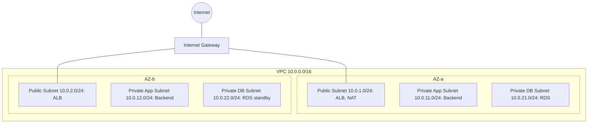
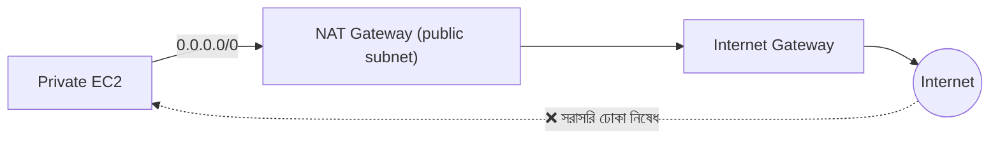
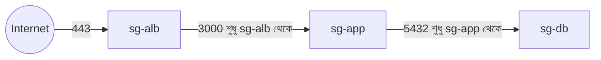
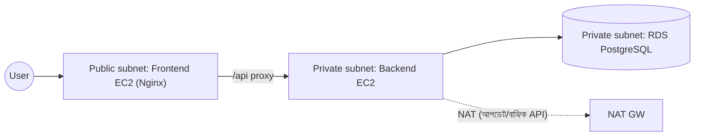
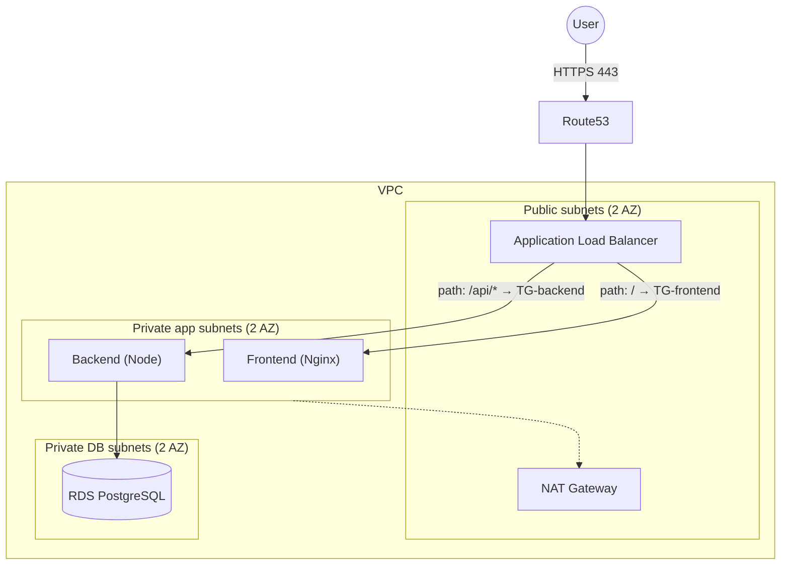
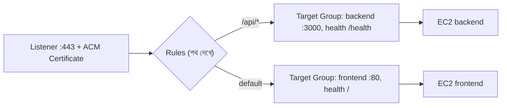
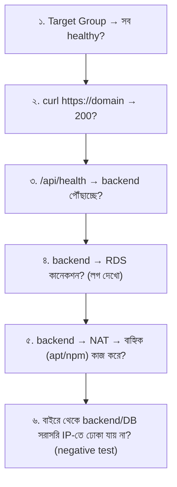

# Module 08 — Securing the 3-Tier Application with AWS VPC and Networking

> **Section 2 · CI/CD, Observability & Infrastructure as Code** · ২টি Live Class
> **Project:** Build the Cloud with Code
> **Goal:** একটা production-ready, private-network three-tier অ্যাপ — Load Balancer-এর পেছনে।
> **Assignment ★:** Network diagram + সম্পূর্ণ private deployment যা কাজ করছে।

---

## 📖 গল্প: খোলা মাঠ থেকে সুরক্ষিত পাড়া

এতদিন BookNest ছিল **খোলা মাঠে** একটা বাড়ি — দরজা দিয়ে সবাই আসত, কিন্তু ভল্ট (DB) একই বাড়িতে। এবার তানভীর একটা **গেটেড পাড়া (VPC)** বানাল:

- **পাড়ার সীমানা = VPC** — AWS-এর ভেতরে তোমার নিজস্ব, বিচ্ছিন্ন নেটওয়ার্ক।
- **সদর রাস্তার দিকের প্লট = Public subnet** — ইন্টারনেট থেকে সরাসরি পৌঁছানো যায়। এখানে থাকবে শুধু *অভ্যর্থনা* (Load Balancer, NAT)।
- **ভেতরের গলি = Private subnet** — রাস্তা থেকে সরাসরি পথ নেই। ম্যানেজার (backend) ও ভল্ট (RDS) এখানে।
- **Internet Gateway (IGW)** = পাড়ার প্রধান ফটক।
- **NAT Gateway** = ভেতরের লোক বাইরে যেতে পারে (আপডেট নামাতে), কিন্তু বাইরের লোক ভেতরে ঢুকতে পারে না — একমুখী দরজা।
- **ALB (Load Balancer)** = ফটকের রিসেপশন — অতিথিকে সঠিক বাড়িতে পাঠায়।

---

# 🧩 Live Class 1 — Basic Three-Tier Architecture (Public and Private Subnets)

## 1. VPC-র মূল উপাদান

| উপাদান | কাজ |
|---|---|
| **VPC** | নিজস্ব ভার্চুয়াল নেটওয়ার্ক; CIDR ব্লক (যেমন `10.0.0.0/16`) |
| **Subnet** | VPC-র ছোট অংশ; একটা AZ-এ থাকে |
| **Route Table** | ট্রাফিক কোথায় যাবে তার মানচিত্র |
| **Internet Gateway** | VPC ↔ ইন্টারনেট |
| **NAT Gateway** | private subnet → ইন্টারনেট (আউটবাউন্ড-ওনলি) |
| **Security Group** | ইনস্ট্যান্স-স্তরের stateful ফায়ারওয়াল |
| **NACL** | subnet-স্তরের stateless ফায়ারওয়াল |

### CIDR সহজে

`10.0.0.0/16` → প্রথম ১৬ বিট নেটওয়ার্ক, বাকি ১৬ বিট = ৬৫,৫৩৬ ঠিকানা। `10.0.1.0/24` → ২৫৬ ঠিকানা (AWS ৫টা রাখে, তাই ২৫১ ব্যবহারযোগ্য)।



> **দুটো AZ কেন?** একটা ডেটা-সেন্টার বন্ধ হলেও সাইট চলবে — High Availability-র প্রথম ধাপ।

## 2. Public বনাম Private — আসল পার্থক্য কী?

Subnet "public" হয় তার **route table**-এর কারণে — নাম দিয়ে নয়:

| Subnet | Route Table-এ আছে | ফল |
|---|---|---|
| **Public** | `0.0.0.0/0 → igw-xxxx` | ইন্টারনেটের সাথে দ্বিমুখী |
| **Private (with NAT)** | `0.0.0.0/0 → nat-xxxx` | শুধু বেরোতে পারে |
| **Private (isolated)** | শুধু `10.0.0.0/16 → local` | কোথাও বেরোয় না (DB-র জন্য আদর্শ) |



## 3. স্তরভিত্তিক Security Group — "Security Group চেইনিং"

**সেরা কৌশল:** IP নয়, **অন্য SG-কে সোর্স** হিসেবে দাও।



| SG | Inbound | কেন |
|---|---|---|
| `sg-alb` | 80, 443 from `0.0.0.0/0` | জনসাধারণের প্রবেশদ্বার |
| `sg-app` | 3000 from **`sg-alb`** | শুধু ALB-ই ব্যাকএন্ডে পৌঁছাবে |
| `sg-db` | 5432 from **`sg-app`** | শুধু অ্যাপ DB-তে পৌঁছাবে |

**সুবিধা:** instance বাড়ুক-কমুক, IP বদলাক — নিয়ম একই থাকে।

## 4. Frontend Public, Backend/DB Private — প্রথম ধাপ

প্রথম লাইভ ক্লাসের মূল কাঠামো: Frontend public subnet-এ (Nginx), Backend ও RDS private subnet-এ।



### Amazon RDS (DB-কে EC2 থেকে আলাদা করা)

```bash
# CLI উদাহরণ (প্রথমে DB subnet group লাগে: কমপক্ষে ২টা AZ-এর private subnet)
aws rds create-db-subnet-group \
  --db-subnet-group-name booknest-db-subnets \
  --db-subnet-group-description "BookNest private DB subnets" \
  --subnet-ids subnet-aaa111 subnet-bbb222        # দুটো আলাদা AZ-র private DB subnet

aws rds create-db-instance \
  --db-instance-identifier booknest-db \
  --engine postgres \
  --db-instance-class db.t3.micro \
  --allocated-storage 20 \
  --master-username booknest_admin \
  --manage-master-user-password \
  --db-subnet-group-name booknest-db-subnets \
  --vpc-security-group-ids sg-db0000 \
  --no-publicly-accessible \
  --storage-encrypted
# --manage-master-user-password : পাসওয়ার্ড AWS Secrets Manager নিজে বানায়/ঘোরায় — কমান্ডে পাসওয়ার্ড লিখতে হয় না
# --no-publicly-accessible       : DB-র পাবলিক IP নেই — মূল নিরাপত্তা সিদ্ধান্ত
# --storage-encrypted            : ডিস্ক এনক্রিপ্টেড
```

কনসোল দিয়ে করলেও একই নীতি: **Public access = No**, Multi-AZ (প্রোডাকশনে), Encryption = Yes।

---

# 🧩 Live Class 2 — Production-Ready Fully Private Architecture with Load Balancer

## 5. পূর্ণ Private আর্কিটেকচার

এবার Frontend-ও private-এ; **একমাত্র ইন্টারনেট-মুখী জিনিস ALB।**



## 6. AWS Load Balancer — ALB/NLB

| | ALB (Application) | NLB (Network) |
|---|---|---|
| স্তর | L7 (HTTP/HTTPS) | L4 (TCP/UDP) |
| রাউটিং | path/host/header ভিত্তিক | পোর্ট ভিত্তিক |
| ব্যবহার | ওয়েব অ্যাপ, API (আমাদের পছন্দ) | অতি-কম latency, static IP, non-HTTP |
| TLS | ACM সার্টিফিকেট দিয়ে terminate | সম্ভব |

### ALB-র তিন উপাদান



- **Listener:** কোন পোর্টে শুনবে (443)। 80 → 443 redirect।
- **Rule:** শর্তে (path/host) সিদ্ধান্ত।
- **Target Group:** টার্গেটের দল + **health check**। অসুস্থ টার্গেটে ট্রাফিক যায় না।

```bash
# Target Group (backend) — health check পথ ও পোর্টসহ
aws elbv2 create-target-group \
  --name booknest-backend-tg \
  --protocol HTTP --port 3000 \
  --vpc-id vpc-xxxx \
  --target-type instance \
  --health-check-path /health \
  --health-check-interval-seconds 15 \
  --healthy-threshold-count 2 \
  --unhealthy-threshold-count 3
# ALB এই /health কল করে; ২ বার সফল = healthy, ৩ বার ব্যর্থ = unhealthy (M04-এ বানানো endpoint-এর আসল কাজ!)
```

### ACM — বিনামূল্যে সার্টিফিকেট

ALB-তে HTTPS-এর জন্য Certbot নয়, **AWS Certificate Manager (ACM)** — DNS যাচাই (Route53-এ এক-ক্লিক CNAME), অটো-রিনিউ। Listener 443-এ সার্টিফিকেট জুড়ে দাও।

## 7. Frontend-কে Private-এ নেওয়া — Nginx পরিবর্তন

ALB এখন `/api` রুট নিজেই ভাগ করে; তাই frontend Nginx-এর শুধু static দেখানোর কাজ:

```nginx
# frontend instance: /etc/nginx/conf.d/booknest.conf
server {
    listen 80;
    root /var/www/booknest;
    index index.html;

    location / { try_files $uri /index.html; }

    # ALB-র health check এই পথ দেখে
    location = /healthz { return 200 "ok"; add_header Content-Type text/plain; }
}
```

Backend `/api/*` সরাসরি ALB থেকে। **মনে রাখবে:** ALB পথ কেটে দেয় না — backend route `/api/...` প্রত্যাশা করবে, অথবা Nginx/ALB rewrite ব্যবহার করো।

## 8. End-to-End Connectivity Test (ধাপে ধাপে)



```bash
# একটা bastion/SSM Session দিয়ে private instance-এ ঢুকে পরীক্ষা (SSH port খোলার দরকার নেই!)
aws ssm start-session --target i-0abc123              # Session Manager — M06-এর SSM ধারণার পুনর্ব্যবহার

# ভেতর থেকে:
curl -s localhost:3000/health
nc -zv <rds-endpoint> 5432                              # DB পোর্টে পৌঁছাতে পারছি?
curl -sI https://registry.npmjs.org | head -1           # NAT দিয়ে বাইরে যেতে পারছি?
```

**Negative test (সবচেয়ে ভুলে যাওয়া):** বাইরের মেশিন থেকে `nc -zv <backend-private-ip> 3000` — ব্যর্থ হওয়াই *সফলতা*।

## 9. Network Security Best Practices

| অনুশীলন | কারণ |
|---|---|
| Least privilege SG; SG-থেকে-SG নিয়ম | ন্যূনতম এক্সপোজার |
| DB ও backend private subnet-এ | সরাসরি আক্রমণ-পথ নেই |
| SSH port 22 বন্ধ, SSM Session Manager | key-ও লাগে না, সব অডিট হয় |
| **VPC Flow Logs** চালু | কে কার সাথে কথা বলেছে তার রেকর্ড |
| **VPC Endpoint** (S3/ECR ইত্যাদির জন্য) | ট্রাফিক ইন্টারনেট/NAT-এ না গিয়ে AWS-এর ভেতরেই |
| WAF (ALB-র সামনে) | SQL injection/bot ফিল্টার |
| TLS সর্বত্র | ট্রানজিটে এনক্রিপশন |

## 10. 💰 NAT Gateway ও Data Transfer খরচ — সতর্কতা

NAT Gateway **ঘণ্টা-হারে + প্রতি GB প্রসেস** চার্জ করে — ছোট প্রজেক্টের বিলে সবচেয়ে বড় বিস্ময়!

| উৎস | খরচ-ঝুঁকি |
|---|---|
| NAT GW চালু রাখা | ঘণ্টায় চার্জ — ব্যবহার না হলেও |
| NAT দিয়ে বড় ডাউনলোড (Docker image, S3) | প্রতি GB চার্জ |
| **ক্রস-AZ ট্রাফিক** | AZ-এর মধ্যে ডেটা চার্জযোগ্য |
| ইন্টারনেটে বাইরে ডেটা (egress) | চার্জযোগ্য; ইনবাউন্ড সাধারণত ফ্রি |

**সাশ্রয় কৌশল:** S3/ECR-র জন্য **Gateway/Interface VPC Endpoint**; শেখার সময় কাজ শেষে NAT ও ALB মুছে ফেলা (Terraform থাকলে এক কমান্ডে — Module 09!); ডেভ এনভায়রনমেন্টে একটাই NAT।

## 11. 🤖 AI ও নেটওয়ার্ক — যাচাইয়ের তালিকা

AI-র দেওয়া নেটওয়ার্ক কনফিগে এগুলো মিলিয়ে নাও:
- [ ] কোন SG-তে `0.0.0.0/0` আছে? (ALB ছাড়া কোথাও থাকলে প্রশ্ন করো)
- [ ] DB `publicly_accessible = false`?
- [ ] Route table: private subnet-এ IGW রুট নেই তো?
- [ ] দুই AZ-তেই সাবনেট আছে?
- [ ] NAT কি পাবলিক subnet-এ বসেছে? (private-এ বসালে কাজ করে না)

## ⚠️ সাধারণ ভুল

| সমস্যা | কারণ |
|---|---|
| ALB `502/503` | Target unhealthy — health path/port/SG ভুল |
| Target বারবার unhealthy | `sg-app` `sg-alb` থেকে 3000 অনুমতি দেয়নি |
| Private instance বাইরে যেতে পারে না | route table-এ NAT রুট নেই / NAT private subnet-এ |
| RDS-এ সংযোগ পারছে না | `sg-db` `sg-app` থেকে 5432 দেয়নি; ভুল endpoint |
| ACM সার্টিফিকেট pending | DNS যাচাই CNAME তৈরি হয়নি |
| পুরো বিল বাড়ছে | ভুলে যাওয়া NAT/ALB/RDS |

## ✅ চেকলিস্ট

- [ ] VPC + ২টা AZ-তে public/app/db subnet
- [ ] IGW + NAT + সঠিক route tables
- [ ] SG চেইন: alb → app → db
- [ ] RDS private, encrypted
- [ ] ALB + target groups + health checks + ACM HTTPS
- [ ] Frontend/Backend private; বাইরে থেকে সরাসরি ঢোকা যায় না (negative test)
- [ ] Network diagram আঁকা (Mermaid/draw.io)

## 🎯 ইন্টারভিউ প্রশ্ন

1. Public আর private subnet-এর আসল পার্থক্য কী? (route table → IGW)
2. NAT Gateway কী করে? Internet Gateway থেকে কীভাবে আলাদা?
3. SG বনাম NACL?
4. কেন SG-তে অন্য SG-কে source দেওয়া ভালো?
5. ALB বনাম NLB কখন কোনটা?
6. Bastion host-এর বিকল্প কী? (SSM Session Manager)
7. VPC Endpoint কেন খরচ ও নিরাপত্তা দুটোই কমায়?

## 🧠 সারসংক্ষেপ

**VPC = গেটেড পাড়া**; public subnet = সদর রাস্তা, private subnet = ভেতরের গলি; ALB = একমাত্র রিসেপশন; SG-চেইন = প্রতি দরজায় আলাদা পাহারা। **যা ইন্টারনেটে দেখানোর দরকার নেই, তা দেখাবে না।**

⬅️ [Module 07](./module-07-observability-metrics-logs-and-traces.md) · ➡️ [Module 09](./module-09-infrastructure-as-code-terraform.md)
