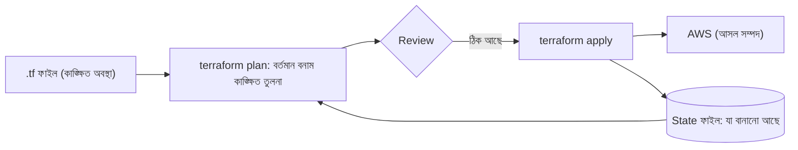
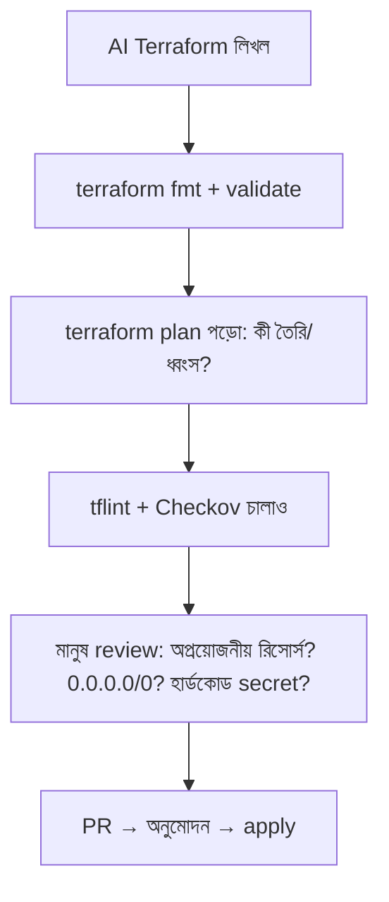
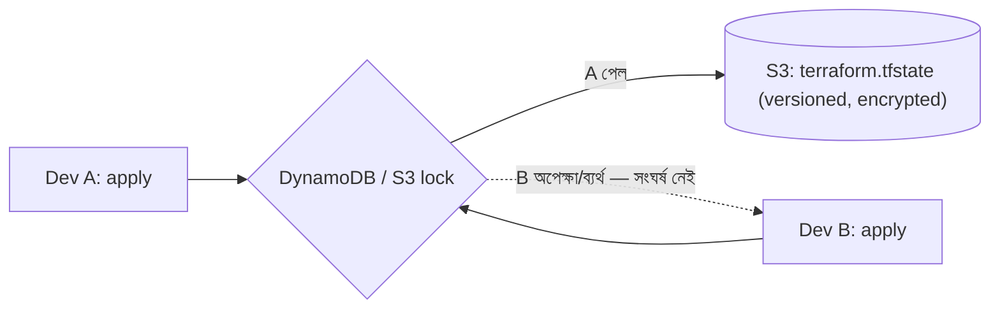
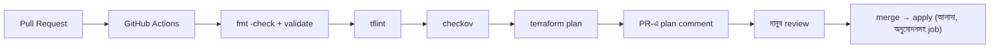

# Module 09 — Infrastructure as Code: Terraform for the 3-Tier Application

> **Section 2 · CI/CD, Observability & Infrastructure as Code** · ২টি Live Class
> **Project:** Build the Cloud with Code
> **Goal:** পুরো three-tier স্ট্যাকের জন্য version-controlled, reviewed ও policy-checked infrastructure।
> **Assignment ★:** Terraform repository, CI-তে plan comment এবং **শূন্য high-severity Checkov finding**।

---

## 📖 গল্প: হাতে আঁকা নকশা বনাম ব্লুপ্রিন্ট

M08-এ তানভীর কনসোলে ক্লিক করে VPC বানিয়েছিল — ৪০ মিনিট। এক সপ্তাহ পর বন্ধু বলল, "আমারও এমন লাগবে।" তানভীর ভুলে গেছে কোন ক্লিক কী ছিল। আরেক দিন ভুল করে কিছু মুছে ফেলল — ফেরাতে পারল না।

তারপর সে শিখল **Terraform** — বাড়ির **ব্লুপ্রিন্ট**। ব্লুপ্রিন্ট ফাইল পড়ে নির্মাণ-ঠিকাদার (Terraform) নিজেই বাড়ি বানায়। নকশা বদলালে সে *শুধু পার্থক্যটুকু* বদলায়। বাড়ি ভেঙে গেলে? আবার একই ব্লুপ্রিন্ট থেকে হুবহু বানানো। আর ব্লুপ্রিন্ট Git-এ — কে কবে কী বদলেছে, PR-এ কে অনুমোদন দিয়েছে, সব রেকর্ড।

**IaC-র মূল কথা:** অবকাঠামোকে সফটওয়্যারের মতো ট্রিট করো — কোড, ভার্সন, রিভিউ, টেস্ট।

---

# 🧩 Live Class 1 — Terraform Fundamentals

## 1. IaC কেন?

| ম্যানুয়াল ক্লিক | IaC (Terraform) |
|---|---|
| পুনরাবৃত্তি কঠিন, ভুলপ্রবণ | একই কোড = একই ফল |
| কে কী বদলেছে অজানা | Git ইতিহাস + PR |
| ধ্বংস/পুনর্নির্মাণ ভয়ের | `destroy`/`apply` নিরাপদ ও দ্রুত |
| dev/staging/prod আলাদা হয়ে যায় (drift) | একই মডিউল, আলাদা ভ্যারিয়েবল |
| খরচ লুকানো | `plan` + cost estimate (M20) |

## 2. Terraform-র আর্কিটেকচার ও Workflow



**মূল কমান্ড চক্র:**

```bash
terraform init       # প্রোভাইডার (AWS plugin) ও মডিউল নামায় — প্রতি নতুন ফোল্ডারে প্রথমে
terraform fmt        # কোড স্টাইল ঠিক করে
terraform validate   # সিনট্যাক্স/লজিক্যাল ভুল
terraform plan       # কী কী বদলাবে তার পূর্বরূপ — ⭐ সবচেয়ে গুরুত্বপূর্ণ ধাপ
terraform apply      # বাস্তবায়ন (প্লান দেখিয়ে অনুমোদন চায়)
terraform destroy    # সবকিছু মুছে ফেলা (শেখার সময় খরচ বাঁচাতে)
```

### Declarative বনাম Imperative

- **Imperative (বাশ স্ক্রিপ্ট):** "VPC বানাও, তারপর subnet বানাও…" — ধাপ বলো।
- **Declarative (Terraform):** "আমি চাই একটা VPC ও দুটো subnet" — *কী চাই* বলো, *কীভাবে* Terraform ঠিক করে।

## 3. প্রথম Terraform — একটা EC2

```hcl
# main.tf
terraform {
  required_version = ">= 1.5"
  required_providers {
    aws = {
      source  = "hashicorp/aws"
      version = "~> 5.0"          # মেজর ভার্সন আটকানো — অপ্রত্যাশিত ভাঙন এড়াতে
    }
  }
}

provider "aws" {
  region = var.region             # হার্ডকোড নয়: ভ্যারিয়েবল থেকে
}

# data source: পুরনো/বিদ্যমান তথ্য *পড়া* (বানানো নয়) — সর্বশেষ Ubuntu AMI খুঁজে আনা
data "aws_ami" "ubuntu" {
  most_recent = true
  owners      = ["099720109477"]  # Canonical-এর অফিসিয়াল AWS account
  filter {
    name   = "name"
    values = ["ubuntu/images/hvm-ssd/ubuntu-jammy-22.04-amd64-server-*"]
  }
}

resource "aws_instance" "web" {
  ami           = data.aws_ami.ubuntu.id     # অন্য রিসোর্স/ডেটার মান রেফারেন্স করা
  instance_type = var.instance_type

  # IMDSv2 বাধ্যতামূলক — SSRF থেকে credential চুরি ঠেকানো (Checkov-ও এটা চায়)
  metadata_options {
    http_tokens = "required"
  }

  root_block_device {
    encrypted   = true                         # ডিস্ক এনক্রিপশন — নিরাপত্তার ডিফল্ট
    volume_size = 20
  }

  tags = {
    Name        = "booknest-web"
    Environment = var.environment
    Owner       = "devops-team"                # M20: খরচ ও মালিকানা ট্র্যাকিং
  }
}
```

```hcl
# variables.tf — ইনপুট
variable "region" {
  type    = string
  default = "ap-southeast-1"
}
variable "instance_type" {
  type    = string
  default = "t3.micro"
}
variable "environment" {
  type = string
  validation {                                  # ভুল মান আগেই ধরা
    condition     = contains(["dev", "staging", "prod"], var.environment)
    error_message = "environment হবে dev, staging বা prod।"
  }
}
```

```hcl
# outputs.tf — অন্য মডিউল/মানুষের জন্য ফলাফল
output "instance_id" {
  value = aws_instance.web.id
}
output "public_ip" {
  value = aws_instance.web.public_ip
}
```

## 4. Plan পড়ার বিদ্যা — Dangerous Change ধরা

```text
  + resource "aws_instance" "web" { ... }        # + তৈরি হবে
  ~ resource "aws_security_group" "app" { ... }  # ~ জায়গাতেই বদলাবে
  - resource "aws_db_instance" "main" { ... }    # - মুছে যাবে ⚠️
-/+ resource "aws_instance" "web" { ... }        # -/+ মুছে নতুন বানাবে (replace) ⚠️⚠️
Plan: 1 to add, 1 to change, 1 to destroy.
```

| প্রতীক | অর্থ | ঝুঁকি |
|---|---|---|
| `+` | create | কম |
| `~` | update in-place | মাঝারি |
| `-` | destroy | **উচ্চ** — ডেটা হারাতে পারে |
| `-/+` | replace (destroy+create) | **অতি উচ্চ** — downtime/ডেটা |

> **"forces replacement"** লেখা দেখলে থামো। DB-র ক্ষেত্রে এর অর্থ — সব ডেটা চলে যেতে পারে।

**Blast radius:** একটা ভুল কমান্ডে কতটা ক্ষতি হতে পারে। ছোট করার উপায়: আলাদা state (network/app/db আলাদা), আলাদা account/environment, `lifecycle { prevent_destroy = true }`:

```hcl
resource "aws_db_instance" "main" {
  # ...
  lifecycle {
    prevent_destroy = true       # ভুল করে destroy/replace হতে চাইলে Terraform-ই আটকে দেবে
  }
}
```

## 5. 🤖 AI-generated Terraform — সঠিকভাবে পর্যালোচনা



**AI-র সাধারণ ভুল:** পুরনো attribute/deprecated syntax, বানানো resource নাম, `0.0.0.0/0` SG, হার্ডকোড পাসওয়ার্ড, বিনা-কারণে বড় instance, `publicly_accessible = true`।

## 6. Remote State (S3) ও State Locking

**Local state-এর সমস্যা:** `terraform.tfstate` তোমার ল্যাপটপে — দলের অন্যরা জানে না; হারালে Terraform ভুলে যায় কী বানিয়েছে। State-এ **secret থাকতে পারে** — Git-এ কখনো নয়।



```hcl
# backend.tf
terraform {
  backend "s3" {
    bucket         = "booknest-tfstate-<UNIQUE_SUFFIX>"   # আগে থেকে হাতে/আলাদা কোডে বানানো বাকেট
    key            = "prod/network/terraform.tfstate"     # state ফাইলের পথ — স্ট্যাক ভেদে আলাদা
    region         = "ap-southeast-1"
    encrypt        = true                                 # S3-তে এনক্রিপ্টেড
    use_lockfile   = true                                 # S3-নেটিভ লকিং (নতুন Terraform ভার্সনে)
    # পুরনো ভার্সনে: dynamodb_table = "tf-locks"
  }
}
```

বাকেট প্রস্তুতি: **Versioning চালু** (ভুলে নষ্ট state ফেরাতে), **Public access block**, **Encryption**।

```bash
terraform init -migrate-state   # লোকাল state → S3-তে সরানো
```

## 7. Terraform Modules — পুনর্ব্যবহার

```text
booknest-infra/
├── modules/
│   ├── vpc/        (main.tf, variables.tf, outputs.tf)
│   ├── alb/
│   └── rds/
└── envs/
    ├── dev/        (main.tf — modules ডাকে, dev মান দিয়ে)
    └── prod/
```

```hcl
# envs/prod/main.tf
module "vpc" {
  source = "../../modules/vpc"      # স্থানীয় মডিউল; রেজিস্ট্রি/Git URL-ও হতে পারে

  name       = "booknest-prod"
  cidr_block = "10.0.0.0/16"
  azs        = ["ap-southeast-1a", "ap-southeast-1b"]
}

module "rds" {
  source = "../../modules/rds"
  subnet_ids = module.vpc.db_subnet_ids      # এক মডিউলের output → আরেকটার input
  vpc_id     = module.vpc.vpc_id
}
```

## 8. Static Check — tflint ও Checkov

```bash
# tflint: Terraform কোডের ভুল/অপ্রচলিত ব্যবহার (যেমন অবৈধ instance type)
tflint --init && tflint

# Checkov: নিরাপত্তা ও কমপ্লায়েন্স ভুল (policy-as-code স্ক্যানার)
pip install checkov
checkov -d . --framework terraform
# উদাহরণ ফলাফল: FAILED CKV_AWS_24: "Ensure no security groups allow ingress from 0.0.0.0:0 to port 22"
```

ইচ্ছাকৃত ব্যতিক্রম (কারণসহ):
```hcl
resource "aws_security_group" "alb" {
  #checkov:skip=CKV_AWS_260:ALB জনসাধারণের জন্য 80 খোলা — HTTPS redirect করে
  # ...
}
```
> skip করলে **কারণ লেখা বাধ্যতামূলক**; "শূন্য high-severity" মানে ফাঁকি দিয়ে skip নয়।

---

# 🧩 Live Class 2 — VPC Architecture with Terraform

## 9. Module 08-এর নেটওয়ার্ক কোডে

```hcl
# modules/vpc/main.tf (সংক্ষিপ্ত রূপ)
resource "aws_vpc" "this" {
  cidr_block           = var.cidr_block
  enable_dns_hostnames = true                   # EC2 DNS নাম ও RDS-র জন্য দরকার
  tags = { Name = var.name }
}

resource "aws_internet_gateway" "this" {
  vpc_id = aws_vpc.this.id
}

# count + index: প্রতি AZ-এর জন্য একটা করে subnet — কপি-পেস্ট ছাড়াই
resource "aws_subnet" "public" {
  count                   = length(var.azs)
  vpc_id                  = aws_vpc.this.id
  cidr_block              = cidrsubnet(var.cidr_block, 8, count.index)        # 10.0.0.0/24, 10.0.1.0/24
  availability_zone       = var.azs[count.index]
  map_public_ip_on_launch = false               # ALB/NAT-র জন্য দরকার নেই; অকারণে পাবলিক IP নয়
  tags = { Name = "${var.name}-public-${count.index}" }
}

resource "aws_subnet" "app" {
  count             = length(var.azs)
  vpc_id            = aws_vpc.this.id
  cidr_block        = cidrsubnet(var.cidr_block, 8, count.index + 10)           # 10.0.10.0/24...
  availability_zone = var.azs[count.index]
  tags = { Name = "${var.name}-app-${count.index}" }
}

resource "aws_subnet" "db" {
  count             = length(var.azs)
  vpc_id            = aws_vpc.this.id
  cidr_block        = cidrsubnet(var.cidr_block, 8, count.index + 20)
  availability_zone = var.azs[count.index]
  tags = { Name = "${var.name}-db-${count.index}" }
}

resource "aws_eip" "nat" {
  domain = "vpc"
}

resource "aws_nat_gateway" "this" {
  allocation_id = aws_eip.nat.id
  subnet_id     = aws_subnet.public[0].id       # NAT অবশ্যই public subnet-এ
  depends_on    = [aws_internet_gateway.this]   # IGW আগে তৈরি হতে হবে — স্পষ্ট নির্ভরতা
}

resource "aws_route_table" "public" {
  vpc_id = aws_vpc.this.id
  route {
    cidr_block = "0.0.0.0/0"
    gateway_id = aws_internet_gateway.this.id   # public = IGW রুট
  }
}

resource "aws_route_table" "private" {
  vpc_id = aws_vpc.this.id
  route {
    cidr_block     = "0.0.0.0/0"
    nat_gateway_id = aws_nat_gateway.this.id    # private = NAT রুট
  }
}

resource "aws_route_table_association" "public" {
  count          = length(var.azs)
  subnet_id      = aws_subnet.public[count.index].id
  route_table_id = aws_route_table.public.id
}
resource "aws_route_table_association" "app" {
  count          = length(var.azs)
  subnet_id      = aws_subnet.app[count.index].id
  route_table_id = aws_route_table.private.id
}
# DB subnet-এ কোনো 0.0.0.0/0 রুট নেই → isolated
```

> `cidrsubnet(prefix, newbits, netnum)`: `/16`-এ `8` বিট যোগ = `/24`; `netnum` কোনটা নেবে।

## 10. Load Balancer, Target Group, SG — কোডে

```hcl
resource "aws_security_group" "alb" {
  name   = "${var.name}-alb"
  vpc_id = aws_vpc.this.id
  ingress {
    from_port   = 443
    to_port     = 443
    protocol    = "tcp"
    cidr_blocks = ["0.0.0.0/0"]
    description = "Public HTTPS"
  }
  egress {
    from_port   = 0
    to_port     = 0
    protocol    = "-1"
    cidr_blocks = ["0.0.0.0/0"]
    description = "ALB to targets"
  }
}

resource "aws_security_group" "app" {
  name   = "${var.name}-app"
  vpc_id = aws_vpc.this.id
  ingress {
    from_port       = 3000
    to_port         = 3000
    protocol        = "tcp"
    security_groups = [aws_security_group.alb.id]    # SG চেইনিং — IP নয়
    description     = "Backend from ALB only"
  }
  egress {
    from_port   = 0
    to_port     = 0
    protocol    = "-1"
    cidr_blocks = ["0.0.0.0/0"]
    description = "Outbound via NAT"
  }
}

resource "aws_lb" "this" {
  name                       = "${var.name}-alb"
  load_balancer_type         = "application"
  security_groups            = [aws_security_group.alb.id]
  subnets                    = aws_subnet.public[*].id
  drop_invalid_header_fields = true                  # Checkov সুপারিশ: অবৈধ হেডার ফেলে দাও
  # production-এ: enable_deletion_protection = true
}

resource "aws_lb_target_group" "backend" {
  name     = "${var.name}-backend"
  port     = 3000
  protocol = "HTTP"
  vpc_id   = aws_vpc.this.id
  health_check {
    path                = "/health"
    healthy_threshold   = 2
    unhealthy_threshold = 3
    interval            = 15
  }
}

resource "aws_lb_listener" "https" {
  load_balancer_arn = aws_lb.this.arn
  port              = 443
  protocol          = "HTTPS"
  ssl_policy        = "ELBSecurityPolicy-TLS13-1-2-2021-06"   # আধুনিক TLS নীতি
  certificate_arn   = var.certificate_arn
  default_action {
    type             = "forward"
    target_group_arn = aws_lb_target_group.backend.arn
  }
}
```

## 11. Bastion Host (ঐচ্ছিক) ও State/Output ব্যবস্থাপনা

> Bastion = public subnet-এ একটা "লাফানোর খুঁটি" EC2 যার মাধ্যমে private EC2-তে SSH। **আধুনিক পছন্দ: SSM Session Manager** — bastion ও port 22 ছাড়াই। Bastion বানালে: শুধু তোমার IP থেকে 22, ছোট instance, কাজ না থাকলে বন্ধ।

```hcl
# SSM-এর জন্য EC2-কে role দাও — bastion-এর দরকার ফুরায়
resource "aws_iam_role" "ssm" {
  name = "${var.name}-ssm"
  assume_role_policy = jsonencode({
    Version = "2012-10-17"
    Statement = [{
      Effect    = "Allow"
      Principal = { Service = "ec2.amazonaws.com" }
      Action    = "sts:AssumeRole"
    }]
  })
}
resource "aws_iam_role_policy_attachment" "ssm" {
  role       = aws_iam_role.ssm.name
  policy_arn = "arn:aws:iam::aws:policy/AmazonSSMManagedInstanceCore"
}
```

**Output ও cross-stack:** `output "vpc_id"` দিয়ে প্রকাশ; অন্য স্ট্যাক পড়ে `terraform_remote_state` বা `data` ব্লকে। **secret `sensitive = true`** দাও যাতে লগে না ছাপে।

```hcl
output "db_endpoint" {
  value     = aws_db_instance.main.endpoint
  sensitive = false
}
```

## 12. CI থেকে Terraform Plan — PR Comment হিসেবে



```yaml
# .github/workflows/terraform.yml
name: Terraform
on:
  pull_request:
    paths: ["envs/**", "modules/**"]
permissions:
  id-token: write          # OIDC (M06) — কোনো স্থায়ী AWS key নয়
  contents: read
  pull-requests: write     # PR-এ comment লিখতে
jobs:
  plan:
    runs-on: ubuntu-latest
    defaults:
      run:
        working-directory: envs/prod
    steps:
      - uses: actions/checkout@v4
      - uses: aws-actions/configure-aws-credentials@v4
        with:
          role-to-assume: arn:aws:iam::<ACCOUNT_ID>:role/gha-terraform-plan   # plan-এর জন্য read-only-সদৃশ role
          aws-region: ap-southeast-1
      - uses: hashicorp/setup-terraform@v3
      - run: terraform fmt -check -recursive      # ফরম্যাট ভুল হলে ফেল
      - run: terraform init -input=false
      - run: terraform validate
      - uses: terraform-linters/setup-tflint@v4
      - run: tflint --init && tflint
      - uses: bridgecrewio/checkov-action@v12
        with:
          directory: envs/prod
          framework: terraform
          soft_fail: false                        # ফাইন্ডিং থাকলে PR ব্লক
      - id: plan
        run: terraform plan -input=false -no-color -out=tfplan | tee plan.txt
      - uses: actions/github-script@v7
        with:
          script: |
            const fs = require('fs');
            const plan = fs.readFileSync('envs/prod/plan.txt', 'utf8').slice(0, 60000);
            github.rest.issues.createComment({
              issue_number: context.issue.number,
              owner: context.repo.owner,
              repo: context.repo.repo,
              body: "### Terraform Plan\n```\n" + plan + "\n```"
            });
```
> **Apply** আলাদা job-এ, `main`-এ merge-এর পর, `environment: production`-এ ম্যানুয়াল অনুমোদনসহ। **PR-এ কখনো apply নয়।**
> (উদাহরণে actions-এর ভার্সন ট্যাগ; M06-র শিক্ষা অনুযায়ী প্রোডাকশনে SHA-pin করো।)

## ⚠️ সাধারণ ভুল

| সমস্যা | কারণ/সমাধান |
|---|---|
| `Error acquiring state lock` | কেউ apply চালাচ্ছে বা আগের রান মাঝপথে মরেছে → নিশ্চিত হয়ে `terraform force-unlock <ID>` |
| plan-এ অকারণ বদল | drift (কেউ কনসোলে হাত দিয়েছে) — `terraform plan -refresh-only` |
| resource আছে কিন্তু state-এ নেই | `terraform import` |
| circular dependency | রিসোর্সের পারস্পরিক নির্ভরতা ভাঙো (SG rule আলাদা করো) |
| state ফাইলে secret | remote encrypted backend; Git-এ নয় (`.gitignore`-এ `*.tfstate`) |
| `terraform destroy` ভুলে prod-এ | আলাদা account/workspace + `prevent_destroy` |

`.gitignore` অবশ্যই:
```text
.terraform/
*.tfstate
*.tfstate.*
*.tfvars        # secret থাকতে পারে (example.tfvars রাখা যায়)
crash.log
```

## ✅ চেকলিস্ট

- [ ] `init/fmt/validate/plan/apply` চক্র বুঝি
- [ ] Remote state S3 + versioning + encryption + lock
- [ ] VPC/subnet/route/NAT/ALB/SG মডিউল আকারে
- [ ] tflint + Checkov CI-তে; high-severity শূন্য
- [ ] PR-এ plan comment
- [ ] `prevent_destroy` DB-তে
- [ ] AI-লেখা কোড plan পড়ে ও Checkov দিয়ে যাচাই করেছি

## 🎯 ইন্টারভিউ প্রশ্ন

1. Terraform state কী? হারালে বা দুজনে একসাথে চালালে কী হয়?
2. `terraform plan`-এ `-/+` মানে কী? কেন বিপজ্জনক?
3. Declarative বনাম imperative IaC?
4. Module কেন ব্যবহার করি? Environment পার্থক্য কীভাবে সামলাও?
5. Drift কী? কীভাবে ধরবে?
6. `count` বনাম `for_each`-এর পার্থক্য? (for_each স্থিতিশীল key — মাঝখানের আইটেম মুছলে বাকিগুলো বদলায় না)
7. Terraform vs CloudFormation vs Pulumi — সংক্ষেপে?
8. CI-তে কেন plan comment ও আলাদা apply অনুমোদন?

## 🧠 সারসংক্ষেপ

**Terraform = অবকাঠামোর ব্লুপ্রিন্ট।** `plan` হলো ঠিকাদারের কাজ শুরুর আগের তালিকা — তা না পড়ে `apply` নয়। State = ঠিকাদারের খাতা (S3-তে, তালা দিয়ে)। Checkov/tflint = নির্মাণ-পরিদর্শক। আর **সবই PR দিয়ে, মানুষের চোখ পেরিয়ে।**

⬅️ [Module 08](./module-08-securing-three-tier-with-aws-vpc-and-networking.md) · ➡️ [Module 10](./module-10-high-availability-auto-scaling-and-codepipeline.md)
