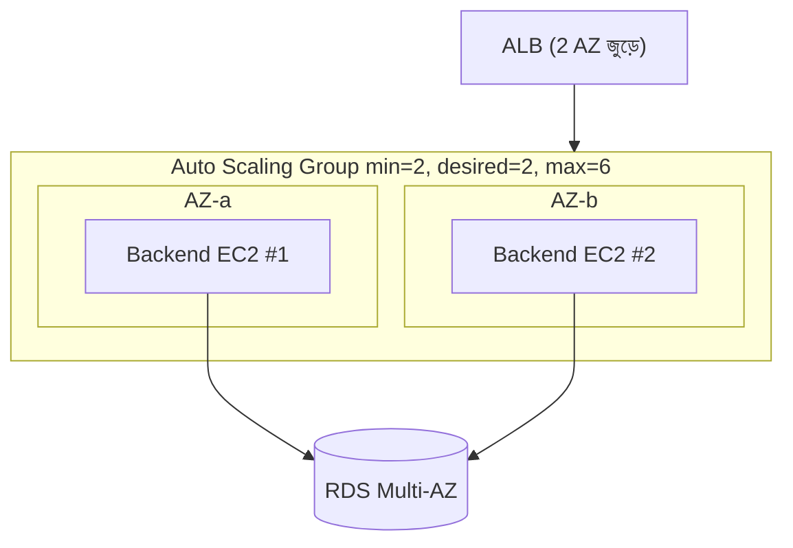
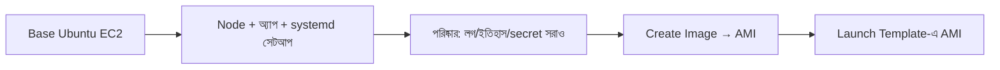
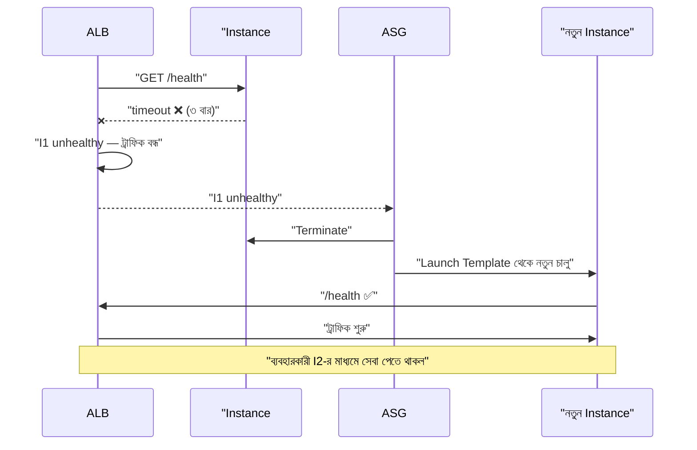
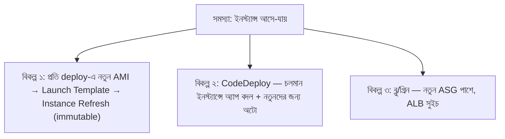
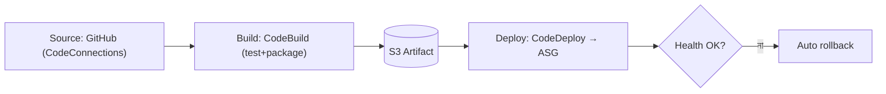
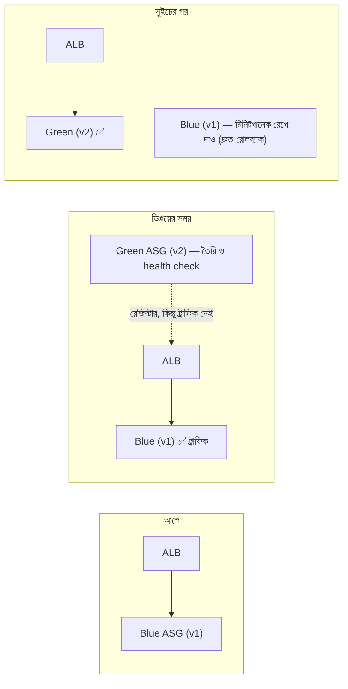

# Module 10 — High Availability Auto Scaling and AWS CodePipeline

> **Section 2 · CI/CD, Observability & Infrastructure as Code** · ২টি Live Class
> **Project:** Build the Cloud with Code
> **Goal:** AWS-এ CI/CD ও IaC সহ একটি highly available, auto-scaling three-tier সিস্টেম।
> **Assignment ★:** প্রদর্শন করো — একটা instance ফেল করল, নিজে নিজে সেরে উঠল, কোনো user-facing downtime নেই।

---

## 📖 গল্প: একজন দোকানদার বনাম একটা দল

BookNest-এ এতদিন ব্যাকএন্ড চালাত **একজনই কর্মচারী** (একটা EC2)। সে অসুস্থ হলে দোকান বন্ধ। বইমেলায় ভিড় বাড়লে সে হাঁপিয়ে যেত।

এবার তানভীর একটা **ম্যানেজড দল** বানাল (Auto Scaling Group):

- ভিড় বাড়লে **নিজে থেকে** আরও কর্মচারী ডাকে (scale out), ভিড় কমলে ছেড়ে দেয় (scale in) — খরচ বাঁচে।
- কেউ অসুস্থ হলে (**health check** ফেল) ম্যানেজার তাকে সরিয়ে **নতুন একজন নেয়** (self-healing)।
- নতুন কর্মচারী নিতে "প্রশিক্ষণ-খাতা" (**AMI + Launch Template**) থেকে হুবহু একই দক্ষতার লোক বানায়।
- ডেলিভারির নতুন নিয়ম চালু করতে (deploy) পুরনো দল না থামিয়ে **নতুন দল** দাঁড় করিয়ে ফটকের ট্রাফিক সরিয়ে দেয় (**blue/green**)।

---

# 🧩 Live Class 1 — Auto Scaling for Three-Tier (High Availability and Self-Healing)

## 1. High Availability (HA) মানে কী?

| ধারণা | অর্থ |
|---|---|
| **HA** | একটা অংশ ফেল করলেও সিস্টেম চলে |
| **Fault tolerance** | ফেল হলে ব্যবহারকারী টেরই পায় না |
| **Scalability** | চাহিদা অনুযায়ী ছোট-বড় হওয়া |
| **Elasticity** | স্বয়ংক্রিয় scale (বাড়া ও কমা) |
| **Self-healing** | অসুস্থ অংশ নিজে বদলে ফেলা |



**মূল প্রয়োজন: Stateless অ্যাপ।** ইনস্ট্যান্স যেকোনো সময় মরতে/জন্মাতে পারে, তাই:
- সেশন/আপলোড ফাইল ইনস্ট্যান্সের ডিস্কে নয় → **S3 / Redis / DB**-তে।
- কনফিগ/secret বেক করা নয় → **SSM Parameter Store / Secrets Manager** থেকে boot-এ।
- লগ লোকাল নয় → Loki/CloudWatch-এ পাঠানো (M07)।

## 2. AMI তৈরি — "সোনার ছাঁচ"

কেন? নতুন instance বুট হয়ে ম্যানুয়ালি `apt install` করলে মিনিট লাগে ও ভুল হয়। **আগে থেকে সব বসানো ছবি (AMI)** থেকে বুট = দ্রুত ও নির্ভরযোগ্য।



```bash
# চলমান "সোনার" instance থেকে AMI
aws ec2 create-image \
  --instance-id i-0abc123 \
  --name "booknest-backend-$(date +%Y%m%d-%H%M)" \
  --no-reboot
# --no-reboot : চলমান ইনস্ট্যান্স রিবুট না করে (ফাইল-সিস্টেম সঙ্গতি কম নিশ্চিত — প্রোডাকশনে রিবুটসহ নেওয়া নিরাপদ)
```

> **আরও ভালো:** **EC2 Image Builder** বা **Packer** — AMI বানানোও কোড/পাইপলাইনে। হাতে-বানানো AMI মানে নিজেই একটা "snowflake সার্ভার"।

## 3. Launch Template

```hcl
resource "aws_launch_template" "backend" {
  name_prefix   = "booknest-backend-"
  image_id      = var.backend_ami_id
  instance_type = "t3.small"

  iam_instance_profile { name = aws_iam_instance_profile.backend.name }  # SSM + Secrets Manager পড়ার অনুমতি

  vpc_security_group_ids = [aws_security_group.app.id]

  metadata_options { http_tokens = "required" }      # IMDSv2

  # boot-এ চলা স্ক্রিপ্ট: secret আনা + সার্ভিস চালু
  user_data = base64encode(<<-EOT
    #!/bin/bash
    set -euo pipefail
    # DB পাসওয়ার্ড বুটের সময় Secrets Manager থেকে — AMI/কোডে নেই
    SECRET=$(aws secretsmanager get-secret-value --secret-id booknest/db --query SecretString --output text)
    echo "DB_PASSWORD=$(echo $SECRET | jq -r .password)" >> /opt/booknest/shared/.env
    systemctl enable --now booknest-backend
  EOT
  )

  tag_specifications {
    resource_type = "instance"
    tags = { Name = "booknest-backend", Environment = var.environment }
  }

  lifecycle { create_before_destroy = true }    # নতুন template আগে, পুরনো পরে — ফাঁক নেই
}
```

## 4. Auto Scaling Group

```hcl
resource "aws_autoscaling_group" "backend" {
  name                = "booknest-backend"
  min_size            = 2          # সর্বনিম্ন ২ — একটা মরলেও সেবা চলে (দুই AZ)
  desired_capacity    = 2
  max_size            = 6          # খরচের ছাদ — অনিয়ন্ত্রিত scale থেকে বিল-সুরক্ষা

  vpc_zone_identifier = aws_subnet.app[*].id           # দুই AZ-র private app subnet
  target_group_arns   = [aws_lb_target_group.backend.arn]

  # ⭐ health_check_type = "ELB": ALB-র /health ফেল হলেও ইনস্ট্যান্স বদল
  # "EC2" হলে শুধু মেশিন-মরা ধরে; অ্যাপ-মরা ধরে না!
  health_check_type         = "ELB"
  health_check_grace_period = 120      # বুটের পর ২ মিনিট সময়; নইলে অ্যাপ উঠতে না উঠতেই "অসুস্থ" ধরে মেরে ফেলবে

  launch_template {
    id      = aws_launch_template.backend.id
    version = "$Latest"
  }

  instance_refresh {                   # Launch Template বদলালে ধাপে ধাপে ইনস্ট্যান্স বদল
    strategy = "Rolling"
    preferences { min_healthy_percentage = 50 }
  }

  tag {
    key                 = "Name"
    value               = "booknest-backend"
    propagate_at_launch = true
  }
}
```

### Self-healing-এর প্রবাহ



## 5. Scaling Policy

### Target Tracking (সবচেয়ে সহজ — প্রথমে এটাই)

"CPU গড়ে ~৫০% রাখো" — ASG নিজে হিসাব করে।

```hcl
resource "aws_autoscaling_policy" "cpu_target" {
  name                   = "cpu-target-50"
  autoscaling_group_name = aws_autoscaling_group.backend.name
  policy_type            = "TargetTrackingScaling"

  target_tracking_configuration {
    predefined_metric_specification {
      predefined_metric_type = "ASGAverageCPUUtilization"
    }
    target_value = 50          # থার্মোস্ট্যাটের মতো: ৫০% এর কাছাকাছি রাখার চেষ্টা
  }
}
```

আরও ভালো মেট্রিক: **`ALBRequestCountPerTarget`** (প্রতি instance-এ কত রিকোয়েস্ট) — CPU-র চেয়ে আসল চাহিদা বেশি প্রতিফলিত করে।

### Step Scaling

মেট্রিক কত ছাড়ালে কত যোগ হবে — ধাপে ধাপে: CPU 60–75% → +1, 75–90% → +2, >90% → +3। বেশি নিয়ন্ত্রণ, বেশি জটিলতা।

| নীতি | কখন |
|---|---|
| **Target tracking** | ডিফল্ট পছন্দ |
| **Step** | ধাপভিত্তিক সূক্ষ্ম নিয়ন্ত্রণ |
| **Scheduled** | জানা প্যাটার্ন (সকাল ৯টা — ভিড়, রাত ২টা — শান্ত) |
| **Predictive** | ঐতিহাসিক ডেটায় আগাম |

**Cooldown/warm-up:** বারবার scale in/out ("flapping") ঠেকাতে অপেক্ষার সময়।

## 6. ALB ইন্টিগ্রেশন ও ডিরেজিস্ট্রেশন ডিলে

- ASG ইনস্ট্যান্স নিজে টার্গেট গ্রুপে রেজিস্টার/ডিরেজিস্টার করে।
- Scale-in-এ ইনস্ট্যান্স মারার আগে ALB **deregistration delay** (ডিফল্ট ৩০০s) অপেক্ষা করে চলমান রিকোয়েস্ট শেষ করতে। দ্রুত API-তে ৩০–৬০s যথেষ্ট:

```hcl
resource "aws_lb_target_group" "backend" {
  # ...
  deregistration_delay = 30      # চলমান রিকোয়েস্ট শেষ হওয়ার জন্য ৩০ সেকেন্ড; ডিফল্ট ৩০০ অকারণ দীর্ঘ
}
```

## 7. 💰 Scaling-এর খরচ

| ঝুঁকি | সুরক্ষা |
|---|---|
| ট্রাফিক-আক্রমণে অসীম scale | `max_size` সীমা + WAF + budget alarm |
| সব সময় বড় `min` | `min` ন্যূনতম রাখো (২ = HA-র জন্য) |
| Idle NAT/ALB | নন-প্রোড সন্ধ্যায় বন্ধ (scheduled scaling to 0) |
| অনুপযুক্ত instance size | right-sizing (M20) |
| **Spot** instance | ৭০–৯০% সাশ্রয় — stateless ওয়ার্কলোডে mixed instances policy |

## 8. 🧪 Failure প্রদর্শন (Assignment — "Chaos" ছোট পরীক্ষা)

```bash
# ১. দুটো instance healthy; ব্রাউজারে সাইট চলছে।
# ২. আলাদা টার্মিনালে অবিরাম রিকোয়েস্ট (downtime ধরার জন্য):
while true; do curl -s -o /dev/null -w "%{http_code} %{time_total}\n" https://booknest.example.com/api/health; sleep 0.5; done

# ৩. একটা instance মেরে ফেলো:
aws ec2 terminate-instances --instance-ids i-0abc123

# ৪. পর্যবেক্ষণ: curl আউটপুটে 200 চলতেই থাকে (অন্যটা সামলাচ্ছে);
#    ASG Activity ট্যাবে "Launching a new EC2 instance" — নিজে সেরে উঠল ✅
```
Grafana-য় (M07) request error rate গ্রাফ সমতল থাকা — এটাই প্রমাণ।

---

# 🧩 Live Class 2 — CI/CD with AWS CodePipeline to Auto Scaling Groups

## 9. ASG-তে CI/CD-র চ্যালেঞ্জ

M06-তে আমরা একটা সার্ভারে SSH/SSM করতাম। এখন সার্ভার **অনেক ও অস্থায়ী** — কোনগুলোতে deploy করব? নতুন যেগুলো জন্মাবে সেগুলোতে কী হবে?



## 10. CodePipeline — তিন ধাপ



| সেবা | কাজ |
|---|---|
| **CodePipeline** | পুরো পাইপলাইনের অর্কেস্ট্রেটর |
| **CodeBuild** | ভাড়ার বিল্ড-মেশিন — টেস্ট ও প্যাকেজ |
| **CodeDeploy** | ইনস্ট্যান্সে ডিপ্লয় — in-place বা blue/green |
| **CodeConnections** | GitHub-এর সাথে নিরাপদ সংযোগ |

> **GitHub Actions vs CodePipeline?** দুটোই ঠিক। কোর্স AWS-নেটিভ পাইপলাইনও শেখায় (সার্টিফিকেশন ও এন্টারপ্রাইজে সাধারণ)। Actions → সহজ, কমিউনিটি; CodePipeline → IAM/AWS-ইন্টিগ্রেশন গভীর, কোনো বাইরের credential লাগে না।

### CodeBuild — `buildspec.yml`

```yaml
# buildspec.yml (repo-র রুটে)
version: 0.2
phases:
  install:
    runtime-versions:
      nodejs: 20                 # বিল্ড-মেশিনে Node ভার্সন আটকানো
  pre_build:
    commands:
      - npm ci
      - npm test                 # টেস্ট ফেল = বিল্ড ফেল = ডিপ্লয় হবে না
  build:
    commands:
      - npm run build
  post_build:
    commands:
      - echo "Build done $(date)"
artifacts:
  files:
    - 'dist/**/*'
    - 'package*.json'
    - 'appspec.yml'
    - 'scripts/**/*'             # CodeDeploy হুক স্ক্রিপ্ট
cache:
  paths:
    - 'node_modules/**/*'
```

### CodeDeploy — `appspec.yml` ও লাইফসাইকেল হুক

```yaml
# appspec.yml
version: 0.0
os: linux
files:
  - source: /
    destination: /opt/booknest/current     # বান্ডেল কোথায় নামবে
hooks:
  ApplicationStop:
    - location: scripts/stop.sh            # পুরনো অ্যাপ বন্ধ
      timeout: 60
  AfterInstall:
    - location: scripts/install_deps.sh    # npm ci --omit=dev
      timeout: 180
  ApplicationStart:
    - location: scripts/start.sh           # সার্ভিস চালু
      timeout: 60
  ValidateService:
    - location: scripts/validate.sh        # ⭐ health check — ফেল হলে ডিপ্লয় ব্যর্থ/রোলব্যাক
      timeout: 120
```

```bash
#!/usr/bin/env bash
# scripts/validate.sh — ডিপ্লয় সফল ধরার আগে চূড়ান্ত পরীক্ষা
set -e
for i in $(seq 1 15); do
  if curl -fsS http://127.0.0.1:3000/health > /dev/null; then
    echo "healthy"; exit 0           # exit 0 = সফল
  fi
  sleep 2
done
echo "unhealthy"; exit 1              # non-zero = CodeDeploy ডিপ্লয় ব্যর্থ ধরে
```

## 11. Blue/Green Deployment কৌশল



| কৌশল | কীভাবে | সুবিধা | অসুবিধা |
|---|---|---|---|
| **In-place / Rolling** | চলমান instance-এ ক্রমে বদল | সস্তা | বদলের সময় ক্ষমতা কম; রোলব্যাক ধীর |
| **Blue/Green** | নতুন সম্পূর্ণ পরিবেশ, ট্রাফিক সুইচ | **zero-downtime, তাৎক্ষণিক রোলব্যাক** | সাময়িক দ্বিগুণ খরচ |
| **Canary** | ট্রাফিকের ৫-১০% নতুনে, ঠিক থাকলে বাড়াও | ঝুঁকি ন্যূনতম | জটিল (M15-এ Argo Rollouts) |

**Zero-downtime কৌশলসমূহ:** health check-সহ গ্রেস পিরিয়ড; connection draining (deregistration delay); **ডাটাবেস মাইগ্রেশন backward-compatible** (expand → migrate → contract) যাতে v1 ও v2 একই DB-তে একসাথে চলতে পারে।

## 12. Terraform দিয়ে Pipeline তৈরি (রূপরেখা)

```hcl
resource "aws_codedeploy_app" "backend" {
  name             = "booknest-backend"
  compute_platform = "Server"
}

resource "aws_codedeploy_deployment_group" "backend" {
  app_name              = aws_codedeploy_app.backend.name
  deployment_group_name = "prod"
  service_role_arn      = aws_iam_role.codedeploy.arn
  autoscaling_groups    = [aws_autoscaling_group.backend.name]

  deployment_style {
    deployment_type   = "BLUE_GREEN"
    deployment_option = "WITH_TRAFFIC_CONTROL"   # ALB-র মাধ্যমে ট্রাফিক সরানো
  }

  blue_green_deployment_config {
    deployment_ready_option { action_on_timeout = "CONTINUE_DEPLOYMENT" }
    green_fleet_provisioning_option { action = "COPY_AUTO_SCALING_GROUP" }   # নতুন ASG = পুরনোর কপি
    terminate_blue_instances_on_deployment_success {
      action                           = "TERMINATE"
      termination_wait_time_in_minutes = 5       # ৫ মিনিট blue রাখো — দ্রুত ফিরে যাওয়ার সুযোগ
    }
  }

  load_balancer_info {
    target_group_info { name = aws_lb_target_group.backend.name }
  }

  auto_rollback_configuration {
    enabled = true
    events  = ["DEPLOYMENT_FAILURE", "DEPLOYMENT_STOP_ON_ALARM"]    # ফেল বা CloudWatch অ্যালার্মে অটো রোলব্যাক
  }
}

resource "aws_codepipeline" "backend" {
  name     = "booknest-backend"
  role_arn = aws_iam_role.codepipeline.arn

  artifact_store {
    location = aws_s3_bucket.artifacts.bucket
    type     = "S3"
  }

  stage {
    name = "Source"
    action {
      name             = "GitHub"
      category         = "Source"
      owner            = "AWS"
      provider         = "CodeStarSourceConnection"
      version          = "1"
      output_artifacts = ["source"]
      configuration = {
        ConnectionArn    = aws_codestarconnections_connection.github.arn
        FullRepositoryId = "my-org/booknest-backend"
        BranchName       = "main"
      }
    }
  }

  stage {
    name = "Build"
    action {
      name             = "CodeBuild"
      category         = "Build"
      owner            = "AWS"
      provider         = "CodeBuild"
      version          = "1"
      input_artifacts  = ["source"]
      output_artifacts = ["build"]
      configuration    = { ProjectName = aws_codebuild_project.backend.name }
    }
  }

  stage {
    name = "Deploy"
    action {
      name            = "CodeDeploy"
      category        = "Deploy"
      owner           = "AWS"
      provider        = "CodeDeploy"
      version         = "1"
      input_artifacts = ["build"]
      configuration = {
        ApplicationName     = aws_codedeploy_app.backend.name
        DeploymentGroupName = aws_codedeploy_deployment_group.backend.deployment_group_name
      }
    }
  }
}
```
> (এটি সংক্ষিপ্ত রূপরেখা — IAM role, S3 বাকেট, CodeBuild প্রজেক্ট, CodeConnections রিসোর্স আলাদা লাগবে; ক্লাসে পূর্ণ কোড দেখানো হবে।) Frontend-এর জন্য আলাদা, সরল পাইপলাইন: build → S3/Nginx-ইনস্ট্যান্সে বা (পরে) CloudFront।

## ⚠️ সাধারণ ভুল

| সমস্যা | কারণ |
|---|---|
| ইনস্ট্যান্স অনবরত মরছে-জন্মাচ্ছে | `health_check_grace_period` কম / অ্যাপ বুটে সময় নেয় / health path ভুল |
| ASG scale-out হচ্ছে না | `max_size` ছোঁয়া, বা মেট্রিক ভুল, বা সাবনেটে IP ফুরিয়েছে |
| নতুন ইনস্ট্যান্সে পুরনো কোড | AMI-তে পুরনো অ্যাপ; CodeDeploy ASG-র সাথে সংযুক্ত নয় |
| CodeDeploy ফেল | `appspec` পাথ/permission ভুল, agent চলছে না, `validate.sh` exit কোড |
| বিল আশ্চর্যজনক | ভুলে যাওয়া green fleet / `max_size` অতি-বড় |
| Blue/green-এ DB ভাঙে | স্কিমা backward-incompatible বদল |

## ✅ চেকলিস্ট

- [ ] AMI (বা Image Builder) + Launch Template
- [ ] ASG min2/max N, ২ AZ, `health_check_type=ELB`
- [ ] Target tracking policy
- [ ] অ্যাপ stateless; secret boot-এ Secrets Manager থেকে
- [ ] Instance মেরে স্ব-সুস্থতা প্রদর্শন (zero downtime)
- [ ] CodePipeline: Source → Build → Deploy; blue/green + auto rollback
- [ ] সব Terraform-এ

## 🎯 ইন্টারভিউ প্রশ্ন

1. Scale up/down (vertical) বনাম scale out/in (horizontal)?
2. ASG-তে `EC2` vs `ELB` health check type?
3. Target tracking vs step vs scheduled scaling?
4. Blue/green বনাম rolling বনাম canary?
5. Stateless কেন জরুরি? কী কী state বাইরে নিতে হয়?
6. CodeDeploy-র লাইফসাইকেল হুকগুলো কী কী?
7. DB-সহ blue/green-এ স্কিমা পরিবর্তন কীভাবে সামলাবে?
8. Immutable infrastructure কী?

## 🧠 সারসংক্ষেপ

**ASG = স্বয়ংক্রিয় দল-ব্যবস্থাপক**: ভিড়ে বাড়ে, অসুস্থকে বদলায়। **AMI + Launch Template = প্রশিক্ষণ-খাতা**। **Blue/Green = পুরনো দল না থামিয়ে নতুন দল**। উচ্চ প্রাপ্যতার মূলমন্ত্র: *সবকিছু বদলযোগ্য (replaceable) বানাও, কিছুকে প্রিয় পোষা প্রাণী (pet) নয়, গবাদি পশু (cattle) ভাবো।*

⬅️ [Module 09](./module-09-infrastructure-as-code-terraform.md) · ➡️ [Module 11 (Exam Week 2)](./module-11-exam-week-2.md)
