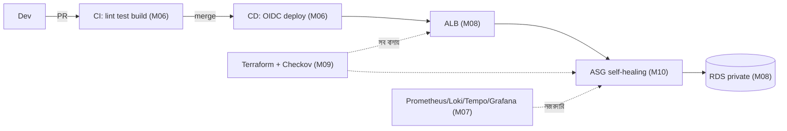

# Module 11 — Exam Week 2

> **Section 2 · CI/CD, Observability & IaC** · এক্সাম উইক
> **কভার করে:** Module 06 – Module 10
> **ধরন:** বড় অ্যাসাইনমেন্ট + লাইভ টেস্ট। **ঝালিয়ে নিতে পারবে নিজেকে।**

---

## 📖 গল্প: দ্বিতীয় পরীক্ষা — "ভেঙে দেখাব"

প্রথম পরীক্ষায় সার্ভার ভাঙা হয়েছিল। এবার মেন্টর **পাইপলাইন ভাঙবেন**, **Terraform-এ ভুল ঢোকাবেন**, **একটা instance মারবেন** — আর দেখবেন তানভীরের সিস্টেম নিজে সামলায় কিনা। পরীক্ষা শুধু "বানাতে পারো?" নয়, **"ভাঙলে টের পাও? ঠিক করতে পারো?"**

---

## 1. পুরো ছবি — এই সপ্তাহে যা মিলিয়ে নিতে হবে

## 2. Mock Lab (লক্ষ্য: ৩–৪ ঘণ্টা)

1. **IaC:** Terraform দিয়ে VPC (২ AZ), subnet তিন স্তর, NAT, ALB, SG চেইন, RDS (private) — remote state সহ।
2. **Compute:** Launch Template + ASG (min 2), `health_check_type=ELB`।
3. **CI/CD:** PR-এ CI + Terraform plan comment + Checkov; main merge-এ OIDC দিয়ে deploy; health check ও rollback।
4. **Observability:** একটা dashboard যাতে golden signals + একটা slow request → trace → log।
5. **ভাঙো ও সারাও:** একটা instance terminate করো; Nginx/অ্যাপ config ভুল push করো — pipeline/health check আটকাল?
6. `terraform destroy` — **সব মুছে খরচ শূন্যে** (বিল বাঁচানো পরীক্ষারও অংশ)।

## 3. টপিকভিত্তিক রিভিশন

### M06 — CI/CD
- [ ] CI/CD পার্থক্য; workflow/job/step/runner
- [ ] `permissions` ন্যূনতম; actions SHA-pin; script injection
- [ ] OIDC trust policy-র `sub` শর্ত; কেন স্থায়ী key নয়
- [ ] Rollback কৌশল ৩টা মুখে বলতে পারি

### M07 — Observability
- [ ] তিন স্তম্ভ ও golden signals
- [ ] PromQL: `rate()`, `histogram_quantile`, error %
- [ ] OTel: SDK → Collector → Tempo; `trace_id` লগে
- [ ] ভালো alert = symptom-based + `for:` + runbook

### M08 — Networking
- [ ] Public vs private = route table
- [ ] SG চেইনিং; ALB listener/rule/target group
- [ ] NAT কেন; খরচ-ঝুঁকি; VPC endpoint
- [ ] SSM Session Manager বনাম bastion

### M09 — Terraform
- [ ] `init/plan/apply/destroy`; plan-এ `-/+` ঝুঁকি
- [ ] Remote state + lock; state-এ secret ঝুঁকি
- [ ] Module, `count` vs `for_each`
- [ ] tflint ও Checkov; drift

### M10 — HA ও Blue/Green
- [ ] Stateless কেন; AMI + Launch Template
- [ ] ASG health check `ELB` vs `EC2`; grace period
- [ ] Target tracking; scaling খরচ
- [ ] Blue/green vs rolling vs canary; CodeDeploy হুক

## 4. দুশ্চিন্তার সম্ভাব্য লাইভ-টেস্ট দৃশ্য ও দ্রুত নির্ণয়

| লক্ষণ | প্রথমে কী দেখবে |
|---|---|
| Pipeline OIDC-তে `Could not assume role` | Trust policy `sub`/`aud`, workflow-তে `id-token: write` |
| ALB 502/503 | Target Group health, `sg-app` ← `sg-alb`, health path |
| ASG instance ঘুরে-ফিরে মরছে | grace period, `/health`, user-data লগ |
| `terraform plan` অপ্রত্যাশিত `-/+` | কোন attribute "forces replacement"? |
| Grafana "No data" | data source, time range, মেট্রিক নাম |
| CodeDeploy ফেল | `/opt/codedeploy-agent/deployment-root/.../logs/scripts.log` |

## 5. লিখিত/মৌখিক নমুনা প্রশ্ন

1. একটা commit `main`-এ merge হওয়ার পর থেকে production-এ পৌঁছানো পর্যন্ত পুরো পথ বর্ণনা করো (কোন কোন সেবা, কোথায় নিরাপত্তা)।
2. তোমার ASG-র একটা instance মরলে কী কী ঘটে, ধাপে ধাপে?
3. Terraform plan-এ তুমি কী কী দেখে "এটা apply করা নিরাপদ নয়" বলবে?
4. DB-সহ blue/green কীভাবে করবে?
5. কীভাবে নিশ্চিত হবে, বাইরে থেকে DB পৌঁছানো যায় না?

## 6. পরীক্ষা-পরবর্তী

- ভুলের তালিকা `exam-2-mistakes.md`-এ।
- **খরচ-অডিট:** Cost Explorer দেখো; কোনো ঘুমন্ত NAT/ALB/RDS আছে?

➡️ পরের সেকশন: [Module 12 — Dockerizing the Three-Tier Application](../section-3-containers-kubernetes-platform/module-12-dockerizing-the-three-tier-application.md)
