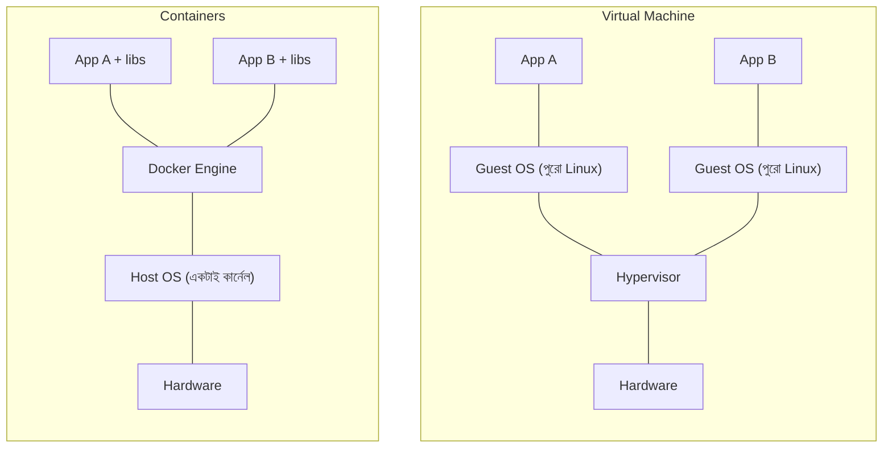
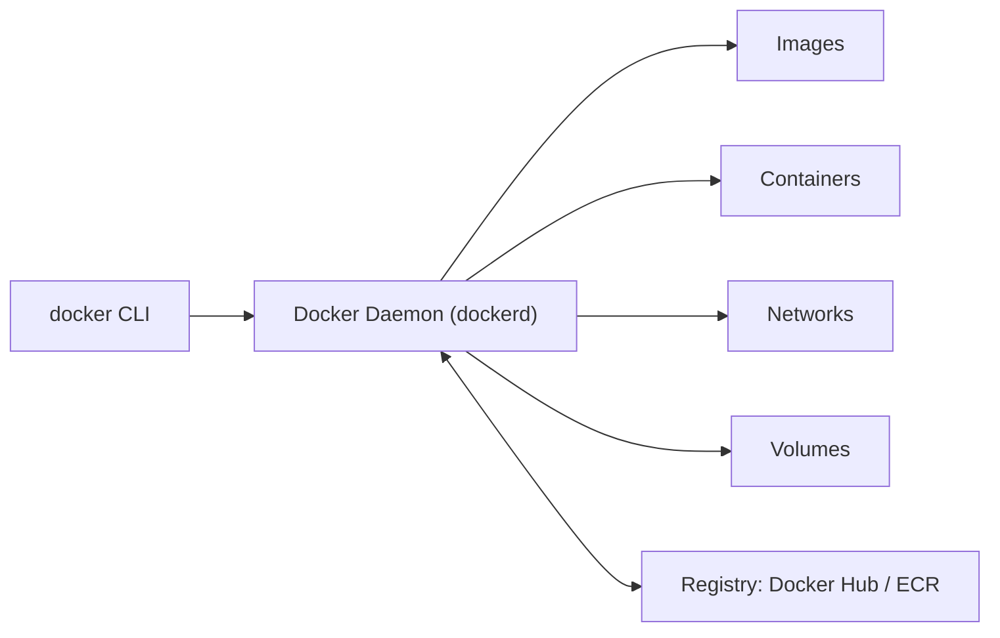
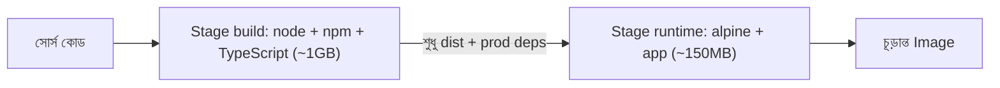
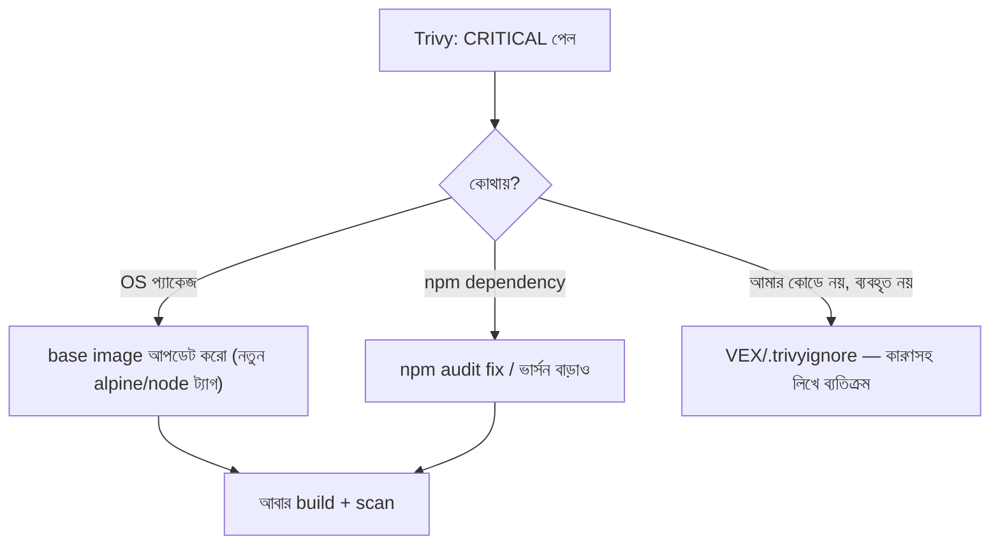
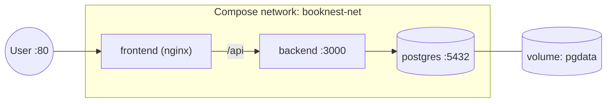

# Module 12 — Dockerizing the Three-Tier Application

> **Section 3 · Containers, Kubernetes & Platform** · ২টি Live Class
> **Project:** Move the App to Kubernetes
> **Goal:** Scanned image, CI/CD, logging ও monitoring সহ একটা containerized three-tier অ্যাপ।
> **Assignment ★:** Image একটা লক্ষ্য-সাইজের নিচে, এবং **কোনো critical vulnerability নেই**।

---

## 📖 গল্প: "আমার মেশিনে চলে" মহামারীর টিকা

তানভীর ASG-র নতুন instance-এ অ্যাপ তোলে — কখনো Node ভার্সন আলাদা, কখনো একটা প্যাকেজ বাদ। বন্ধু নিজের ল্যাপটপে চালাতে গিয়ে ২ ঘণ্টা সেটআপে ব্যয় করল।

এরপর সে শিখল **কনটেইনার** — **শিপিং কন্টেইনারের** ধারণা। জাহাজে মাল পাঠাতে কেউ চাল, কাঁচ, গাড়ি আলাদা করে সাজায় না; সব **একই মাপের বাক্সে** ভরে। বাক্সের ভেতরে কী আছে জাহাজের জানার দরকার নেই। ঠিক তেমনি: অ্যাপ + তার Node + তার লাইব্রেরি — সব এক **image** বাক্সে। যেখানেই চালাও (ল্যাপটপ, EC2, Kubernetes) — হুবহু একই।

---

# 🧩 Live Class 1 — Docker Fundamentals and Containerizing the Application

## 1. Container বনাম Virtual Machine



| | VM | Container |
|---|---|---|
| বুট | মিনিট | সেকেন্ড/মিলিসেকেন্ড |
| সাইজ | GB | MB |
| আইসোলেশন | শক্তিশালী (আলাদা কার্নেল) | হালকা (কার্নেল ভাগাভাগি; namespace/cgroup) |
| ঘনত্ব | কম | অনেক বেশি |
| ব্যবহার | OS-স্তরের আলাদা প্রয়োজন | অ্যাপ প্যাকেজিং ও মাইক্রোসার্ভিস |

> ⚠️ কার্নেল ভাগ হয় বলে কনটেইনার VM-এর মতো শক্ত নিরাপত্তা-সীমা নয় — তাই non-root ইউজার, read-only ফাইল-সিস্টেম, ন্যূনতম image ইত্যাদি অভ্যাস গুরুত্বপূর্ণ।

## 2. Docker Architecture ও মূল শব্দ



| শব্দ | উপমা |
|---|---|
| **Image** | রেসিপি + সাজানো উপকরণ (শুধু-পড়া টেমপ্লেট) |
| **Container** | রেসিপি থেকে রান্না-হওয়া চলমান খাবার (image-এর চলমান রূপ) |
| **Dockerfile** | রেসিপি লেখার নির্দেশনা |
| **Registry** | রেসিপির লাইব্রেরি (Docker Hub, **ECR**) |
| **Volume** | কনটেইনারের বাইরে স্থায়ী ডেটার ডিস্ক |
| **Layer** | image-এর প্রতিটা Dockerfile ধাপ একেকটা ক্যাশযোগ্য স্তর |

### ইনস্টল ও প্রাথমিক কমান্ড

```bash
sudo apt update && sudo apt install -y docker.io
sudo usermod -aG docker $USER      # sudo ছাড়া docker চালাতে; লগআউট-লগইন লাগবে
newgrp docker

docker run hello-world             # যাচাই
docker run -d --name web -p 8080:80 nginx   # -d ব্যাকগ্রাউন্ড; -p হোস্ট:কনটেইনার পোর্ট
docker ps                          # চলমান কনটেইনার
docker logs -f web                 # লগ
docker exec -it web sh             # ভেতরে ঢোকা (debug-এর জন্য)
docker stop web && docker rm web   # বন্ধ ও মোছা
docker images                      # স্থানীয় image
docker system df                   # ডিস্ক ব্যবহার; docker system prune → অব্যবহৃত পরিষ্কার
```

## 3. Dockerfile — Backend (সাধারণ বনাম ভালো)

### ❌ নতুনদের প্রথম চেষ্টা

```dockerfile
FROM node:20
WORKDIR /app
COPY . .                    # সব কপি: node_modules, .git, .env পর্যন্ত!
RUN npm install
RUN npm run build
CMD ["node", "dist/main.js"]
# সমস্যা: ১GB+ image, ক্যাশ কাজ করে না (কোড বদলালেই npm install আবার), root হিসেবে চলে, secret ঢুকে যেতে পারে
```

### ✅ Multi-stage build — ছোট, নিরাপদ, ক্যাশ-বান্ধব

```dockerfile
# ---------- Stage 1: build (ভারী টুলস এখানে; চূড়ান্ত image-এ যাবে না) ----------
FROM node:20-alpine AS build
WORKDIR /app

# প্রথমে শুধু package ফাইল কপি — কেন? Docker স্তর ক্যাশ করে।
# কোড বদলালে কিন্তু dependency না বদলালে `npm ci` স্তর ক্যাশ থেকে আসে → বিল্ড দ্রুত
COPY package.json package-lock.json ./
RUN npm ci

COPY . .
RUN npm run build && npm prune --omit=dev    # build-এর পর devDependencies ছাঁটাই

# ---------- Stage 2: runtime (শুধু যা চালাতে লাগে) ----------
FROM node:20-alpine AS runtime
ENV NODE_ENV=production
WORKDIR /app

# non-root ইউজার: কনটেইনার ভাঙলে হ্যাকার root পাবে না
RUN addgroup -S app && adduser -S app -G app

# build stage থেকে শুধু প্রয়োজনীয় জিনিস কপি — কম্পাইলার, সোর্স, ক্যাশ বাদ
COPY --from=build --chown=app:app /app/dist ./dist
COPY --from=build --chown=app:app /app/node_modules ./node_modules
COPY --from=build --chown=app:app /app/package.json ./

USER app                       # এখন থেকে root নয়
EXPOSE 3000                    # ডকুমেন্টেশন (আসলে পোর্ট খোলে না; -p/Service খোলে)

# কনটেইনারের নিজস্ব health check
HEALTHCHECK --interval=30s --timeout=3s --start-period=20s --retries=3 \
  CMD wget -qO- http://127.0.0.1:3000/health || exit 1

CMD ["node", "dist/main.js"]   # exec ফর্ম (JSON array): সিগন্যাল (SIGTERM) সরাসরি node-এ পৌঁছায় → graceful shutdown
```

```text
# .dockerignore — কেন? অনাকাঙ্ক্ষিত ফাইল (secret/বিশাল ফোল্ডার) build context-এ ঢোকা আটকায়
node_modules
dist
.git
.env
*.pem
Dockerfile
docker-compose*.yml
npm-debug.log
```



## 4. Frontend Dockerfile — Build + Nginx

```dockerfile
# Stage 1: React build
FROM node:20-alpine AS build
WORKDIR /app
COPY package*.json ./
RUN npm ci
COPY . .
ARG VITE_API_URL=/api            # build-time argument: API-র ঠিকানা frontend কোডে ঢোকে
ENV VITE_API_URL=$VITE_API_URL
RUN npm run build

# Stage 2: শুধু Nginx + build-করা static ফাইল (Node-ই নেই!)
FROM nginxinc/nginx-unprivileged:alpine    # non-root Nginx image — port 8080-এ চলে
COPY --from=build /app/dist /usr/share/nginx/html
COPY nginx.conf /etc/nginx/conf.d/default.conf
EXPOSE 8080
```

```nginx
# nginx.conf (frontend কনটেইনারের ভেতরের)
server {
    listen 8080;
    root /usr/share/nginx/html;
    location / { try_files $uri /index.html; }   # SPA fallback
    location = /healthz { return 200 "ok"; }
}
```

## 5. Image Best Practices — চেকলিস্ট

| অনুশীলন | কারণ |
|---|---|
| Multi-stage build | image ছোট, আক্রমণ-পৃষ্ঠ কম |
| ছোট base image (`alpine`, `-slim`, distroless) | দুর্বলতা কম, ডাউনলোড দ্রুত |
| **নির্দিষ্ট ভার্সন ট্যাগ** (`node:20.11-alpine`), `latest` নয় | পুনরুৎপাদনযোগ্য |
| non-root `USER` | privilege escalation কমায় |
| `.dockerignore` | secret/বাড়তি ফাইল আটকায় |
| dependency ফাইল আগে কপি | স্তর-ক্যাশের সুবিধা |
| `HEALTHCHECK` | অর্কেস্ট্রেটর অসুস্থ কনটেইনার ধরতে পারে |
| secret কখনো `ENV`/`ARG`/image-এ নয় | `docker history`-তে দেখা যায়! |

## 6. DockerHub ও AWS ECR-এ পুশ

```bash
# Docker Hub
docker login
docker build -t booknest-backend:1.0.0 ./backend
docker tag booknest-backend:1.0.0 myuser/booknest-backend:1.0.0
docker push myuser/booknest-backend:1.0.0

# --- AWS ECR (প্রাইভেট রেজিস্ট্রি; IAM দিয়ে নিয়ন্ত্রিত) ---
aws ecr create-repository --repository-name booknest-backend \
  --image-scanning-configuration scanOnPush=true \
  --image-tag-mutability IMMUTABLE        # একই ট্যাগ ওভাররাইট নিষেধ — "1.0.0" সবসময় একই জিনিস

ACCOUNT=$(aws sts get-caller-identity --query Account --output text)
REGION=ap-southeast-1
REG=$ACCOUNT.dkr.ecr.$REGION.amazonaws.com

# ECR লগইন: অস্থায়ী টোকেন (১২ ঘণ্টা) — স্থায়ী পাসওয়ার্ড নয়
aws ecr get-login-password --region $REGION | docker login --username AWS --password-stdin $REG

docker tag booknest-backend:1.0.0 $REG/booknest-backend:1.0.0
docker push $REG/booknest-backend:1.0.0
```

> **ট্যাগিং কৌশল:** `1.0.0` (সেমভার) + `git-sha` (যেমন `a1b2c3d`) — কোন কোড থেকে এই image তা সবসময় জানা যায়।

## 7. Trivy দিয়ে Vulnerability Scan

```bash
# Trivy ইনস্টল (Ubuntu) — অফিসিয়াল নির্দেশনা অনুসরণ করো
# image স্ক্যান: HIGH ও CRITICAL ফাইন্ডিং
trivy image --severity HIGH,CRITICAL booknest-backend:1.0.0

# CI-তে: CRITICAL পেলে বিল্ড ফেল (exit-code 1)
trivy image --exit-code 1 --severity CRITICAL --ignore-unfixed booknest-backend:1.0.0
# --ignore-unfixed : যে দুর্বলতার এখনো প্যাচ নেই সেগুলো গুনি না (করার কিছু নেই)
```

**ফাইন্ডিং পেলে কী করবে?**



## 8. 🤖 AI দিয়ে Dockerfile রিভিউ

AI-কে Dockerfile লিখতে/রিভিউ করতে বলে এই চার জায়গা নিজে মেলাও:

| AI-র সাধারণ ভুল | তুমি কী যাচাই করবে |
|---|---|
| `FROM node:latest` | নির্দিষ্ট ভার্সন? |
| root ইউজার | `USER` আছে? |
| `COPY . .` প্রথমে | স্তর-ক্যাশ নষ্ট; `.dockerignore` আছে? |
| `ENV DB_PASSWORD=...` | **leaked secret** — সরাও |
| বড় ইমেজ | `docker images`-এ সাইজ দেখো, `dive` টুল দিয়ে স্তর বিশ্লেষণ |

---

# 🧩 Live Class 2 — Docker Compose and Migrating Deployment from VMs to Containers

## 9. Docker Compose — বহু কনটেইনার, এক ফাইল



```yaml
# docker-compose.yml
services:
  db:
    image: postgres:16-alpine              # নির্দিষ্ট মেজর ভার্সন
    restart: unless-stopped                # ক্র্যাশ/রিবুটে আবার চালু
    environment:
      POSTGRES_USER: booknest_app
      POSTGRES_PASSWORD_FILE: /run/secrets/db_password   # পাসওয়ার্ড ফাইল থেকে — ENV-তে সরাসরি নয়
      POSTGRES_DB: booknest
    secrets:
      - db_password
    volumes:
      - pgdata:/var/lib/postgresql/data    # ⭐ named volume: কনটেইনার মুছলেও ডেটা থাকে
    networks: [booknest-net]
    healthcheck:                           # DB প্রস্তুত কিনা — depends_on এর জন্য
      test: ["CMD-SHELL", "pg_isready -U booknest_app -d booknest"]
      interval: 5s
      timeout: 3s
      retries: 10
    # ports: নেই! DB হোস্টে খোলা নয় — শুধু অভ্যন্তরীণ নেটওয়ার্কে

  backend:
    build: ./backend
    restart: unless-stopped
    environment:
      NODE_ENV: production
      DB_HOST: db                          # সার্ভিসের নামই hostname — Compose-এর অন্তর্নির্মিত DNS
      DB_PORT: 5432
      DB_USER: booknest_app
      DB_NAME: booknest
      DB_PASSWORD_FILE: /run/secrets/db_password
    secrets:
      - db_password
    depends_on:
      db:
        condition: service_healthy         # DB healthy হলে তবেই backend শুরু (শুধু "started" নয়)
    networks: [booknest-net]
    healthcheck:
      test: ["CMD", "wget", "-qO-", "http://127.0.0.1:3000/health"]
      interval: 15s
      timeout: 3s
      retries: 3

  frontend:
    build:
      context: ./frontend
      args:
        VITE_API_URL: /api
    restart: unless-stopped
    ports:
      - "80:8080"                          # একমাত্র বাহ্যিক পোর্ট
    depends_on:
      - backend
    networks: [booknest-net]

volumes:
  pgdata:

networks:
  booknest-net:

secrets:
  db_password:
    file: ./secrets/db_password.txt        # ⚠️ এই ফাইল .gitignore-এ
```

```bash
docker compose up -d --build        # বিল্ড + ব্যাকগ্রাউন্ডে চালু
docker compose ps                   # অবস্থা ও health
docker compose logs -f backend      # নির্দিষ্ট সার্ভিসের লগ
docker compose exec db psql -U booknest_app booknest   # ভেতরে ঢুকে DB
docker compose down                 # বন্ধ (volume থাকে); `down -v` volume-ও মোছে ⚠️ ডেটা যাবে
```

## 10. VM বনাম Container তুলনা (আমাদের অ্যাপে)

| বিষয় | VM (M04–M10) | Container (এখন) |
|---|---|---|
| বিল্ড আউটপুট | AMI | Image |
| ডিপ্লয় গতি | মিনিট (ইনস্ট্যান্স বুট) | সেকেন্ড |
| কনফিগ ড্রিফট | সম্ভব (হাতে বদল) | immutable image |
| রিসোর্স দক্ষতা | OS-ওভারহেড | ঘন প্যাকিং |
| পরিবেশ-সমতা (dev=prod) | কঠিন | সহজ |
| স্কেলিং | ASG | Kubernetes (M13-14) |

## 11. GitHub Actions Pipeline VM → Docker মাইগ্রেশন

```yaml
# .github/workflows/docker-deploy.yml
name: Build & Deploy Containers
on:
  push:
    branches: [main]
permissions:
  id-token: write
  contents: read
jobs:
  build-push:
    runs-on: ubuntu-latest
    outputs:
      tag: ${{ steps.meta.outputs.tag }}
    steps:
      - uses: actions/checkout@v4
      - uses: aws-actions/configure-aws-credentials@v4     # OIDC (M06)
        with:
          role-to-assume: arn:aws:iam::<ACCOUNT_ID>:role/gha-ecr-push
          aws-region: ap-southeast-1
      - id: ecr
        uses: aws-actions/amazon-ecr-login@v2
      - id: meta
        run: echo "tag=${GITHUB_SHA::7}" >> "$GITHUB_OUTPUT"   # git SHA-র প্রথম ৭ অক্ষর = image ট্যাগ

      - name: Build
        run: docker build -t ${{ steps.ecr.outputs.registry }}/booknest-backend:${{ steps.meta.outputs.tag }} ./backend

      - name: Trivy scan (CRITICAL হলে ফেল)
        uses: aquasecurity/trivy-action@0.28.0          # প্রোডাকশনে SHA-pin করো
        with:
          image-ref: ${{ steps.ecr.outputs.registry }}/booknest-backend:${{ steps.meta.outputs.tag }}
          severity: CRITICAL
          exit-code: "1"
          ignore-unfixed: true

      - name: Push
        run: docker push ${{ steps.ecr.outputs.registry }}/booknest-backend:${{ steps.meta.outputs.tag }}

  deploy:
    needs: build-push
    runs-on: ubuntu-latest
    environment: production
    steps:
      - uses: aws-actions/configure-aws-credentials@v4
        with:
          role-to-assume: arn:aws:iam::<ACCOUNT_ID>:role/gha-deploy
          aws-region: ap-southeast-1
      - name: EC2-তে নতুন image টেনে compose আপ (SSM)
        run: |
          aws ssm send-command \
            --instance-ids "${{ vars.EC2_INSTANCE_ID }}" \
            --document-name "AWS-RunShellScript" \
            --parameters 'commands=["cd /opt/booknest && IMAGE_TAG=${{ needs.build-push.outputs.tag }} docker compose pull && IMAGE_TAG=${{ needs.build-push.outputs.tag }} docker compose up -d"]'
```

## 12. Centralized Logging ও Monitoring কনটেইনারের জন্য

```yaml
# docker-compose.observability.yml — M07-র স্ট্যাক কনটেইনারে
services:
  prometheus:
    image: prom/prometheus:latest        # প্রোডাকশনে নির্দিষ্ট ভার্সন
    volumes:
      - ./prometheus.yml:/etc/prometheus/prometheus.yml:ro    # :ro = শুধু-পড়া মাউন্ট
    ports: ["9090:9090"]
  cadvisor:                              # কনটেইনার-স্তরের CPU/RAM/নেটওয়ার্ক metrics
    image: gcr.io/cadvisor/cadvisor:latest
    volumes:
      - /:/rootfs:ro
      - /var/run:/var/run:ro
      - /sys:/sys:ro
      - /var/lib/docker/:/var/lib/docker:ro
  loki:
    image: grafana/loki:latest
    ports: ["3100:3100"]
  promtail:                              # Docker লগ সংগ্রহ → Loki
    image: grafana/promtail:latest
    volumes:
      - /var/lib/docker/containers:/var/lib/docker/containers:ro
      - /var/run/docker.sock:/var/run/docker.sock:ro
      - ./promtail.yml:/etc/promtail/config.yml
  grafana:
    image: grafana/grafana:latest
    ports: ["3001:3000"]
```

**মূল নিয়ম:** কনটেইনার **stdout/stderr-এ লগ লেখে** (ফাইলে নয়); Docker/Promtail সেটা তুলে নেয়। `/var/run/docker.sock` মাউন্ট করা মানে হোস্টের উপর প্রায় root ক্ষমতা — শক্ত কারণ ছাড়া নয়।

## ⚠️ সাধারণ ভুল

| সমস্যা | কারণ/সমাধান |
|---|---|
| Image বিশাল (>৫০০MB) | multi-stage নেই, `node:20` full, `.dockerignore` নেই |
| প্রতিবার সব dependency নামছে | `COPY . .` আগে দেওয়া |
| Backend DB পায় না | `DB_HOST=localhost` (কনটেইনারে `localhost` মানে নিজেই!) → সার্ভিস নাম `db` |
| রিস্টার্টে ডেটা গায়েব | volume নেই / `down -v` |
| "permission denied" non-root-এ | `--chown` ভুল / পোর্ট <1024 |
| `exec format error` | ভিন্ন CPU আর্কিটেকচার (Mac ARM → x86 EC2) → `docker buildx build --platform linux/amd64` |
| Secret image-এ ঢুকেছে | `docker history`, রোটেট করো, রিবিল্ড |

## ✅ চেকলিস্ট

- [ ] Backend ও Frontend multi-stage Dockerfile, non-root
- [ ] `.dockerignore`
- [ ] Image লক্ষ্য-সাইজের নিচে (যেমন backend <200MB)
- [ ] Trivy: কোনো CRITICAL নেই
- [ ] ECR-এ immutable ট্যাগে push
- [ ] `docker-compose.yml`: network, volume, health check, secret
- [ ] Pipeline: build → scan → push → deploy
- [ ] কনটেইনার লগ Loki-তে, metrics Prometheus-এ

## 🎯 ইন্টারভিউ প্রশ্ন

1. Container বনাম VM?
2. Image বনাম Container? Layer ক্যাশ কীভাবে কাজ করে?
3. Multi-stage build কেন?
4. `CMD` বনাম `ENTRYPOINT`; exec ফর্ম বনাম shell ফর্ম?
5. কনটেইনারের ডেটা স্থায়ী করতে কী? (volume/bind mount)
6. `docker compose`-এ কনটেইনারগুলো একে অপরকে কীভাবে খোঁজে? (সার্ভিস নাম DNS)
7. কনটেইনার নিরাপত্তা: কী কী করবে?
8. Image ট্যাগ `latest` কেন বিপজ্জনক?

## 🧠 সারসংক্ষেপ

**Image = সিল-করা বাক্স; Container = চলমান বাক্স।** ছোট (multi-stage), নিরাপদ (non-root, স্ক্যান করা), পুনরুৎপাদনযোগ্য (পিন করা ভার্সন)। Compose = ছোট স্কেলের কন্ডাক্টর; বড় স্কেলের কন্ডাক্টর **Kubernetes** (পরের মডিউল)।

⬅️ [Module 11](../section-2-cicd-observability-iac/module-11-exam-week-2.md) · ➡️ [Module 13](./module-13-kubernetes-fundamentals.md)
