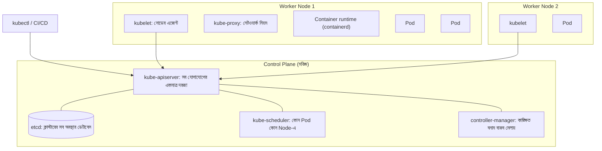
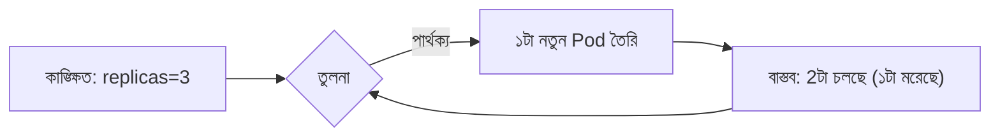
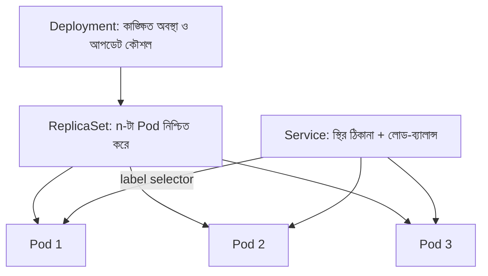
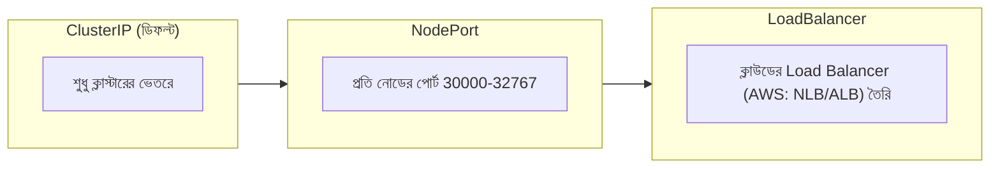
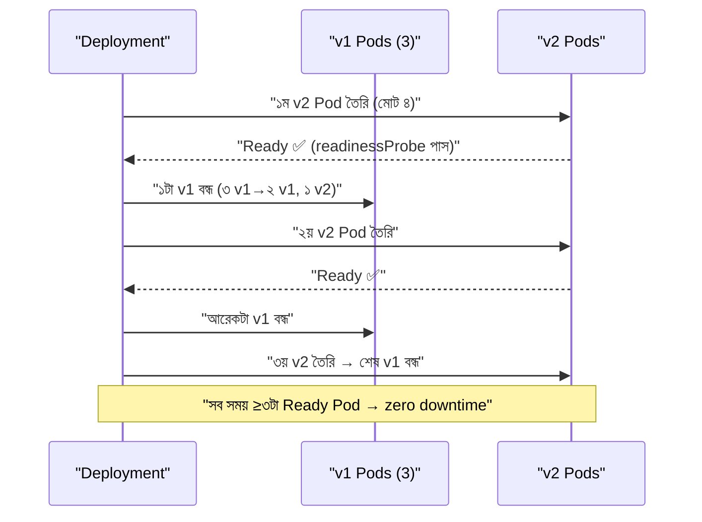
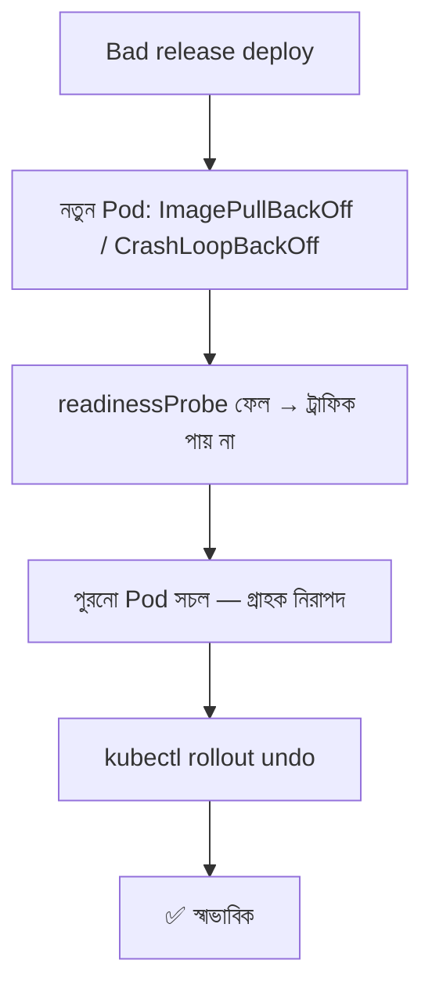
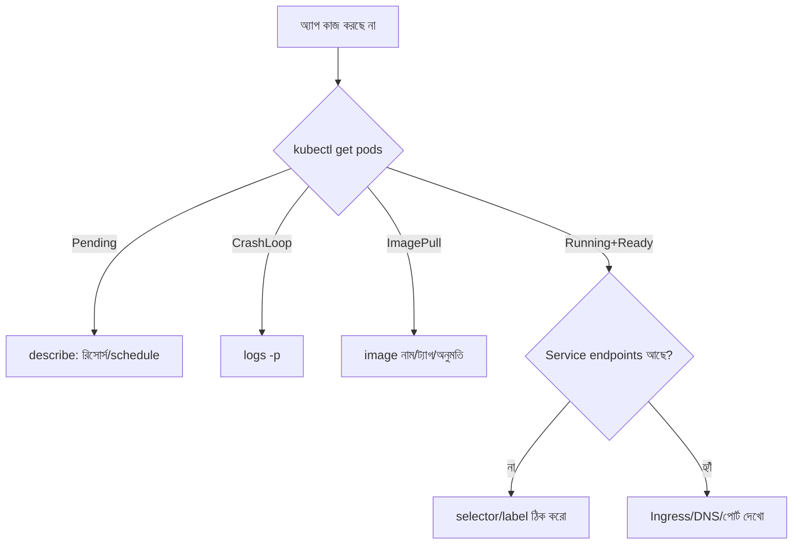

# Module 13 — Kubernetes Fundamentals

> **Section 3 · Containers, Kubernetes & Platform** · ২টি Live Class
> **Project:** Move the App to Kubernetes
> **Goal:** একটা অ্যাপ deploy ও expose করে Kubernetes-এর মূল বিষয় শেখা।
> **Assignment ★:** ইচ্ছাকৃত একটা bad release সহ অ্যাপ deploy করো এবং rollback করো।

---

## 📖 গল্প: ক্যাপ্টেন ছাড়া একশো কন্টেইনার

M12-এ তানভীরের ১০টা কনটেইনার ছিল, সে নিজে `docker compose` দিয়ে সামলাত। এখন ১০০টা, ১০টা সার্ভারে। প্রশ্ন:

- কোন কনটেইনার কোন সার্ভারে বসবে? কে ঠিক করবে?
- একটা সার্ভার মরলে ওর কনটেইনারগুলো কোথায় যাবে?
- নতুন ভার্সন চালাতে পুরনোগুলো একে একে কীভাবে বদলাবে — গ্রাহক না টের পায়?
- কনটেইনারগুলো একে অপরকে খুঁজবে কীভাবে — তাদের IP তো বারবার বদলায়?

**Kubernetes (K8s)** হলো এই বিশাল জাহাজের **ক্যাপ্টেন**। তুমি বলো **"আমি চাই ব্যাকএন্ডের ৩টা কপি সবসময় চলুক"** — ক্যাপ্টেন প্রতি সেকেন্ডে দেখে বাস্তবে ৩টা চলছে কিনা, না থাকলে নিজে ঠিক করে। এটাই **desired state (কাঙ্ক্ষিত অবস্থা)** দর্শন — Terraform-এর মতোই।

---

# 🧩 Live Class 1 — Kubernetes Architecture and Cluster Setup

## 1. Container Orchestration কেন?

| সমস্যা | K8s-এর সমাধান |
|---|---|
| কোথায় চালাব? | **Scheduling** — রিসোর্স দেখে নোড বাছে |
| মরলে? | **Self-healing** — আবার চালু করে |
| ভিড় বাড়লে? | **Scaling** — HPA (M14) |
| নতুন ভার্সন | **Rolling update + rollback** |
| একে অপরকে খোঁজা | **Service discovery ও DNS** |
| কনফিগ/secret | ConfigMap/Secret |

## 2. Architecture — Control Plane ও Worker Node



| উপাদান | কাজ | উপমা |
|---|---|---|
| **API Server** | REST দরজা; সবাই এর মাধ্যমে কথা বলে | রিসেপশন |
| **etcd** | সব কনফিগ/অবস্থার স্থায়ী স্টোর | দপ্তরের মূল খাতা |
| **Scheduler** | নতুন Pod-এর জন্য নোড বাছাই | কাজের বণ্টনকারী |
| **Controller Manager** | লুপ: "যা চাই = যা আছে?" | সুপারভাইজার |
| **kubelet** | নোডে Pod চালায়, স্বাস্থ্য জানায় | ফ্লোর-ম্যানেজার |
| **kube-proxy** | Service-এ ট্রাফিক রাউট | ট্রাফিক পুলিশ |

### Reconciliation Loop — K8s-এর হৃদস্পন্দন



## 3. Cluster সেটআপ — Minikube, K3s, EKS

| টুল | কখন | বৈশিষ্ট্য |
|---|---|---|
| **Minikube / kind** | লোকাল শেখা | ল্যাপটপে একটা ছোট ক্লাস্টার |
| **K3s** | হালকা, edge, ছোট সার্ভার | একটা বাইনারি, কম রিসোর্স |
| **EKS** | AWS-এ প্রোডাকশন | control plane AWS ম্যানেজ করে (M14) |

```bash
# ---- kubectl ইনস্টল ----
curl -LO "https://dl.k8s.io/release/$(curl -L -s https://dl.k8s.io/release/stable.txt)/bin/linux/amd64/kubectl"
sudo install kubectl /usr/local/bin/kubectl
kubectl version --client

# ---- Minikube (লোকাল) ----
# minikube ইনস্টল অফিসিয়াল পেজ অনুযায়ী; Docker ড্রাইভার থাকলে:
minikube start --driver=docker --cpus=2 --memory=4096
kubectl get nodes          # STATUS=Ready?

# ---- K3s (এক-সার্ভার ক্লাস্টার, EC2/ভিএম-এ) ----
curl -sfL https://get.k3s.io | sh -
sudo k3s kubectl get nodes
```

```bash
# kubeconfig: ~/.kube/config — কোন ক্লাস্টারে, কোন ক্রেডেনশিয়ালে কথা বলবে
kubectl config get-contexts            # সব ক্লাস্টার/কনটেক্সট
kubectl config use-context minikube    # সুইচ — ⚠️ prod-এ ভুল কমান্ড এড়াতে সবসময় দেখো কোথায় আছো!
kubectl config current-context
```

## 4. kubectl — প্রতিদিনের কমান্ড

```bash
kubectl get pods                       # Pod তালিকা
kubectl get pods -o wide               # নোড ও IP সহ
kubectl get all -n booknest            # namespace-এর সব
kubectl describe pod <name>            # ⭐ বিস্তারিত + Events (সমস্যা নির্ণয়ের সেরা বন্ধু)
kubectl logs <pod> -f                  # লগ; -p আগের (ক্র্যাশ-হওয়া) কনটেইনারের
kubectl exec -it <pod> -- sh           # ভেতরে ঢোকা
kubectl apply -f deployment.yaml       # YAML থেকে তৈরি/আপডেট (declarative)
kubectl delete -f deployment.yaml
kubectl get events --sort-by=.metadata.creationTimestamp   # সাম্প্রতিক ঘটনা
kubectl port-forward svc/backend 3000:3000   # লোকালে সার্ভিস টেস্ট
```

> **`apply` (declarative) বনাম `create`/`run` (imperative):** প্রোডাকশনে সবসময় YAML + `apply` + Git।

## 5. মূল Objects



| Object | কী | মনে রাখার কৌশল |
|---|---|---|
| **Pod** | ১+ কনটেইনারের ক্ষুদ্রতম ডিপ্লয়-একক; একই IP/স্টোরেজ ভাগ করে | "বাক্স" |
| **ReplicaSet** | নির্দিষ্ট সংখ্যক Pod রাখে | "গণনাকারী" |
| **Deployment** | ReplicaSet-এর ম্যানেজার; rolling update, rollback | **ডিফল্টভাবে এটাই ব্যবহার** |
| **Service** | Pod-এর সামনে স্থির নাম/IP | "ঠিকানা-বই" |
| **Namespace** | ক্লাস্টারের ভেতরে ভার্চুয়াল ভাগ | "আলাদা ঘর" |

> **Pod সরাসরি বানাবে না** — মরলে কেউ ফেরাবে না। সবসময় Deployment।

### Service-এর ধরন



| ধরন | কখন |
|---|---|
| **ClusterIP** | অভ্যন্তরীণ (backend↔DB, frontend↔backend) — অধিকাংশ |
| **NodePort** | টেস্ট/ডেমো; প্রোডাকশনে সরাসরি নয় |
| **LoadBalancer** | বাইরে এক্সপোজ (প্রতিটার জন্য আলাদা LB = খরচ → পরে Ingress, M14) |

---

# 🧩 Live Class 2 — ConfigMaps, Secrets and Simple Application Deployment

## 6. Namespace

```bash
kubectl create namespace booknest        # imperative দ্রুত পথ
kubectl config set-context --current --namespace=booknest   # ডিফল্ট namespace সেট
```
```yaml
# namespace.yaml — declarative, Git-এ রাখা যায়
apiVersion: v1
kind: Namespace
metadata:
  name: booknest
  labels:
    app.kubernetes.io/part-of: booknest
```

## 7. ConfigMap ও Secret

| | ConfigMap | Secret |
|---|---|---|
| কী রাখে | নন-সিক্রেট কনফিগ | পাসওয়ার্ড, টোকেন |
| এনকোডিং | সরল টেক্সট | base64 (**এনক্রিপশন নয়!**) |

> ⚠️ **base64 ≠ encryption।** Secret YAML Git-এ রাখলে সবাই ডিকোড করতে পারে। প্রোডাকশনে: **External Secrets Operator + AWS Secrets Manager** (M18) বা Sealed Secrets। এবং etcd-র encryption-at-rest চালু (EKS-এ KMS)।

```yaml
# configmap.yaml
apiVersion: v1
kind: ConfigMap
metadata:
  name: backend-config
  namespace: booknest
data:
  NODE_ENV: "production"
  PORT: "3000"
  DB_HOST: "postgres"        # DB Service-এর নাম (DNS দিয়ে)
  DB_PORT: "5432"
  DB_NAME: "booknest"
---
# secret.yaml — ⚠️ শেখার জন্য; আসল পাসওয়ার্ড Git-এ নয়
apiVersion: v1
kind: Secret
metadata:
  name: backend-secret
  namespace: booknest
type: Opaque
stringData:                  # stringData: সরল টেক্সট লিখলে K8s নিজে base64 করে
  DB_USER: "booknest_app"
  DB_PASSWORD: "CHANGE_ME"   # ← placeholder; kubectl create secret দিয়ে CLI থেকে দাও
```

```bash
# Git-এ না রেখে সরাসরি ক্লাস্টারে Secret তৈরি (শেখার সময় ভালো অভ্যাস)
kubectl create secret generic backend-secret -n booknest \
  --from-literal=DB_USER=booknest_app \
  --from-literal=DB_PASSWORD="$(openssl rand -base64 24)"
```

## 8. Backend Deployment — সম্পূর্ণ YAML

```yaml
# backend-deployment.yaml
apiVersion: apps/v1
kind: Deployment
metadata:
  name: backend
  namespace: booknest
  labels:
    app: backend
spec:
  replicas: 3                          # কাঙ্ক্ষিত অবস্থা: সবসময় ৩টা Pod
  revisionHistoryLimit: 5              # ৫টা পুরনো ReplicaSet রাখো (rollback-এর জন্য)
  selector:
    matchLabels:
      app: backend                     # এই label-ওয়ালা Pod-গুলো আমার
  strategy:
    type: RollingUpdate
    rollingUpdate:
      maxSurge: 1                      # আপডেটের সময় সর্বোচ্চ ১টা বাড়তি Pod
      maxUnavailable: 0                # ⭐ কখনো ক্ষমতা কমাব না → zero-downtime
  template:
    metadata:
      labels:
        app: backend                   # selector-এর সাথে হুবহু মিলতে হবে
    spec:
      containers:
        - name: backend
          image: <ACCOUNT>.dkr.ecr.ap-southeast-1.amazonaws.com/booknest-backend:1.0.0
          ports:
            - containerPort: 3000
          envFrom:
            - configMapRef:
                name: backend-config   # ConfigMap-এর সব key → env var
            - secretRef:
                name: backend-secret   # Secret-এর সব key → env var
          resources:                   # ⭐ বাধ্যতামূলক অভ্যাস (বিস্তারিত M14)
            requests:                  # scheduler এটা ধরে নোড বাছে (গ্যারান্টি)
              cpu: "100m"              # 100 millicore = 0.1 CPU
              memory: "128Mi"
            limits:                    # এর বেশি নিতে পারবে না (memory ছাড়ালে OOMKilled)
              cpu: "500m"
              memory: "256Mi"
          readinessProbe:              # "ট্রাফিক নেওয়ার জন্য প্রস্তুত?" — ফেল হলে Service থেকে বাদ
            httpGet: { path: /health, port: 3000 }
            initialDelaySeconds: 5
            periodSeconds: 5
          livenessProbe:               # "বেঁচে আছি?" — ফেল হলে কনটেইনার রিস্টার্ট
            httpGet: { path: /health, port: 3000 }
            initialDelaySeconds: 20
            periodSeconds: 10
          securityContext:             # M12-র শিক্ষা কাজে
            runAsNonRoot: true
            allowPrivilegeEscalation: false
            readOnlyRootFilesystem: true
---
apiVersion: v1
kind: Service
metadata:
  name: backend
  namespace: booknest
spec:
  type: ClusterIP                      # অভ্যন্তরীণ
  selector:
    app: backend                       # এই label-ওয়ালা Pod-এ ট্রাফিক
  ports:
    - port: 3000                       # Service-এর পোর্ট
      targetPort: 3000                 # Pod-এর পোর্ট
```

### Rolling Update কীভাবে চলে (`maxSurge:1, maxUnavailable:0`, replicas=3)



## 9. Nginx/Frontend Deploy ও Expose

```yaml
# frontend.yaml (সংক্ষিপ্ত)
apiVersion: apps/v1
kind: Deployment
metadata: { name: frontend, namespace: booknest }
spec:
  replicas: 2
  selector: { matchLabels: { app: frontend } }
  template:
    metadata: { labels: { app: frontend } }
    spec:
      containers:
        - name: frontend
          image: <ACCOUNT>.dkr.ecr.ap-southeast-1.amazonaws.com/booknest-frontend:1.0.0
          ports: [{ containerPort: 8080 }]
          resources:
            requests: { cpu: "50m", memory: "64Mi" }
            limits:   { cpu: "200m", memory: "128Mi" }
          readinessProbe:
            httpGet: { path: /healthz, port: 8080 }
---
apiVersion: v1
kind: Service
metadata: { name: frontend, namespace: booknest }
spec:
  type: LoadBalancer        # শেখার জন্য সরাসরি বাইরে; প্রোডাকশনে Ingress (M14)
  selector: { app: frontend }
  ports: [{ port: 80, targetPort: 8080 }]
```

```bash
kubectl apply -f namespace.yaml
kubectl apply -f configmap.yaml
kubectl apply -f backend-deployment.yaml
kubectl apply -f frontend.yaml

kubectl get pods -n booknest -w         # -w: লাইভ দেখো
kubectl get svc -n booknest             # EXTERNAL-IP
kubectl rollout status deploy/backend -n booknest   # আপডেট সম্পন্ন কিনা
```

### Service Discovery — DNS

ক্লাস্টারের ভেতরে `backend` নামেই পৌঁছানো যায়:

```text
backend                                  ← একই namespace থেকে
backend.booknest                         ← অন্য namespace থেকে
backend.booknest.svc.cluster.local       ← পূর্ণ নাম (FQDN)
```
Frontend-এর Nginx কনফিগে `proxy_pass http://backend:3000;` — Service নামেই কাজ করে, IP লাগে না।

## 10. 🤖 AI দিয়ে Manifest তৈরি — dry-run ও kubeconform

```bash
# ১. client-side dry-run: YAML পার্স হয় কিনা
kubectl apply -f backend-deployment.yaml --dry-run=client

# ২. server-side dry-run: ক্লাস্টারের API-র কাছে যাচাই (অ্যাডমিশন নিয়মসহ), কিন্তু তৈরি করে না
kubectl apply -f backend-deployment.yaml --dry-run=server

# ৩. kubeconform: অফলাইনে K8s schema মিলিয়ে যাচাই — CI-তে দারুণ
kubeconform -strict -summary backend-deployment.yaml

# ৪. কী বদলাবে তার পূর্বরূপ
kubectl diff -f backend-deployment.yaml
```

**AI-র সাধারণ K8s ভুল:** পুরনো `apiVersion` (`extensions/v1beta1`), selector↔label অমিল, resources নেই, probe নেই, `latest` ট্যাগ, Secret-এ আসল পাসওয়ার্ড, `privileged: true`।

## 11. Rollout, Rollback — Assignment-এর মূল

```bash
# ইচ্ছাকৃত bad release: এমন image ট্যাগ যা নেই
kubectl set image deploy/backend backend=<ACCOUNT>.dkr.ecr...booknest-backend:DOES-NOT-EXIST -n booknest
kubectl rollout status deploy/backend -n booknest --timeout=60s
# → "Waiting for rollout..." আটকে থাকবে

kubectl get pods -n booknest
# NAME                       READY   STATUS             
# backend-7d9f8-xxxxx        1/1     Running            ← পুরনো (সচল! maxUnavailable:0-র কারণে সেবা বন্ধ হয়নি)
# backend-5c6b4-yyyyy        0/1     ImagePullBackOff   ← নতুন, ব্যর্থ

kubectl describe pod backend-5c6b4-yyyyy -n booknest   # Events-এ কারণ: "manifest unknown"

# রোলব্যাক
kubectl rollout history deploy/backend -n booknest     # সংস্করণ-তালিকা
kubectl rollout undo deploy/backend -n booknest        # আগের ভার্সনে
kubectl rollout undo deploy/backend --to-revision=2 -n booknest   # নির্দিষ্ট ভার্সনে
```



## 12. Pod-সমস্যা নির্ণয়ের মানচিত্র

| STATUS | অর্থ | প্রথমে কী দেখবে |
|---|---|---|
| `Pending` | কোনো নোডে জায়গা পাচ্ছে না | `describe` → Events: insufficient cpu/memory, taint |
| `ImagePullBackOff` / `ErrImagePull` | image আনতে পারছে না | ভুল নাম/ট্যাগ, রেজিস্ট্রি অনুমতি |
| `CrashLoopBackOff` | চালু হয়েই মরছে, বারবার | `logs -p`, env/config/secret সঠিক? |
| `OOMKilled` | memory limit ছাড়িয়েছে | limit বাড়াও / লিক খোঁজো |
| `CreateContainerConfigError` | ConfigMap/Secret নেই | নাম/namespace |
| Running কিন্তু `0/1 Ready` | readiness ফেল | probe পথ/পোর্ট, অ্যাপ লগ |
| Service-এ সাড়া নেই | selector অমিল | `kubectl get endpoints <svc>` — খালি মানে label মেলেনি |



## ⚠️ সাধারণ ভুল

| ভুল | ফল |
|---|---|
| Deployment `selector` ≠ `template.labels` | তৈরিই হয় না (validation error) |
| `resources` না দেওয়া | একটা Pod পুরো নোড খেয়ে ফেলতে পারে; HPA কাজ করে না |
| `livenessProbe` অতি-কড়া | ধীর বুটে অনবরত রিস্টার্ট লুপ |
| `latest` ট্যাগ + `imagePullPolicy` | কোন ভার্সন চলছে অজানা |
| ভুল context-এ `kubectl delete` | prod ধ্বংস — সবসময় `current-context` দেখো |
| Secret Git-এ | লিক |

## ✅ চেকলিস্ট

- [ ] Control plane/worker উপাদান ও কাজ বলতে পারি
- [ ] Minikube/K3s-এ ক্লাস্টার চালু
- [ ] Namespace, ConfigMap, Secret তৈরি
- [ ] Backend Deployment (resources + probes + securityContext) + ClusterIP Service
- [ ] Frontend expose
- [ ] `--dry-run`, `kubectl diff`, `kubeconform` ব্যবহার
- [ ] Bad release → ব্যর্থ → `rollout undo` সফল

## 🎯 ইন্টারভিউ প্রশ্ন

1. Kubernetes architecture ব্যাখ্যা করো (control plane বনাম node উপাদান)।
2. Pod, ReplicaSet, Deployment-এর সম্পর্ক?
3. Service-এর তিন ধরন; কখন কোনটা?
4. `readinessProbe` বনাম `livenessProbe`?
5. `requests` বনাম `limits`?
6. `maxSurge` ও `maxUnavailable` কী?
7. Secret কি নিরাপদ? কীভাবে নিরাপদ করবে?
8. `CrashLoopBackOff` হলে কীভাবে ডিবাগ করবে?
9. Declarative বনাম imperative?

## 🧠 সারসংক্ষেপ

**K8s = ক্যাপ্টেন**: তুমি *কী চাই* বলো (Deployment), সে *কীভাবে* ঠিক করে ও সর্বক্ষণ মিলিয়ে দেখে। **Pod → ReplicaSet → Deployment → Service** চতুষ্টয় + ConfigMap/Secret + probes + resources = দৈনন্দিন K8s। ভুল হলে `describe`-এর Events-ই প্রথম সূত্র।

⬅️ [Module 12](./module-12-dockerizing-the-three-tier-application.md) · ➡️ [Module 14](./module-14-migrating-the-three-tier-application-to-eks.md)
