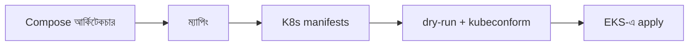
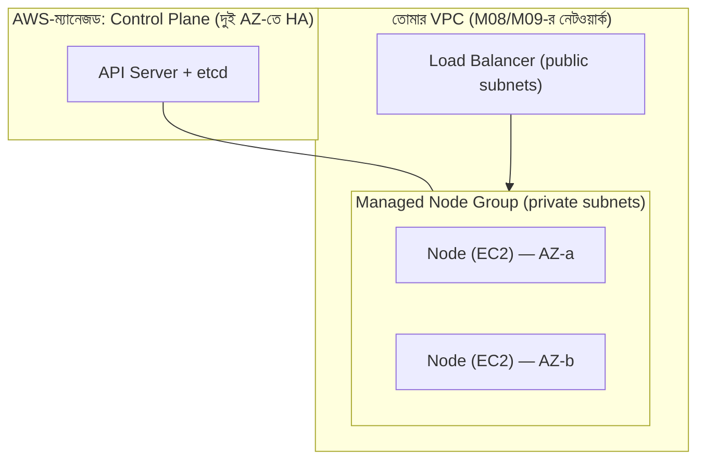
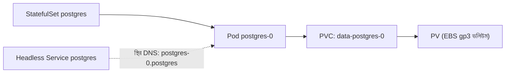
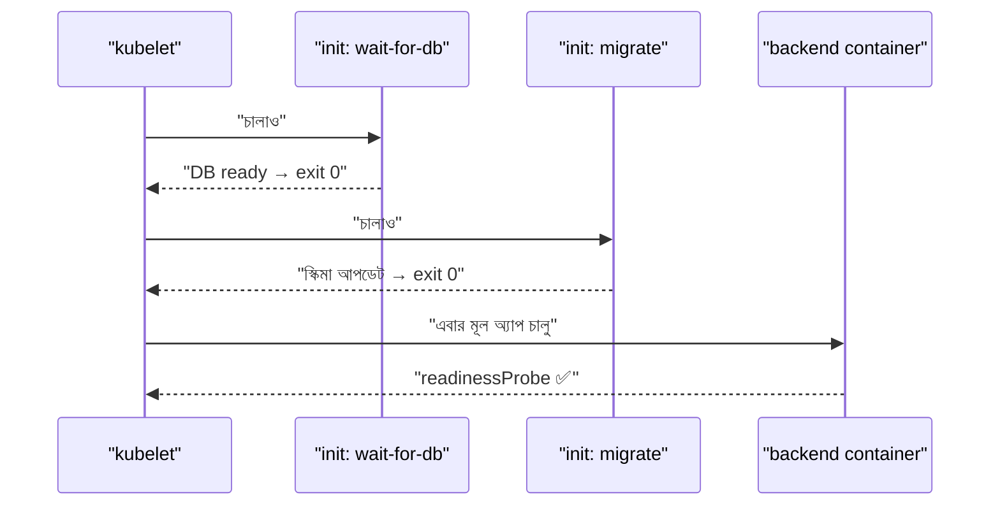
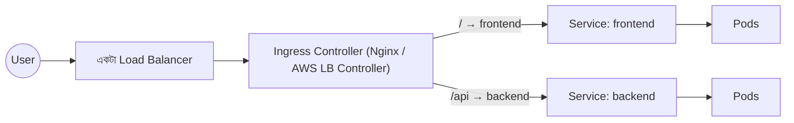
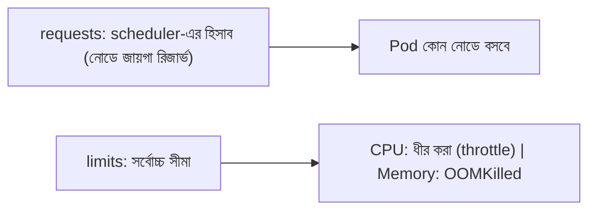
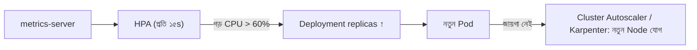
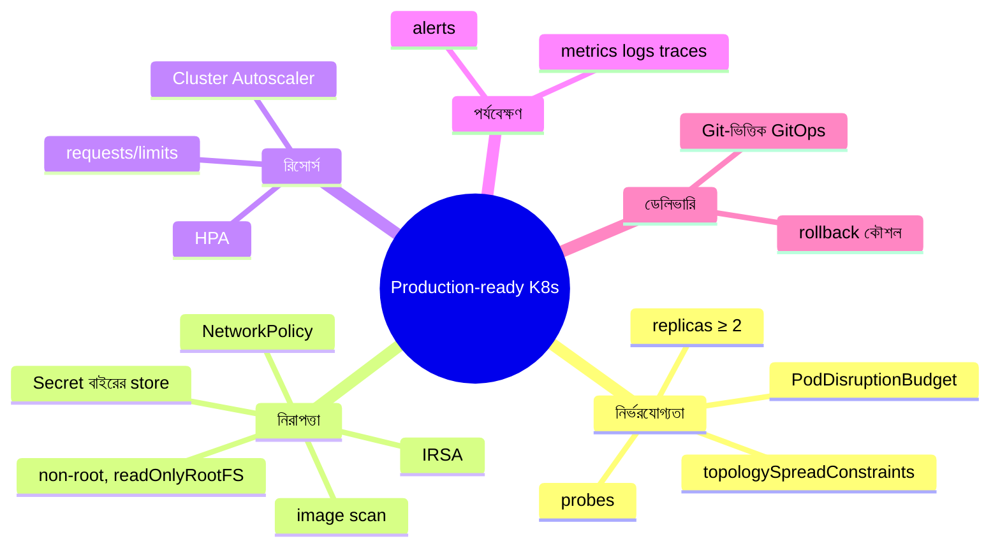

# Module 14 — Migrating the Three-Tier Application to Kubernetes (EKS)

> **Section 3 · Containers, Kubernetes & Platform** · ২টি Live Class
> **Project:** Move the App to Kubernetes
> **Goal:** production-grade কনফিগারেশনসহ EKS-এ চলমান three-tier অ্যাপ।
> **Assignment ★:** লোডের নিচে HPA কাজ করছে — প্রদর্শনসহ EKS deployment।

---

## 📖 গল্প: ঘর বদলের দিন

M13-এ তানভীর লোকাল Minikube-এ খেলত — "খেলনার বাড়ি"। এবার **আসল বাড়ি** — AWS EKS: যেখানে control plane AWS নিজে চালায় (সে শুধু worker node আর অ্যাপ সামলায়)। বাড়ি বদলের মতোই কাজ:

1. **নকশা** — Compose-এর প্রতিটা অংশ K8s-এর কোন object হবে?
2. **নতুন বাড়ি বানানো** — Terraform দিয়ে EKS।
3. **ভারী জিনিস আগে** — ডাটাবেস (সবচেয়ে সাবধানে)।
4. **তারপর বাকি আসবাব** — backend, frontend।
5. **দরজা-ঘণ্টি** — Ingress দিয়ে বাইরের প্রবেশপথ।
6. **ভিড় সামলানো** — HPA।
7. **সিসিটিভি** — লগ ও মনিটরিং।

---

# 🧩 Live Class 1 — Database and Backend Migration to Kubernetes

## 1. Migration Strategy — Compose থেকে K8s

| Docker Compose | Kubernetes |
|---|---|
| `service:` | **Deployment** + **Service** |
| `environment:` | **ConfigMap** / **Secret** |
| `volumes:` | **PersistentVolumeClaim** |
| `ports:` (বাইরের) | **Ingress** / LoadBalancer Service |
| `depends_on` + healthcheck | **initContainer** + **readinessProbe** |
| `restart: unless-stopped` | Deployment-এর self-healing |
| `networks:` | Namespace + Service DNS + (NetworkPolicy) |

> **টুল:** `kompose convert` Compose→K8s খসড়া দেয় — শুরুর জন্য ভালো, কিন্তু আউটপুট প্রোডাকশন-উপযোগী নয় (resources/probes/security নেই)। **খসড়া হিসেবে নাও, হাতে শক্ত করো।**



## 2. EKS ক্লাস্টার — Terraform দিয়ে

### EKS-এর স্থাপত্য



```hcl
# eks.tf — কমিউনিটি মডিউল ব্যবহার (পুনর্লিখন না করে; ভার্সন পিন করো)
module "eks" {
  source  = "terraform-aws-modules/eks/aws"
  version = "~> 20.0"

  cluster_name    = "booknest-prod"
  cluster_version = "1.30"                 # সমর্থিত সর্বশেষ স্থিতিশীল ভার্সন দেখে নাও

  vpc_id     = module.vpc.vpc_id           # M09-র VPC মডিউল পুনর্ব্যবহার
  subnet_ids = module.vpc.private_app_subnet_ids   # নোড private subnet-এ

  cluster_endpoint_public_access = true    # শেখার জন্য; প্রোডাকশনে CIDR সীমিত বা private
  enable_cluster_creator_admin_permissions = true

  cluster_addons = {
    coredns                = {}            # ক্লাস্টার DNS
    kube-proxy             = {}
    vpc-cni                = {}            # Pod-কে VPC-র আসল IP
    aws-ebs-csi-driver     = {}            # EBS ভলিউম (PV) তৈরির জন্য — StatefulSet-এ দরকার
  }

  eks_managed_node_groups = {
    default = {
      instance_types = ["t3.medium"]
      min_size       = 2
      max_size       = 5
      desired_size   = 2
      # নোড IMDSv2, এনক্রিপ্টেড ডিস্ক — মডিউলের ডিফল্ট + Checkov যাচাই
    }
  }
}
```

```bash
terraform apply                      # ~১০-১৫ মিনিট
aws eks update-kubeconfig --region ap-southeast-1 --name booknest-prod   # kubectl-কে ক্লাস্টার চেনানো
kubectl get nodes                    # ২টা Ready নোড
```

> 💰 **EKS খরচ:** control plane ঘণ্টা-হারে চার্জ + নোডের EC2 + NAT + LB। **শেখা শেষে `terraform destroy`!** (M20 FinOps)

### Pod-কে AWS অনুমতি — IRSA / Pod Identity

Pod-এ AWS access key রাখা **নয়**। IAM Role→ServiceAccount (**IRSA**) বা **EKS Pod Identity**: নির্দিষ্ট Pod শুধু নির্দিষ্ট role পায় — M06-র OIDC ধারণারই K8s সংস্করণ।

## 3. PostgreSQL on Kubernetes — StatefulSet, PV ও PVC

### কেন Deployment নয়, StatefulSet?

| | Deployment | StatefulSet |
|---|---|---|
| Pod-এর নাম | এলোমেলো (`backend-7d9-x2`) | স্থির (`postgres-0`, `postgres-1`) |
| স্টোরেজ | শেয়ার/অস্থায়ী | **প্রতি Pod-এর নিজস্ব স্থায়ী ভলিউম** |
| ক্রম | সব একসাথে | একটা একটা করে, ক্রমানুসারে |
| ব্যবহার | stateless | **ডেটাবেস, ডেটা-নির্ভর** |



| শব্দ | অর্থ |
|---|---|
| **PV** (PersistentVolume) | ক্লাস্টারের আসল স্টোরেজ-টুকরো (EBS ভলিউম) |
| **PVC** (PersistentVolumeClaim) | Pod-এর "আমার এত GB লাগবে" দাবি |
| **StorageClass** | কোন ধরনের ডিস্ক (gp3) ও কীভাবে বানাবে |

```yaml
# postgres.yaml
apiVersion: storage.k8s.io/v1
kind: StorageClass
metadata:
  name: gp3-encrypted
provisioner: ebs.csi.aws.com
parameters:
  type: gp3
  encrypted: "true"                    # ডিস্ক এনক্রিপ্টেড
reclaimPolicy: Retain                  # PVC মুছলেও ডিস্ক থাকবে — ভুলে ডেটা হারানো ঠেকায়
volumeBindingMode: WaitForFirstConsumer   # Pod যে AZ-তে বসবে, ভলিউম সেই AZ-তেই তৈরি (AZ-অমিল সমস্যা এড়ায়)
allowVolumeExpansion: true
---
apiVersion: v1
kind: Service
metadata:
  name: postgres
  namespace: booknest
spec:
  clusterIP: None                      # Headless: Pod-এর স্থির DNS নাম দেয়
  selector: { app: postgres }
  ports: [{ port: 5432 }]
---
apiVersion: apps/v1
kind: StatefulSet
metadata:
  name: postgres
  namespace: booknest
spec:
  serviceName: postgres
  replicas: 1                          # সিঙ্গেল-ইনস্ট্যান্স; HA-র জন্য Operator (CloudNativePG) বা RDS
  selector: { matchLabels: { app: postgres } }
  template:
    metadata: { labels: { app: postgres } }
    spec:
      securityContext:
        fsGroup: 999                   # ভলিউমের মালিকানা postgres গ্রুপে
      containers:
        - name: postgres
          image: postgres:16-alpine
          ports: [{ containerPort: 5432 }]
          env:
            - name: POSTGRES_USER
              valueFrom: { secretKeyRef: { name: backend-secret, key: DB_USER } }
            - name: POSTGRES_PASSWORD
              valueFrom: { secretKeyRef: { name: backend-secret, key: DB_PASSWORD } }
            - name: POSTGRES_DB
              value: booknest
            - name: PGDATA
              value: /var/lib/postgresql/data/pgdata   # সাবফোল্ডার: ভলিউমের lost+found সমস্যা এড়াতে
          volumeMounts:
            - { name: data, mountPath: /var/lib/postgresql/data }
          resources:
            requests: { cpu: "250m", memory: "512Mi" }
            limits:   { memory: "1Gi" }
          readinessProbe:
            exec: { command: ["pg_isready", "-U", "booknest_app", "-d", "booknest"] }
            periodSeconds: 5
  volumeClaimTemplates:                # প্রতি Pod-এর জন্য নিজস্ব PVC স্বয়ংক্রিয় তৈরি
    - metadata: { name: data }
      spec:
        accessModes: ["ReadWriteOnce"] # একই সময়ে একটা নোডে মাউন্ট
        storageClassName: gp3-encrypted
        resources:
          requests: { storage: 20Gi }
```

> ⚠️ **বাস্তব পরামর্শ:** প্রোডাকশনে স্টেটফুল ডেটাবেসের জন্য সাধারণত **Amazon RDS (ম্যানেজড)** পছন্দ — ব্যাকআপ, Multi-AZ, প্যাচিং AWS করে। K8s-এ PostgreSQL চালানো শেখার জন্য চমৎকার, প্রোডাকশনে সাবধান (backup/restore, failover, upgrade — সব তোমার দায়িত্ব)। দুই পথই জানা ইন্টারভিউতে সুবিধা।

### Database Backup — ভুলে যাওয়া ধাপ

```yaml
# CronJob: প্রতি রাতে pg_dump → S3 (সংক্ষিপ্ত রূপ)
apiVersion: batch/v1
kind: CronJob
metadata: { name: pg-backup, namespace: booknest }
spec:
  schedule: "0 2 * * *"                 # প্রতিদিন রাত ২টা
  concurrencyPolicy: Forbid             # আগেরটা না শেষ হলে নতুন শুরু নয়
  jobTemplate:
    spec:
      template:
        spec:
          restartPolicy: OnFailure
          containers:
            - name: backup
              image: <ACCOUNT>.dkr.ecr...pg-backup:1.0.0   # pg_dump + aws-cli সম্বলিত
              command: ["/bin/sh","-c","pg_dump -h postgres -U $DB_USER $DB_NAME | gzip | aws s3 cp - s3://booknest-backups/$(date +%F).sql.gz"]
```
**ব্যাকআপ যাচাই না করলে ব্যাকআপ নেই** — মাঝে মাঝে restore পরীক্ষা করো।

## 4. Backend Deployment, Service, Config

M13-র `backend-deployment.yaml` এখানে প্রায় হুবহু প্রযোজ্য। EKS-এ বদল:

- image: **ECR** থেকে (নোডের IAM role-এ `AmazonEC2ContainerRegistryReadOnly`; মডিউল ডিফল্টে থাকে)।
- `DB_HOST: postgres` (Headless Service-এর নাম)।
- **init container দিয়ে DB-মাইগ্রেশন ও প্রস্তুতি:**

```yaml
      initContainers:
        - name: wait-for-db                       # DB না আসা পর্যন্ত অপেক্ষা (Compose-এর depends_on-এর বদলে)
          image: postgres:16-alpine
          command: ["sh","-c","until pg_isready -h postgres -p 5432; do echo waiting; sleep 2; done"]
        - name: migrate                           # স্কিমা মাইগ্রেশন — অ্যাপ শুরুর আগে একবার
          image: <ACCOUNT>.dkr.ecr...booknest-backend:1.0.0
          command: ["node","dist/migrate.js"]
          envFrom:
            - configMapRef: { name: backend-config }
            - secretRef:    { name: backend-secret }
```

> **মাইগ্রেশন কৌশল:** কয়েকটা replica একসাথে `migrate` চালালে সংঘর্ষ। ভালো: আলাদা **Job** (বা Helm hook, M15) যা একবারই চলে; এবং মাইগ্রেশন **backward-compatible** (expand → migrate → contract)।



---

# 🧩 Live Class 2 — Frontend Migration, Ingress and Production-Ready Deployment

## 5. Frontend Deployment ও Service

M13-র মতোই; Service এবার **ClusterIP** (বাইরের দরজা Ingress)।

```yaml
apiVersion: v1
kind: Service
metadata: { name: frontend, namespace: booknest }
spec:
  type: ClusterIP
  selector: { app: frontend }
  ports: [{ port: 80, targetPort: 8080 }]
```

## 6. Ingress ও Ingress Controller

**সমস্যা:** প্রতিটা সার্ভিসে `type: LoadBalancer` = প্রতিটার জন্য আলাদা AWS LB = টাকা ও ঝামেলা। **সমাধান:** একটা প্রবেশদ্বার + পথ-নিয়ম।



| | Ingress (object) | Ingress Controller |
|---|---|---|
| কী | নিয়মের ঘোষণা (YAML) | নিয়ম পড়ে বাস্তবায়নকারী প্রোগ্রাম |
| উদাহরণ | `kind: Ingress` | **ingress-nginx**, **AWS Load Balancer Controller** |

> শুধু Ingress YAML লিখলে কিছুই হয় না — **controller ইনস্টল করা বাধ্যতামূলক।**

```bash
# ingress-nginx ইনস্টল (Helm; Helm বিস্তারিত M15-এ)
helm repo add ingress-nginx https://kubernetes.github.io/ingress-nginx
helm repo update
helm install ingress-nginx ingress-nginx/ingress-nginx \
  --namespace ingress-nginx --create-namespace \
  --set controller.service.type=LoadBalancer \
  --set controller.service.annotations."service\.beta\.kubernetes\.io/aws-load-balancer-type"=nlb   # NLB ব্যবহার
kubectl get svc -n ingress-nginx       # EXTERNAL-IP/hostname → Route53-এ CNAME/Alias
```

```yaml
# ingress.yaml
apiVersion: networking.k8s.io/v1
kind: Ingress
metadata:
  name: booknest
  namespace: booknest
  annotations:
    nginx.ingress.kubernetes.io/ssl-redirect: "true"
    cert-manager.io/cluster-issuer: letsencrypt-prod   # cert-manager দিয়ে অটো TLS (Let's Encrypt)
spec:
  ingressClassName: nginx
  tls:
    - hosts: [booknest.example.com]
      secretName: booknest-tls                         # cert-manager এখানে সার্টিফিকেট রাখে
  rules:
    - host: booknest.example.com
      http:
        paths:
          - path: /api
            pathType: Prefix
            backend:
              service: { name: backend, port: { number: 3000 } }
          - path: /
            pathType: Prefix
            backend:
              service: { name: frontend, port: { number: 80 } }
```

**বিকল্প:** AWS Load Balancer Controller → Ingress থেকে সরাসরি **ALB** (ACM সার্টিফিকেট, WAF ইন্টিগ্রেশন)। AWS-কেন্দ্রিক পরিবেশে জনপ্রিয়।

## 7. Resource Requests/Limits ও Horizontal Pod Autoscaler (HPA)

### Requests বনাম Limits (গভীরে)



| সেটিং | ফল |
|---|---|
| requests অতি-কম | নোড অতিরিক্ত ভরে, ধীর/অস্থির |
| requests অতি-বেশি | জায়গা নষ্ট, খরচ বাড়ে |
| CPU limit অতি-কম | throttling → latency |
| Memory limit < ব্যবহার | OOMKilled রিস্টার্ট |
| **requests ছাড়া HPA** | CPU% হিসাব করতে পারে না — কাজই করে না |

**VPA/মেট্রিক্স দেখে ক্রমে সামঞ্জস্য করো** — অনুমানে নয়।

### HPA

```bash
# HPA-র মেট্রিক্সের উৎস: metrics-server
kubectl apply -f https://github.com/kubernetes-sigs/metrics-server/releases/latest/download/components.yaml
kubectl top pods -n booknest           # কাজ করছে?
```

```yaml
apiVersion: autoscaling/v2
kind: HorizontalPodAutoscaler
metadata: { name: backend, namespace: booknest }
spec:
  scaleTargetRef:
    apiVersion: apps/v1
    kind: Deployment
    name: backend
  minReplicas: 2                       # সর্বনিম্ন ২ — HA
  maxReplicas: 10                      # খরচের ছাদ
  metrics:
    - type: Resource
      resource:
        name: cpu
        target:
          type: Utilization
          averageUtilization: 60       # requests-এর ৬০% ছাড়ালে বাড়াও
  behavior:                            # flapping এড়াতে
    scaleDown:
      stabilizationWindowSeconds: 300  # ৫ মিনিট স্থির থাকলে তবেই কমাবে
```



> **দুই স্তরের scaling:** HPA = Pod বাড়ায়; **Cluster Autoscaler / Karpenter** = Pod-এর জায়গা না থাকলে *নোড* বাড়ায়।

### 🧪 লোড দিয়ে HPA প্রদর্শন (Assignment)

```bash
# লোড জেনারেটর (ক্লাস্টারের ভেতরে)
kubectl run load --rm -it --image=busybox:1.36 -n booknest --restart=Never -- \
  /bin/sh -c "while true; do wget -q -O- http://backend:3000/api/books; done"

# অন্য টার্মিনালে লাইভ পর্যবেক্ষণ
kubectl get hpa backend -n booknest -w     # TARGETS: 20%/60% → 150%/60%, REPLICAS: 2 → 6
kubectl get pods -n booknest -w            # নতুন Pod জন্মাচ্ছে
# লোড থামাও → ৫ মিনিট পর REPLICAS আবার কমবে
```
আরও বাস্তবসম্মত লোডের জন্য **k6** (M19)।

## 8. Liveness ও Readiness — গভীরে

| Probe | ব্যর্থ হলে | ব্যবহার |
|---|---|---|
| **Startup** | বুট শেষ না হওয়া পর্যন্ত বাকি probe বন্ধ | ধীর-বুট অ্যাপ |
| **Readiness** | Service-এর endpoints থেকে সরায় (রিস্টার্ট নয়) | "ব্যস্ত/প্রস্তুত নই" |
| **Liveness** | কনটেইনার রিস্টার্ট | "আটকে গেছি (deadlock)" |

> **ফাঁদ:** liveness-এ DB-চেক রেখো না — DB ধীর হলে সব Pod একসাথে রিস্টার্ট হয়ে সংকট বাড়ায়। Liveness = "প্রসেস নিজে সুস্থ?"; Readiness = "ডিপেন্ডেন্সিসহ কাজ করতে পারব?"।

## 9. Logs ও Monitoring — Kubernetes-এ

M07-র স্ট্যাক K8s-এ Helm দিয়ে:

```bash
# kube-prometheus-stack: Prometheus + Grafana + Alertmanager + K8s dashboards একসাথে
helm repo add prometheus-community https://prometheus-community.github.io/helm-charts
helm install monitoring prometheus-community/kube-prometheus-stack -n monitoring --create-namespace

# Loki + Promtail (লগ)
helm repo add grafana https://grafana.github.io/helm-charts
helm install loki grafana/loki-stack -n monitoring --set promtail.enabled=true,grafana.enabled=false
```

অ্যাপের মেট্রিক স্ক্র্যাপ — **ServiceMonitor** (Prometheus Operator-এর CRD):

```yaml
apiVersion: monitoring.coreos.com/v1
kind: ServiceMonitor
metadata:
  name: backend
  namespace: booknest
  labels: { release: monitoring }        # kube-prometheus-stack এই label দেখে খুঁজে নেয়
spec:
  selector:
    matchLabels: { app: backend }
  endpoints:
    - port: http                          # Service-এর port-এর *নাম* (ports:-এ name: http দিতে হবে)
      path: /metrics
      interval: 15s
```

**K8s-নির্দিষ্ট alert:** `KubePodCrashLooping`, `KubeDeploymentReplicasMismatch`, `KubeNodeNotReady`, `PVC almost full` — kube-prometheus-stack-এ অনেকগুলো বিল্ট-ইন।

## 10. Production-Readiness চেকলিস্ট



```yaml
# PodDisruptionBudget: নোড-আপগ্রেড/ড্রেনের সময়ও কমপক্ষে ১টা Pod জীবিত
apiVersion: policy/v1
kind: PodDisruptionBudget
metadata: { name: backend, namespace: booknest }
spec:
  minAvailable: 1
  selector: { matchLabels: { app: backend } }
---
# NetworkPolicy: শুধু backend-ই postgres-এ কথা বলতে পারবে (K8s-স্তরের "SG চেইন")
apiVersion: networking.k8s.io/v1
kind: NetworkPolicy
metadata: { name: postgres-allow-backend, namespace: booknest }
spec:
  podSelector: { matchLabels: { app: postgres } }
  policyTypes: [Ingress]
  ingress:
    - from:
        - podSelector: { matchLabels: { app: backend } }
      ports: [{ port: 5432 }]
```
> NetworkPolicy কাজ করতে CNI-র সমর্থন লাগে (EKS-এ VPC CNI-র network policy ফিচার চালু করতে হয় বা Calico)।

Pod-কে বিভিন্ন AZ-তে ছড়াতে:

```yaml
      topologySpreadConstraints:
        - maxSkew: 1
          topologyKey: topology.kubernetes.io/zone     # AZ-ভিত্তিক সমবণ্টন
          whenUnsatisfiable: ScheduleAnyway
          labelSelector: { matchLabels: { app: backend } }
```

## ⚠️ সাধারণ ভুল

| সমস্যা | কারণ |
|---|---|
| PVC `Pending` | StorageClass নেই / EBS CSI driver নেই / AZ-অমিল |
| Pod `Pending` — `volume node affinity conflict` | ভলিউম অন্য AZ-তে; `WaitForFirstConsumer` ব্যবহার করো |
| Ingress কাজ করে না | Controller ইনস্টল নেই / `ingressClassName` ভুল / DNS |
| HPA `<unknown>/60%` | metrics-server নেই বা `requests` নেই |
| `ImagePullBackOff` ECR-এ | নোড role-এ ECR অনুমতি নেই; ভুল রিজিয়ন |
| ডাটা হারিয়েছি | `reclaimPolicy: Delete` + PVC মুছেছি; ব্যাকআপ নেই |
| `terraform destroy` আটকে | LoadBalancer Service/Ingress আগে `kubectl delete` করো (AWS LB ও ENI ঝুলে থাকে) |

## ✅ চেকলিস্ট

- [ ] Terraform দিয়ে EKS + managed node group + addons
- [ ] `kubectl` EKS-এ সংযুক্ত
- [ ] PostgreSQL StatefulSet + PVC (বা RDS) + ব্যাকআপ
- [ ] Backend (init/migrate), Frontend deployed
- [ ] Ingress + TLS + DNS
- [ ] Requests/limits, probes, PDB
- [ ] HPA লোডের নিচে কাজ করতে দেখেছি
- [ ] Logs (Loki) ও metrics (Prometheus/Grafana) K8s-এ
- [ ] শেষে `destroy` করে খরচ শূন্যে

## 🎯 ইন্টারভিউ প্রশ্ন

1. StatefulSet বনাম Deployment? কখন কোনটা?
2. PV, PVC, StorageClass-এর সম্পর্ক?
3. Ingress বনাম Ingress Controller বনাম LoadBalancer Service?
4. HPA কীভাবে কাজ করে? কেন `requests` ছাড়া কাজ করে না?
5. HPA বনাম Cluster Autoscaler/Karpenter?
6. Liveness-এ DB-চেক কেন বিপজ্জনক?
7. PodDisruptionBudget কী?
8. EKS কী ম্যানেজ করে, তুমি কী?
9. Pod থেকে S3 ব্যবহার করতে কী করবে? (IRSA/Pod Identity — key নয়)
10. K8s-এ ডাটাবেস চালানো বনাম RDS — কোনটা কখন?

## 🧠 সারসংক্ষেপ

**Compose → K8s ম্যাপিং, Terraform-এ EKS, ডেটা-নির্ভরের জন্য StatefulSet+PVC (বা RDS), দরজার জন্য Ingress, ভিড়ের জন্য HPA, নিরাপত্তার জন্য NetworkPolicy+IRSA, চোখের জন্য Prometheus/Loki।** এটাই "production-grade" — শুধু চলা নয়, ভাঙলে টিকে থাকা, বাড়লে বাড়া।

⬅️ [Module 13](./module-13-kubernetes-fundamentals.md) · ➡️ [Module 15](./module-15-packaging-and-delivery-helm-and-gitops-with-argo-cd.md)
