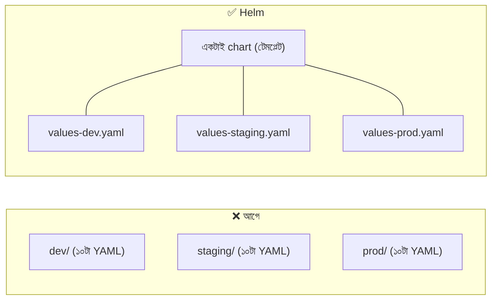
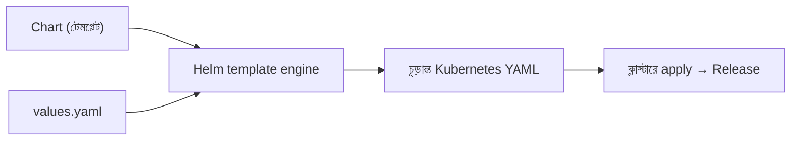
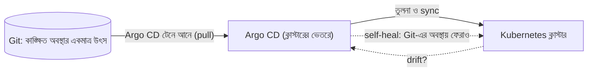
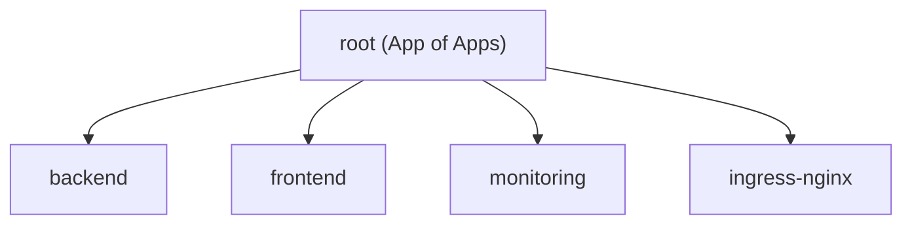
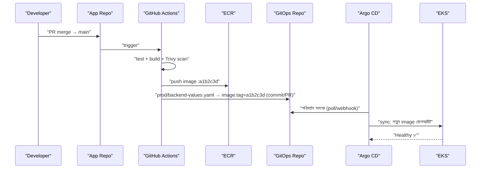
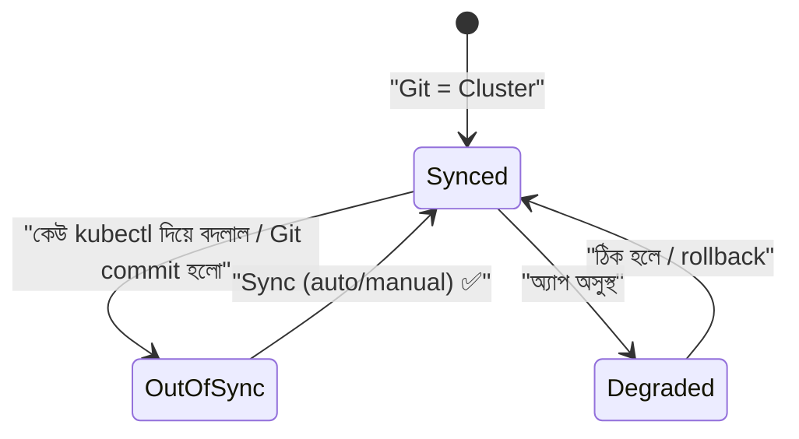
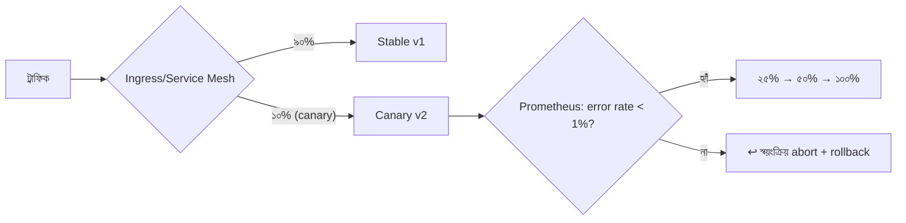

# Module 15 — Packaging and Delivery: Helm and GitOps with Argo CD

> **Section 3 · Containers, Kubernetes & Platform** · ২টি Live Class
> **Project:** Deploy by Git Commit
> **Goal:** three-tier অ্যাপের প্রতিটা deployment ঘটবে শুধুমাত্র একটা **Git commit**-এর মাধ্যমে।
> **Assignment ★:** একটা canary release চালাও যা failing metric দেখলে **নিজে থেকে rollback** করে।

---

## 📖 গল্প: কপি-পেস্টের জঞ্জাল থেকে "Git-ই সত্য"

BookNest-এ এখন তিন পরিবেশ: dev, staging, prod। K8s YAML কপি করে করে তিন ফোল্ডার — `replicas`, image ট্যাগ, ডোমেইন আলাদা, বাকি ৯০% একই। একটা ফিচার বদলাতে তিন জায়গায় হাত! একদিন prod-এ ভুল ট্যাগ বসল, কেউ টের পেল না কে করল।

তারপর দুটো বিপ্লব:

1. **Helm — রেসিপির টেমপ্লেট।** একটাই রেসিপি, পরিবেশভেদে শুধু "মান" (values) বদলাও।
2. **GitOps — Git-ই সত্যের উৎস।** ক্লাস্টারে সরাসরি `kubectl apply` নিষিদ্ধ। যা Git-এ লেখা, ক্লাস্টার ঠিক তা-ই। কেউ হাতে বদলালে **Argo CD** (একজন অক্লান্ত পাহারাদার) সেটা আবার Git-এর অবস্থায় ফিরিয়ে দেয়।

Deploy করা = Git-এ commit। Rollback = Git revert। ইতিহাস = `git log`। অডিট = ফ্রি।

---

# 🧩 Live Class 1 — Packaging the Application with Helm

## 1. কপি-পেস্ট manifest-এর সমস্যা



## 2. Helm কী?

**Helm = Kubernetes-এর প্যাকেজ ম্যানেজার** (apt/npm-এর মতো)। এক-ধাক্কায় install, upgrade, rollback, uninstall।

| শব্দ | অর্থ |
|---|---|
| **Chart** | প্যাকেজ (টেমপ্লেট + ডিফল্ট মান) |
| **Values** | কাস্টমাইজেশন ইনপুট |
| **Release** | ক্লাস্টারে ইনস্টল-হওয়া chart-এর একটা নামকরা কপি |
| **Repository** | chart-এর সংগ্রহ |
| **Revision** | release-এর প্রতিটা সংস্করণ (rollback-এর ভিত্তি) |



## 3. Chart-এর গঠন

```bash
helm create booknest          # বেসিক স্ট্রাকচার তৈরি
```
```text
booknest/
├── Chart.yaml            # chart-এর নাম, ভার্সন
├── values.yaml           # ডিফল্ট মান
├── values-dev.yaml       # পরিবেশ-ওভাররাইড
├── values-prod.yaml
├── charts/               # নির্ভরতা (sub-chart)
└── templates/
    ├── _helpers.tpl      # পুনর্ব্যবহারযোগ্য টেমপ্লেট-টুকরো (নাম/label)
    ├── deployment.yaml
    ├── service.yaml
    ├── ingress.yaml
    ├── hpa.yaml
    ├── configmap.yaml
    └── NOTES.txt         # install-এর পর কী দেখাবে
```

```yaml
# Chart.yaml
apiVersion: v2
name: booknest-backend
description: BookNest backend API
type: application
version: 0.3.0           # chart নিজের ভার্সন — টেমপ্লেট বদলালে বাড়াও
appVersion: "1.4.2"      # অ্যাপের ভার্সন (তথ্যমূলক)
```

## 4. Three-Tier Manifest → Helm Chart

### values.yaml — একটাই জায়গায় সব কনফিগ

```yaml
# values.yaml
replicaCount: 2

image:
  repository: <ACCOUNT>.dkr.ecr.ap-southeast-1.amazonaws.com/booknest-backend
  tag: ""                       # খালি = Chart.appVersion; CI/GitOps এখানে git-sha বসায়
  pullPolicy: IfNotPresent

service:
  port: 3000

config:                         # ConfigMap-এ যাবে
  NODE_ENV: production
  DB_HOST: postgres
  DB_NAME: booknest

existingSecret: backend-secret  # Secret chart-এ নয়; আলাদা (External Secrets, M18) — Git-এ secret নয়

ingress:
  enabled: true
  host: booknest.example.com
  path: /api

resources:
  requests: { cpu: 100m, memory: 128Mi }
  limits:   { cpu: 500m, memory: 256Mi }

autoscaling:
  enabled: true
  minReplicas: 2
  maxReplicas: 10
  targetCPUUtilizationPercentage: 60
```

```yaml
# values-prod.yaml — শুধু যা আলাদা, তাই
replicaCount: 3
ingress:
  host: booknest.example.com
resources:
  limits: { cpu: "1", memory: 512Mi }
autoscaling:
  maxReplicas: 20
```
```yaml
# values-dev.yaml
replicaCount: 1
ingress:
  host: dev.booknest.example.com
autoscaling:
  enabled: false
```

### টেমপ্লেট — Go template সিনট্যাক্স

```yaml
# templates/deployment.yaml
apiVersion: apps/v1
kind: Deployment
metadata:
  name: {{ include "booknest.fullname" . }}          # _helpers.tpl থেকে নাম
  labels:
    {{- include "booknest.labels" . | nindent 4 }}   # nindent: নতুন লাইন + ৪ স্পেস ইন্ডেন্ট
spec:
  {{- if not .Values.autoscaling.enabled }}
  replicas: {{ .Values.replicaCount }}               # HPA থাকলে replicas বসাই না (HPA-র সাথে লড়াই এড়াতে)
  {{- end }}
  selector:
    matchLabels:
      {{- include "booknest.selectorLabels" . | nindent 6 }}
  template:
    metadata:
      labels:
        {{- include "booknest.selectorLabels" . | nindent 8 }}
      annotations:
        # ConfigMap বদলালে checksum বদলায় → Pod রিস্টার্ট হয়ে নতুন কনফিগ নেয় (নইলে পুরনো কনফিগেই চলত)
        checksum/config: {{ include (print $.Template.BasePath "/configmap.yaml") . | sha256sum }}
    spec:
      containers:
        - name: backend
          image: "{{ .Values.image.repository }}:{{ .Values.image.tag | default .Chart.AppVersion }}"
          imagePullPolicy: {{ .Values.image.pullPolicy }}
          ports:
            - name: http
              containerPort: {{ .Values.service.port }}
          envFrom:
            - configMapRef:
                name: {{ include "booknest.fullname" . }}
            - secretRef:
                name: {{ .Values.existingSecret }}
          resources:
            {{- toYaml .Values.resources | nindent 12 }}
          readinessProbe:
            httpGet: { path: /health, port: http }
          livenessProbe:
            httpGet: { path: /health, port: http }
            initialDelaySeconds: 20
```

```yaml
# templates/configmap.yaml
apiVersion: v1
kind: ConfigMap
metadata:
  name: {{ include "booknest.fullname" . }}
data:
  {{- range $key, $val := .Values.config }}       # values-এর config map ঘুরে প্রতিটা key-value লেখে
  {{ $key }}: {{ $val | quote }}
  {{- end }}
```

```yaml
# templates/hpa.yaml — শর্তসাপেক্ষ রিসোর্স
{{- if .Values.autoscaling.enabled }}
apiVersion: autoscaling/v2
kind: HorizontalPodAutoscaler
metadata:
  name: {{ include "booknest.fullname" . }}
spec:
  scaleTargetRef:
    apiVersion: apps/v1
    kind: Deployment
    name: {{ include "booknest.fullname" . }}
  minReplicas: {{ .Values.autoscaling.minReplicas }}
  maxReplicas: {{ .Values.autoscaling.maxReplicas }}
  metrics:
    - type: Resource
      resource:
        name: cpu
        target:
          type: Utilization
          averageUtilization: {{ .Values.autoscaling.targetCPUUtilizationPercentage }}
{{- end }}
```

## 5. Helm কমান্ড ও Lint

```bash
helm lint ./booknest                                     # ভুল/সতর্কতা ধরা
helm template booknest ./booknest -f values-prod.yaml    # ক্লাস্টারে না বসিয়ে চূড়ান্ত YAML দেখো — ⭐ ডিবাগের প্রধান উপায়
helm template ./booknest -f values-prod.yaml | kubeconform -strict -    # schema যাচাই

helm install booknest ./booknest -n booknest -f values-prod.yaml --create-namespace
helm upgrade booknest ./booknest -n booknest -f values-prod.yaml --set image.tag=a1b2c3d
helm upgrade --install booknest ./booknest ...           # নেই তো install, আছে তো upgrade — CI-র জন্য আদর্শ
helm upgrade ... --atomic --timeout 5m                   # ব্যর্থ হলে নিজে রোলব্যাক

helm list -n booknest
helm history booknest -n booknest                        # revision তালিকা
helm rollback booknest 2 -n booknest                     # revision ২-এ ফেরা
helm uninstall booknest -n booknest
```

**Chart Versioning:** chart `version` সেমভার (টেমপ্লেট বদলালে)। `appVersion` অ্যাপের। OCI রেজিস্ট্রিতে (ECR) chart push:

```bash
helm package ./booknest                              # booknest-0.3.0.tgz
aws ecr get-login-password | helm registry login --username AWS --password-stdin <REG>
helm push booknest-0.3.0.tgz oci://<REG>/helm-charts
```

## 6. 🤖 AI-সহায়তায় Chart রচনা ও রিভিউ

AI দ্রুত chart বানায়, কিন্তু ভুল: ভুল `nindent` সংখ্যা (YAML ইন্ডেন্ট ভাঙে), `.Values` পাথ বানানো, `default` ভুলে যাওয়া, hard-coded নাম, secret values-এ রেখে দেওয়া।

**যাচাই-ধাপ:** `helm lint` → `helm template` পড়ে চোখে দেখা → `kubeconform` → `--dry-run=server` → ডেভ এনভায়রনমেন্টে `install`।

---

# 🧩 Live Class 2 — GitOps with Argo CD and Progressive Delivery

## 7. GitOps নীতি



| নীতি | অর্থ |
|---|---|
| **Declarative** | সব কিছু YAML/Helm-এ বর্ণিত |
| **Versioned** | Git = ইতিহাস + অডিট + রোলব্যাক |
| **Automatically pulled** | ক্লাস্টারের ভেতর থেকে এজেন্ট টানে |
| **Continuously reconciled** | drift নিজে ঠিক হয় |

### Push বনাম Pull deployment

| Push (M06) | Pull (GitOps) |
|---|---|
| CI পাইপলাইন ক্লাস্টারে ঢুকে apply করে | ক্লাস্টারের ভেতরের এজেন্ট Git থেকে টানে |
| CI-র কাছে ক্লাস্টারের **অ্যাডমিন চাবি** | CI-র কাছে ক্লাস্টারের চাবি **নেই** — নিরাপদ |
| drift অজানা | drift ধরা ও ঠিক হয় |

## 8. Argo CD ইনস্টল

```bash
kubectl create namespace argocd
kubectl apply -n argocd -f https://raw.githubusercontent.com/argoproj/argo-cd/stable/manifests/install.yaml
kubectl get pods -n argocd

# প্রাথমিক অ্যাডমিন পাসওয়ার্ড (প্রথম লগইনের পর বদলে ফেলো; CLI/UI)
kubectl -n argocd get secret argocd-initial-admin-secret -o jsonpath="{.data.password}" | base64 -d; echo
kubectl port-forward svc/argocd-server -n argocd 8080:443      # https://localhost:8080
```
> প্রোডাকশনে: SSO (OIDC), RBAC, Ingress+TLS; initial secret মুছে ফেলা।

## 9. Application ও "App of Apps" প্যাটার্ন

### Git রিপো-কাঠামো (দুটো রিপো — ভালো অভ্যাস)

```text
booknest-app/          ← অ্যাপের কোড + Dockerfile + CI           (ডেভেলপারদের)
booknest-gitops/       ← K8s/Helm কনফিগ — "কাঙ্ক্ষিত অবস্থা"    (ডিপ্লয় রিপো)
├── apps/                          # App-of-Apps: Argo Application-গুলোর তালিকা
│   ├── root.yaml
│   ├── backend.yaml
│   ├── frontend.yaml
│   └── monitoring.yaml
└── envs/
    ├── dev/backend-values.yaml
    └── prod/backend-values.yaml   ← এই ফাইলের image.tag বদলই = ডিপ্লয়
```

```yaml
# apps/backend.yaml — Argo CD "Application"
apiVersion: argoproj.io/v1alpha1
kind: Application
metadata:
  name: booknest-backend-prod
  namespace: argocd
spec:
  project: default
  source:
    repoURL: https://github.com/my-org/booknest-gitops.git
    targetRevision: main
    path: charts/booknest-backend            # Helm chart-এর পথ
    helm:
      valueFiles:
        - ../../envs/prod/backend-values.yaml
  destination:
    server: https://kubernetes.default.svc   # একই ক্লাস্টার
    namespace: booknest
  syncPolicy:
    automated:
      prune: true        # Git থেকে সরানো রিসোর্স ক্লাস্টার থেকেও মোছো
      selfHeal: true     # হাতে বদলালে Git-এ ফেরাও (drift থেকে সুরক্ষা)
    syncOptions:
      - CreateNamespace=true
```

```yaml
# apps/root.yaml — "App of Apps": একটা Application যা বাকি সব Application ঘোষণা করে
apiVersion: argoproj.io/v1alpha1
kind: Application
metadata: { name: root, namespace: argocd }
spec:
  project: default
  source:
    repoURL: https://github.com/my-org/booknest-gitops.git
    targetRevision: main
    path: apps                  # এই ফোল্ডারের সব Application YAML
  destination: { server: https://kubernetes.default.svc, namespace: argocd }
  syncPolicy: { automated: { prune: true, selfHeal: true } }
```

**সুবিধা:** `kubectl apply -f root.yaml` একবার — বাকি সব Git থেকে স্বয়ংক্রিয়; নতুন ক্লাস্টার = মিনিটে পূর্ণ পুনর্নির্মাণ (disaster recovery!)।

## 10. পূর্ণ GitOps ফ্লো — CI ইমেজ বানায়, Git commit ডিপ্লয় করে



```yaml
# CI-র শেষ ধাপ: GitOps রিপোতে tag আপডেট (সংক্ষিপ্ত)
      - name: GitOps repo আপডেট
        run: |
          git clone https://x-access-token:${{ secrets.GITOPS_TOKEN }}@github.com/my-org/booknest-gitops.git
          cd booknest-gitops
          # yq দিয়ে শুধু image.tag বদলানো — হাতে sed নয়, কাঠামো নষ্ট হয় না
          yq -i '.image.tag = "${{ needs.build.outputs.tag }}"' envs/prod/backend-values.yaml
          git config user.name  "ci-bot"
          git config user.email "ci-bot@users.noreply.github.com"
          git commit -am "deploy: backend ${{ needs.build.outputs.tag }}"
          git push
```
> `GITOPS_TOKEN` — শুধু ওই রিপোতে লেখার অনুমতিসহ সীমিত টোকেন (fine-grained PAT/GitHub App)। সরাসরি `main`-এ push না করে **PR**-ও করা যায় (প্রোডাকশনে অনুমোদনের ধাপ হিসেবে)। বিকল্প: **Argo CD Image Updater**।

## 11. Drift Detection ও Self-Healing

```bash
# কেউ লুকিয়ে হাতে scale করল:
kubectl scale deploy backend -n booknest --replicas=1
# Argo CD: App "OutOfSync" দেখায় → selfHeal: true হলে কয়েক সেকেন্ডে নিজে replicas আবার Git-এর মানে ফেরায়
```



**Rollback = Git revert:**

```bash
git revert <bad-commit-sha>      # নতুন "ফেরত" commit — ইতিহাস অটুট
git push                         # Argo CD নিজে sync → আগের অবস্থা
# ⚠️ Argo UI-র "Rollback" বোতাম auto-sync বন্ধ করে দেয়; Git-ই সত্য রাখতে git revert সেরা
```

## 12. Progressive Delivery — Argo Rollouts, Canary ও Blue/Green

**সমস্যা:** Rolling update-এ নতুন ভার্সন *ধীরে* আসে, কিন্তু **ভুল হলে স্বয়ংক্রিয় থামে না** (Pod Ready হলেই এগোয়, যদিও error rate বাড়ছে)। **Argo Rollouts** মেট্রিক দেখে সিদ্ধান্ত নেয়।



```bash
kubectl create namespace argo-rollouts
kubectl apply -n argo-rollouts -f https://github.com/argoproj/argo-rollouts/releases/latest/download/install.yaml
# CLI/dashboard: kubectl plugin — kubectl argo rollouts get rollout backend -w
```

```yaml
# Deployment-এর বদলে Rollout (বাকি spec প্রায় হুবহু)
apiVersion: argoproj.io/v1alpha1
kind: Rollout
metadata: { name: backend, namespace: booknest }
spec:
  replicas: 5
  selector: { matchLabels: { app: backend } }
  template:
    metadata: { labels: { app: backend } }
    spec:
      containers:
        - name: backend
          image: <ACCOUNT>.dkr.ecr...booknest-backend:a1b2c3d
          ports: [{ name: http, containerPort: 3000 }]
  strategy:
    canary:
      canaryService: backend-canary          # canary Pod-এর Service
      stableService: backend                 # stable Pod-এর Service
      trafficRouting:
        nginx:
          stableIngress: booknest            # Ingress-nginx দিয়ে ওজন-ভিত্তিক ট্রাফিক ভাগ
      analysis:                              # ⭐ canary চলাকালে স্বয়ংক্রিয় মেট্রিক-যাচাই
        templates:
          - templateName: success-rate
        startingStep: 1
      steps:
        - setWeight: 10                      # ১০% ট্রাফিক
        - pause: { duration: 2m }            # ২ মিনিট দেখো
        - setWeight: 25
        - pause: { duration: 2m }
        - setWeight: 50
        - pause: { duration: 2m }
        # শেষে ১০০% — যদি সব ঠিক
---
apiVersion: argoproj.io/v1alpha1
kind: AnalysisTemplate
metadata: { name: success-rate, namespace: booknest }
spec:
  metrics:
    - name: success-rate
      interval: 30s                          # প্রতি ৩০ সেকেন্ডে পরীক্ষা
      count: 5
      failureLimit: 1                        # ১বারের বেশি ব্যর্থ হলে → rollback
      successCondition: result[0] >= 0.99    # সফলতার হার ≥ ৯৯%
      provider:
        prometheus:
          address: http://monitoring-kube-prometheus-prometheus.monitoring:9090
          query: |
            sum(rate(http_requests_total{service="backend-canary",status!~"5.."}[2m]))
            /
            sum(rate(http_requests_total{service="backend-canary"}[2m]))
```

### Blue/Green (Rollouts)

```yaml
  strategy:
    blueGreen:
      activeService: backend                 # বর্তমানে ট্রাফিক পায়
      previewService: backend-preview        # নতুন ভার্সন আগে এখানে টেস্ট
      autoPromotionEnabled: false            # ম্যানুয়াল অনুমোদনে সুইচ
      scaleDownDelaySeconds: 300             # সুইচের পর ৫ মিনিট পুরনো রাখো (দ্রুত ফেরার জন্য)
```

| কৌশল | সুবিধা | খরচ/জটিলতা |
|---|---|---|
| Rolling | সরল, বিল্ট-ইন | মেট্রিক-অন্ধ |
| Blue/Green | তাৎক্ষণিক সুইচ/ফেরা | সাময়িক ২× রিসোর্স |
| **Canary** | ঝুঁকি ন্যূনতম, মেট্রিক-চালিত | ট্রাফিক-রাউটিং ও মেট্রিক দরকার |

### 🧪 Assignment — Failing metric-এ auto rollback

1. Canary v2-তে ইচ্ছাকৃত bug (যেমন ৩০% রিকোয়েস্টে 500)।
2. Git commit → Argo sync → Rollout শুরু (১০% ট্রাফিক)।
3. `AnalysisRun` সফলতার হার <৯৯% ধরে → **Rollout "Degraded", ট্রাফিক আবার ১০০% stable-এ** — কেউ হাত দেয়নি।
4. Grafana-য় ওই সময়ের error spike ও recovery স্ক্রিনশট রাখো।

```bash
kubectl argo rollouts get rollout backend -n booknest -w     # লাইভ ধাপ ও analysis ফলাফল
kubectl argo rollouts abort backend -n booknest              # হাতে থামানো
kubectl argo rollouts promote backend -n booknest            # পুরো এগিয়ে নেওয়া (pause থেকে)
```

## ⚠️ সাধারণ ভুল

| সমস্যা | কারণ/সমাধান |
|---|---|
| Helm render করে ভাঙা YAML | `nindent` সংখ্যা ভুল → `helm template` দেখো |
| ConfigMap বদলালে Pod নতুন কনফিগ নেয় না | `checksum/config` annotation নেই |
| Argo বারবার OutOfSync | HPA `replicas` বনাম chart `replicas` লড়াই / mutating webhook → `ignoreDifferences` |
| Argo "prune" ভুল রিসোর্স মুছল | prune-এ সাবধান; প্রথমে manual sync, `Prune=false` annotation গুরুত্বপূর্ণ রিসোর্সে |
| secret Git-এ | External Secrets/Sealed Secrets (M18) |
| Rollout analysis সবসময় ফেল | Prometheus query ভুল/মেট্রিক নেই (কোনো ট্রাফিক নেই) |
| CI নিজেই `kubectl apply` করছে | GitOps-এর বিরুদ্ধ — CI Git-এ লেখে, ক্লাস্টারে নয় |

## ✅ চেকলিস্ট

- [ ] Chart: templates, values, helpers; dev/prod values
- [ ] `helm lint/template/kubeconform` পাস
- [ ] Argo CD ইনস্টল ও Application (auto-sync, prune, selfHeal)
- [ ] App-of-Apps; দুই রিপো (app ও gitops)
- [ ] CI image বানিয়ে GitOps রিপোতে tag আপডেট করে
- [ ] Drift নিজে ঠিক হতে দেখেছি
- [ ] Argo Rollouts canary + AnalysisTemplate; failing metric-এ auto rollback
- [ ] Rollback = `git revert`

## 🎯 ইন্টারভিউ প্রশ্ন

1. Helm কেন? `helm template` ও `helm lint`-এর কাজ?
2. Chart `version` বনাম `appVersion`?
3. GitOps কী? Push বনাম pull মডেল; কোনটা কেন নিরাপদ?
4. Argo CD `selfHeal` ও `prune` কী?
5. App of Apps প্যাটার্ন কেন?
6. Canary বনাম Blue/Green বনাম Rolling?
7. Argo Rollouts কীভাবে স্বয়ংক্রিয় rollback ঠিক করে? (AnalysisTemplate + Prometheus)
8. কেন app রিপো ও GitOps রিপো আলাদা?
9. GitOps-এ secret কীভাবে সামলাবে?

## 🧠 সারসংক্ষেপ

**Helm = একটা রেসিপি, বহু পরিবেশ। GitOps (Argo CD) = Git যা বলে, ক্লাস্টার তা-ই — হাতে বদলালে নিজে ফেরে।** Deploy = commit, Rollback = revert। **Argo Rollouts** যোগ করলে ডিপ্লয় *মেট্রিক দেখে নিজেই সিদ্ধান্ত নেয়* — ভুল হলে ফিরে যায়, মানুষ ঘুমাতে পারে।

⬅️ [Module 14](./module-14-migrating-the-three-tier-application-to-eks.md) · ➡️ [Module 16](./module-16-platform-engineering-building-an-internal-developer-platform.md)
