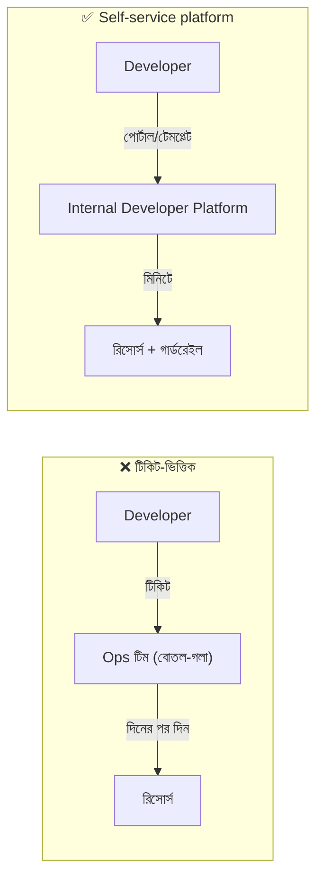
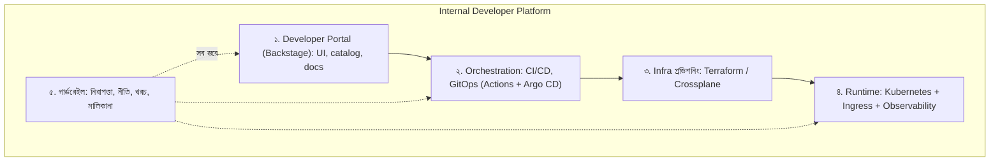
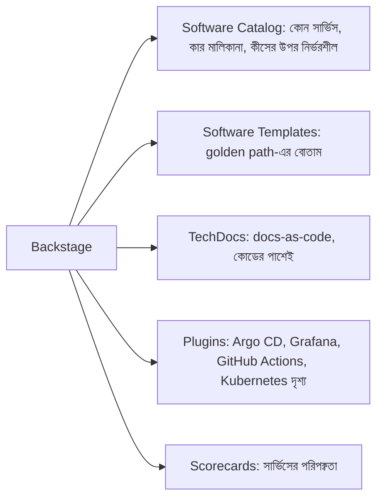
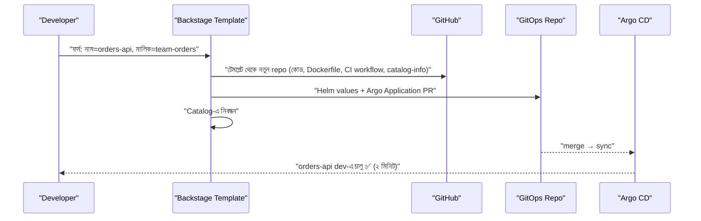
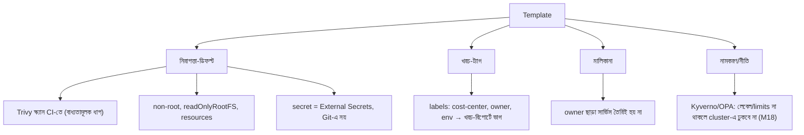
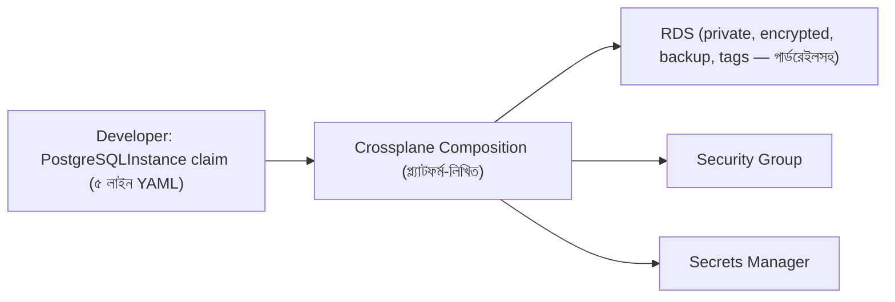
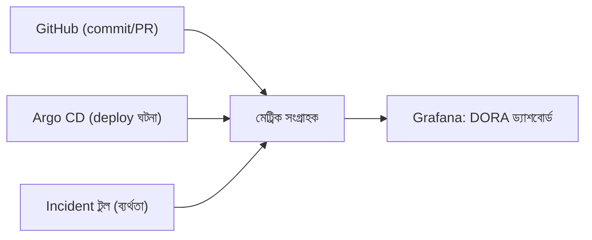

# Module 16 — Platform Engineering: Building an Internal Developer Platform

> **Section 3 · Containers, Kubernetes & Platform** · ২টি Live Class
> **Project:** Self-Service Developer Portal
> **Goal:** একজন developer কোনো টিকিট না খুলেই platform দিয়ে নতুন service তৈরি ও deploy করতে পারবে।
> **Assignment ★:** একটা কার্যকর **golden path template** প্রকাশ করো এবং তা দিয়ে একটা নতুন service onboard করো।

---

## 📖 গল্প: "টিকিট দিয়ে অপেক্ষা" থেকে "নিজেই করে ফেলা"

BookNest এখন বড়: ১২ জন developer, ৮টা service। নতুন service লাগলে নিয়ম:

1. DevOps-কে Slack-এ বলো → 2. টিকিট → 3. ৩ দিন পর repo → 4. আরও ২ দিন পর CI → 5. আরও এক সপ্তাহ পর K8s manifest...

তানভীর (এখন DevOps) দিনভর একই কাজ বারবার করে — **সে নিজেই বাধা (bottleneck)**। Developer-রা হতাশ, কেউ কেউ নিজেরা অনিরাপদ উপায়ে ডিপ্লয় করছে।

সমাধান — **Platform Engineering:** DevOps টিম এখন **একটা পণ্য বানায়, যার গ্রাহক হলো developer-রা**। "নতুন service" বোতামে ক্লিক করলে ২ মিনিটে: repo, CI/CD, Helm chart, Argo CD অ্যাপ, মনিটরিং, নিরাপত্তা-ডিফল্ট — সব তৈরি। যেন **শহরের পাকা সড়ক (paved road)**: ইচ্ছে হলে জঙ্গলের পথে যেতে পারো, কিন্তু পাকা সড়কটা এতই সহজ যে সবাই সেটাই বেছে নেয় — আর সড়কের নিরাপত্তা-বেড়া আগে থেকেই বসানো।

---

# 🧩 Live Class 1 — Platform Engineering Concepts and Golden Paths

## 1. টিকিট-ভিত্তিক Ops থেকে Self-Service



## 2. DevOps vs Platform Engineering vs SRE

| | DevOps | Platform Engineering | SRE |
|---|---|---|---|
| মূল ফোকাস | সংস্কৃতি + অটোমেশন | **Developer অভিজ্ঞতা (DevEx)** দেওয়া পণ্য | নির্ভরযোগ্যতা (SLO) |
| গ্রাহক | নিজের দল | **অভ্যন্তরীণ developer-রা** | ব্যবহারকারী |
| আউটপুট | pipeline, infra | **IDP, golden paths** | SLO, incident প্রক্রিয়া |

## 3. Platform as a Product

> **"Developers are the customer."** প্ল্যাটফর্ম টিম নিজেকে **পণ্য-দল** ভাবে: ব্যবহারকারীর সাক্ষাৎকার, অনুসন্ধান, রোডম্যাপ, ফিডব্যাক, গ্রহণযোগ্যতার মেট্রিক। কেউ প্ল্যাটফর্ম ব্যবহার না করলে — সেটা আদেশের ব্যর্থতা নয়, **পণ্যের ব্যর্থতা।**

### Platform-এর পাঁচ স্তর (IDP-র কাঠামো)



## 4. Golden Paths ও Paved Roads

**Golden path:** একটা নির্দিষ্ট ধরনের কাজের জন্য **সবচেয়ে সহজ, সমর্থিত, নিরাপদ, আগে-থেকে-ভাবা রাস্তা।**

| বৈশিষ্ট্য | কেন |
|---|---|
| **ঐচ্ছিক** (বাধ্যতামূলক নয়) | জোর করা হলে লোকে এড়ায়; ভালো হলে নিজেই বেছে নেয় |
| **ডিফল্টে নিরাপদ** | scan, non-root, secret ম্যানেজমেন্ট বিল্ট-ইন |
| **সম্পূর্ণ** | কোড থেকে প্রোডাকশন পর্যন্ত (CI, deploy, monitoring) |
| **সমর্থিত** | প্ল্যাটফর্ম টিম রক্ষণাবেক্ষণ করে |
| **অতিক্রমযোগ্য** (escape hatch) | বিশেষ প্রয়োজনে সরে যাওয়া যায় — কিন্তু দায়িত্ব নিজের |

উদাহরণ golden path-সমূহ: *"নতুন Node.js API সার্ভিস"*, *"নতুন React ফ্রন্টএন্ড"*, *"নতুন ব্যাকগ্রাউন্ড ওয়ার্কার"*, *"নতুন PostgreSQL ডেটাবেস"*।

## 5. Backstage — Developer Portal

**Backstage** (Spotify-র ওপেন-সোর্স, এখন CNCF) — ডেভেলপার পোর্টালের কাঠামো।



### 5.1 Software Catalog — `catalog-info.yaml`

প্রতিটা সার্ভিসের রিপোতে একটা ফাইল; Backstage পড়ে ক্যাটালগ বানায়।

```yaml
# catalog-info.yaml (সার্ভিসের রিপো-রুটে)
apiVersion: backstage.io/v1alpha1
kind: Component
metadata:
  name: booknest-backend
  description: BookNest API (বই, অর্ডার)
  annotations:
    github.com/project-slug: my-org/booknest-backend      # GitHub প্লাগইনের জন্য
    argocd/app-name: booknest-backend-prod                # Argo CD প্লাগইনের জন্য
    backstage.io/techdocs-ref: dir:.                      # docs এই রিপোতেই
    grafana/dashboard-selector: "booknest-backend"
  tags: [nodejs, api]
spec:
  type: service
  lifecycle: production              # experimental / production / deprecated
  owner: team-storefront             # ⭐ মালিকানা — রাত ২টায় কাকে ডাকবে?
  system: booknest
  dependsOn:
    - resource:booknest-db           # নির্ভরশীলতা-গ্রাফ
  providesApis:
    - booknest-api
```

> **ক্যাটালগের আসল শক্তি:** "এই সার্ভিসের মালিক কে? কোথায় ডকস? কী কী এর উপর নির্ভর করে? শেষ ডিপ্লয় কখন? ড্যাশবোর্ড কোথায়?" — **এক জায়গায় উত্তর।**

### 5.2 TechDocs

```yaml
# mkdocs.yml (সার্ভিস রিপোতে) + docs/index.md → Backstage-এ স্বয়ংক্রিয় সুন্দর ডকস সাইট
site_name: booknest-backend
nav:
  - Home: index.md
  - Runbook: runbook.md
  - API: api.md
plugins: [techdocs-core]
```
**Docs-as-code:** ডকস কোডের পাশে, PR-এ রিভিউ — তাই বাসি হয় কম।

### 5.3 Scorecards ও Service Maturity

সার্ভিস "প্রোডাকশন-প্রস্তুত" কি না, মাপার চেকলিস্ট:

| বিষয় | ব্রোঞ্জ | সিলভার | গোল্ড |
|---|---|---|---|
| মালিক ঘোষিত | ✅ | ✅ | ✅ |
| README/runbook | ✅ | ✅ | ✅ |
| CI + টেস্ট | | ✅ | ✅ |
| Image scan পাস | | ✅ | ✅ |
| SLO ও অ্যালার্ট | | | ✅ |
| Dashboards ও tracing | | | ✅ |
| ব্যাকআপ/DR পরীক্ষিত | | | ✅ |

---

# 🧩 Live Class 2 — Self-Service Templates with Guardrails

## 6. Backstage Software Template (Scaffolder)

লক্ষ্য: ফর্মে নাম/মালিক দিলে স্বয়ংক্রিয়ভাবে **repo + CI + Helm chart + Argo CD অ্যাপ + catalog entry**।



```yaml
# template.yaml — Backstage software template
apiVersion: scaffolder.backstage.io/v1beta3
kind: Template
metadata:
  name: nodejs-service
  title: Node.js API Service (Golden Path)
  description: নিরাপদ ডিফল্টসহ নতুন Node.js সার্ভিস — repo, CI, Helm, Argo CD, মনিটরিং
  tags: [recommended, nodejs]
spec:
  owner: platform-team
  type: service

  parameters:                          # ফর্মের ক্ষেত্র
    - title: সার্ভিসের তথ্য
      required: [name, owner]
      properties:
        name:
          title: সার্ভিসের নাম
          type: string
          pattern: '^[a-z][a-z0-9-]{2,30}$'      # কেবল ছোট হাতের অক্ষর/হাইফেন — নামকরণ-নীতির গার্ডরেইল
        owner:
          title: মালিক দল
          type: string
          ui:field: OwnerPicker                   # ক্যাটালগ থেকে বাছাই — মালিকানা বাধ্যতামূলক
          ui:options:
            catalogFilter: { kind: Group }
        costCenter:
          title: Cost Center (খরচ-ট্যাগ)
          type: string
          enum: [storefront, payments, platform]
    - title: পরিবেশ
      properties:
        needsDatabase:
          title: PostgreSQL লাগবে?
          type: boolean
          default: false

  steps:
    - id: fetch
      name: টেমপ্লেট থেকে কোড তৈরি
      action: fetch:template
      input:
        url: ./skeleton                            # skeleton/ ফোল্ডারে Dockerfile, CI, chart, catalog-info
        values:
          name: ${{ parameters.name }}
          owner: ${{ parameters.owner }}
          costCenter: ${{ parameters.costCenter }}

    - id: publish
      name: GitHub-এ নতুন repo
      action: publish:github
      input:
        repoUrl: github.com?owner=my-org&repo=${{ parameters.name }}
        defaultBranch: main
        # branch protection, CODEOWNERS skeleton-এর মধ্যেই

    - id: gitops
      name: GitOps রিপোতে Argo Application PR
      action: publish:github:pull-request
      input:
        repoUrl: github.com?owner=my-org&repo=booknest-gitops
        branchName: onboard-${{ parameters.name }}
        title: "onboard: ${{ parameters.name }}"
        sourcePath: ./gitops-skeleton

    - id: register
      name: Catalog-এ নিবন্ধন
      action: catalog:register
      input:
        repoContentsUrl: ${{ steps['publish'].output.repoContentsUrl }}
        catalogInfoPath: /catalog-info.yaml

  output:
    links:
      - title: নতুন repo
        url: ${{ steps['publish'].output.remoteUrl }}
      - title: Catalog-এ খুলুন
        icon: catalog
        entityRef: ${{ steps['register'].output.entityRef }}
```

### Template-এর ভেতরে কী থাকে (`skeleton/`)

```text
skeleton/
├── src/                      # "Hello" সার্ভিস + /health + /metrics (গোল্ডেন সিগন্যাল প্রস্তুত)
├── Dockerfile                # multi-stage, non-root (M12)
├── .github/workflows/ci.yml  # test + build + Trivy + ECR push + GitOps tag আপডেট (M06/M12/M15)
├── chart/                    # Helm chart (M15)
├── catalog-info.yaml         # মালিক ও নির্ভরতা (পরিবর্তনশীল ${{ values.owner }})
├── CODEOWNERS
├── mkdocs.yml + docs/        # TechDocs
└── renovate.json             # নির্ভরতা-আপডেট স্বয়ংক্রিয়
```

## 7. Guardrails — "পাকা সড়কের বেড়া"

গার্ডরেইল = **বাধা নয়, নিরাপদ ডিফল্ট** — developer-কে ভাবতেই হয় না।



**Template-এ বসানো ট্যাগ (খরচ ও মালিকানা):**

```yaml
# chart/templates/_helpers.tpl — প্রতিটা রিসোর্সে স্বয়ংক্রিয় লেবেল
{{- define "service.labels" -}}
app.kubernetes.io/name: {{ .Values.name }}
app.kubernetes.io/managed-by: platform-template
owner: {{ .Values.owner }}
cost-center: {{ .Values.costCenter }}
environment: {{ .Values.environment }}
{{- end }}
```

> **নীতি:** গার্ডরেইল দুই স্তরে — (১) **শিফট-লেফট:** টেমপ্লেটে ডিফল্ট, CI-তে চেক; (২) **শিফট-রাইট:** ক্লাস্টারে admission policy যা ভুল জিনিস ঢুকতেই দেয় না (M18)।

## 8. Crossplane — Self-Service Infrastructure (ধারণা মাত্র)

**সমস্যা:** Developer-এর PostgreSQL ডেটাবেস (RDS) লাগবে, কিন্তু Terraform শেখাতে চাও না।
**Crossplane:** Kubernetes-কেই infrastructure-এর কন্ট্রোল প্ল্যান বানায় — AWS রিসোর্সও K8s YAML দিয়ে।



```yaml
# Developer শুধু এটুকু লেখে (সহজ, নিরাপদ বিমূর্ততা)
apiVersion: platform.booknest.io/v1
kind: PostgreSQLInstance
metadata: { name: orders-db, namespace: orders }
spec:
  size: small                # small/medium/large — instance class-এর বিমূর্ততা
  storageGB: 20
# পেছনে Composition নিশ্চিত করে: private subnet, encryption, Multi-AZ (prod), ব্যাকআপ, ট্যাগ
```
> **Terraform বনাম Crossplane:** Terraform = প্ল্যাটফর্ম টিম/ইঞ্জিনিয়ারদের হাতে; Crossplane = developer-দের জন্য K8s-নেটিভ self-service প্রান্ত। একে অপরের শত্রু নয় — অনেক জায়গায় একসাথে চলে। (কোর্সে শুধু ধারণা।)

## 9. DORA Metrics — প্ল্যাটফর্মের সাফল্য মাপা

প্ল্যাটফর্ম **কাজ করছে** কিনা বুঝবে কীভাবে? **DORA-র চার (+১) মেট্রিক:**

| মেট্রিক | কী মাপে | এলিট লক্ষ্য |
|---|---|---|
| **Deployment Frequency** | কত ঘন ঘন প্রোডাকশনে ডিপ্লয় | দিনে একাধিকবার |
| **Lead Time for Changes** | commit → প্রোডাকশন | < ১ ঘণ্টা |
| **Change Failure Rate** | কত % ডিপ্লয় সমস্যা ঘটায় | < ১৫% |
| **Time to Restore (MTTR)** | বিপর্যয় থেকে ফিরতে সময় | < ১ ঘণ্টা |
| *(Reliability)* | SLO পূরণ | — |



**আরও মাপো:** নতুন service onboard-এর সময় (টিকিট: ১ সপ্তাহ → platform: ১০ মিনিট), golden path গ্রহণের হার, developer সন্তুষ্টি (NPS/সার্ভে), টিকিট-সংখ্যা হ্রাস।

> ⚠️ **Goodhart-এর সূত্র:** মেট্রিক লক্ষ্য হয়ে গেলে তা আর ভালো মেট্রিক থাকে না। DORA দিয়ে *দল* মাপো, *ব্যক্তি* নয়, এবং কারণ খোঁজো।

## 10. 🤖 AI ও প্ল্যাটফর্ম

- AI দিয়ে `skeleton` ও template YAML-এর খসড়া — কিন্তু **golden path-এর নিরাপত্তা-ডিফল্ট মানুষকে সিদ্ধান্ত নিতে হবে** (সব developer এর উপর প্রভাব!)।
- Backstage-এ AI-সহকারী (ক্যাটালগ/ডকস থেকে "এই সার্ভিসের রানবুক কোথায়?") — প্ল্যাটফর্মের DevEx-এর আধুনিক স্তর।
- পরীক্ষা: template দিয়ে একটা ডামি সার্ভিস তৈরি করে *আসলে ডিপ্লয় হয় কিনা* যাচাই — AI-লেখা টেমপ্লেট না চালিয়ে বিশ্বাস নয়।

## ⚠️ সাধারণ ভুল

| ভুল | ফল |
|---|---|
| প্ল্যাটফর্ম বানিয়ে developer-দের জিজ্ঞেস না করা | কেউ ব্যবহার করে না ("ivory tower") |
| সবকিছু বাধ্যতামূলক করা | developer-রা পাশ কাটায়, শত্রুভাব |
| Golden path বাসি হয়ে যাওয়া | পুরনো নিরাপত্তা-ডিফল্ট ছড়ায় — টেমপ্লেটেরও ভার্সনিং ও আপডেট দরকার |
| মালিকানা ঐচ্ছিক | ইনসিডেন্টে কাকে ডাকব? |
| অতি-জটিল প্ল্যাটফর্ম আগেই | ছোট শুরু করো: একটা golden path, একটা টেমপ্লেট |
| Backstage রক্ষণাবেক্ষণের খরচ অবমূল্যায়ন | এর জন্য আলাদা মনোযোগ/টিম লাগে; ছোট দলে বিকল্প (Port, Cortex বা সরল টেমপ্লেট রিপো) |

## ✅ চেকলিস্ট

- [ ] Platform-as-a-product ধারণা বুঝি
- [ ] একটা golden path ঠিক করেছি (Node.js API সার্ভিস)
- [ ] Backstage ক্যাটালগে ≥২ সার্ভিস, `owner` সহ
- [ ] Software template: repo + CI + Helm + Argo + catalog স্বয়ংক্রিয়
- [ ] গার্ডরেইল: scan, non-root, cost tags, owner বাধ্যতামূলক
- [ ] টেমপ্লেট দিয়ে নতুন সার্ভিস onboard — ২০ মিনিটের মধ্যে প্রোডাকশন-সদৃশ পরিবেশে চলছে
- [ ] DORA মেট্রিক ও onboarding-সময় বেসলাইন

## 🎯 ইন্টারভিউ প্রশ্ন

1. DevOps বনাম Platform Engineering বনাম SRE?
2. "Platform as a product" মানে কী?
3. Golden path কী? কেন বাধ্যতামূলক হওয়া উচিত নয়?
4. Backstage-এর প্রধান উপাদানগুলো কী?
5. Guardrails ও gates-এর পার্থক্য? (গার্ডরেইল = নিরাপদ ডিফল্ট; গেট = আটকানো)
6. DORA-র চার মেট্রিক বলো। প্ল্যাটফর্ম কীভাবে এগুলো উন্নত করে?
7. Crossplane vs Terraform?
8. প্ল্যাটফর্ম টিমের সাফল্য কীভাবে মাপবে?

## 🧠 সারসংক্ষেপ

**Platform Engineering = developer-দের জন্য "পাকা সড়ক" বানানো।** Backstage = সড়কের নকশা ও মানচিত্র, Template = সড়কে ওঠার র‍্যাম্প, Guardrail = বেড়া ও সাইনবোর্ড, DORA = সড়ক সত্যিই যাত্রা দ্রুত করল কিনা তার স্পিডোমিটার। **গ্রাহক (developer) খুশি না হলে প্ল্যাটফর্ম ব্যর্থ।**

⬅️ [Module 15](./module-15-packaging-and-delivery-helm-and-gitops-with-argo-cd.md) · ➡️ [Module 17 (Exam Week 3)](./module-17-exam-week-3.md)
