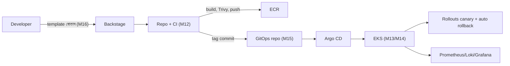

# Module 17 — Exam Week 3

> **Section 3 · Containers, Kubernetes & Platform** · এক্সাম উইক
> **কভার করে:** Module 12 – Module 16
> **ধরন:** বড় অ্যাসাইনমেন্ট + লাইভ টেস্ট। **ঝালিয়ে নিতে পারবে নিজেকে।**

---

## 📖 গল্প: তৃতীয় পরীক্ষা — "ক্যাপ্টেনের পরীক্ষা"

এবার মেন্টর বললেন: "জাহাজের নিয়ন্ত্রণ নাও — ভুল Pod ঢোকাব, bad release পাঠাব, Argo CD-র সাথে লড়ব। আর নতুন এক developer-কে platform দিয়ে ২০ মিনিটে সার্ভিস তুলতে দেব — দেখব তোমার 'পাকা সড়ক' সত্যিই পাকা কিনা।"

---

## 1. পুরো ছবি

## 2. Mock Lab (লক্ষ্য: ৪–৫ ঘণ্টা)

1. **Docker:** backend/frontend multi-stage Dockerfile; Trivy-তে CRITICAL শূন্য; ECR-এ push।
2. **EKS:** Terraform দিয়ে ক্লাস্টার; Postgres (StatefulSet বা RDS), backend, frontend; Ingress + TLS।
3. **Reliability:** resources/probes/PDB/HPA; লোড দিয়ে scale-out প্রদর্শন।
4. **Helm:** chart বানাও (dev/prod values), `helm lint/template` পাস।
5. **GitOps:** Argo CD App-of-Apps; commit দিয়ে ডিপ্লয়; হাতে scale করে selfHeal দেখো।
6. **Progressive:** Rollouts canary + AnalysisTemplate; ইচ্ছাকৃত bug → auto rollback।
7. **Platform:** Backstage template (অথবা সরল template repo) দিয়ে নতুন সার্ভিস onboard।
8. **Cleanup:** `destroy` — সব LB/EBS/NAT/EKS মুছে খরচ শূন্য।

## 3. টপিক-ভিত্তিক রিভিশন

### M12 Docker
- [ ] VM বনাম Container; image/layer/ক্যাশ
- [ ] Multi-stage, non-root, `.dockerignore`, পিন-করা ট্যাগ
- [ ] Compose: network/volume/healthcheck/secret
- [ ] ECR push, immutable ট্যাগ; Trivy ফাইন্ডিং সামলানো

### M13 Kubernetes
- [ ] Control plane উপাদান ও reconciliation loop
- [ ] Pod/RS/Deployment/Service (3 ধরন)/Namespace
- [ ] ConfigMap vs Secret (base64 ≠ encryption)
- [ ] `rollout undo`; `maxSurge/maxUnavailable`
- [ ] Pod status → কারণ মানচিত্র (`Pending`, `CrashLoopBackOff`, `ImagePullBackOff`, `OOMKilled`)

### M14 EKS
- [ ] StatefulSet + PV/PVC + StorageClass; RDS-এর সাথে তুলনা
- [ ] Ingress বনাম Controller; ingress-nginx / AWS LB Controller
- [ ] requests/limits; HPA ও Cluster Autoscaler; liveness-readiness ফাঁদ
- [ ] PDB, NetworkPolicy, IRSA

### M15 Helm ও GitOps
- [ ] Chart কাঠামো, `values`, `helm template`
- [ ] GitOps নীতি; push বনাম pull; selfHeal/prune
- [ ] App-of-Apps; দুই রিপো
- [ ] Canary/Blue-Green; AnalysisTemplate; rollback = `git revert`

### M16 Platform
- [ ] Platform as a product; golden path; guardrails
- [ ] Backstage: catalog, template, TechDocs
- [ ] DORA চার মেট্রিক

## 4. লাইভ-টেস্টের সম্ভাব্য সমস্যা ও দ্রুত নির্ণয়

| লক্ষণ | প্রথমে |
|---|---|
| `ImagePullBackOff` | image নাম/ট্যাগ, ECR অনুমতি, রিজিয়ন |
| `CrashLoopBackOff` | `kubectl logs -p`, env/secret, probe |
| Service-এ সাড়া নেই | `kubectl get endpoints` খালি? selector/label |
| PVC `Pending` | StorageClass, EBS CSI addon, AZ |
| HPA `<unknown>` | metrics-server, `requests` |
| Argo `OutOfSync` অবিরাম | `ignoreDifferences` (HPA replicas) |
| Ingress 404/502 | Controller আছে? `ingressClassName`, backend Service/port |
| Helm render ভাঙা | `helm template`, `nindent` |
| Rollout সবসময় abort | Prometheus query / মেট্রিক নেই |

## 5. মৌখিক/লিখিত নমুনা প্রশ্ন

1. ব্রাউজারে `https://booknest.example.com/api/books` → উত্তর, K8s-এর ভেতরের পুরো পথ বর্ণনা করো (DNS → LB → Ingress → Service → Pod → DB)।
2. একটা Pod `CrashLoopBackOff` — ধাপে ধাপে কীভাবে ডিবাগ করবে?
3. GitOps-এ prod-এ জরুরি ফিক্স কীভাবে দেবে? (hotfix PR → merge → Argo sync; `kubectl edit` নয়)
4. Canary অটো-রোলব্যাক কীভাবে কাজ করে?
5. তোমার platform-এ নতুন developer ২০ মিনিটে কী কী পায়?
6. কোন কোন ক্ষেত্রে K8s অপ্রয়োজনীয়? (ছোট একক অ্যাপ → ECS/App Runner/EC2 যথেষ্ট — **টুল বেছে নেওয়া পরিপক্বতার লক্ষণ**)

## 6. পরীক্ষা-পরবর্তী

- `exam-3-mistakes.md` আপডেট।
- **খরচ-অডিট:** `kubectl get svc -A | grep LoadBalancer`, Cost Explorer; EKS/NAT/ELB/EBS মুছেছ?

➡️ পরের সেকশন: [Module 18 — DevSecOps and Software Supply Chain Security](../section-4-devsecops-sre-finops-ai-ops/module-18-devsecops-and-software-supply-chain-security.md)
