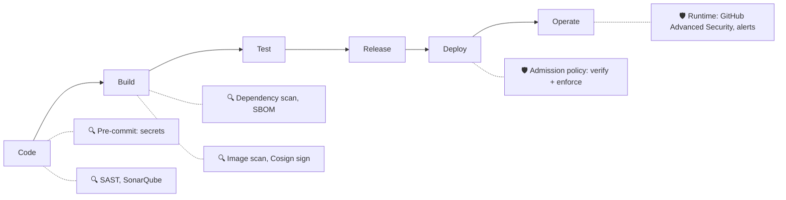
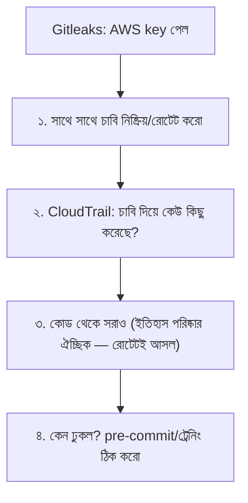
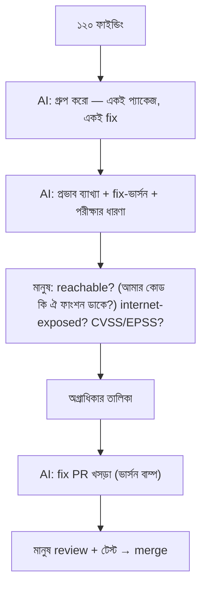
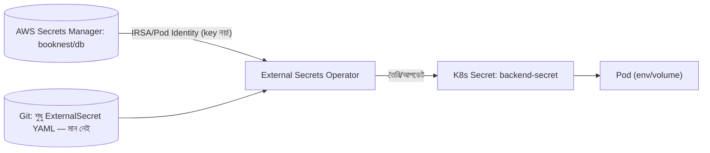
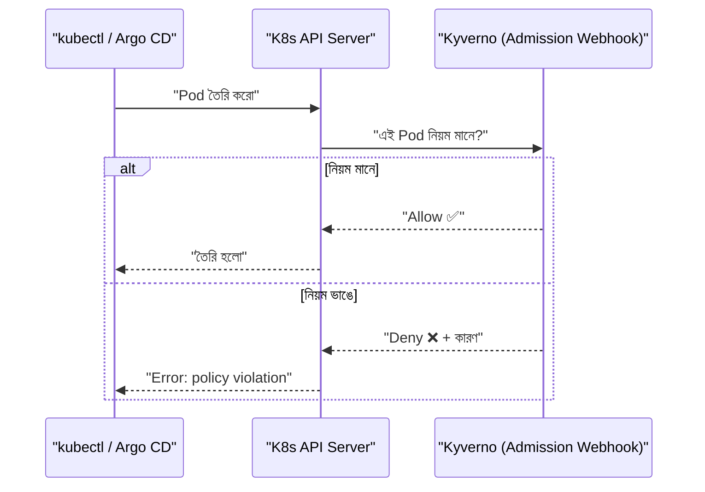
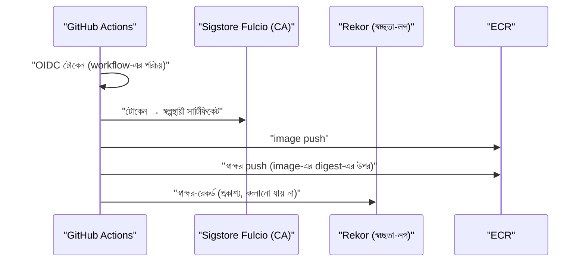
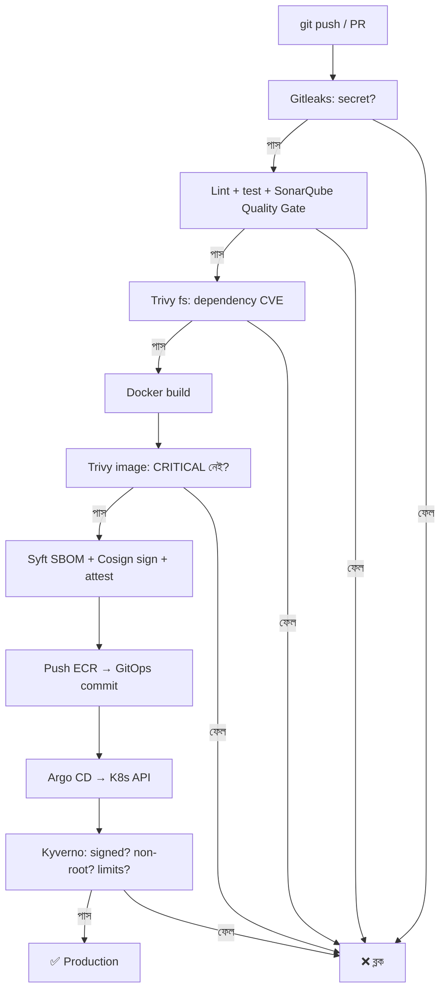

# Module 18 — DevSecOps and Software Supply Chain Security

> **Section 4 · DevSecOps, SRE, FinOps & AI Operations** · ২টি Live Class
> **Project:** Secure, Reliable and Cost-Smart Production
> **Goal:** এমন একটা CI/CD pipeline ও cluster যেখানে **অনিরাপদ বা unsigned কোড production-এ পৌঁছাতেই পারে না**।
> **Assignment ★:** প্রদর্শন করো — pipeline একটা vulnerable image **reject** করছে, আর cluster একটা unsigned image **reject** করছে।

---

## 📖 গল্প: গুদামের মালের নিরাপত্তা-পরীক্ষা

BookNest-এর বই ছাপাখানা থেকে আসে। একদিন শোনা গেল — অন্য এক দোকানে কেউ **ভেজাল বই** ঢুকিয়ে দিয়েছে, সরবরাহকারীর গাড়ি থেকেই। তানভীর ভাবল: আমার সফটওয়্যারেও তো **শত শত "সরবরাহকারী"** — npm প্যাকেজ, base image, তৃতীয়-পক্ষ action! এদের একটা ভেজাল হলে?

এবার সে গুদামে **পাঁচ ধাপের পরীক্ষা** বসাল:

1. **গেটে পরীক্ষা (SAST/Secrets):** নিজের কোডে ভুল ও লুকোনো চাবি আছে কি?
2. **সরবরাহকারী যাচাই (Dependency scan):** আসা প্যাকেজে জানা দুর্বলতা আছে কি?
3. **মালের তালিকা (SBOM):** বাক্সের ভেতরে ঠিক কী কী আছে — লিখিত তালিকা।
4. **সিল ও স্বাক্ষর (Cosign):** "এই বাক্স আমাদের কারখানা থেকেই এসেছে" — ছাপ।
5. **দোকানের দরজায় প্রহরী (Admission policy):** ছাপ নেই বা নিয়ম ভাঙা বাক্স ভেতরে ঢুকবেই না।

এই ধারণাটার নাম **Shift-Left Security** — সমস্যা যত *বাঁয়ে* (আগে) ধরা যায়, ঠিক করা তত সস্তা।

---

# 🧩 Live Class 1 — Shift-Left Security in CI

## 1. DevSecOps ও Shift-Left



> **খরচের নিয়ম:** ডেভেলপারের ল্যাপটপে বাগ ধরলে ১ টাকা, CI-তে ১০ টাকা, প্রোডাকশনে ১০০ টাকা (এবং সুনাম)। তাই "বাঁয়ে সরাও"।

### সরঞ্জাম মানচিত্র

| ধরন | কী খোঁজে | টুল (কোর্স) |
|---|---|---|
| **SAST** | আমার কোডের নিরাপত্তা-ভুল | **SonarQube** |
| **SCA** (Dependency) | লাইব্রেরির জানা দুর্বলতা (CVE) | **Trivy**, `npm audit`, Dependabot |
| **Secret scanning** | কোডে ভুলে রাখা চাবি/পাসওয়ার্ড | **Gitleaks** |
| **Container scan** | image-এর OS/লাইব্রেরি দুর্বলতা | **Trivy** |
| **SBOM** | সফটওয়্যারের উপাদান-তালিকা | **Syft** |
| **Signing** | উৎস ও অখণ্ডতার প্রমাণ | **Cosign** |
| **Policy** | নিয়ম-জোরদার | **Kyverno / OPA Gatekeeper** |
| **IaC scan** | Terraform/K8s ভুল-কনফিগ | Checkov (M09) |
| **DAST** | চলমান অ্যাপে আক্রমণ-পরীক্ষা | OWASP ZAP (বোনাস) |

## 2. SAST — SonarQube দিয়ে কোড কোয়ালিটি ও নিরাপত্তা

**SonarQube** বিশ্লেষণ করে: bugs, vulnerabilities, security hotspots, code smells, duplication, coverage — এবং **Quality Gate** (পাস/ফেল নিয়ম)।

```bash
# SonarQube সার্ভার (শেখার জন্য Docker-এ)
docker run -d --name sonarqube -p 9000:9000 sonarqube:community
# http://localhost:9000 → প্রথম লগইনে পাসওয়ার্ড বদলাও → প্রজেক্ট → টোকেন তৈরি
```

```properties
# sonar-project.properties (repo-রুটে)
sonar.projectKey=booknest-backend
sonar.sources=src
sonar.tests=test
sonar.javascript.lcov.reportPaths=coverage/lcov.info    # টেস্ট coverage রিপোর্ট
sonar.exclusions=**/node_modules/**,**/dist/**
```

```yaml
# CI ধাপ
      - name: টেস্ট + coverage
        run: npm ci && npm test -- --coverage
      - name: SonarQube স্ক্যান
        uses: sonarsource/sonarqube-scan-action@v4      # প্রোডাকশনে SHA-pin
        env:
          SONAR_TOKEN: ${{ secrets.SONAR_TOKEN }}
          SONAR_HOST_URL: ${{ vars.SONAR_HOST_URL }}
      - name: Quality Gate ফেল করলে pipeline ফেল
        uses: sonarsource/sonarqube-quality-gate-action@v1
        timeout-minutes: 5
        env:
          SONAR_TOKEN: ${{ secrets.SONAR_TOKEN }}
```

**Quality Gate-এর সাধারণ নিয়ম ("নতুন কোডে" প্রযোজ্য — Clean as You Code):**

| শর্ত | সীমা |
|---|---|
| নতুন কোডে Vulnerability | 0 |
| নতুন কোডে Coverage | ≥ ৮০% |
| Duplication | < ৩% |
| Security Hotspot রিভিউ | ১০০% |

> **কেন "নতুন কোড"?** পুরনো কোডের হাজার সমস্যায় থেমে না গিয়ে, নতুন যা লিখছো তা পরিষ্কার রাখো — ক্রমে উন্নতি।

## 3. Dependency Scanning — Trivy

```bash
# ফাইল-সিস্টেম/রিপো স্ক্যান: package-lock.json দেখে নির্ভরতার CVE
trivy fs --severity HIGH,CRITICAL --exit-code 1 --ignore-unfixed .

# নির্দেশনা: --exit-code 1 → ফাইন্ডিং থাকলে নন-জিরো exit → CI ফেল
npm audit --omit=dev --audit-level=high      # npm-নেটিভ বিকল্প
```

**Dependabot / Renovate:** স্বয়ংক্রিয় নির্ভরতা-আপডেট PR।

```yaml
# .github/dependabot.yml
version: 2
updates:
  - package-ecosystem: npm
    directory: "/"
    schedule: { interval: weekly }
    open-pull-requests-limit: 5
  - package-ecosystem: github-actions       # Actions-এর ভার্সনও (SHA-pin হলে SHA আপডেট করবে)
    directory: "/"
    schedule: { interval: weekly }
  - package-ecosystem: docker
    directory: "/"
    schedule: { interval: weekly }
```

## 4. Secret Scanning — Gitleaks

কোডে চাবি ঢুকে গেলে `git rm` যথেষ্ট নয় — **Git ইতিহাসে থেকে যায়।** চাবি *রোটেট* করাই একমাত্র সমাধান।

```bash
# সমগ্র ইতিহাস স্ক্যান
gitleaks detect --source . --verbose
# শুধু স্টেজ-করা ফাইল (pre-commit-এ)
gitleaks protect --staged --verbose
```

```yaml
# .pre-commit-config.yaml — commit-এর আগেই ধরা (ল্যাপটপেই!)
repos:
  - repo: https://github.com/gitleaks/gitleaks
    rev: v8.18.4              # ভার্সন বসিয়ে পিন করো
    hooks:
      - id: gitleaks
```
```yaml
# CI-তে দ্বিতীয় প্রতিরক্ষা-রেখা
      - uses: actions/checkout@v4
        with: { fetch-depth: 0 }          # পুরো ইতিহাস নামাও, নইলে ইতিহাসে লুকানো সিক্রেট ধরা পড়ে না
      - uses: gitleaks/gitleaks-action@v2
        env:
          GITHUB_TOKEN: ${{ secrets.GITHUB_TOKEN }}
```



## 5. SBOM — Syft

**SBOM (Software Bill of Materials)** = সফটওয়্যারের "উপাদান-তালিকা" (packages + ভার্সন + লাইসেন্স)। কেন? নতুন CVE (যেমন Log4Shell) এলে এক মিনিটে জানা যায়: "আমার কোন কোন সার্ভিসে এটা আছে?"

```bash
# image থেকে SBOM (SPDX ফরম্যাট)
syft <REG>/booknest-backend:a1b2c3d -o spdx-json > sbom.spdx.json

# SBOM থেকে দুর্বলতা খোঁজা (Grype/Trivy)
trivy sbom sbom.spdx.json --severity HIGH,CRITICAL
```
> SBOM image-এর সাথে **attestation** হিসেবে সংযুক্ত করা যায় (Cosign `attest`) — পরে যাচাইযোগ্য।

## 6. 🤖 AI-সহায়তায় Vulnerability Triage

Trivy ১২০টা ফাইন্ডিং দিল। কোনটা আগে?



| প্রশ্ন | কেন |
|---|---|
| Reachable? | দুর্বল ফাংশন আমি ডাকিই না → ঝুঁকি কম |
| Exposed? | ইন্টারনেটে খোলা সার্ভিস আগে |
| Fix আছে? | প্যাচ নেই → mitigation/বিকল্প |
| EPSS/KEV? | বাস্তবে শোষিত হচ্ছে কি (CISA KEV তালিকা)? |

> **সতর্কতা:** AI "এটা false positive" বললে **নিজে যাচাই** করো; ভুল সাময়িক-নিশ্চিন্ততা আক্রমণের দরজা।

---

# 🧩 Live Class 2 — Runtime Secrets and Policy as Code

## 7. Secrets Management — AWS Secrets Manager + External Secrets Operator

**সমস্যা:** K8s Secret = base64; Git-এ রাখা অসম্ভব। **সমাধান:** আসল secret AWS Secrets Manager-এ; K8s-এ **External Secrets Operator (ESO)** তা সিঙ্ক করে।



```bash
helm repo add external-secrets https://charts.external-secrets.io
helm install external-secrets external-secrets/external-secrets -n external-secrets --create-namespace
```

```yaml
# SecretStore: AWS-এ কীভাবে লগইন করবে
apiVersion: external-secrets.io/v1beta1
kind: ClusterSecretStore
metadata: { name: aws-secrets }
spec:
  provider:
    aws:
      service: SecretsManager
      region: ap-southeast-1
      auth:
        jwt:
          serviceAccountRef:           # IRSA: ServiceAccount-এর IAM role দিয়ে — স্থায়ী চাবি নেই
            name: external-secrets
            namespace: external-secrets
---
# ExternalSecret: কোন secret আনবে, K8s-এ কী নামে রাখবে
apiVersion: external-secrets.io/v1beta1
kind: ExternalSecret
metadata: { name: backend-secret, namespace: booknest }
spec:
  refreshInterval: 1h                  # প্রতি ঘণ্টায় সিঙ্ক — রোটেশন নিজে প্রতিফলিত
  secretStoreRef: { name: aws-secrets, kind: ClusterSecretStore }
  target:
    name: backend-secret               # যে K8s Secret তৈরি হবে
  data:
    - secretKey: DB_PASSWORD
      remoteRef:
        key: booknest/db               # Secrets Manager-এর secret নাম
        property: password             # JSON-এর কোন ফিল্ড
    - secretKey: DB_USER
      remoteRef: { key: booknest/db, property: username }
```
**লাভ:** ✅ Git-এ কোনো মান নেই ✅ কেন্দ্রীয় রোটেশন ✅ CloudTrail অডিট ✅ IAM-দিয়ে নিয়ন্ত্রণ।

> **বিকল্প:** Secrets Store CSI Driver (সরাসরি Pod-এ মাউন্ট), Sealed Secrets (এনক্রিপ্ট করে Git-এ), HashiCorp Vault।

## 8. Policy as Code — Kyverno

**Kyverno** = Kubernetes-নেটিভ নীতি-ইঞ্জিন (YAML-এই নীতি, নতুন ভাষা নয়)। কাজ: **Validate** (নিয়ম ভাঙলে আটকাও), **Mutate** (ডিফল্ট বসাও), **Generate**, **Verify images**।



```bash
helm repo add kyverno https://kyverno.github.io/kyverno/
helm install kyverno kyverno/kyverno -n kyverno --create-namespace
```

### নীতি ১: Privileged Pod নিষেধ

```yaml
apiVersion: kyverno.io/v1
kind: ClusterPolicy
metadata: { name: disallow-privileged }
spec:
  validationFailureAction: Enforce        # Audit = শুধু রিপোর্ট; Enforce = আটকাও (প্রথমে Audit দিয়ে শুরু করো!)
  background: true
  rules:
    - name: no-privileged-containers
      match:
        any:
          - resources: { kinds: [Pod] }
      validate:
        message: "Privileged container নিষিদ্ধ (privileged: true)।"
        pattern:
          spec:
            containers:
              - =(securityContext):
                  =(privileged): "false"   # =(...) মানে "থাকলে এই মান হতে হবে"
```

### নীতি ২: resources ও non-root বাধ্যতামূলক

```yaml
apiVersion: kyverno.io/v1
kind: ClusterPolicy
metadata: { name: require-resources-and-nonroot }
spec:
  validationFailureAction: Enforce
  rules:
    - name: require-limits
      match: { any: [{ resources: { kinds: [Pod], namespaces: [booknest] } }] }
      validate:
        message: "CPU/memory requests ও memory limit বাধ্যতামূলক।"
        pattern:
          spec:
            containers:
              - resources:
                  requests: { cpu: "?*", memory: "?*" }
                  limits:   { memory: "?*" }
    - name: require-non-root
      match: { any: [{ resources: { kinds: [Pod], namespaces: [booknest] } }] }
      validate:
        message: "runAsNonRoot: true দিতে হবে।"
        pattern:
          spec:
            securityContext:
              runAsNonRoot: true
```

### নীতি ৩: Unsigned image নিষেধ (Assignment-এর দ্বিতীয় অংশ)

আগে image **সই** করতে হবে (§9), তারপর cluster যাচাই করবে:

```yaml
apiVersion: kyverno.io/v1
kind: ClusterPolicy
metadata: { name: verify-image-signature }
spec:
  validationFailureAction: Enforce
  webhookTimeoutSeconds: 30
  rules:
    - name: verify-booknest-images
      match: { any: [{ resources: { kinds: [Pod], namespaces: [booknest] } }] }
      verifyImages:
        - imageReferences:
            - "<ACCOUNT>.dkr.ecr.ap-southeast-1.amazonaws.com/booknest-*"
          mutateDigest: true             # ট্যাগ → ডাইজেস্টে বদলে দেয়: ট্যাগ পরে বদলে চুরি করা যায় না
          attestors:
            - entries:
                - keyless:               # চাবি ছাড়া (OIDC-ভিত্তিক) স্বাক্ষর যাচাই
                    subject: "https://github.com/my-org/*"     # শুধু আমাদের org-র workflow-র সই গ্রহণযোগ্য
                    issuer: "https://token.actions.githubusercontent.com"
                    rekor:
                      url: https://rekor.sigstore.dev
```

> **Rollout কৌশল:** নতুন নীতি প্রথমে `Audit` — কী কী ভাঙত দেখো; তারপর `Enforce`। সরাসরি Enforce করলে সব ডিপ্লয় আটকে যেতে পারে। সিস্টেম namespace (`kube-system`) বাদ দাও।

**বিকল্প:** OPA Gatekeeper (Rego ভাষা) — আরও শক্তিশালী কিন্তু শেখা কঠিন; AWS-স্তরে SCP/Config।

## 9. Cosign দিয়ে Image Signing



**Keyless signing:** স্থায়ী private key রাখার ঝুঁকি নেই — workflow-এর OIDC পরিচয়ই স্বাক্ষরের ভিত্তি (M06-র OIDC ধারণা!)।

```yaml
# CI-তে
permissions:
  id-token: write          # keyless সইয়ের জন্য OIDC টোকেন
  contents: read
steps:
  - uses: sigstore/cosign-installer@v3
  - name: Build & push (digest সংরক্ষণ)
    id: build
    run: |
      docker build -t $IMAGE:$TAG .
      docker push $IMAGE:$TAG
      DIGEST=$(docker inspect --format='{{index .RepoDigests 0}}' $IMAGE:$TAG)
      echo "digest=$DIGEST" >> "$GITHUB_OUTPUT"
  - name: Cosign sign (digest-এ — ট্যাগে নয়)
    run: cosign sign --yes ${{ steps.build.outputs.digest }}
  - name: SBOM attestation সংযুক্ত
    run: |
      syft ${{ steps.build.outputs.digest }} -o spdx-json > sbom.spdx.json
      cosign attest --yes --predicate sbom.spdx.json --type spdxjson ${{ steps.build.outputs.digest }}
```

```bash
# হাতে যাচাই (কে সই করেছে তা নির্দিষ্ট করে!)
cosign verify <REG>/booknest-backend@sha256:abc... \
  --certificate-identity-regexp "https://github.com/my-org/.*" \
  --certificate-oidc-issuer https://token.actions.githubusercontent.com
```
**কেন digest-এ সই?** ট্যাগ (`:1.0`) বদলে অন্য image দেখাতে পারে; digest (`sha256:...`) বিষয়বস্তুর আঙুলের ছাপ — অপরিবর্তনীয়।

## 10. Snyk / GitHub Advanced Security ও স্বয়ংক্রিয় Gate

| ফিচার | কাজ |
|---|---|
| **Dependabot alerts/updates** | নির্ভরতা-দুর্বলতা + স্বয়ংক্রিয় PR |
| **Code scanning (CodeQL)** | SAST (GitHub-নেটিভ) |
| **Secret scanning + Push protection** | secret সহ push-ই আটকে দেয় |
| **Snyk** | কোড, নির্ভরতা, কনটেইনার, IaC — বাণিজ্যিক, ডেভেলপার-বান্ধব |

```yaml
# .github/workflows/codeql.yml (সংক্ষিপ্ত)
name: CodeQL
on: [push, pull_request]
permissions: { security-events: write, contents: read }
jobs:
  analyze:
    runs-on: ubuntu-latest
    steps:
      - uses: actions/checkout@v4
      - uses: github/codeql-action/init@v3
        with: { languages: javascript-typescript }
      - uses: github/codeql-action/analyze@v3
```

### প্রতিটি push-এ স্বয়ংক্রিয় Security Gate — সম্পূর্ণ ছবি



## 11. 🧪 Assignment প্রদর্শন

**১. Vulnerable image reject (pipeline):** ইচ্ছাকৃতভাবে পুরনো base image (`node:14-alpine`) বা পুরনো দুর্বল লাইব্রেরি → push → Trivy ধাপ লাল ❌, merge ব্লক। স্ক্রিনশট + ফাইন্ডিং।

**২. Unsigned image reject (cluster):**
```bash
# CI-এর বাইরে, সই ছাড়া একটা image হাতে পুশ করে ডিপ্লয়ের চেষ্টা
kubectl run rogue -n booknest --image=<REG>/booknest-backend:unsigned-test
# Error from server: admission webhook "mutate.kyverno.svc-fail" denied the request:
#   image verification failed ... no signatures found
```
**৩. Privileged Pod reject:** `securityContext.privileged: true` সহ Pod → Kyverno `denied`।

## ⚠️ সাধারণ ভুল

| ভুল | ফল/সমাধান |
|---|---|
| Gitleaks শুধু শেষ commit দেখছে | `fetch-depth: 0` দাও |
| ইতিহাস থেকে secret মুছে নিশ্চিন্ত | চাবি **রোটেট** করো — কপি আগেই বেরিয়ে থাকতে পারে |
| Scan আছে, কিন্তু ফেল হলে pipeline থামে না | `exit-code: 1` / gate বাধ্যতামূলক |
| Kyverno সরাসরি `Enforce` | সব আটকে যায় → আগে `Audit` |
| ট্যাগে সই | digest-এ সই করো |
| অতি-কড়া নীতিতে developer-রা পাশ কাটায় | গার্ডরেইল + স্পষ্ট error-বার্তা; ব্যতিক্রম-প্রক্রিয়া |
| CVE-র "সংখ্যা" দেখে আতঙ্ক | reachable/exposed/EPSS দিয়ে অগ্রাধিকার |
| `.trivyignore`-এ অকারণ ব্যতিক্রম | কারণ ও মেয়াদ লিখে রাখো |

## ✅ চেকলিস্ট

- [ ] Pre-commit + CI-তে Gitleaks
- [ ] SonarQube Quality Gate pipeline ফেল করায়
- [ ] Trivy fs ও image — CRITICAL হলে ফেল
- [ ] Dependabot সক্রিয়
- [ ] SBOM তৈরি ও image-এ attest
- [ ] Cosign keyless সই (digest-এ)
- [ ] Secrets: Secrets Manager + ESO; Git-এ মান নেই
- [ ] Kyverno: privileged ব্লক, resources/non-root বাধ্যতামূলক, signed-only
- [ ] দুটো প্রদর্শন সফল (vuln image ও unsigned image reject)

## 🎯 ইন্টারভিউ প্রশ্ন

1. Shift-left কী? কেন গুরুত্বপূর্ণ?
2. SAST, DAST, SCA-র পার্থক্য?
3. SBOM কী? Log4Shell-এর মতো ঘটনায় কেন কাজে লাগে?
4. Cosign keyless signing কীভাবে কাজ করে? কেন digest-এ সই?
5. K8s Secret কি নিরাপদ? ESO কীভাবে সাহায্য করে?
6. Admission controller কী? Kyverno বনাম OPA Gatekeeper?
7. Secret commit হয়ে গেলে কী করবে?
8. Supply chain attack কী? (SolarWinds, `event-stream`, ভুয়া প্যাকেজ) — কীভাবে প্রতিরোধ করবে?
9. `Audit` বনাম `Enforce` নীতি-মোড কখন কোনটা?
10. Vulnerability অগ্রাধিকার কীভাবে ঠিক করবে?

## 🧠 সারসংক্ষেপ

**নিরাপত্তা = একটা দরজা নয়, পরপর কয়েকটা দরজা (defense in depth)।** কোডে (SAST/Gitleaks) → নির্ভরতায় (Trivy/SBOM) → image-এ (স্ক্যান+সই) → cluster-দরজায় (Kyverno)। যে নিয়ম মানুষের স্মরণ-শক্তির উপর নির্ভর করে, তা একদিন ভাঙবেই — **তাই নিয়মকে কোডে (policy as code) পরিণত করো**, যাতে অনিরাপদ জিনিস *প্রোডাকশনে পৌঁছাতেই না পারে।*

⬅️ [Module 17](../section-3-containers-kubernetes-platform/module-17-exam-week-3.md) · ➡️ [Module 19](./module-19-sre-and-ai-powered-operations.md)
