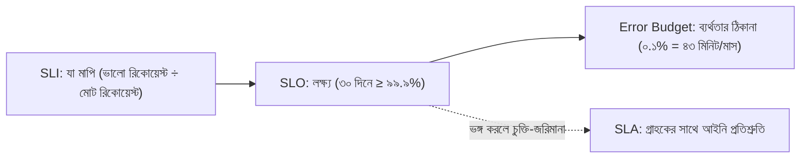
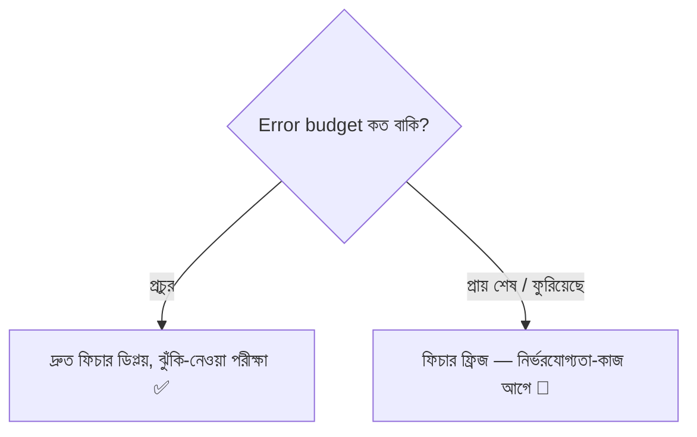
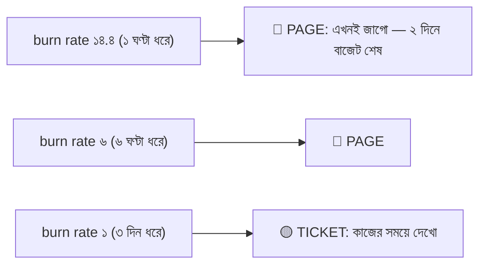
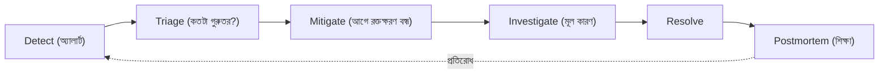
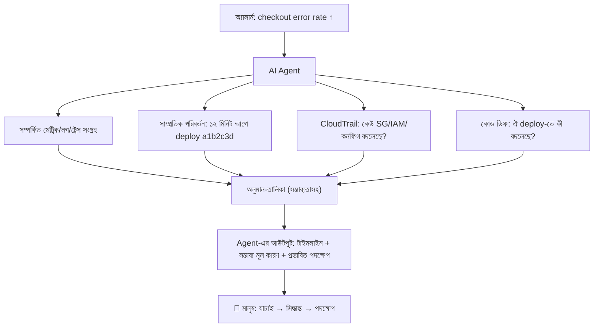
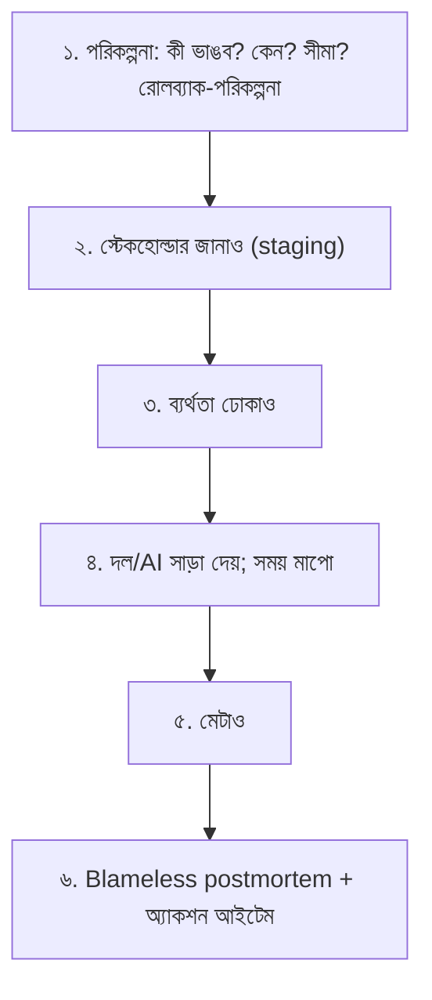

# Module 19 — SRE and AI-Powered Operations

> **Section 4 · DevSecOps, SRE, FinOps & AI Operations** · ২টি Live Class
> **Project:** Secure, Reliable and Cost-Smart Production
> **Goal:** AI-এর সাহায্যে সিস্টেম চালানো ও incident দ্রুত মেটানো — কিন্তু **মানুষের জবাবদিহি অক্ষুণ্ণ রেখে**।
> **Assignment ★:** Game day postmortem — SLO-র উপর প্রভাব + AI agent-এর findings-এর মূল্যায়নসহ।

---

## 📖 গল্প: "সাইট ঠিক আছে" মানে কী?

BookNest-এর মালিক জিজ্ঞেস করলেন, "আমাদের সাইট কতটা নির্ভরযোগ্য?" তানভীর বলল, "খুব! ৯৯.৯৯%!" — মালিক: "কীসের ৯৯.৯৯%? কে মেপেছে? ১০০% হলে ভালো না?"

তানভীর বুঝল দুটো শিক্ষা:

1. **নির্ভরযোগ্যতা মাপতে হয় গ্রাহকের চোখে** — সার্ভারের CPU কম হলেও গ্রাহক চেকআউটে ত্রুটি পেলে সাইট "খারাপ"।
2. **১০০% চাওয়া ভুল** — প্রতিটা অতিরিক্ত "নাইন" খরচ ১০ গুণ বাড়ায়, আর ফিচার-গতি কমায়। **ঠিক যতটা নির্ভরযোগ্যতা গ্রাহকের লাগে, তার বেশি নয়।**

এই চিন্তা-পদ্ধতিই **SRE (Site Reliability Engineering)** — নির্ভরযোগ্যতাকে *সংখ্যা ও বাজেট* দিয়ে পরিচালনা। আর তারপর রাত ৩টার incident-এ তানভীরের পাশে বসে থাকে একটা AI সহকারী — যে ঘণ্টায় কাজ মিনিটে করে দেয়, কিন্তু **শেষ সিদ্ধান্ত তানভীরের।**

---

# 🧩 Live Class 1 — Reliability Engineering: SLOs, Alerts and Load Testing

## 1. SLI, SLO, SLA, Error Budget



| শব্দ | অর্থ | BookNest উদাহরণ |
|---|---|---|
| **SLI** (Indicator) | গ্রাহকের অভিজ্ঞতার মাপকাঠি | সফল (non-5xx) চেকআউট রিকোয়েস্টের শতাংশ |
| **SLO** (Objective) | SLI-র অভ্যন্তরীণ লক্ষ্য | ৩০ দিনে ৯৯.৯% |
| **SLA** (Agreement) | গ্রাহকের সাথে চুক্তি (+ শাস্তি) | SLO-র চেয়ে ঢিলা (যেমন ৯৯.৫%) |
| **Error Budget** | `১০০% − SLO` = সহনীয় ব্যর্থতা | ০.১% ≈ ৪৩.২ মিনিট/৩০ দিন |

### "নাইন"-এর খরচ

| SLO | মাসে অনুমোদিত ডাউনটাইম |
|---|---|
| 99% | ~৭ ঘণ্টা ১৮ মি |
| 99.9% | ~৪৩ মিনিট |
| 99.95% | ~২১ মিনিট |
| 99.99% | ~৪ মিনিট |

### Error Budget — সিদ্ধান্ত-যন্ত্র


**এটাই SRE-র জাদু:** "নির্ভরযোগ্যতা বনাম গতি"-র তর্ক আবেগে নয়, **সংখ্যায়** মেটে।

### ভালো SLI কীভাবে বাছবে (ব্যবহারকারী-যাত্রা ভিত্তিক)

| যাত্রা | SLI | মাপার উপায় |
|---|---|---|
| বই দেখা | Availability: সফল GET /api/books | ALB/অ্যাপ মেট্রিক |
| বই দেখা | Latency: ৯৫% < ৫০০ms | histogram |
| চেকআউট | Availability + Correctness | অর্ডার-সফলতার হার |

### PromQL-এ SLI ও Error Budget Burn

```promql
# SLI: গত ৩০ দিনে সফল রিকোয়েস্টের অনুপাত
sum(rate(http_requests_total{status!~"5.."}[30d]))
/ sum(rate(http_requests_total[30d]))

# ৫ মিনিটের error ratio
sum(rate(http_requests_total{status=~"5.."}[5m])) / sum(rate(http_requests_total[5m]))
```

## 2. Alerting — লক্ষণ-ভিত্তিক ও Burn-Rate

M07-এর শিক্ষা: কারণে নয়, **লক্ষণে** অ্যালার্ট। SRE-র আরও উন্নত রূপ: **Burn rate**।

**Burn rate** = error budget কত দ্রুত পুড়ছে। ১ = ঠিক ৩০ দিনে ফুরাবে; ১৪.৪ = ~২ দিনে ফুরাবে।



```yaml
# Multi-window, multi-burn-rate alert (SLO 99.9% → budget 0.001)
groups:
  - name: slo-burn
    rules:
      - alert: ErrorBudgetFastBurn
        expr: |
          (
            sum(rate(http_requests_total{status=~"5.."}[1h])) / sum(rate(http_requests_total[1h])) > (14.4 * 0.001)
          and
            sum(rate(http_requests_total{status=~"5.."}[5m])) / sum(rate(http_requests_total[5m])) > (14.4 * 0.001)
          )
        for: 2m
        labels: { severity: page }
        annotations:
          summary: "Error budget দ্রুত পুড়ছে (১ঘ+৫মি উভয় উইন্ডো)"
          runbook_url: https://wiki.example.com/runbooks/slo-fast-burn
      - alert: ErrorBudgetSlowBurn
        expr: |
          (
            sum(rate(http_requests_total{status=~"5.."}[6h])) / sum(rate(http_requests_total[6h])) > (6 * 0.001)
          and
            sum(rate(http_requests_total{status=~"5.."}[30m])) / sum(rate(http_requests_total[30m])) > (6 * 0.001)
          )
        for: 15m
        labels: { severity: ticket }
```
> **কেন দুই উইন্ডো?** লম্বা উইন্ডো = "সত্যিই সমস্যা", ছোট উইন্ডো = "এখনো চলছে (সেরে যায়নি)" — মিথ্যা অ্যালার্ট কমে।

**ভালো অ্যালার্টের নীতি (সারাংশ):** actionable (করার কিছু আছে), symptom-based, runbook সংযুক্ত, **page শুধু যা এখনই মানুষ চায়** — বাকি টিকিট/ড্যাশবোর্ড।

## 3. Load Testing — k6

**কেন?** প্রোডাকশনে ভিড় আসার আগে জানা: কত লোডে সিস্টেম ভাঙে? SLO কোথায় ভঙ্গ হয়? HPA/ASG ঠিকমতো scale করে?

```javascript
// loadtest.js — k6 স্ক্রিপ্ট (JavaScript)
import http from 'k6/http';
import { check, sleep } from 'k6';

export const options = {
  stages: [
    { duration: '2m', target: 50 },    // ২ মিনিটে ধীরে ৫০ ভার্চুয়াল ইউজারে (ramp-up) — হঠাৎ ধাক্কা নয়
    { duration: '5m', target: 50 },    // ৫ মিনিট স্থির লোড (steady state)
    { duration: '2m', target: 200 },   // spike: বইমেলার ভিড়
    { duration: '2m', target: 0 },     // ramp-down
  ],
  thresholds: {                         // ⭐ SLO-কে পরীক্ষার পাস/ফেল শর্তে রূপান্তর
    http_req_failed:   ['rate<0.001'],           // ব্যর্থতা < ০.১% (SLO)
    http_req_duration: ['p(95)<500', 'p(99)<1500'], // p95 < 500ms
  },
};

export default function () {
  const res = http.get(`${__ENV.BASE_URL}/api/books`);
  check(res, {
    'status 200': (r) => r.status === 200,
    'শরীর খালি নয়': (r) => r.body.length > 0,
  });
  sleep(1);                             // বাস্তব ব্যবহারকারী একটু থামে (think time)
}
```

```bash
k6 run -e BASE_URL=https://staging.booknest.example.com loadtest.js
# threshold ভাঙলে exit code ≠ 0 → CI ফেল! (পারফরম্যান্স-রিগ্রেশন ধরার উপায়)
```

**পরীক্ষার ধরন:**

| ধরন | লক্ষ্য |
|---|---|
| **Smoke** | সামান্য লোডে স্ক্রিপ্ট ঠিক আছে? |
| **Load** | প্রত্যাশিত লোডে ঠিকঠাক? |
| **Stress** | ভাঙার সীমা কোথায়? |
| **Spike** | হঠাৎ ভিড়ে? |
| **Soak** | দীর্ঘ সময়ে লিক/ক্ষয়? |

> ⚠️ **প্রোডাকশনে সরাসরি load test নয়** (অনুমতি ছাড়া) — staging-এ, প্রোডাকশন-সদৃশ ডেটা ও আকারে। আসল ব্যবহারকারী/বিল/তৃতীয়-পক্ষ API-র ক্ষতি এড়াতে।

## 4. CloudWatch — মেট্রিক, লগ, অ্যালার্ম, Container Insights

| সেবা | কাজ |
|---|---|
| **CloudWatch Metrics** | AWS-সেবার মেট্রিক (ALB, RDS, EC2, Lambda) — অটো |
| **CloudWatch Logs** | লগ গ্রুপ/স্ট্রিম; **Logs Insights** কোয়েরি |
| **CloudWatch Alarms** | মেট্রিক সীমা ছাড়ালে → SNS/অ্যাকশন |
| **Container Insights** | EKS/ECS-এর Pod/নোড-স্তরের মেট্রিক ও লগ |

```bash
# Logs Insights কোয়েরি — গত ঘণ্টার সবচেয়ে ধীর API
fields @timestamp, @message
| filter @message like /duration/
| parse @message "duration=* ms path=*" as duration, path
| stats avg(duration), pct(duration, 95), count() by path
| sort pct(duration, 95) desc
| limit 10
```

```hcl
# Terraform: ALB 5xx অ্যালার্ম
resource "aws_cloudwatch_metric_alarm" "alb_5xx" {
  alarm_name          = "booknest-alb-5xx-high"
  namespace           = "AWS/ApplicationELB"
  metric_name         = "HTTPCode_Target_5XX_Count"
  dimensions          = { LoadBalancer = aws_lb.this.arn_suffix }
  statistic           = "Sum"
  period              = 60                      # ১ মিনিটের উইন্ডো
  evaluation_periods  = 5                       # ৫ মিনিট টানা
  threshold           = 20
  comparison_operator = "GreaterThanThreshold"
  treat_missing_data  = "notBreaching"          # ডেটা না থাকলে অ্যালার্ম নয় (নইলে রাতে মিথ্যা বাজে)
  alarm_actions       = [aws_sns_topic.oncall.arn]
}
```

**Prometheus/Grafana (M07) বনাম CloudWatch:** AWS-নেটিভ মেট্রিকে CloudWatch স্বাভাবিক; অ্যাপ/K8s-এ Prometheus; Grafana-য় দুটোই এক ড্যাশবোর্ডে (CloudWatch data source)।

---

# 🧩 Live Class 2 — AIOps: Incident Response with AI Agents

## 5. Incident Response-এর চক্র



**মূল নীতি:** *আগে Mitigate (ক্ষতি কমাও — rollback, scale, failover), পরে Root Cause।* রাত ৩টায় কারণ খোঁজা নয়, গ্রাহককে বাঁচানো আগে।

| ভূমিকা | কাজ |
|---|---|
| **Incident Commander** | সিদ্ধান্ত নেয়, সমন্বয় করে |
| **Operations/Responder** | কারিগরি তদন্ত ও ফিক্স |
| **Communications** | স্টেকহোল্ডার/স্ট্যাটাস পেজ আপডেট |
| **Scribe** | টাইমলাইন লেখে |

**Severity:**

| স্তর | অর্থ | সাড়া |
|---|---|---|
| SEV1 | পুরো সাইট/অর্থ-ক্ষতি | তাৎক্ষণিক, সবাই |
| SEV2 | বড় ফিচার ভাঙা | ৩০ মিনিটে |
| SEV3 | ছোট/কিছু ব্যবহারকারী | কর্মঘণ্টায় |

## 6. CloudWatch Anomaly Detection

স্থির সীমা ("CPU>80%") সপ্তাহের ভিন্ন সময়ের জন্য অযথার্থ। **Anomaly Detection** ঐতিহাসিক প্যাটার্ন শেখে (ঘণ্টা/দিন-ভিত্তিক ঋতুচক্রসহ) এবং "স্বাভাবিকের ব্যান্ড" আঁকে — ব্যান্ডের বাইরে গেলে অ্যালার্ম।

```hcl
resource "aws_cloudwatch_metric_alarm" "orders_anomaly" {
  alarm_name          = "orders-per-min-anomaly"
  comparison_operator = "LessThanLowerThreshold"      # স্বাভাবিকের চেয়ে অস্বাভাবিক কম অর্ডার
  evaluation_periods  = 3
  threshold_metric_id = "band"
  metric_query {
    id          = "m1"
    return_data = true
    metric {
      namespace   = "BookNest"
      metric_name = "OrdersPlaced"
      period      = 300
      stat        = "Sum"
    }
  }
  metric_query {
    id         = "band"
    expression = "ANOMALY_DETECTION_BAND(m1, 2)"       # ২ স্ট্যান্ডার্ড ডেভিয়েশনের ব্যান্ড
  }
}
```
> ব্যবসায়িক মেট্রিকে (অর্ডার/মিনিট) অ্যানোমালি অ্যালার্ম প্রায়ই সার্ভার-মেট্রিকের আগে সমস্যা ধরে।

## 7. AWS DevOps Agent ও AI Incident তদন্ত

AI-agent incident-এ যা করতে পারে (AWS DevOps Agent-এর মতো টুল — CloudWatch, CloudTrail, deployment-ইতিহাস, কোড, টপোলজি সংযুক্ত):



**AI যা ভালো পারে:** দ্রুত তথ্য-সমন্বয় (৫টা টুল ঘাঁটা), পরিবর্তনের সাথে লক্ষণের সম্পর্ক, টাইমলাইন ও postmortem-খসড়া, রানবুক-ধাপ প্রস্তাব।

**AI যেখানে ভুল করে:** সম্পর্ককে কারণ ভাবে (correlation ≠ causation), অসম্পূর্ণ ডেটায় আত্মবিশ্বাসী উত্তর, অ-নথিভুক্ত সিস্টেমের সূক্ষ্ম নির্ভরতা বোঝে না।

### কখন AI-কে বিশ্বাস, কখন escalate?

| পরিস্থিতি | সিদ্ধান্ত |
|---|---|
| AI-র প্রস্তাব পূর্ব-পরিচিত প্যাটার্নে মেলে + কম-ঝুঁকির (rollback) | ✅ মানুষ যাচাই করে এগোও |
| AI-র প্রমাণ দুর্বল / একাধিক পরস্পরবিরোধী অনুমান | ⚠️ নিজে তদন্ত; আরও ডেটা |
| প্রস্তাবিত পদক্ষেপ অপরিবর্তনীয়/ডেটা-ধ্বংসী (DB পরিবর্তন, মুছে ফেলা) | 🛑 সিনিয়র/IC-র অনুমোদন |
| SEV1 + আত্মবিশ্বাস কম | 🛑 মানুষ-নেতৃত্বে; AI শুধু সহায়ক |
| AI **কিছুই খুঁজে পায়নি** | ≠ "সমস্যা নেই" — মানুষ চালিয়ে যাও |

> **সোনার নিয়ম:** **AI পরামর্শ দেয়; মানুষ সিদ্ধান্ত নেয় ও জবাবদিহি করে।** প্রতিটা AI-প্রস্তাবিত পদক্ষেপের আগে প্রশ্ন: *"যদি ভুল হয়, ক্ষতি কতটা ও ফেরানো যায়?"* (M21-এ Human approval gate-এর ভিত্তি)

## 8. AI-জেনারেটেড Incident Timeline ও Postmortem

### Blameless Postmortem — কাঠামো

**Blameless:** "কে ভুল করল?" নয়, "**সিস্টেম কীভাবে ভুল করা সম্ভব করল?**" দোষারোপ হলে মানুষ তথ্য লুকায়, শেখা বন্ধ।

```markdown
# Postmortem: Checkout ত্রুটি (SEV2) — 2026-11-15

## সারাংশ
২০ মিনিট ধরে ২৮% checkout ব্যর্থ হয়েছে। কারণ: নতুন deploy-এ DB connection pool সীমা ভুল।

## প্রভাব
- সময়কাল: ১৪:০৩–১৪:২৩ (২০ মিনিট)
- ব্যবহারকারী: আনুমানিক ৩৪০ ব্যর্থ চেকআউট
- **SLO প্রভাব:** মাসিক error budget-এর ৪৬% খরচ (৪৩ মিনিটের মধ্যে ২০ মিনিট)

## টাইমলাইন (UTC+6)
| সময় | ঘটনা |
|---|---|
| 14:00 | deploy a1b2c3d (Argo CD) |
| 14:03 | ErrorBudgetFastBurn অ্যালার্ট |
| 14:06 | on-call স্বীকার; AI agent তদন্ত শুরু |
| 14:11 | AI: "deploy-এর সাথে সম্পর্ক সম্ভাব্য" |
| 14:15 | rollback (git revert) সিদ্ধান্ত — মানুষ |
| 14:23 | স্বাভাবিক ✅ |

## মূল কারণ (৫ Whys)
১. কেন ব্যর্থ? DB "too many connections"
২. কেন? pool size ২০ × ১০ replica = ২০০ > DB max 100
৩. কেন? নতুন config-এ pool বাড়ানো, DB সীমা বিবেচনা হয়নি
৪. কেন ধরা পড়েনি? staging-এ ১ replica; load test ছিল না
৫. কেন? Definition of Done-এ "connection budget" নেই

## কী ভালো কাজ করেছে
- দ্রুত অ্যালার্ট (৩ মিনিট), দ্রুত rollback
## কী ভালো যায়নি
- staging প্রোডাকশন-সদৃশ নয়
## AI-র ভূমিকা মূল্যায়ন
- ✅ সঠিক: deploy-সংশ্লিষ্ট বলেছে, টাইমলাইন সঠিক
- ❌ ভুল: প্রথমে "RDS CPU" সন্দেহ করেছে (CPU স্বাভাবিক ছিল) — ৪ মিনিট নষ্ট
- সময় বাঁচা: ম্যানুয়াল তদন্তে আনুমানিক ২০ মিনিট লাগত
## অ্যাকশন আইটেম
| কাজ | মালিক | তারিখ |
|---|---|---|
| Connection budget চেকলিস্টে | @team-orders | ২০ নভে |
| staging-এ k6 load test CI-তে | @platform | ৩০ নভে |
| PgBouncer বিবেচনা | @sre | ১৫ ডিসে |
```

**AI-র কাজ:** লগ/অ্যালার্ট/চ্যাট থেকে *টাইমলাইনের খসড়া* ও *প্রথম পাঠ*; **মানুষের কাজ:** সত্যতা যাচাই, ৫ Whys-এ গভীরতা, অ্যাকশন আইটেমের মালিকানা। (AI-র টাইমলাইনে ভুল সময়/কারণ ঢোকা সাধারণ — প্রতিটা তথ্য উৎসের সাথে মেলাও।)

## 9. 🎮 Game Day — Assignment-এর কেন্দ্র

**Game Day** = নিয়ন্ত্রিত পরিবেশে ইচ্ছাকৃত ব্যর্থতা ঢুকিয়ে দল ও সিস্টেমের সাড়া অনুশীলন।



### ব্যর্থতা ঢোকানোর উদাহরণ

```bash
# ক) ভুল DB পাসওয়ার্ড/কনফিগ ডিপ্লয় (Argo-তে ভুল commit)
# খ) একটা AZ-এর সব ইনস্ট্যান্স মেরে ফেলা
aws ec2 terminate-instances --instance-ids $(aws ec2 describe-instances --filters "Name=availability-zone,Values=ap-southeast-1a" "Name=tag:Name,Values=booknest-backend" --query "Reservations[].Instances[].InstanceId" --output text)

# গ) K8s: Pod মেরে ফেলা / নেটওয়ার্ক বিলম্ব (chaos টুল: Litmus, Chaos Mesh, AWS FIS)
kubectl delete pod -l app=backend -n booknest --force

# ঘ) CPU চাপ (stress)
kubectl run stress --image=polinux/stress --restart=Never -- stress --cpu 4 --timeout 300
```
**AWS Fault Injection Service (FIS):** নিয়ন্ত্রিত, নিরাপত্তা-বাঁধনসহ (stop condition: অ্যালার্ম বাজলে পরীক্ষা থামে) chaos পরীক্ষা।

### Game Day-তে AI-র মূল্যায়ন ছক (Assignment)

| মাপকাঠি | AI agent | মানুষ (একা হলে) |
|---|---|---|
| Time to detect | অ্যালার্ম-নির্ভর (একই) | একই |
| Time to first correct hypothesis | ? মিনিট | ? মিনিট |
| ভুল অনুমান কয়টা | ? | ? |
| প্রস্তাবিত পদক্ষেপ নিরাপদ ছিল? | হ্যাঁ/না | — |
| MTTR | ? | ? |
| মানুষের সংশোধন লেগেছে কোথায় | তালিকা | — |

## ⚠️ সাধারণ ভুল

| ভুল | ফল |
|---|---|
| SLO ১০০% চাওয়া | অসম্ভব ও অকার্যকর; ফিচার-গতি মরে |
| শুধু CPU/মেমরি-অ্যালার্ম | গ্রাহকের কষ্টের সাথে সম্পর্কহীন নয়েজ |
| সবকিছুই page | alert fatigue — আসল সংকট মিস |
| Postmortem-এ ব্যক্তিকে দোষ | তথ্য লুকোনো, শেখা বন্ধ |
| Postmortem লিখে অ্যাকশন আইটেম ফলো-আপ না করা | একই ঘটনা ফিরে আসে |
| AI-র কথা বিনা-যাচাইয়ে মানা | ভুল ফিক্স → ঘটনা বড় |
| Production-এ unannounced chaos | নিজেই incident বানানো |
| k6 থ্রেশহোল্ড ছাড়া | পাস/ফেল নেই — কেবল "সংখ্যা" |

## ✅ চেকলিস্ট

- [ ] SLI/SLO ঠিক (২টি ব্যবহারকারী-যাত্রার জন্য), error budget হিসাব
- [ ] Burn-rate অ্যালার্ট (fast + slow) ও runbook
- [ ] k6 লোড টেস্ট threshold সহ; staging-এ চালিয়েছি
- [ ] CloudWatch অ্যালার্ম + Container Insights; Anomaly Detection একটি ব্যবসায়িক মেট্রিকে
- [ ] AI agent দিয়ে incident তদন্ত অনুশীলন
- [ ] Game day সম্পন্ন; ব্যর্থতা ঢুকিয়ে মেটানো
- [ ] Blameless postmortem: টাইমলাইন, ৫ Whys, **SLO প্রভাব**, **AI মূল্যায়ন**, অ্যাকশন আইটেম

## 🎯 ইন্টারভিউ প্রশ্ন

1. SLI, SLO, SLA ও Error Budget — ব্যাখ্যা করো। ১০০% SLO কেন খারাপ?
2. Error budget ফুরিয়ে গেলে কী করবে?
3. Burn rate অ্যালার্ট কেন সাধারণ threshold-এর চেয়ে ভালো?
4. Four Golden Signals?
5. Incident-এ "mitigate আগে, root cause পরে" কেন?
6. Blameless postmortem কী? ৫ Whys কীভাবে?
7. Load, stress, spike, soak test-এর পার্থক্য?
8. AI incident-এ কীভাবে সাহায্য করে? কখন তাকে বিশ্বাস করবে না?
9. Game day কী? কেন করি?
10. MTTD, MTTR, MTBF কী?

## 🧠 সারসংক্ষেপ

**SRE = নির্ভরযোগ্যতাকে সংখ্যা ও বাজেটে রূপান্তর** (SLI→SLO→Error Budget), অ্যালার্ম গ্রাহকের কষ্টে, ভিড় আগে পরীক্ষা (k6), ভাঙলে আগে মেটাও পরে খোঁজো, শেষে blameless শেখা। **AI দ্রুত তথ্য-সমন্বয়কারী সহকারী — কিন্তু সিদ্ধান্ত ও জবাবদিহি মানুষের।** এই সীমারেখা পরের মডিউলে (Agentic DevOps) *গভীর নিয়মে* পরিণত হবে।

⬅️ [Module 18](./module-18-devsecops-and-software-supply-chain-security.md) · ➡️ [Module 20](./module-20-serverless-architecture-and-finops.md)
