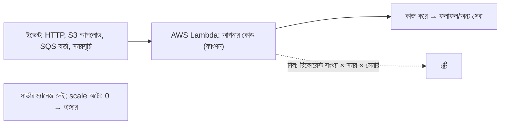
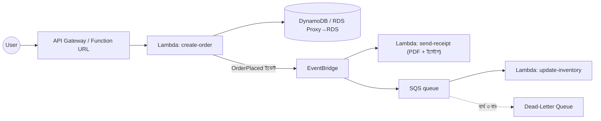
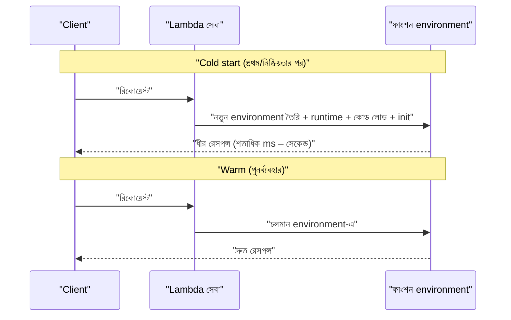
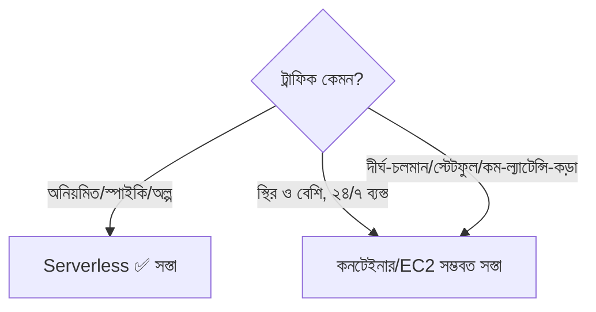
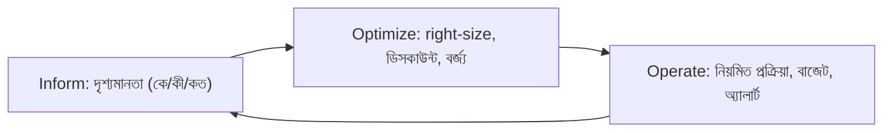
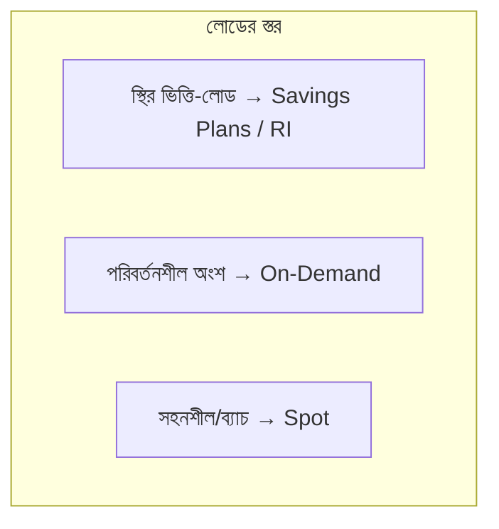
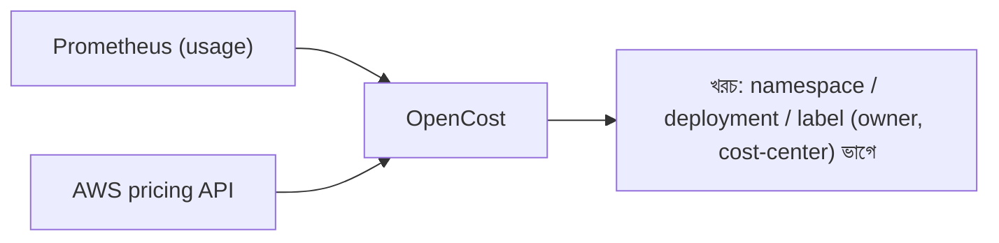
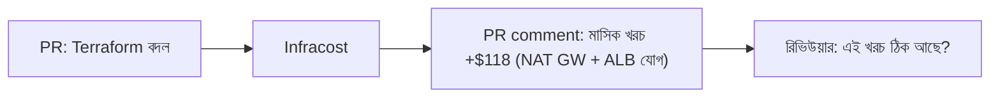
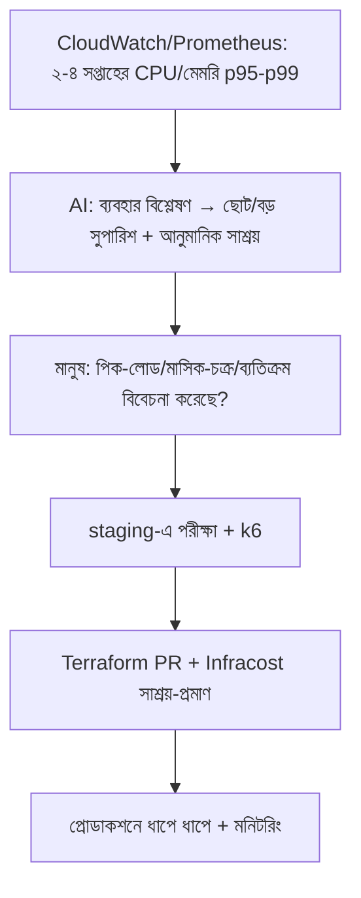

# Module 20 — Serverless Architecture and FinOps

> **Section 4 · DevSecOps, SRE, FinOps & AI Operations** · ২টি Live Class
> **Project:** Secure, Reliable and Cost-Smart Production
> **Goal:** একটা serverless component deploy করা এবং **প্রতিটা infrastructure পরিবর্তনে খরচ দৃশ্যমান ও রিভিউযোগ্য** করা।
> **Assignment ★:** পুরো স্ট্যাকের একটা cost report, এবং তিনটা right-sizing পরিবর্তন প্রয়োগ।

---

## 📖 গল্প: ট্যাক্সি বনাম নিজের গাড়ি, আর মাসশেষের বিল

BookNest-এ মাঝে মাঝে একটা কাজ লাগে: গ্রাহক বই কিনলে PDF রসিদ বানিয়ে ইমেইল করা। দিনে ২০০ বার চলে, প্রতিবার ২ সেকেন্ড। এর জন্য তানভীর একটা পুরো EC2 সার্ভার ২৪ ঘণ্টা চালিয়ে রেখেছে — **নিজের গাড়ি কিনে দিনে ১০ মিনিট চালানো।**

**Serverless (Lambda) = ট্যাক্সি।** যখন লাগে তখনই ডাকো, যতক্ষণ চলে ততক্ষণেরই ভাড়া, না চললে এক পয়সাও নয়। গ্যারেজ, তেল, ড্রাইভার (সার্ভার, OS, প্যাচ, scaling) — সব AWS-এর মাথাব্যথা।

কিন্তু মাস শেষে বিল দেখে তানভীর চমকে গেল — কোথায় টাকা যাচ্ছে বোঝেই না! সে শিখল **FinOps — খরচকে ইঞ্জিনিয়ারিং মেট্রিক হিসেবে দেখা:** কে খরচ করছে? কেন? যা পাচ্ছি তার মূল্য কত? এই প্রশ্নগুলোর উত্তর **প্রতিটা PR-এই** পাওয়া যাওয়া উচিত — মাস-শেষের বিলে নয়।

---

# 🧩 Live Class 1 — Serverless Architecture in Practice

## 1. Serverless কীভাবে কাজ করে



| বৈশিষ্ট্য | অর্থ |
|---|---|
| **No server management** | OS/প্যাচ/স্কেল AWS-এর |
| **Event-driven** | ইভেন্ট এলে চলে |
| **Pay-per-use** | ব্যবহারের মিলিসেকেন্ডে বিল; অলস = ০ |
| **Auto-scale** | প্রতি-ইভেন্টে instance, ০ থেকে হাজারে |
| **স্বল্পায়ু** | Lambda সর্বোচ্চ ১৫ মিনিট; stateless |

### প্রধান Providers ও সেবা

| ক্লাউড | Function | API | ইভেন্ট/কিউ |
|---|---|---|---|
| **AWS** | Lambda | API Gateway / Function URL | SQS, SNS, EventBridge, S3 events |
| Azure | Functions | API Management | Event Grid, Service Bus |
| GCP | Cloud Functions / Cloud Run | API Gateway | Pub/Sub |
| Edge | Cloudflare Workers, Lambda@Edge | — | — |

### সাধারণ ব্যবহার

- ছবি/ফাইল প্রসেসিং (S3 আপলোডে থাম্বনেইল)
- ওয়েবহুক হ্যান্ডলার, হালকা API
- নির্ধারিত কাজ (রাতের রিপোর্ট, ক্লিনআপ)
- ইভেন্ট-ড্রিভেন ওয়ার্কফ্লো (অর্ডার → পেমেন্ট → ইমেইল)
- ডেটা পাইপলাইনের ছোট ধাপ, ইনফ্রা-অটোমেশন (EC2 স্ন্যাপশট ক্লিনআপ)

## 2. Lambda + API Gateway + Event-driven প্যাটার্ন



| সেবা | ভূমিকা | উপমা |
|---|---|---|
| **API Gateway** | HTTP দরজা: auth, throttling, ক্যাশ | রিসেপশন |
| **SQS** | কিউ — বার্তা জমা, ধীরে প্রসেস; পিক সামলায় | ডাকবাক্স |
| **SNS** | pub/sub — এক বার্তা অনেক গ্রাহকে | মাইকে ঘোষণা |
| **EventBridge** | ইভেন্ট-বাস, নিয়ম দিয়ে রাউটিং + সময়সূচি | ডাকঘরের বাছাই-ঘর |
| **DLQ** | বারবার ব্যর্থ বার্তার আস্তানা (হারায় না) | "অমীমাংসিত চিঠি" বাক্স |

**মূল নকশা-নীতি:** সরাসরি কল (সিঙ্ক্রোনাস) → কিউ/ইভেন্ট (অ্যাসিঙ্ক্রোনাস) — একটা অংশ ধীর/ভাঙলে বাকি সব থামে না (**decoupling**)। কিউ-ভিত্তিক হলে **idempotent** হ্যান্ডলার লাগে (একই বার্তা দু'বার এলেও ক্ষতি নেই)।

### Lambda ফাংশন — Node.js উদাহরণ

```javascript
// receipt/index.mjs — অর্ডার-রসিদ বানায়
import { S3Client, PutObjectCommand } from '@aws-sdk/client-s3';
import { SESv2Client, SendEmailCommand } from '@aws-sdk/client-sesv2';

// ⭐ ক্লায়েন্ট handler-এর বাইরে তৈরি: warm invocation-এ পুনর্ব্যবহার (প্রতিবার নতুন সংযোগের খরচ বাঁচে)
const s3  = new S3Client({});
const ses = new SESv2Client({});

export const handler = async (event) => {
  // EventBridge ইভেন্টের ডেটা event.detail-এ
  const { orderId, email, total } = event.detail;

  // idempotency: একই orderId-র রসিদ আগে বানানো হলে আবার নয় (বার্তা ডুপ্লিকেট এলেও নিরাপদ)
  const key = `receipts/${orderId}.txt`;

  const body = `BookNest রসিদ\nঅর্ডার: ${orderId}\nমোট: ${total} টাকা`;
  await s3.send(new PutObjectCommand({
    Bucket: process.env.BUCKET,            // কনফিগ env var থেকে; কোডে হার্ডকোড নয়
    Key: key,
    Body: body,
    ServerSideEncryption: 'AES256',
  }));

  await ses.send(new SendEmailCommand({
    FromEmailAddress: process.env.FROM_EMAIL,
    Destination: { ToAddresses: [email] },
    Content: { Simple: { Subject: { Data: 'আপনার রসিদ' }, Body: { Text: { Data: body } } } },
  }));

  console.log(JSON.stringify({ msg: 'receipt sent', orderId }));   // structured log (M07)
  return { ok: true };
};
```

## 3. Terraform দিয়ে Serverless ডিপ্লয়

```hcl
# IAM role: Lambda শুধু যা দরকার তাই পারবে (least privilege)
resource "aws_iam_role" "receipt" {
  name = "booknest-receipt-lambda"
  assume_role_policy = jsonencode({
    Version = "2012-10-17"
    Statement = [{ Effect = "Allow", Principal = { Service = "lambda.amazonaws.com" }, Action = "sts:AssumeRole" }]
  })
}

resource "aws_iam_role_policy" "receipt" {
  role = aws_iam_role.receipt.id
  policy = jsonencode({
    Version = "2012-10-17"
    Statement = [
      { Effect = "Allow", Action = ["s3:PutObject"], Resource = "${aws_s3_bucket.receipts.arn}/receipts/*" },
      { Effect = "Allow", Action = ["ses:SendEmail"], Resource = "*" },    # SES-এ resource-level সীমা আরও কড়া করা যায়
      { Effect = "Allow", Action = ["logs:CreateLogStream", "logs:PutLogEvents"], Resource = "${aws_cloudwatch_log_group.receipt.arn}:*" },
    ]
  })
}

resource "aws_cloudwatch_log_group" "receipt" {
  name              = "/aws/lambda/booknest-receipt"
  retention_in_days = 14                       # 💰 অসীম লগ-সংরক্ষণ = অসীম খরচ — সবসময় retention দাও
}

data "archive_file" "receipt" {
  type        = "zip"
  source_dir  = "${path.module}/receipt"
  output_path = "${path.module}/receipt.zip"
}

resource "aws_lambda_function" "receipt" {
  function_name    = "booknest-receipt"
  role             = aws_iam_role.receipt.arn
  runtime          = "nodejs20.x"
  handler          = "index.handler"
  filename         = data.archive_file.receipt.output_path
  source_code_hash = data.archive_file.receipt.output_base64sha256   # কোড বদলালেই নতুন ডিপ্লয়
  architectures    = ["arm64"]               # 💰 Graviton: ~২০% সস্তা ও প্রায়ই দ্রুত
  memory_size      = 256                     # MB — CPU আনুপাতিক; খরচ = মেমরি × সময়
  timeout          = 10                      # সেকেন্ড — ডিফল্ট ৩; অতি-বড় রাখা বিপজ্জনক (আটকে গেলে বিল)
  reserved_concurrent_executions = 20        # সর্বোচ্চ সমান্তরাল — খরচ-ছাদ + ডাউনস্ট্রিম রক্ষা

  environment {
    variables = {
      BUCKET     = aws_s3_bucket.receipts.bucket
      FROM_EMAIL = "noreply@booknest.example.com"
    }
  }
  tags = { Environment = var.environment, Owner = "team-orders", CostCenter = "storefront" }
}

# EventBridge নিয়ম: OrderPlaced এলে এই ফাংশন
resource "aws_cloudwatch_event_rule" "order_placed" {
  name = "order-placed"
  event_pattern = jsonencode({ source = ["booknest.orders"], "detail-type" = ["OrderPlaced"] })
}
resource "aws_cloudwatch_event_target" "receipt" {
  rule = aws_cloudwatch_event_rule.order_placed.name
  arn  = aws_lambda_function.receipt.arn
}
resource "aws_lambda_permission" "events" {
  statement_id  = "AllowEventBridge"
  action        = "lambda:InvokeFunction"
  function_name = aws_lambda_function.receipt.function_name
  principal     = "events.amazonaws.com"
  source_arn    = aws_cloudwatch_event_rule.order_placed.arn
}
```

## 4. Lambda-র বাস্তব সীমাবদ্ধতা — Cold Start ও অন্যান্য



| সমস্যা | মোকাবিলা |
|---|---|
| **Cold start** | ছোট প্যাকেজ, হালকা runtime (Node/Go/Python), `arm64`, **Provisioned Concurrency** (খরচ আছে), SnapStart (Java), VPC-তে না রাখা (দরকার ছাড়া) |
| **১৫ মিনিট সীমা** | দীর্ঘ কাজ → Step Functions / Fargate / Batch |
| **ডাটাবেস সংযোগ-ঝড়** | RDS Proxy (সংযোগ পুল) বা DynamoDB |
| **Observability কঠিন** | structured লগ, X-Ray/OTel tracing, Powertools |
| **লোকাল ডিবাগ কঠিন** | SAM/LocalStack, ভালো ইউনিট টেস্ট |
| **Vendor lock-in** | ব্যবসায়িক লজিক আলাদা মডিউলে; হ্যান্ডলার পাতলা রাখো |

## 5. Pros/Cons — এবং কেন কিছু দল ফিরে আসে

| ✅ সুবিধা | ❌ অসুবিধা |
|---|---|
| ০ অ্যাডমিন, অটো-স্কেল | Cold start latency |
| অলস সময়ে ০ খরচ | **স্থির বড় লোডে ব্যয়বহুল** (কনটেইনার/EC2 সস্তা হয়) |
| দ্রুত শুরু | ডিবাগ/টেস্ট জটিল |
| ইভেন্ট-ড্রিভেন সহজ | সীমা: সময়, পেলোড, কনকারেন্সি |
| বিল-সংযোগ ব্যবহারের সাথে | vendor lock-in, বহু-ফাংশনের "ছড়ানো জটিলতা" |



> **কেন কিছু দল serverless থেকে কনটেইনারে ফিরে যায়?** ট্রাফিক স্থির ও বিশাল হলে "প্রতি-কলে বিল" মোট খরচ ছাড়িয়ে যায়; cold-start/সীমা/ডিবাগ-জটিলতা; অনেক ছোট ফাংশন → জটিল নির্ভরতা-জাল। **সমাধান "সবকিছু serverless" বা "কিছুই না" নয় — কাজের ধরন দেখে বাছাই।** (এটাই পরিণত ইঞ্জিনিয়ারিং-মন।)

---

# 🧩 Live Class 2 — FinOps: Cost as an Engineering Metric

## 6. FinOps কী?

> **FinOps = ইঞ্জিনিয়ারিং, ফাইন্যান্স ও ব্যবসার সহযোগিতায় ক্লাউড খরচের দায়িত্বশীল ব্যবস্থাপনা।** লক্ষ্য খরচ *কমানো* নয়, **প্রতি টাকায় সর্বোচ্চ ব্যবসায়িক মূল্য**।



### ক্লাউড খরচ কোথায় লুকিয়ে থাকে (সাধারণ বর্জ্য)

| বর্জ্য | উদাহরণ | সমাধান |
|---|---|---|
| ঘুমন্ত রিসোর্স | বন্ধ-না-করা dev EC2, ভুলে-যাওয়া ELB/NAT/EBS ভলিউম/স্ন্যাপশট | নিয়মিত ক্লিনআপ, অটো-শাটডাউন |
| Over-provisioned | t3.xlarge-এ CPU ৫% | right-sizing |
| **NAT Gateway** + ডেটা-ট্রান্সফার | ক্রস-AZ, ইন্টারনেট-এগ্রেস | VPC endpoint, লোকালিটি |
| অসীম লগ | CloudWatch retention নেই | retention + sampling |
| On-demand-এ স্থির লোড | ২৪/৭ চলা প্রোডাকশন | Savings Plans/RI |
| ভুল স্টোরেজ ক্লাস | S3 Standard-এ পুরনো ডেটা | lifecycle → IA/Glacier |

## 7. Cost Allocation Tags — "এই টাকা কার?"

```hcl
# provider-স্তরে default_tags — সব রিসোর্সে স্বয়ংক্রিয় (ভুলে ভুলে যাওয়া ঠেকায়)
provider "aws" {
  region = var.region
  default_tags {
    tags = {
      Environment = var.environment      # dev/staging/prod
      Owner       = "team-storefront"    # কে দায়ী
      CostCenter  = "storefront"         # কোন বাজেট-মাথা
      Project     = "booknest"
      ManagedBy   = "terraform"
    }
  }
}
```
**বাকি ধাপ:** Billing → Cost allocation tags → ট্যাগগুলো **activate** করো (নইলে Cost Explorer-এ দেখা যায় না; সক্রিয়করণের পর থেকে প্রযোজ্য)। K8s-এ: লেবেল (M16-র গার্ডরেইল) → OpenCost/Kubecost-এ।

> **ট্যাগ ছাড়া খরচ-দায়িত্ব নেই।** Checkov/OPA/Config rule দিয়ে ট্যাগ বাধ্যতামূলক করো।

## 8. AWS Budgets ও Cost Explorer

```bash
# Cost Explorer CLI: গত ৩০ দিনে সেবা-ভিত্তিক খরচ
aws ce get-cost-and-usage \
  --time-period Start=$(date -d '30 days ago' +%F),End=$(date +%F) \
  --granularity MONTHLY \
  --metrics UnblendedCost \
  --group-by Type=DIMENSION,Key=SERVICE \
  --query 'ResultsByTime[0].Groups[].[Keys[0],Metrics.UnblendedCost.Amount]' --output text | sort -k2 -nr | head
```

```hcl
# Budget: মাসিক সীমা + ৮০% (actual) ও ১০০% (forecast) এ ইমেইল
resource "aws_budgets_budget" "monthly" {
  name         = "booknest-monthly"
  budget_type  = "COST"
  limit_amount = "100"
  limit_unit   = "USD"
  time_unit    = "MONTHLY"

  notification {
    comparison_operator        = "GREATER_THAN"
    threshold                  = 80
    threshold_type             = "PERCENTAGE"
    notification_type          = "ACTUAL"
    subscriber_email_addresses = ["devops@booknest.example.com"]
  }
  notification {
    comparison_operator        = "GREATER_THAN"
    threshold                  = 100
    threshold_type             = "PERCENTAGE"
    notification_type          = "FORECASTED"             # ভবিষ্যদ্বাণী: মাস শেষের আগেই সতর্ক
    subscriber_email_addresses = ["devops@booknest.example.com"]
  }
}
```
**আরও:** **AWS Cost Anomaly Detection** (অস্বাভাবিক খরচ-লাফে ML-অ্যালার্ট), Cost & Usage Report (CUR) + Athena (গভীর বিশ্লেষণ)।

## 9. Savings Plans, Reserved, Spot

| মডেল | ছাড় (আনুমানিক) | প্রতিশ্রুতি | কখন |
|---|---|---|---|
| **On-Demand** | ০% | নেই | অনিশ্চিত/স্বল্পমেয়াদী |
| **Savings Plans** (Compute) | ~৩০–৬৬% | ১/৩ বছর, $/ঘণ্টা | স্থির **ভিত্তি-লোড**; instance-ধরন বদলাতে নমনীয় |
| **Reserved Instances** | ~৪০–৭২% | ১/৩ বছর, নির্দিষ্ট ধরন | স্থির, নির্দিষ্ট (RDS ইত্যাদি) |
| **Spot** | ~৭০–৯০% | নেই, তবে **২ মিনিটের নোটিশে কেড়ে নিতে পারে** | stateless, ব্যর্থতা-সহনশীল (batch, CI runner, K8s worker-এর অংশ) |


> ⚠️ **প্রতিশ্রুতির আগে right-size করো!** ভুল-আকারের instance-এ Savings Plan কেনা = ভুলকে ৩ বছরের জন্য আটকে ফেলা। ক্রম: **মুছো → ছোট করো → তারপর ছাড় কেনো।** (আর এটা আর্থিক সিদ্ধান্ত — ঝুঁকি বুঝে, প্রয়োজনে ফাইন্যান্স/অ্যাডভাইজারের সাথে।)

## 10. Kubernetes খরচ-দৃশ্যমানতা — OpenCost



```bash
helm repo add opencost https://opencost.github.io/opencost-helm-chart
helm install opencost opencost/opencost -n opencost --create-namespace \
  --set opencost.prometheus.internal.serviceName=monitoring-kube-prometheus-prometheus \
  --set opencost.prometheus.internal.namespaceName=monitoring
kubectl port-forward -n opencost svc/opencost 9090:9090 --address 0.0.0.0   # UI (শেখার জন্য)
```
**যা দেখবে:** কোন namespace/সার্ভিস কত খরচ; **অব্যবহৃত requests (idle/waste)** — requests=১ CPU কিন্তু ব্যবহার ০.১ হলে ৯০% নষ্ট; efficiency%। → resources সঠিক করো (M14), Karpenter/Cluster Autoscaler-এ নোড consolidation।

## 11. Infracost — প্রতিটা Terraform PR-এ খরচের অনুমান



```yaml
# .github/workflows/infracost.yml
name: Infracost
on:
  pull_request:
    paths: ["envs/**", "modules/**"]
permissions: { contents: read, pull-requests: write }
jobs:
  infracost:
    runs-on: ubuntu-latest
    steps:
      - uses: actions/checkout@v4
        with: { ref: "${{ github.event.pull_request.base.ref }}" }
      - uses: infracost/actions/setup@v3
        with: { api-key: "${{ secrets.INFRACOST_API_KEY }}" }
      - name: ভিত্তি (base) খরচ
        run: infracost breakdown --path=envs/prod --format=json --out-file=/tmp/base.json
      - uses: actions/checkout@v4                      # PR-ব্রাঞ্চে ফিরে
      - name: PR-এর খরচ ও পার্থক্য
        run: infracost diff --path=envs/prod --compare-to=/tmp/base.json --format=json --out-file=/tmp/diff.json
      - name: PR-এ comment
        run: |
          infracost comment github --path=/tmp/diff.json \
            --repo=$GITHUB_REPOSITORY --github-token=${{ github.token }} \
            --pull-request=${{ github.event.pull_request.number }} --behavior=update
```

**"খরচ-গেট"** (ঐচ্ছিক): পার্থক্য > $৫০/মাস হলে বিশেষ অনুমোদন — ছোট পরিবর্তন আটকায় না, বড় খরচ-লাফ ধরে। **এটাই "cost as an engineering metric"।**

## 12. 🤖 AI-সহায়তায় Right-Sizing — যাচাইসহ



**AWS-নেটিভ সহায়ক:** **AWS Compute Optimizer** (ML-ভিত্তিক সুপারিশ: EC2/EBS/Lambda), Trusted Advisor।

| AI/টুল-সুপারিশ | তুমি কী যাচাই করবে |
|---|---|
| "t3.large→t3.small" (CPU ১৫%) | **মেমরি**ও কম? পিক (মাসের শেষ, বইমেলা)? burst-ক্রেডিট? |
| "RDS ছোট করো" | সংযোগ-সংখ্যা, IOPS, ব্যাকআপ-উইন্ডো |
| "Lambda memory কমাও" | মেমরি↓ = CPU↓ = সময়↑ — মোট খরচ বাড়তেও পারে! (power-tuning দিয়ে মাপো) |
| "এই ভলিউম অব্যবহৃত, মুছো" | সত্যিই অব্যবহৃত? মালিক কে? স্ন্যাপশট আছে? |

> ⚠️ **right-sizing একতরফা কাটছাঁট নয়।** SLO ভাঙলে সাশ্রয় অর্থহীন। প্রতিটা পরিবর্তনের আগে-পরে **SLO ও latency মিলিয়ে দেখো**।

## 13. 🎯 Assignment: পূর্ণ স্ট্যাকের Cost Report ও তিন Right-Sizing

**Cost Report টেমপ্লেট:**

```markdown
# BookNest Cost Report — নভেম্বর ২০২৬
## সারাংশ
মাসিক মোট: $___  | আগের মাস: $___ | পরিবর্তন: ___%
## সেবা-ভিত্তিক শীর্ষ ৫
| সেবা | $ | % |
|---|---|---|
| EKS (control plane + nodes) | | |
| NAT Gateway | | |
| RDS | | |
| ALB | | |
| CloudWatch Logs | | |
## Owner/Environment ভাগ (ট্যাগ থেকে)
## বর্জ্য-চিহ্ন (অব্যবহৃত/অতি-বড়)
## প্রয়োগ করা ৩ Right-Sizing
| # | পরিবর্তন | আগে | পরে | মাসিক সাশ্রয় | ঝুঁকি/যাচাই | SLO প্রভাব |
|---|---|---|---|---|---|---|
| 1 | | | | | | |
## সুপারিশ (Savings Plan, Spot, VPC endpoint...)
```

**সম্ভাব্য তিন পরিবর্তনের ধারণা:** (১) CloudWatch লগ retention ৯০→১৪ দিন + noisy debug লগ কমানো; (২) dev EKS node group-কে ছোট instance/Spot + রাতে scale-to-zero; (৩) S3 ও ECR lifecycle policy (পুরনো ডেটা/image মোছা); (৪) NAT → VPC endpoint (S3/ECR); (৫) Lambda arm64 + memory tuning; (৬) অতি-বড় requests কমানো (OpenCost-এর waste দেখে)।

## ⚠️ সাধারণ ভুল

| ভুল | ফল |
|---|---|
| Lambda `timeout` ১৫ মিনিট রাখা | আটকে গেলে (loop) বিশাল বিল |
| লগ retention না দেওয়া | চুপিসারে বাড়তে থাকা CloudWatch বিল |
| ট্যাগ না দেওয়া/অ্যাক্টিভেট না করা | "কে খরচ করছে" উত্তরহীন |
| right-size না করে Savings Plan | ভুল-আকার আটকে যায় |
| Spot-এ স্টেটফুল/ডাটাবেস | হঠাৎ কেড়ে নিলে ডেটা-ক্ষতি |
| কেবল খরচ কমাতে SLO বিসর্জন | গ্রাহক হারানো > সাশ্রয় |
| Serverless-কে সব-সমাধান ভাবা | স্থির বড় লোডে বেশি খরচ |
| Budget alert নেই | মাস শেষে চমক |
| ভুলে যাওয়া শেখার রিসোর্স (EKS/NAT/ALB) | টাকা পুড়ছে — প্রতিবার `destroy` |

## ✅ চেকলিস্ট

- [ ] Lambda + EventBridge/API Gateway দিয়ে একটা serverless কম্পোনেন্ট Terraform-এ ডিপ্লয়
- [ ] Lambda: least-privilege role, timeout, retention, arm64, DLQ (কিউ-ভিত্তিক হলে)
- [ ] `default_tags` + cost-allocation tags activate
- [ ] Budget + forecast alert; Cost Anomaly Detection
- [ ] OpenCost ড্যাশবোর্ডে namespace-ভিত্তিক খরচ ও waste
- [ ] Infracost প্রতি Terraform PR-এ comment
- [ ] Cost report + ৩ right-sizing (SLO যাচাইসহ)

## 🎯 ইন্টারভিউ প্রশ্ন

1. Serverless কী? কখন উপযুক্ত, কখন নয়?
2. Cold start কী? কীভাবে কমাবে?
3. SQS বনাম SNS বনাম EventBridge? DLQ কী ও কেন?
4. Lambda-র সীমাবদ্ধতা? কেন কিছু দল serverless থেকে কনটেইনারে ফেরে?
5. FinOps কী? কেন "খরচ কমানো" নয়, "মূল্য-সর্বোচ্চকরণ"?
6. Savings Plans বনাম Reserved বনাম Spot?
7. ট্যাগিং কেন গুরুত্বপূর্ণ? Cost allocation tag কীভাবে কাজ করে?
8. K8s-এ খরচ কীভাবে দৃশ্যমান করবে? (OpenCost/Kubecost)
9. Infracost কী? PR-এ খরচ দেখানোর সুবিধা?
10. প্রোডাকশন-সার্ভিস right-size করার নিরাপদ পদ্ধতি?

## 🧠 সারসংক্ষেপ

**Serverless = ট্যাক্সি** (অনিয়মিত কাজে সেরা, স্থির বিশাল লোডে নিজের গাড়ি সস্তা)। **FinOps = খরচকে মেট্রিক বানানো** — ট্যাগে *কার*, Budget-এ *কত*, OpenCost-এ *কোথায়*, Infracost-এ *PR-এই*, right-sizing-এ *কমানো* — সবসময় SLO-র পাহারায়। **মূল সূত্র: মুছো → ছোট করো → তারপর ছাড় কেনো।**

⬅️ [Module 19](./module-19-sre-and-ai-powered-operations.md) · ➡️ [Module 21](./module-21-agentic-devops-operating-infrastructure-with-ai-agents.md)
