# Module 23 — Exam Week 4

> **Section 4 · DevSecOps, SRE, FinOps & AI Operations** · এক্সাম উইক
> **কভার করে:** Module 18 – Module 22
> **ধরন:** বড় অ্যাসাইনমেন্ট + লাইভ টেস্ট। **ঝালিয়ে নিতে পারবে নিজেকে।**

---

## 📖 গল্প: চতুর্থ পরীক্ষা — "বিশ্বাসের পরীক্ষা"

এবার মেন্টর শুধু সিস্টেম ভাঙবেন না — **বিশ্বাস ভাঙার চেষ্টা** করবেন: pipeline-এ দুর্বল image ঢোকাবেন, cluster-এ unsigned image পাঠাবেন, SLO-র বাইরে ঠেলে দেবেন, agent-কে একটা বিষাক্ত issue পড়াবেন, আর AI-সহকারীর prompt খারাপ করে দেবেন। প্রশ্ন একটাই: **তোমার সিস্টেমের গার্ডরেইলগুলো কি সত্যিই ধরে?**

---

## 1. পুরো ছবি — "Secure, Reliable, Cost-Smart, AI-Safe"

```mermaid
flowchart TB
    subgraph SEC["🔐 Secure (M18)"]
      S1["Gitleaks + SonarQube + Trivy"] --> S2["SBOM + Cosign sign"] --> S3["Kyverno: signed-only"]
      S4["ESO + Secrets Manager"]
    end
    subgraph REL["🛡️ Reliable (M19)"]
      R1["SLI/SLO + burn-rate alert"] --> R2["k6 load test gate"]
      R3["Game day + blameless postmortem"]
    end
    subgraph COST["💰 Cost-Smart (M20)"]
      C1["Tags + Budget + Anomaly"] --> C2["OpenCost + Infracost"] --> C3["Right-size + Serverless"]
    end
    subgraph AGENT["🤖 Agent-Safe (M21)"]
      A1["Least-privilege IAM"] --> A2["PR-only + approval gates"] --> A3["CloudTrail + policy"]
    end
    subgraph LLM["🧠 LLMOps (M22)"]
      L1["RAG + Bedrock/IRSA"] --> L2["LLM observability"] --> L3["Eval gate + cost control"]
    end
    SEC --> PROD["✅ Production"]
    REL --> PROD
    COST --> PROD
    AGENT --> PROD
    LLM --> PROD
```

## 2. Mock Lab (লক্ষ্য: ৫–৬ ঘণ্টা)

1. **Security gate:** pipeline-এ Gitleaks/Sonar/Trivy/SBOM/Cosign; ইচ্ছাকৃত দুর্বল image → ❌ ব্লক। Kyverno দিয়ে unsigned ও privileged Pod → ❌ deny।
2. **Secrets:** Secrets Manager + ESO; Git-এ কোনো মান নেই।
3. **SRE:** ২টি SLI/SLO, burn-rate অ্যালার্ট, k6 threshold; staging-এ লোড দিয়ে SLO পরীক্ষা।
4. **Game day:** ব্যর্থতা ঢোকাও (AZ-এর instance/ভুল কনফিগ), AI agent দিয়ে তদন্ত, blameless postmortem (SLO-প্রভাবসহ)।
5. **FinOps:** tags/Budget; OpenCost/Infracost; ৩টি right-sizing; cost report।
6. **Agent:** read-only role + deny-তালিকা; agent দিয়ে ভাঙা deployment PR-এ ঠিক; self-merge ব্লক প্রমাণ; prompt-injection red-team।
7. **LLM:** RAG সার্ভিস ডিপ্লয়; Grafana LLM dashboard; prompt খারাপ করে eval-ফেলে deploy ব্লক।
8. **Cleanup:** সব ধ্বংস করে খরচ শূন্য।

## 3. টপিক-ভিত্তিক রিভিশন

### M18 DevSecOps
- [ ] Shift-left; SAST/SCA/DAST/Secret/Image/IaC স্ক্যানের পার্থক্য
- [ ] SBOM কী, কেন; Cosign keyless, digest-এ সই
- [ ] ESO + Secrets Manager; K8s Secret ≠ নিরাপদ
- [ ] Kyverno: Audit vs Enforce; verifyImages; অ্যাডমিশন-ফ্লো
- [ ] Secret leak হলে: **রোটেট**; ইতিহাস মোছা যথেষ্ট নয়

### M19 SRE
- [ ] SLI/SLO/SLA/Error budget; "নাইন"-এর খরচ
- [ ] Burn-rate (multi-window) অ্যালার্ট
- [ ] k6 টেস্ট-ধরন; threshold = SLO
- [ ] Incident: mitigate আগে; severity; ভূমিকা
- [ ] Blameless postmortem + ৫ Whys; AI কখন বিশ্বাস, কখন escalate

### M20 Serverless ও FinOps
- [ ] Lambda মডেল, cold start, সীমা; SQS/SNS/EventBridge/DLQ
- [ ] Serverless কখন সস্তা, কখন নয়
- [ ] Tags, Budgets, Anomaly Detection; Savings Plans/RI/Spot
- [ ] OpenCost, Infracost; **মুছো → ছোট করো → ছাড় কেনো**

### M21 Agentic DevOps
- [ ] Assistant/agent/autonomous; MCP কী ও ঝুঁকি
- [ ] IAM: RO ডিফল্ট, ট্যাগ-শর্ত, explicit deny, অস্থায়ী সেশন
- [ ] PR-only + CODEOWNERS + environment approval
- [ ] CloudTrail অডিট; **prompt injection**, secret leak, runaway cost, destructive cmd
- [ ] Team agent policy-র উপাদান; lethal trifecta

### M22 LLMOps
- [ ] RAG ধাপ; pgvector; embedding-মাত্রা/মডেল-সংযোগ
- [ ] Bedrock vs self-hosted; IRSA — key নেই
- [ ] LLM-মেট্রিক (latency, TTFT, tokens, cost, quality)
- [ ] Prompt/মডেল ভার্সনিং + rollback; **eval gate**
- [ ] Cost control ৬ কৌশল; GPU-ভিত্তি (device plugin, taint)

## 4. লাইভ-টেস্টের সম্ভাব্য দৃশ্য ও নির্ণয়

| লক্ষণ | প্রথমে |
|---|---|
| Pipeline হঠাৎ লাল — Trivy | কোন CVE? base image আপডেট? fix-ভার্সন আছে? |
| Kyverno-য় ডিপ্লয় denied | error-বার্তা কোন নীতি? unsigned? limits নেই? |
| ESO সিক্রেট সিঙ্ক হচ্ছে না | `kubectl describe externalsecret`; IRSA role; Secret নাম/property |
| Error budget দ্রুত পুড়ছে | সাম্প্রতিক deploy? → rollback আগে |
| k6 threshold ফেল | কোন endpoint? DB? HPA scale হলো? |
| বিল লাফিয়েছে | Cost Explorer সেবা-ভিত্তিক; NAT/লগ/GPU/ভুলে-যাওয়া রিসোর্স; ট্যাগ দেখে মালিক |
| Agent PR-এ অপ্রত্যাশিত ফাইল | diff রিভিউ; CODEOWNERS; লাল পতাকা |
| LLM উত্তর খারাপ | কোন `prompt_version`? retrieval খালি? eval-স্কোর? |
| LLM বিল বাড়ছে | tokens/request, cache-hit, `maxTokens`, লুপ/অপব্যবহার |

## 5. মৌখিক/লিখিত নমুনা প্রশ্ন

1. একজন developer `AWS_SECRET_ACCESS_KEY` commit করে ফেলল। প্রথম ১০ মিনিটে কী করবে? (রোটেট → CloudTrail → প্রতিরোধ)
2. তোমার pipeline-এ একটা unsigned, vulnerable image প্রোডাকশনে পৌঁছাতে পারবে না — কোন কোন স্তরে আটকাবে?
3. SLO 99.9% হলে মাসে কত মিনিট ডাউনটাইম অনুমোদিত? Budget ফুরোলে কী?
4. আমি তোমার agent-কে একটা পাবলিক issue পড়তে দিলাম যাতে লুকানো নির্দেশ আছে। কী ঘটতে পারে, কীভাবে আটকাবে?
5. মাসিক বিল ২× হয়েছে। কোথা থেকে শুরু করবে?
6. AI সহকারীর নতুন prompt কীভাবে নিরাপদে প্রোডাকশনে নেবে? (PR → eval gate → canary → মনিটর → rollback)
7. একই agent-কে প্রোডাকশন ডেটাবেস-পড়ার অনুমতি + ওয়েব-ব্রাউজ + ইমেইল-পাঠানো — কেন বিপজ্জনক?
8. কোন ক্ষেত্রে Lambda, কোন ক্ষেত্রে EKS?

## 6. পরীক্ষা-পরবর্তী

- `exam-4-mistakes.md` আপডেট।
- **নিরাপত্তা-অডিট:** সব repo-তে `gitleaks`, সব অব্যবহৃত IAM key/role, খোলা Security Group, ভুলে-যাওয়া MCP/agent টোকেন।
- **খরচ-অডিট:** Cost Explorer; GPU/EKS/NAT/ALB/EBS/Lambda লগ।

➡️ পরের সেকশন: [Module 24 — AWS Deep Dive and Well-Architected Review](../section-5-aws-deep-dive-capstone/module-24-aws-deep-dive-and-well-architected-review.md)
