# Module 24 — AWS Deep Dive and Well-Architected Review

> **Section 5 · AWS Deep Dive & Capstone** · ২টি Live Class
> **Project:** Capstone: Production-Ready AI App, End to End
> **Goal:** Certification-ready AWS জ্ঞান — নিজের architecture-এ প্রয়োগ করা।
> **Assignment ★:** নিজের অ্যাপের একটা **লিখিত Well-Architected Review**, অগ্রাধিকারপ্রাপ্ত fix-তালিকাসহ।

---

## 📖 গল্প: বাড়ির ইঞ্জিনিয়ারের চূড়ান্ত পরিদর্শন

তানভীর এখন অনেক কিছু বানিয়েছে — VPC, EKS, GitOps, মনিটরিং, AI সার্ভিস। কিন্তু একটা প্রশ্ন বাকি: **"আমার বাড়ি কি সত্যিই মজবুত?"** একজন অভিজ্ঞ স্থপতি এলেন, হাতে ৬-টা প্রশ্নের তালিকা:

1. **নিরাপত্তা** — তালা ঠিক আছে? কার কাছে কোন চাবি?
2. **নির্ভরযোগ্যতা** — একটা দেয়াল ভাঙলে বাড়ি দাঁড়িয়ে থাকবে?
3. **কর্মদক্ষতা** — সঠিক যন্ত্র সঠিক কাজে?
4. **খরচ** — অকারণ বিদ্যুৎ-বিল?
5. **পরিচালনা** — মেরামত/পর্যবেক্ষণ সহজ?
6. **টেকসই** — পরিবেশের উপর প্রভাব?

এটাই **AWS Well-Architected Framework**। আর তার আগে, **IAM, Organizations, S3, ব্যাকআপ, CloudTrail** — AWS-এর ভিত — গভীরে বোঝা দরকার, যা SAA পরীক্ষার ও প্রতিটা ইন্টারভিউয়ের প্রাণ।

---

# 🧩 Live Class 1 — IAM, Organizations and Resilience

## 1. IAM গভীরে — Policy মূল্যায়ন-যুক্তি

IAM-এ অনুমতি-সিদ্ধান্তের ক্রম (সরলীকৃত):

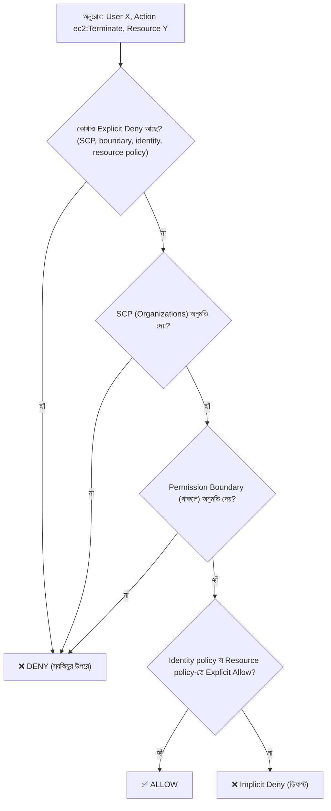

> **তিনটা সূত্র মুখস্থ নয়, বোঝো:** (১) ডিফল্ট = Deny। (২) Explicit Deny সর্বদা জেতে। (৩) SCP/Boundary কখনো অনুমতি *দেয় না* — শুধু **সর্বোচ্চ সীমা** টানে; অনুমতি আসে Allow থেকে।

### Policy-র ধরন

| ধরন | কোথায় লাগে | উদাহরণ |
|---|---|---|
| **Identity-based** | User/Group/Role-এ | "এই role S3 পড়তে পারে" |
| **Resource-based** | রিসোর্সে (S3 bucket policy, SQS, KMS key, Lambda) | "এই বাকেট অমুক account পড়তে পারে" |
| **Permission Boundary** | User/Role-এ সর্বোচ্চ সীমা | "এই role যাই পাক, IAM-পরিবর্তন নয়" |
| **SCP** | Account/OU-তে (Organizations) | "এই OU-তে অনুমোদিত রিজিয়নের বাইরে কিছু নয়" |
| **Session policy** | অস্থায়ী সেশনে আরও সংকীর্ণ করতে | assume-role-এর সময় |

### Role ও Trust Policy — দুই-অংশের গল্প

Role-এর **দুটো আলাদা policy**:

```json
// ১. Trust policy — "কে এই role নিতে পারবে?" (প্রিন্সিপাল)
{
  "Version": "2012-10-17",
  "Statement": [{
    "Effect": "Allow",
    "Principal": { "AWS": "arn:aws:iam::111111111111:root" },   // অন্য অ্যাকাউন্ট (cross-account)
    "Action": "sts:AssumeRole",
    "Condition": {
      "Bool": { "aws:MultiFactorAuthPresent": "true" },         // MFA বাধ্যতামূলক
      "StringEquals": { "sts:ExternalId": "booknest-audit-2026" }  // confused-deputy সুরক্ষা (তৃতীয়-পক্ষ)
    }
  }]
}
```
```json
// ২. Permissions policy — "role নিলে কী করতে পারবে?"
{
  "Version": "2012-10-17",
  "Statement": [{ "Effect": "Allow", "Action": ["s3:GetObject"], "Resource": "arn:aws:s3:::booknest-reports/*" }]
}
```

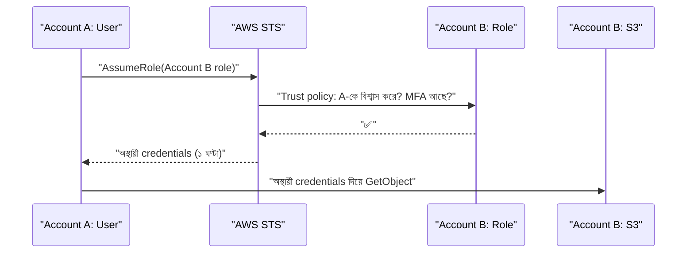

### IAM Best Practices (সংক্ষিপ্ত তালিকা — পরীক্ষা ও ইন্টারভিউ)

1. Root: MFA, কোনো access key নয়, প্রতিদিনের কাজে নয়।
2. মানুষ → **IAM Identity Center (SSO)**; IAM user এড়াও।
3. মেশিন/ওয়ার্কলোড → **Role** (EC2 instance profile, IRSA, Lambda role); দীর্ঘস্থায়ী key নয়।
4. Least privilege; **IAM Access Analyzer** দিয়ে অতিরিক্ত অনুমতি/পাবলিক-শেয়ারিং ধরো; "last accessed" দেখে অনুমতি ছাঁটো।
5. শর্ত ব্যবহার: MFA, IP, `aws:SourceVpce`, ট্যাগ (ABAC)।
6. অব্যবহৃত user/key নিয়মিত অপসারণ; key rotation; **Credential Report**।

## 2. AWS Organizations ও SCP

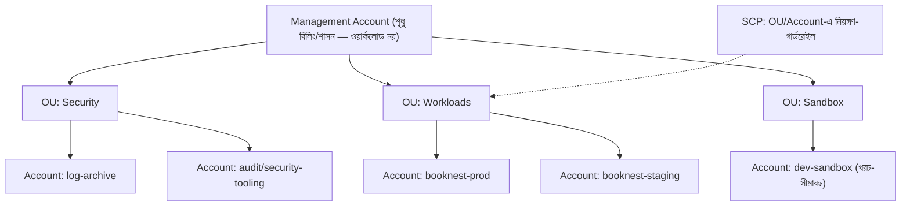

**কেন মাল্টি-অ্যাকাউন্ট?** **Blast radius** (prod ও dev আলাদা অ্যাকাউন্ট — একটার ভুল অন্যটাকে ছোঁয় না), বিলিং-বিভাজন, অ্যাক্সেস-সীমা, কোটা। এটা AWS-এর সবচেয়ে শক্ত আইসোলেশন-সীমা।

### SCP উদাহরণ — গার্ডরেইল

```json
{
  "Version": "2012-10-17",
  "Statement": [
    { "Sid": "DenyOutsideApprovedRegions", "Effect": "Deny",
      "NotAction": ["iam:*", "organizations:*", "route53:*", "cloudfront:*", "support:*", "sts:*"],
      "Resource": "*",
      "Condition": { "StringNotEquals": { "aws:RequestedRegion": ["ap-southeast-1", "us-east-1"] } } },
    { "Sid": "ProtectCloudTrail", "Effect": "Deny",
      "Action": ["cloudtrail:StopLogging", "cloudtrail:DeleteTrail", "cloudtrail:UpdateTrail"],
      "Resource": "*" },
    { "Sid": "DenyLeavingOrg", "Effect": "Deny", "Action": "organizations:LeaveOrganization", "Resource": "*" },
    { "Sid": "DenyRootUser", "Effect": "Deny", "Action": "*", "Resource": "*",
      "Condition": { "StringLike": { "aws:PrincipalArn": "arn:aws:iam::*:root" } } }
  ]
}
```
> **মনে রাখো:** SCP **management account-কে প্রভাবিত করে না**, এবং SCP *অনুমতি দেয় না* — শুধু ছাদ। (পরীক্ষার প্রিয় প্রশ্ন।)

## 3. S3 — Storage Classes ও Lifecycle

| Storage Class | কখন | আনুমানিক খরচ-ধারণা | পুনরুদ্ধার |
|---|---|---|---|
| **Standard** | ঘন ঘন ব্যবহার | বেশি | তাৎক্ষণিক |
| **Intelligent-Tiering** | ব্যবহারের ধরন অজানা | স্বয়ংক্রিয় স্তর-বদল (ছোট মনিটরিং-ফি) | তাৎক্ষণিক |
| **Standard-IA** | মাসে ১-২ বার, দ্রুত দরকার | কম (+ retrieval fee, ৩০ দিন ন্যূনতম) | তাৎক্ষণিক |
| **One Zone-IA** | পুনরুৎপাদনযোগ্য, একটা AZ-এ | আরও কম (ডেটা ১ AZ-এ — ঝুঁকি) | তাৎক্ষণিক |
| **Glacier Instant Retrieval** | বছরে ১-২ বার, তবু তাৎক্ষণিক | আরও কম | মিলিসেকেন্ড |
| **Glacier Flexible Retrieval** | আর্কাইভ | অতি কম | মিনিট–ঘণ্টা |
| **Glacier Deep Archive** | দীর্ঘমেয়াদী (কমপ্লায়েন্স) | সবচেয়ে কম | ~১২–৪৮ ঘণ্টা |

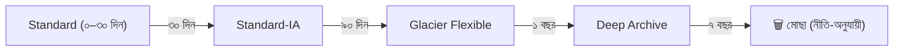

```hcl
resource "aws_s3_bucket_lifecycle_configuration" "logs" {
  bucket = aws_s3_bucket.logs.id
  rule {
    id     = "tiering"
    status = "Enabled"
    filter {}
    transition { days = 30  storage_class = "STANDARD_IA" }
    transition { days = 90  storage_class = "GLACIER" }
    expiration { days = 2555 }                                  # ~৭ বছর
    noncurrent_version_expiration { noncurrent_days = 30 }      # পুরনো ভার্সন সাফ (versioning-এর খরচ নিয়ন্ত্রণ)
    abort_incomplete_multipart_upload { days_after_initiation = 7 }   # আধা-আপলোডে লুকানো খরচ বন্ধ
  }
}
```

### S3 নিরাপত্তা ও টেকসই-করণ

| ফিচার | কাজ |
|---|---|
| **Block Public Access** (account-স্তরে) | ভুলে পাবলিক হওয়া ঠেকায় |
| **Versioning** | মুছে/ওভাররাইট হলেও ফেরানো যায় |
| **MFA Delete / Object Lock** | অপরিবর্তনীয়তা (ransomware/কমপ্লায়েন্স) |
| **Encryption (SSE-S3/SSE-KMS)** | বিশ্রামে এনক্রিপশন (এখন ডিফল্ট) |
| **Replication (CRR/SRR)** | অন্য রিজিয়ন/অ্যাকাউন্টে কপি |
| **Bucket policy + `aws:SecureTransport`** | শুধু HTTPS |
| **Access Analyzer for S3** | পাবলিক/ক্রস-অ্যাকাউন্ট এক্সপোজার |

## 4. Backup ও Disaster Recovery কৌশল

**দুটো মূল শব্দ:**
- **RPO** (Recovery Point Objective) — *কতটা ডেটা হারানো সহনীয়?* (সময়: শেষ ব্যাকআপ থেকে বিপর্যয় পর্যন্ত)
- **RTO** (Recovery Time Objective) — *কত সময়ে আবার চালু করতে হবে?*

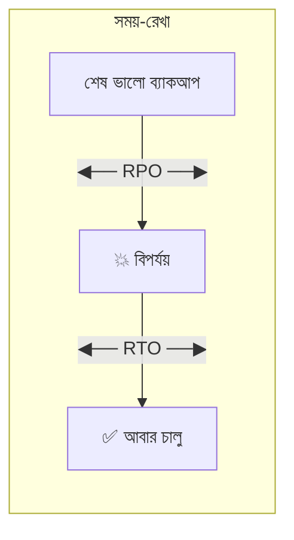

### DR-এর চার কৌশল (খরচ ↑, RTO/RPO ↓)

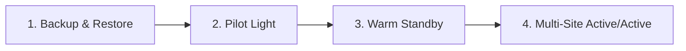

| কৌশল | বর্ণনা | RTO/RPO | খরচ |
|---|---|---|---|
| **Backup & Restore** | ব্যাকআপ অন্য রিজিয়নে; বিপর্যয়ে নতুন করে বানাও (IaC!) | ঘণ্টা–দিন | 💲 |
| **Pilot Light** | DR-রিজিয়নে শুধু মূল (ডেটাবেস-রেপ্লিকা) চালু; বাকি বন্ধ — দরকারে চালু | ১০ মিনিট–ঘণ্টা | 💲💲 |
| **Warm Standby** | DR-রিজিয়নে ছোট-মাপে পূর্ণ সিস্টেম চলছে; দরকারে বড় করো | মিনিট | 💲💲💲 |
| **Multi-Site Active/Active** | দুই রিজিয়নেই পূর্ণ লোড | প্রায় শূন্য | 💲💲💲💲 |

> **নীতি:** ব্যবসার *আসলে যা লাগে* সেই RTO/RPO ঠিক করো, তারপর সবচেয়ে সস্তা যে কৌশল তা পূরণ করে সেটা নাও। সবকিছুতে Active/Active = অপচয়। M09-র Terraform থাকলে "Backup & Restore" অনেক শক্তিশালী — পুরো পরিবেশ কোড থেকে পুনর্নির্মাণ।

### AWS Backup ও RDS

```hcl
resource "aws_backup_plan" "daily" {
  name = "booknest-daily"
  rule {
    rule_name         = "daily-35d"
    target_vault_name = aws_backup_vault.main.name
    schedule          = "cron(0 18 * * ? *)"            # UTC 18:00 = ঢাকা ভোর ০০:০০
    lifecycle { delete_after = 35 }
    copy_action {                                        # অন্য রিজিয়নে কপি (রিজিয়ন-বিপর্যয় থেকে সুরক্ষা)
      destination_vault_arn = aws_backup_vault.dr.arn
      lifecycle { delete_after = 35 }
    }
  }
}
```
- **RDS:** স্বয়ংক্রিয় ব্যাকআপ + **Point-in-Time Recovery** (RPO ~৫ মিনিট), **Multi-AZ** (AZ-বিপর্যয়, স্বয়ংক্রিয় failover), **Cross-Region Read Replica** (DR)। *Multi-AZ ≠ ব্যাকআপ* (ভুল DELETE দুই কপিতেই যায়)।
- **"ব্যাকআপ যাচাই না করলে ব্যাকআপ নেই"** — নিয়মিত **restore ড্রিল**।

## 5. CloudTrail Logging

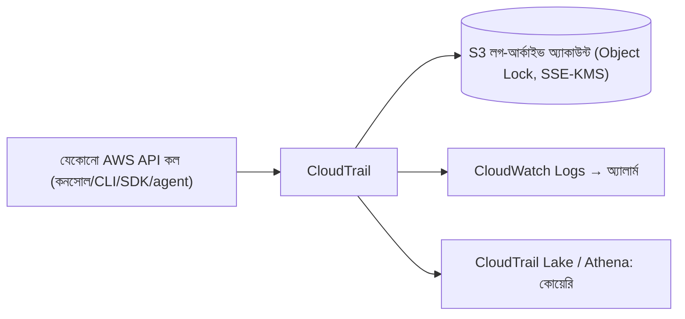

| ধরন | কী রেকর্ড |
|---|---|
| **Management events** | নিয়ন্ত্রণ-স্তরের কাজ (CreateUser, RunInstances) — ডিফল্টে |
| **Data events** | ডেটা-স্তর (S3 GetObject, Lambda Invoke) — চালু করতে হয়, খরচ আছে |
| **Insights events** | অস্বাভাবিক API-কার্যকলাপ শনাক্ত |

**সেরা অনুশীলন:** **Organization trail** (সব অ্যাকাউন্ট একসাথে), multi-region, **log file validation**, আলাদা log-archive অ্যাকাউন্টে অপরিবর্তনীয় S3, SCP দিয়ে বন্ধ করা নিষেধ (§2), গুরুত্বপূর্ণ ইভেন্টে EventBridge অ্যালার্ট (root লগইন, IAM-পরিবর্তন, `StopLogging`)।

---

# 🧩 Live Class 2 — Well-Architected Review and Certification Preparation

## 6. AWS Well-Architected Framework — ছয় স্তম্ভ

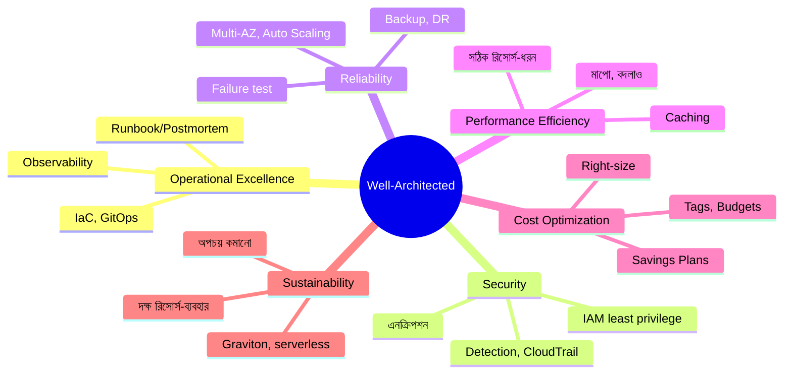

| স্তম্ভ | মূল প্রশ্ন | আমাদের কোর্সে কোথায় |
|---|---|---|
| **Operational Excellence** | কীভাবে চালাই, শিখি, উন্নত করি? | M06, M07, M09, M15, M19 |
| **Security** | তথ্য/সিস্টেম কীভাবে রক্ষা করি? | M02, M08, M18, M21 |
| **Reliability** | ব্যর্থতা থেকে কীভাবে সেরে উঠি? | M08, M10, M14, M19 |
| **Performance Efficiency** | সঠিক সম্পদ সঠিকভাবে ব্যবহার? | M10, M14, M19(k6) |
| **Cost Optimization** | অপচয় ছাড়া মূল্য? | M20 |
| **Sustainability** | পরিবেশগত প্রভাব কমানো? | M20 (Graviton, scale-to-zero) |

### স্তম্ভগুলোর মধ্যে ট্রেড-অফ

কোনো আর্কিটেকচার সব স্তম্ভে ১০০ নয়। **Multi-region (Reliability↑) = Cost↓, জটিলতা↑**। **Spot (Cost↑) = Reliability-ঝুঁকি**। ভালো স্থপতি **সচেতনভাবে ট্রেড-অফ বাছে ও লিখে রাখে** (Architecture Decision Records)।

## 7. 🔍 Well-Architected Review — নিজের অ্যাপে চালানো

**AWS Well-Architected Tool** (কনসোলে বিনামূল্যে) — প্রশ্নমালা দেয়, ঝুঁকি (HRI/MRI) চিহ্নিত করে। অথবা হাতে চেকলিস্ট। ধাপ:

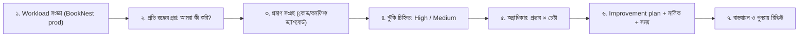

### BookNest-এর নমুনা ঝুঁকি-তালিকা (ছক)

| স্তম্ভ | পর্যবেক্ষণ | ঝুঁকি | প্রমাণ |
|---|---|---|---|
| Security | CI role-এর পলিসিতে `s3:*` Resource `*` | **High** | IAM policy |
| Security | RDS ব্যাকআপ এনক্রিপ্টেড, কিন্তু CloudTrail শুধু একটা অ্যাকাউন্টে | Medium | Trail কনফিগ |
| Reliability | RDS Single-AZ | **High** | Terraform |
| Reliability | ব্যাকআপ restore কখনো পরীক্ষা হয়নি | **High** | রানবুকে নেই |
| Ops Excellence | Runbook শুধু ২টা অ্যালার্টে | Medium | Wiki |
| Performance | k6 টেস্ট ম্যানুয়াল, CI-তে নেই | Medium | CI |
| Cost | NAT Gateway ডেটা-ট্রান্সফার শীর্ষ-৩ খরচ; S3/ECR-র জন্য VPC endpoint নেই | Medium | Cost Explorer |
| Sustainability | সব ইনস্ট্যান্স x86; Graviton-যোগ্য | Low | EC2 তালিকা |

### অগ্রাধিকার ম্যাট্রিক্স

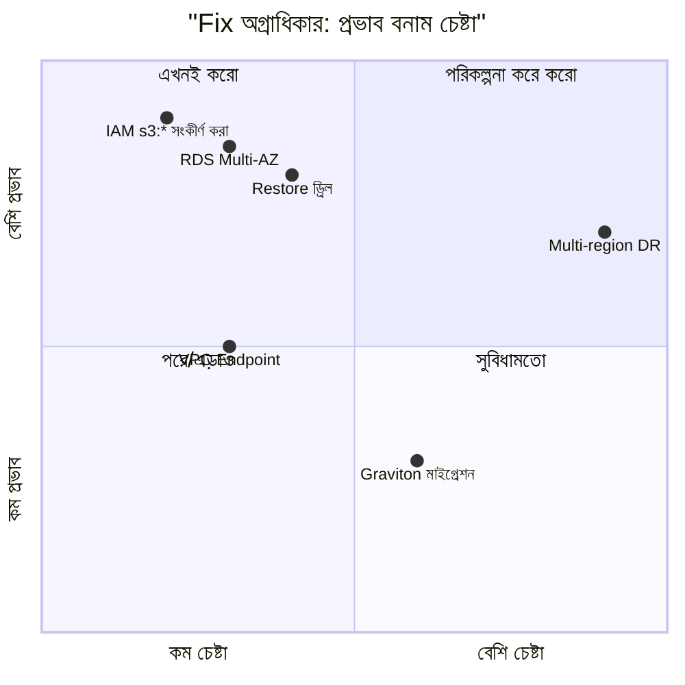

## 8. CloudFormation Basics (পরীক্ষা-কভারেজের জন্য সংক্ষিপ্ত)

Terraform আমাদের প্রধান IaC; তবে **SAA পরীক্ষা ও AWS-নেটিভ পরিবেশে CloudFormation** আসে। মূল ধারণা Terraform-এর মতোই — ঘোষণামূলক টেমপ্লেট → **Stack**।

| CloudFormation | Terraform-এ সমতুল্য |
|---|---|
| Template (YAML/JSON) | `.tf` ফাইল |
| **Stack** | state-সহ ডিপ্লয়-করা সেট |
| **Change Set** (পূর্বরূপ) | `terraform plan` |
| Parameters / Outputs | variables / outputs |
| Drift Detection | `plan -refresh-only` |
| **StackSets** | বহু অ্যাকাউন্ট/রিজিয়নে ডিপ্লয় |
| State | AWS ম্যানেজ করে (ফাইল-ঝামেলা নেই) |

```yaml
# template.yaml — একটা এনক্রিপ্টেড, ভার্সনড S3 বাকেট
AWSTemplateFormatVersion: "2010-09-09"
Description: BookNest reports bucket
Parameters:
  Env:
    Type: String
    AllowedValues: [dev, staging, prod]
Resources:
  ReportsBucket:
    Type: AWS::S3::Bucket
    DeletionPolicy: Retain                 # স্ট্যাক মুছলেও ডেটা থাকবে
    Properties:
      BucketName: !Sub "booknest-reports-${Env}-${AWS::AccountId}"
      VersioningConfiguration: { Status: Enabled }
      BucketEncryption:
        ServerSideEncryptionConfiguration:
          - ServerSideEncryptionByDefault: { SSEAlgorithm: AES256 }
      PublicAccessBlockConfiguration:
        BlockPublicAcls: true
        BlockPublicPolicy: true
        IgnorePublicAcls: true
        RestrictPublicBuckets: true
Outputs:
  BucketArn:
    Value: !GetAtt ReportsBucket.Arn
```
```bash
aws cloudformation deploy --template-file template.yaml --stack-name booknest-reports --parameter-overrides Env=prod
aws cloudformation describe-stack-events --stack-name booknest-reports   # ব্যর্থতার কারণ
```
**পরীক্ষার জন্য মনে রাখো:** intrinsic functions (`!Ref`, `!GetAtt`, `!Sub`, `!Join`), `DependsOn`, `DeletionPolicy`, rollback আচরণ, nested stacks, StackSets, Change Sets।

## 9. AWS Certified Solutions Architect – Associate (SAA-C03) — পরীক্ষা-কৌশল

> পরীক্ষার ডোমেইন/ওজন/মূল্য/ফরম্যাট সময়ের সাথে বদলায় — **অফিসিয়াল AWS Certification পেজে সর্বশেষ যাচাই করো।**

### চার ডোমেইনের (প্রচলিত) ভাগ

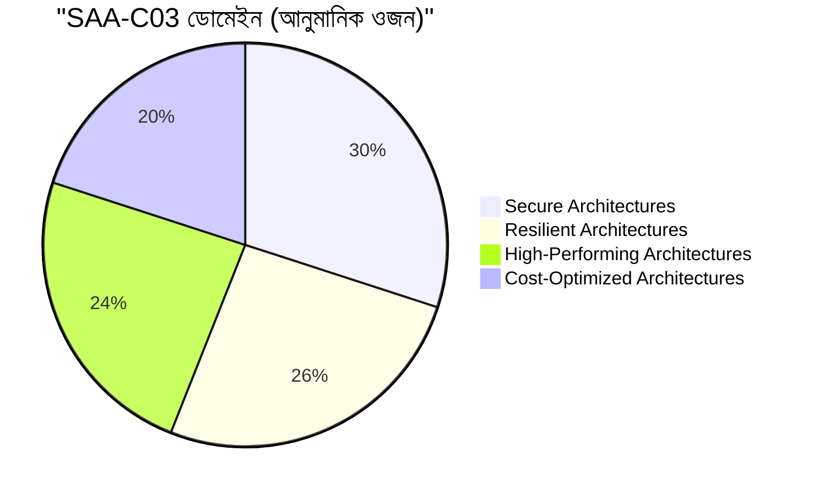

### প্রশ্ন-ধরন ও কৌশল

| কৌশল | ব্যাখ্যা |
|---|---|
| **কীওয়ার্ড ধরো** | "সবচেয়ে কম খরচে", "সর্বোচ্চ প্রাপ্যতা", "ন্যূনতম অপারেশনাল ওভারহেড", "সর্বনিম্ন latency" — এগুলোই উত্তর নির্ধারণ করে |
| **বাদ দিয়ে এগোও** | ২টা স্পষ্ট ভুল বাদ দিলে ৫০% সম্ভাবনা |
| **"Managed" পছন্দ** | সমান শর্তে AWS-ম্যানেজড সেবা (RDS > EC2-তে DB; Fargate > নিজস্ব সার্ভার) |
| **Decouple** | SQS/SNS/EventBridge দিয়ে — প্রায়ই সঠিক উত্তর |
| **Stateless + Multi-AZ** | নির্ভরযোগ্যতার ডিফল্ট |
| **নিরাপত্তায়** | Role > key, Least privilege, এনক্রিপশন, VPC endpoint, private subnet |
| **সময় ব্যবস্থাপনা** | কঠিন প্রশ্ন flag করে এগোও; শেষে ফিরে আসো |

### মূল "জোড়া" — বারবার আসে

| পরিস্থিতি | সাধারণ উত্তর |
|---|---|
| স্থির ওয়েব কনটেন্ট বিশ্বব্যাপী | S3 + CloudFront |
| DB read বেশি | RDS Read Replica / ElastiCache |
| DB high-availability | RDS Multi-AZ |
| অনিয়মিত ওয়ার্কলোড, সার্ভার চাই না | Lambda / Fargate |
| বার্তা-বিচ্ছিন্নকরণ | SQS (কিউ), SNS (fan-out), EventBridge (রুল-রাউটিং) |
| ভারী সংযোগ, কম-ল্যাটেন্সি, স্ট্যাটিক IP | NLB |
| পথ/হোস্ট-ভিত্তিক রাউটিং | ALB |
| একাধিক AZ-এ অটো-হিলিং | ASG + ALB |
| অন-প্রেম ↔ AWS প্রাইভেট সংযোগ | Direct Connect / Site-to-Site VPN |
| ক্রস-অ্যাকাউন্ট অ্যাক্সেস | IAM Role (Assume Role) |
| আর্কাইভ, বিরল-অ্যাক্সেস | S3 Glacier + Lifecycle |
| DR কম খরচে | Backup & Restore / Pilot Light |
| ডেটা এনক্রিপশন-নিয়ন্ত্রণ | KMS (CMK) |
| প্রাইভেট subnet থেকে S3 (NAT এড়িয়ে) | Gateway VPC Endpoint |

### প্রস্তুতি পরিকল্পনা (৪ সপ্তাহ নমুনা)

| সপ্তাহ | ফোকাস |
|---|---|
| ১ | IAM, VPC, EC2, S3 — (কোর্সের M02, M08 পুনর্বার) + ডোমেইন ১ (Secure) |
| ২ | RDS/Aurora, DynamoDB, ELB/ASG, Route53, CloudFront — ডোমেইন ২ (Resilient) |
| ৩ | SQS/SNS/Lambda, ECS/EKS, Kinesis, Storage ধরন — ডোমেইন ৩ (Performance) |
| ৪ | Cost (Savings Plans, S3 ক্লাস, Spot) + **৩–৪টা পূর্ণ প্র্যাকটিস টেস্ট** + দুর্বল-বিষয় |

> **সবচেয়ে কার্যকর:** কোর্সে যা **হাতে বানিয়েছ** (VPC, ALB, ASG, RDS, IAM, S3 lifecycle) — এগুলো পরীক্ষায় সবচেয়ে সহজ ঠেকবে; শূন্য-পড়ুয়াদের তুলনায় তোমার সুবিধা বিশাল। আর তোমার নিজের অ্যাকাউন্টে পরীক্ষা-পূর্বে **ছোট ল্যাব** (এবং শেষে `destroy`)।

## 10. 🎯 Assignment — লিখিত Well-Architected Review

**টেমপ্লেট (জমা: `well-architected-review.md`):**

```markdown
# Well-Architected Review — BookNest (Production)
**তারিখ:** | **রিভিউয়ার:** | **Workload:** three-tier + AI service on EKS/AWS

## ১. Workload সারাংশ (আর্কিটেকচার ডায়াগ্রামসহ)
## ২. স্তম্ভ-ভিত্তিক মূল্যায়ন
### Operational Excellence
- আমরা যা ভালো করি:
- ফাঁক/ঝুঁকি (High/Medium/Low):
### Security  (…একই কাঠামো… ছয়টা স্তম্ভের জন্য)
## ৩. ঝুঁকি-রেজিস্টার
| # | স্তম্ভ | ঝুঁকি | তীব্রতা | প্রমাণ |
## ৪. অগ্রাধিকারপ্রাপ্ত Fix-তালিকা (প্রভাব × চেষ্টা)
| অগ্রাধিকার | Fix | স্তম্ভ | চেষ্টা | মালিক | সময়সীমা | সাফল্যের মাপকাঠি |
## ৫. ট্রেড-অফ ও সিদ্ধান্ত (কেন কিছু ঝুঁকি গ্রহণ করছি)
## ৬. পরবর্তী রিভিউ: তারিখ
```

**মান-নির্ণায়ক:** ✅ প্রতিটা ঝুঁকির সাথে **প্রমাণ**; ✅ অগ্রাধিকার *যুক্তিসহ*; ✅ সবকিছু "ঠিক আছে" বলা নয় — সৎ ফাঁক-সনাক্তকরণ; ✅ অন্তত ৫টা fix বাস্তবায়নযোগ্য মালিক-ও-সময়সহ; ✅ ট্রেড-অফ স্পষ্ট।

## ⚠️ সাধারণ ভুল

| ভুল | ফল |
|---|---|
| IAM-এ `Action:*, Resource:*` "সময় বাঁচাতে" | প্রথম ফাঁস = পুরো অ্যাকাউন্ট |
| SCP-কে অনুমতি-দাতা ভাবা | কিছুই কাজ করে না; SCP শুধু ছাদ |
| Single account-এ prod+dev | একটা ভুলে সব |
| Multi-AZ-কে ব্যাকআপ ভাবা | ভুল DELETE দুই কপিতেই |
| ব্যাকআপ আছে, restore কখনো পরীক্ষা হয়নি | সংকটে "ব্যাকআপ ভাঙা" |
| সব ডেটা Standard S3 ক্লাসে চিরকাল | অপচয় (lifecycle নেই) |
| CloudTrail একই অ্যাকাউন্টে, বন্ধ করা যায় | আক্রমণকারী আগে লগ বন্ধ করে |
| WA Review একবার করে ভুলে যাওয়া | আর্কিটেকচার বদলায়, ঝুঁকি ফিরে আসে — পুনরাবৃত্তি |
| পরীক্ষায় "সবচেয়ে জটিল" উত্তর বাছা | প্রায়ই সঠিক = সবচেয়ে সরল, managed |

## ✅ চেকলিস্ট

- [ ] IAM মূল্যায়ন-যুক্তি (Deny > Allow > implicit deny; SCP/boundary = ছাদ) ব্যাখ্যা করতে পারি
- [ ] Role trust policy বনাম permissions policy; cross-account assume-role
- [ ] Organizations/SCP; multi-account যুক্তি
- [ ] S3 ক্লাস, lifecycle, Block Public Access, Object Lock
- [ ] RPO/RTO; DR-এর ৪ কৌশল; AWS Backup; restore ড্রিল
- [ ] CloudTrail Organization trail, validation, আলাদা আর্কাইভ
- [ ] ছয় স্তম্ভ ও ট্রেড-অফ
- [ ] নিজের অ্যাপের লিখিত WA Review ও অগ্রাধিকার-তালিকা
- [ ] CloudFormation-এর মূল ধারণা
- [ ] SAA প্রস্তুতি-পরিকল্পনা ও ≥১টা প্র্যাকটিস টেস্ট

## 🎯 ইন্টারভিউ প্রশ্ন

1. IAM policy মূল্যায়ন কীভাবে হয়? Explicit deny বনাম allow?
2. SCP ও IAM policy-র পার্থক্য? SCP কি management account-এ প্রযোজ্য?
3. Permission boundary কী? কখন ব্যবহার?
4. Cross-account access কীভাবে দেবে? `ExternalId` কেন?
5. RPO ও RTO কী? DR-এর চার কৌশল ও ট্রেড-অফ?
6. Multi-AZ বনাম Read Replica বনাম Backup?
7. S3 storage class কীভাবে বাছবে? Lifecycle কেন?
8. CloudTrail-কে "tamper-proof" কীভাবে করবে?
9. Well-Architected-এর ছয় স্তম্ভ; স্তম্ভগুলোর মধ্যে ট্রেড-অফের উদাহরণ?
10. CloudFormation বনাম Terraform?
11. একটা workload-এর Well-Architected review কীভাবে চালাবে?

## 🧠 সারসংক্ষেপ

**IAM = সিদ্ধান্তের যুক্তি (Deny সর্বদা জেতে; SCP ছাদ), Organizations = মাল্টি-অ্যাকাউন্ট আইসোলেশন, S3+Lifecycle = সঠিক দামে সঠিক ঠাঁই, DR = RTO/RPO-র সাথে খরচের দরকষাকষি, CloudTrail = অপরিবর্তনীয় রেকর্ড।** **Well-Architected = নিজের কাজকে নিজে সৎভাবে পরিদর্শন** — ছয় প্রশ্ন, ঝুঁকি-তালিকা, অগ্রাধিকার, ট্রেড-অফ। প্রমাণ-সহ আত্মসমালোচনাই পরিণত ইঞ্জিনিয়ারের চিহ্ন।

⬅️ [Module 23](../section-4-devsecops-sre-finops-ai-ops/module-23-exam-week-4.md) · ➡️ [Module 25](./module-25-capstone-build.md)
