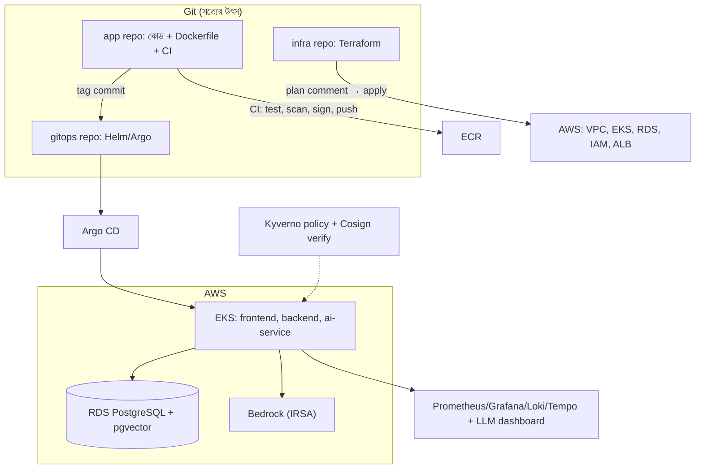
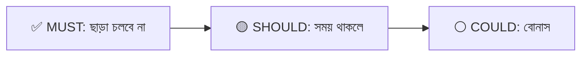
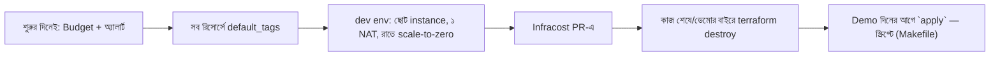
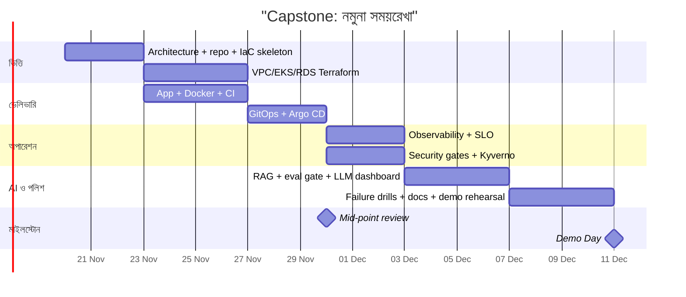

# Module 25 — Capstone Build

> **Section 5 · AWS Deep Dive & Capstone** · ২টি Live Class
> **Project:** Capstone: Production-Ready AI App, End to End
> **Goal:** Capstone-এর infrastructure, delivery ও observability **সম্পূর্ণ কাজ করছে**।
> **Assignment ★:** Mid-point milestone-এ Capstone repository।

---

## 📖 গল্প: প্রথম থেকে শেষ পর্যন্ত একটা পূর্ণ যাত্রা

এতদিন তানভীর টুকরো টুকরো শিখেছে — VPC এক মডিউলে, Docker আরেকটায়, Argo CD অন্যটায়। এখন মেন্টর বললেন: **"সব জোড়া লাগিয়ে একটা সত্যিকারের প্রোডাক্ট প্রোডাকশনে তোলো — যেন কোনো ক্লায়েন্টকে দিয়ে বলতে পারো 'এই নাও, আমি এটা বানিয়েছি, আর এটা ঘুমের মধ্যেও চলবে।'"**

এটা শেষ পরীক্ষা নয়, **পোর্টফোলিও**। ইন্টারভিউয়ে "আমি Terraform জানি" আর "আমি এই লিংকের সিস্টেমটা শূন্য থেকে বানিয়েছি, ভাঙলে এভাবে সারে" — দুটোর ওজন আকাশ-পাতাল।

---

# 🧩 Live Class 1 — Capstone Kickoff and Architecture Review

## 1. Capstone ব্রিফ — কী বানাচ্ছ?

> **Production-Ready AI App, End to End:** একটা three-tier অ্যাপ + AI ফিচার (RAG/LLM), যা Terraform-এ বানানো, EKS-এ চলে, GitOps-এ ডেলিভার হয়, observability-সহ, নিরাপদ, খরচ-সচেতন, এবং ভাঙলে সারে।



### মূল্যায়ন-রুব্রিক (সাধারণ কাঠামো — ইনস্ট্রাক্টরের চূড়ান্ত রুব্রিক মিলিয়ে নাও)

| বিভাগ | কী দেখা হবে | ওজন (নমুনা) |
|---|---|---|
| **Infrastructure (IaC)** | Terraform মডিউল, remote state, প্রাইভেট নেটওয়ার্ক, Checkov পাস | ২০% |
| **Delivery** | CI/CD, OIDC, GitOps, canary/rollback | ২০% |
| **Observability** | metrics/logs/traces, SLO, অর্থবহ অ্যালার্ট, LLM ড্যাশবোর্ড | ১৫% |
| **Security** | স্ক্যান, সই, Kyverno, secrets, least privilege | ১৫% |
| **Reliability** | HA, HPA, ব্যাকআপ-restore, failure recovery প্রদর্শন | ১৫% |
| **AI ফিচার** | RAG কার্যকর, eval gate, cost control | ১০% |
| **ডকুমেন্টেশন ও উপস্থাপনা** | README, ডায়াগ্রাম, runbook, ট্রেড-অফ ব্যাখ্যা | ৫% |

## 2. স্কোপ — "যথেষ্ট ছোট, যথেষ্ট পূর্ণ"

**সবচেয়ে বড় Capstone-ভুল: অতি-উচ্চাকাঙ্ক্ষা।** সময় সীমিত — একটা *সম্পূর্ণ-কার্যকর ছোট* সিস্টেম, *অর্ধেক-কাজ করা বিশাল* সিস্টেমের চেয়ে ঢের ভালো।



| স্তর | কী |
|---|---|
| **MUST** | Terraform-এ VPC+EKS(বা ECS)+RDS; ৩-টায়ার অ্যাপ + একটা AI endpoint; CI/CD+GitOps; Prometheus/Grafana; Trivy+Cosign+Kyverno(১-২ নীতি); ASG/HPA; ব্যাকআপ; README+ডায়াগ্রাম |
| **SHOULD** | canary + auto-rollback; Loki+Tempo; eval gate; Infracost; ESO; SLO+burn-rate |
| **COULD** | Backstage template; multi-region DR; agent-লেখা PR (policy সহ); GPU/self-hosted মডেল |

> **নিয়ম:** MUST আগে সম্পূর্ণ → তারপর SHOULD। **MUST-এর কোনোটা অর্ধেক রেখে COULD ধরো না।**

## 3. Architecture Review — প্রত্যেক টিম উপস্থাপন করবে

ইনস্ট্রাক্টররা আর্কিটেকচার রিভিউতে ঝুঁকি ও স্কোপ দেখবেন। প্রস্তুত করো:

```markdown
# Capstone Architecture Proposal

## ১. সমস্যা ও ব্যবহারকারী (একটা বাক্যে)
## ২. আর্কিটেকচার ডায়াগ্রাম (Mermaid/draw.io)
## ৩. প্রযুক্তি-পছন্দ ও কেন (ট্রেড-অফসহ)
| সিদ্ধান্ত | বিকল্প | কেন এটা |
|---|---|---|
| EKS vs ECS | | |
| RDS vs Postgres-on-K8s | | |
| Bedrock vs self-hosted | | |
## ৪. নিরাপত্তা-মডেল (কে কী পারে; secrets; supply-chain)
## ৫. ব্যর্থতা-মডেল: কী ভাঙতে পারে, কীভাবে সারে? (SLO ও RTO/RPO)
## ৬. খরচ-অনুমান (Infracost দিয়ে) ও কীভাবে বন্ধ রাখব (destroy-পরিকল্পনা)
## ৭. স্কোপ: MUST / SHOULD / COULD
## ৮. ঝুঁকি ও প্রশমন (শীর্ষ ৫)
## ৯. সময়সূচি ও মাইলস্টোন
```

### রিভিউয়াররা যে প্রশ্ন করবেন (আগে থেকে ভাবো)

1. এই সিস্টেমের সবচেয়ে বড় single point of failure কোনটা?
2. একটা AZ হারালে কী ঘটবে? DB হারালে?
3. প্রোডাকশনে কে কী অ্যাক্সেস পায়? Agent/CI-র অনুমতি?
4. মাসিক খরচ কত? ৫× ট্রাফিকে কত?
5. এই AI ফিচার ভুল উত্তর দিলে কীভাবে জানবে?
6. প্রথম ৫টা অ্যালার্ট কী কী, কেন?
7. তুমি কী *করছ না* (স্কোপের বাইরে) এবং কেন?

## 4. প্রজেক্ট-কাঠামো ও সংগঠন

```text
capstone/
├── README.md                    # প্রথম যা কেউ পড়বে — ডায়াগ্রাম, কীভাবে চালাব, ডেমো-লিংক
├── docs/
│   ├── architecture.md          # ডায়াগ্রামসহ + ADR
│   ├── decisions/               # ADR-001-eks-vs-ecs.md ...
│   ├── runbooks/                # high-error-rate.md, db-restore.md, rollback.md
│   ├── slo.md
│   ├── security.md
│   └── cost.md
├── app/                         # frontend/, backend/, ai-service/
├── infra/                       # Terraform: modules/, envs/{dev,prod}/
├── gitops/                      # Helm values, Argo apps, Kyverno policies
├── .github/workflows/           # ci.yml, terraform.yml, infracost.yml, eval.yml
└── eval/                        # golden.jsonl + run-eval
```

**ADR (Architecture Decision Record) — ছোট, মূল্যবান:**

```markdown
# ADR-003: AI মডেল — Bedrock বনাম Self-hosted
- **অবস্থা:** গৃহীত | **তারিখ:** 2026-11-20
- **প্রসঙ্গ:** স্থির লোড কম, ছোট দল, GPU-অপারেশনের অভিজ্ঞতা সীমিত।
- **সিদ্ধান্ত:** Bedrock + IRSA।
- **ফলাফল:** (+) কোনো GPU/key-ব্যবস্থাপনা নেই; (−) প্রতি-টোকেন খরচ, মডেল-পছন্দ সীমিত।
- **পুনর্বিবেচনা:** দৈনিক >X টোকেন হলে self-host খরচ তুলনা।
```
> **কেন ADR?** ইন্টারভিউয়ে "কেন X বেছেছিলে?" — উত্তর লেখা আছে। আর ছয় মাস পরে তুমি নিজেই ভুলে যাবে।

## 5. খরচ-সুরক্ষা — Capstone-এর জন্য সবার আগে



```makefile
# Makefile — এক-কমান্ডে তোলা ও নামানো (ডেমো ও খরচ-নিয়ন্ত্রণ)
.PHONY: up down plan
plan:
	cd infra/envs/prod && terraform init -input=false && terraform plan -out=tfplan
up:
	cd infra/envs/prod && terraform apply tfplan && ./scripts/bootstrap-argocd.sh
down:
	./scripts/delete-lb-services.sh        # আগে K8s LB/Ingress মোছো — নইলে destroy আটকে যায় (M14)
	cd infra/envs/prod && terraform destroy -auto-approve
```
> ⚠️ `-auto-approve` কেবল নিজের sandbox-এ। কখনো shared/real প্রোডাকশনে নয়।

---

# 🧩 Live Class 2 — Mid-Point Review and Unblock Clinic

## 6. Mid-Point Milestone — কতটা এগোনো উচিত?



### Mid-Point চেকলিস্ট (Assignment ★: "Capstone repository at mid-point milestone")

**অবশ্যই থাকতে হবে:**

- [ ] রিপোতে README + আর্কিটেকচার ডায়াগ্রাম
- [ ] Terraform: নেটওয়ার্ক + ক্লাস্টার/কম্পিউট + DB **`apply` হয়েছে ও কাজ করছে**; remote state
- [ ] অ্যাপ (৩ টায়ার) কনটেইনারাইজড ও **ডিপ্লয়-করা**; ডোমেইন+HTTPS
- [ ] CI চলে (test+build+scan) ও image ECR-তে
- [ ] GitOps: Argo CD অ্যাপ — commit দিয়ে ডিপ্লয় (অন্তত একটা সার্ভিস)
- [ ] মৌলিক মনিটরিং: Prometheus/Grafana দৃশ্যমান
- [ ] Budget অ্যালার্ট + ট্যাগ
- [ ] স্কোপ ডকুমেন্ট (MUST/SHOULD/COULD) ও ঝুঁকি-তালিকা

**মধ্য-বিন্দুতে বাকি থাকতে পারে:** AI ফিচারের পূর্ণ eval-গেট, canary, Kyverno পূর্ণ নীতি, DR-ড্রিল, পলিশ।

## 7. Live Troubleshooting Clinic — আটকে গেলে

ক্লিনিকে সাহায্য পেতে — **প্রশ্ন গুছিয়ে আনো**:

```markdown
## আটকানো সমস্যা (ক্লিনিকে দেখাব)
**লক্ষ্য:** কী করতে চাচ্ছিলাম?
**প্রত্যাশা বনাম বাস্তব:**
**কী চেষ্টা করেছি (ক্রমানুসারে):**
**প্রমাণ:** error-বার্তা (secret মাস্ক করে), `kubectl describe`/logs-এর অংশ, `terraform plan` আউটপুট
**আমার অনুমান (২-৩টা):**
**AI কী বলেছিল / সেটা সঠিক ছিল কিনা:**
```
> এই ছাঁচ নিজেই অর্ধেক সমস্যা সমাধান করে দেয় (rubber-duck debugging)। আর ইন্টারভিউ/চাকরিতে **"সমস্যা গুছিয়ে উপস্থাপন"** একটা মূল্যবান দক্ষতা।

### সাধারণ Capstone-আটকানোর মানচিত্র

| আটকানো | প্রথমে কী দেখবে | মডিউল |
|---|---|---|
| Terraform `apply` ঝুলে/ব্যর্থ | সদ্য-ভাঙা লাইন, IAM অনুমতি, কোটা, লক | M09 |
| EKS নোড Ready নয় | নোড-role, subnet/NAT, addons | M14 |
| Pod `Pending` | requests > নোড ক্ষমতা, PVC AZ | M13/14 |
| Argo `OutOfSync/Degraded` | ইভেন্ট, health, Helm render | M15 |
| Ingress 404/502 | controller, ingressClass, Service endpoints | M14 |
| Kyverno সবকিছু আটকাচ্ছে | Audit-এ ফেরো, নীতি-বার্তা, system namespace বাদ | M18 |
| ESO সিঙ্ক ব্যর্থ | IRSA role, secret নাম, SecretStore | M18 |
| Bedrock `AccessDenied` | মডেল-অ্যাক্সেস চালু? role policy, রিজিয়ন | M22 |
| pgvector কোয়েরি ধীর/ভুল | ইনডেক্স, মাত্রা-অমিল | M22 |
| বিল বাড়ছে | NAT/EKS/ALB/লগ | M20 |

## 8. ডকুমেন্টেশন — "ডেমোর বাইরের জীবন"

README-র শক্তিশালী কাঠামো (নিয়োগকর্তা প্রথম ৩০ সেকেন্ডে এটাই পড়বেন):

```markdown
# BookNest AI — Production-Ready Capstone

> একটা বাক্যে: কী, কাদের জন্য, কী-সমস্যার সমাধান।


## ⚡ হাইলাইটস
- ✅ Terraform: ২ AZ VPC, EKS, RDS (Multi-AZ) — Checkov: ০ high
- ✅ GitOps (Argo CD) + canary rollback মেট্রিক-চালিত
- ✅ সাপ্লাই-চেইন: Trivy → SBOM → Cosign → Kyverno verify
- ✅ SLO 99.9% + burn-rate alert; k6 gate
- ✅ RAG (Bedrock+pgvector) + eval gate + LLM cost dashboard
- 💰 মাসিক খরচ আনুমানিক $__ (Infracost), নন-ডেমোতে $0 (`make down`)

## 🎬 ডেমো  (ভিডিও/লিংক/স্ক্রিনশট)
## 🏗️ আর্কিটেকচার ও সিদ্ধান্ত  (ADR লিংক)
## 🚀 কীভাবে চালাব  (`make up`)
## 🔐 নিরাপত্তা-মডেল
## 📈 পর্যবেক্ষণ ও SLO
## 🧪 ব্যর্থতা-পরীক্ষা (কী ভেঙেছি, কীভাবে সেরেছে) + postmortem
## 💡 কী শিখেছি / কী ভিন্নভাবে করতাম
```

> **"কী ভিন্নভাবে করতাম"** অংশটা আত্ম-সমালোচনা — সিনিয়র-সুলভ পরিপক্বতার চিহ্ন; ইন্টারভিউয়ারদের প্রিয়।

## 9. 🤖 Capstone-এ AI — সঠিক ব্যবহার

| AI-কে দাও | নিজে করো |
|---|---|
| Boilerplate Terraform/Helm/CI-র খসড়া | আর্কিটেকচার-সিদ্ধান্ত ও ট্রেড-অফ |
| README/ডকের প্রথম খসড়া | তথ্য-যাচাই, "আমি কেন" অংশ |
| ডিবাগ-অনুমান-তালিকা | আসল লগ পড়া, কারণ নিশ্চিত করা |
| টেস্ট/eval-কেসের আইডিয়া | কোন কেস আসলে গুরুত্বপূর্ণ |

> **সততা:** Capstone-এ কোন অংশ AI-লেখা ও কীভাবে যাচাই করেছ — README-তে স্বচ্ছভাবে লেখো। ইন্টারভিউয়ে "এটা কীভাবে কাজ করে?" — তুমি প্রতিটা লাইন ব্যাখ্যা করতে পারবে, এটাই লক্ষ্য। **ব্যাখ্যা করতে পারো না এমন কিছু তোমার রিপোতে রেখো না।** (M01-র নিয়ম: তুমিই দায়ী।)

## ⚠️ সাধারণ ভুল

| ভুল | ফল |
|---|---|
| স্কোপ অতি-বিশাল | কিছুই সম্পূর্ণ নয় |
| শেষ সপ্তাহে সব একসাথে জোড়া | অপ্রত্যাশিত ইন্টিগ্রেশন-সমস্যা — প্রথম থেকেই end-to-end পাতলা-কাট (thin slice) |
| README/ডকস শেষ মুহূর্তে | দুর্বল উপস্থাপনা; ডেমো-নির্ভর |
| খরচ-নিয়ন্ত্রণ ভুলে যাওয়া | অপ্রত্যাশিত বিল |
| ডেমোর আগের রাতে প্রথম `apply` | প্রথমবারেই ব্যর্থ — আগেই পুনরাবৃত্তি-ড্রিল |
| Secrets/টোকেন রিপোতে | পোর্টফোলিও-রিপো পাবলিক হলে বিপর্যয় — Gitleaks! |
| পাবলিক রিপোতে প্রকৃত AWS অ্যাকাউন্ট-ID/ARN/ডোমেইন-গোপন-তথ্য | মাস্ক/placeholder |
| অন্যের কোড/টেমপ্লেট কপি, উৎস উল্লেখ নেই | সততা-সমস্যা — উৎস লেখো |

## ✅ চেকলিস্ট

- [ ] Capstone ব্রিফ ও রুব্রিক বুঝেছি
- [ ] MUST/SHOULD/COULD স্কোপ লিখেছি
- [ ] Architecture proposal + ADR (≥৩টা সিদ্ধান্ত)
- [ ] রিপো-কাঠামো, README খসড়া
- [ ] Budget/ট্যাগ/`make up|down` প্রস্তুত
- [ ] Mid-point: Terraform + ডিপ্লয়ড অ্যাপ + CI + GitOps + মৌলিক মনিটরিং কাজ করছে
- [ ] ক্লিনিকের জন্য আটকানো-সমস্যা গুছিয়ে লেখা
- [ ] পাবলিক রিপোতে secret/ID স্ক্যান (Gitleaks)

## 🎯 ইন্টারভিউ প্রশ্ন (Capstone থেকে)

1. তোমার সিস্টেমের সবচেয়ে বড় single point of failure কী ও কেন?
2. একটা AZ বন্ধ হলে কী ঘটবে? প্রমাণ দেখাও।
3. প্রথম ১০টা সিদ্ধান্তের মধ্যে কোনটা এখন ভিন্নভাবে করতে?
4. কীভাবে নিশ্চিত করেছ অনিরাপদ code প্রোডাকশনে যেতে পারে না?
5. খরচ কত, কীভাবে কমাতে/নিয়ন্ত্রণে রেখেছ?
6. AI ফিচারের মান কীভাবে মাপো ও খারাপ হলে কী হয়?
7. কোন অংশ AI লিখেছে, কীভাবে যাচাই করেছ?

## 🧠 সারসংক্ষেপ

**Capstone = পুরো কোর্সকে একটা পণ্যে জোড়া।** ছোট কিন্তু সম্পূর্ণ (MUST আগে), প্রথম থেকেই end-to-end পাতলা-কাট, খরচ-সুরক্ষা শুরুর দিনে, সিদ্ধান্ত লিখে রাখো (ADR), সমস্যা গুছিয়ে উপস্থাপন করো। মাঝপথের পরীক্ষা: "কাজ করছে?" — চূড়ান্ত পরীক্ষা: "ভাঙলে কাজ করে?"

⬅️ [Module 24](./module-24-aws-deep-dive-and-well-architected-review.md) · ➡️ [Module 26](./module-26-capstone-demo-day-and-career-readiness.md)
