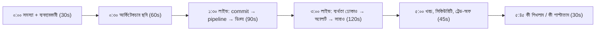
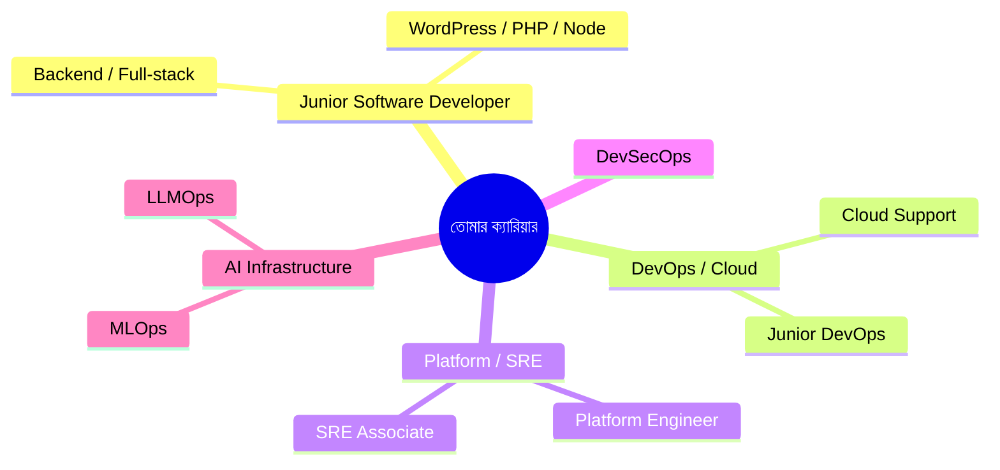

# Module 26 — Capstone Demo Day and Career Readiness

> **Section 5 · AWS Deep Dive & Capstone** · ২টি Live Class
> **Goal:** একটা পোর্টফোলিও-উপযোগী Capstone এবং 2026-ধাঁচের ইন্টারভিউয়ের প্রস্তুতি।
> **Assignment ★:** চূড়ান্ত Capstone সাবমিশন ও পোর্টফোলিও রাইট-আপ।
> **সঙ্গী ফোল্ডার:** চাকরি-খোঁজার পূর্ণ গাইড আছে [`career-track/`](../career-track/README.md)-এ।

---

## 📖 গল্প: মঞ্চে ওঠার দিন

তানভীর জানে, ডেমো-ডের পাঁচ মিনিট ইন্টারভিউয়ের পাঁচ মিনিটের মহড়া। সামনে প্যানেল। সে বলল না "আমি কী কী টুল জানি"। সে বলল: **"এই সিস্টেম আমি বানিয়েছি। এখন আপনারা এর একটা অংশ ভাঙুন। আমি দেখাব কীভাবে ধরা পড়ে আর কীভাবে সারে।"** প্যানেল সামনে ঝুঁকে বসল। এটাই সেই মুহূর্ত, যখন "শিক্ষার্থী" থেকে "ইঞ্জিনিয়ার" হওয়া শুরু।

---

# 🧩 Live Class 1 — Capstone Demo Day

## 1. ৫–৭ মিনিটের ডেমো-কাঠামো



> **সোনালি নিয়ম:** ডেমো লাইভ হলেও **ব্যাকআপ রেকর্ডিং** রাখো। ইন্টারনেট/AWS যেকোনো মুহূর্তে বিশ্বাসঘাতকতা করতে পারে।

## 2. Live Failure Injection — কী ভাঙবে ও কীভাবে দেখাবে

| ইনজেক্ট | প্রত্যাশিত প্রতিক্রিয়া | যা দেখাবে |
|---|---|---|
| একটা Pod মেরে ফেলো | Deployment নতুন Pod তোলে | `kubectl get pods -w` |
| ভুল image tag পুশ | probe/Argo Degraded, canary rollback | Argo UI, অ্যালার্ট |
| unsigned image ডিপ্লয় | Kyverno deny | error বার্তা |
| লোড বাড়াও (k6) | HPA scale-out | Grafana প্যানেল |
| ব্যাকএন্ডে ইচ্ছাকৃত ৫xx | burn-rate অ্যালার্ট | Alertmanager/Slack |
| ভুল prompt (AI) | eval gate ব্লক | CI লাল |

```bash
# ডেমো-স্ক্রিপ্ট নমুনা — প্রতিটি ধাপের আগে বলো কী ঘটবে (ভবিষ্যদ্বাণী করা = আত্মবিশ্বাস)
kubectl -n booknest delete pod -l app=backend --wait=false   # কেন: self-healing দেখানো
kubectl -n booknest get pods -w                              # কেন: নতুন Pod ওঠা লাইভে দেখা
```

## 3. প্যানেল-স্কোরিং: কীভাবে নম্বর বাড়াবে

- **প্রমাণ দেখাও, দাবি নয়:** "আমরা সিকিউর" না বলে `Kyverno denied` স্ক্রিনশট দেখাও।
- **ট্রেড-অফ বলো:** "EKS নিয়েছি কারণ…, ECS হলে সহজ হতো কিন্তু…"
- **সীমাবদ্ধতা স্বীকার করো:** "এখানে single NAT, প্রোডাকশনে প্রতি AZ-এ দিতাম।" এটা দুর্বলতা নয়, পরিপক্বতা।
- **টাইমে শেষ করো।** অতিরিক্ত সময় মানে পরিকল্পনার অভাব।

---

# 🧩 Live Class 2 — 2026 Job Market and Interview Preparation

## 4. টার্গেট রোলগুলো



> **বাস্তব পরামর্শ:** জুনিয়র পর্যায়ে সরাসরি "DevOps Engineer" পদ কম। অনেকেই **Software Developer / Support / Cloud Associate** দিয়ে ঢুকে ভেতরে DevOps-এ যায়। তাই ডেভেলপার-দক্ষতা + DevOps-জ্ঞান = শক্ত সংমিশ্রণ। বিস্তারিত: [`career-track/00-junior-dev-roadmap.md`](../career-track/00-junior-dev-roadmap.md)।

## 5. Capstone → পোর্টফোলিও ও LinkedIn কেস-স্টাডি

```markdown
# [BookNest AI] — Production-Ready Cloud-Native App

**সমস্যা:** ... **আমার ভূমিকা:** ... **সময়:** ...

## যা বানিয়েছি (সংখ্যাসহ)
- Terraform দিয়ে ২-AZ VPC + EKS + RDS; `terraform plan` PR-এ কমেন্ট, Checkov ০ high
- CI/CD: PR থেকে প্রোডাকশন গড়ে ~X মিনিট; canary + auto-rollback
- SLO 99.9%, burn-rate অ্যালার্ট; k6-তে p95 < 300ms
- খরচ: ডেমোর বাইরে $0 (`make down`), চালু থাকলে ~$X/মাস

## সবচেয়ে কঠিন সমস্যা ও সমাধান (গল্প)
## কী পাল্টাতাম
## লিংক: রিপো · ডেমো ভিডিও · আর্কিটেকচার ডক
```

**LinkedIn পোস্ট-কাঠামো (hook → গল্প → শিক্ষা → লিংক):**

```text
আমি ইচ্ছে করে আমার নিজের প্রোডাকশন ভেঙেছি। 🔧
(১) কী ভেঙেছি  (২) কীভাবে ধরা পড়ল  (৩) কত সেকেন্ডে সারল  (৪) কী শিখলাম
রিপো ও ডেমো: <link>
```

## 6. AI-যুগের ইন্টারভিউ প্রশ্ন

| প্রশ্ন | ভালো উত্তরের সূত্র |
|---|---|
| AI-লেখা Terraform রিভিউ করবে কীভাবে? | `plan` পড়ি; IAM `*`, খোলা SG, destroy/replace, state পরিবর্তন খুঁজি; Checkov; ছোট-ব্লাস্ট-র‍্যাডিয়াস env-এ আগে |
| AI agent-কে কীভাবে প্রোডাকশনে সুরক্ষিত রাখো? | read-only ডিফল্ট, PR-only, approval gate, explicit deny, অডিট, prompt-injection ভাবনা |
| ইনসিডেন্টে AI-র সুপারিশ ভুল হলে? | mitigate আগে; AI অনুমান মাত্র; লগ/মেট্রিক দিয়ে যাচাই; দায় আমার |
| একটা ডিপ্লয় ভেঙে দিল — প্রথম ৫ মিনিট? | rollback আগে, কারণ পরে; কমিউনিকেট; postmortem |
| কেন Kubernetes? কখন না? | স্কেল/ইকোসিস্টেম বনাম জটিলতা; ছোট অ্যাপে ECS/Lambda/PaaS |
| Terraform state হারালে? | S3 versioning + lock; `import`; remote state এর কারণ |

## 7. মক টেকনিক্যাল ইন্টারভিউ — নিজে নিজে

১. ৪৫ মিনিট টাইমার। ২. প্রশ্ন র‍্যান্ডম বেছে নাও [`career-track/04-interview-prep.md`](../career-track/04-interview-prep.md) থেকে। ৩. জোরে বলে উত্তর দাও (রেকর্ড করো)। ৪. পরে দেখো: কোথায় থমকালে? ৫. ওই বিষয়ের মডিউল আবার পড়ো।

**STAR কাঠামো (আচরণগত প্রশ্ন):** Situation → Task → Action → Result। প্রতিটি উত্তরে একটা সংখ্যা রাখো।

## ⚠️ সাধারণ ভুল

| ভুল | সমাধান |
|---|---|
| টুলের তালিকা আওড়ানো | সমস্যা → সিদ্ধান্ত → ফলাফল গল্প |
| "আমি সব জানি" ভাব | "এটা জানি না, কিন্তু এভাবে শিখব" — সততা বিশ্বাস বাড়ায় |
| পাবলিক রিপোতে secret/অ্যাকাউন্ট ID | স্ক্যান + মাস্ক |
| ডেমোর আগে প্রথমবার `apply` | আগেই দুইবার রিহার্সাল |
| শুধু অ্যাপ্লাই-করে বসে থাকা | রেফারাল, নেটওয়ার্ক, ছোট প্রোজেক্ট-শেয়ার |

## ✅ চূড়ান্ত সাবমিশন চেকলিস্ট (Assignment ★)

- [ ] রিপোর README (ডায়াগ্রাম, `make up`, ডেমো লিংক, ট্রেড-অফ, "কী পাল্টাতাম")
- [ ] ADR ≥৩টি, runbook ≥৩টি, SLO ডক, খরচ ডক
- [ ] Gitleaks পরিষ্কার; কোনো আসল secret/ID নেই
- [ ] ডেমো ভিডিও (≤৫ মিনিট) + আর্কিটেকচার ছবি
- [ ] পোর্টফোলিও রাইট-আপ (কেস-স্টাডি ফরম্যাট)
- [ ] LinkedIn আপডেট + একটি পোস্ট
- [ ] রিজুমে আপডেট (১ পৃষ্ঠা) — [`career-track/01-resume-and-linkedin.md`](../career-track/01-resume-and-linkedin.md)
- [ ] `terraform destroy` — বিল শূন্য নিশ্চিত

## 🧠 সারসংক্ষেপ

ডেমো-ডে = প্রমাণের দিন: **লাইভ ডেলিভারি, লাইভ ব্যর্থতা, লাইভ পুনরুদ্ধার**। তারপর সেই কাজটাকে গল্পে পরিণত করো (রিপো + কেস-স্টাডি + পোস্ট) এবং চাকরি-খোঁজার নিয়মিত অভ্যাস শুরু করো। কোর্স শেষ, ক্যারিয়ার শুরু।

⬅️ [Module 25](./module-25-capstone-build.md) · ➡️ [Career Track](../career-track/README.md)
